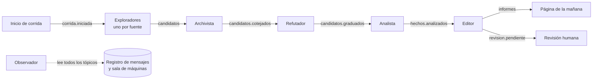

# 0002. Los agentes se coordinan por mensajes en tópicos

- Estado: aceptado
- Fecha: 2026-11-07

## Contexto

Una noche de El Parte pasa por seis agentes: exploradores, archivista, refutador, analista, editor y observador. Hay que decidir cómo se pasan el trabajo. Tres objetivos del proyecto condicionan la respuesta:

- Cada corrida tiene que poder **repetirse** (por ejemplo, sobre las noches del banco de pruebas).
- La **sala de máquinas** tiene que mostrar qué hizo cada agente, con qué entrada y con qué resultado.
- Quien lea el repositorio tiene que **entender la orquestación** sin descifrar un marco que la esconde.

Spring AI no coordina agentes entre sí: da piezas para escribir cada agente por dentro, y los patrones de orquestación que documenta son ejemplos de código. [PROVEN: [docs/verificaciones/spring-ai.md](../docs/verificaciones/spring-ai.md), 2026-11-07]

## Decisión

Los agentes no se llaman entre sí: cada uno lee mensajes de un tópico, hace su trabajo y publica mensajes en otro tópico. El camino de una noche es fijo y lo define la topología de tópicos, no un modelo de lenguaje.

Reglas:

1. **Sobre común.** Todo mensaje lleva el identificador de la corrida, su propio identificador, el del mensaje que lo causó, el agente que lo emitió, la versión de su contrato y la fecha y hora. El contenido de cada tipo de mensaje se define en `docs/contratos.md` (T03).
2. **El registro de mensajes es la historia de la corrida.** El observador guarda cada mensaje en la base. La sala de máquinas se arma leyendo ese registro, y una corrida se repite volviendo a inyectar sus mensajes de entrada con las respuestas del modelo grabadas.
3. **Entrega al menos una vez, con idempotencia.** Un mensaje puede llegar dos veces; procesarlo dos veces no puede crear dos hechos. La regla de identidad de cada hecho va en `docs/contratos.md`.
4. **La frontera es el tópico, no el proceso.** En la versión 0, todos los agentes pueden correr en una sola aplicación, cada uno con su consumidor. Separarlos en procesos distintos después no cambia ningún contrato.

Qué sistema de mensajería se usa lo decide el [ADR 0003](0003-eleccion-del-stack.md).

## Razones

- Repetir una corrida es volver a pasar sus mensajes. Sin mensajes, habría que reconstruir qué recibió cada agente. [INFERRED: de la regla 2]
- La sala de máquinas sale del mismo registro que usa el sistema, así que no puede contar algo distinto de lo que pasó. [INFERRED: de la regla 2]
- La documentación de Spring AI recomienda flujos de trabajo con camino fijo para tareas bien definidas, porque son más predecibles que los agentes que deciden sus propios pasos. Una noche de El Parte es una tarea bien definida. [PROVEN: https://docs.spring.io/spring-ai/reference/api/effective-agents.html, 2026-11-07]
- Cada agente se puede probar solo, con mensajes de entrada armados a mano. [INFERRED]

## Alternativas rechazadas

- **Llamadas directas entre agentes, en una cadena de métodos.** Es lo más simple, pero se pierde la repetición desde mensajes y la sala de máquinas tendría que armarse con registros aparte.
- **Un motor de flujos de trabajo externo.** Agrega un servidor y un modelo de programación propios, y la orquestación queda escondida en ese marco, contra el objetivo didáctico. [ASSUMED]
- **Subagentes que decide el modelo** (por ejemplo, con spring-ai-agent-utils). El camino deja de ser fijo, y esa biblioteca es de la comunidad y todavía no llegó a su versión 1.0. [PROVEN para la versión: [docs/verificaciones/spring-ai.md](../docs/verificaciones/spring-ai.md), 2026-11-07]
- **Usar la base de datos como cola.** Tiene menos piezas, pero obliga a reimplementar lo que un sistema de mensajería ya resuelve (consumidores, posiciones de lectura, reintentos). [INFERRED]

## Costos

- Una pieza más de infraestructura: el sistema de mensajería.
- Seguir un hallazgo obliga a encadenar mensajes. La sala de máquinas existe justamente para eso.
- Los contratos de los mensajes hay que versionarlos.

## Qué la haría reversar

Que el sistema de mensajería impida levantar todo con un solo comando en una máquina común, o que repetir una corrida desde sus mensajes resulte impracticable.
