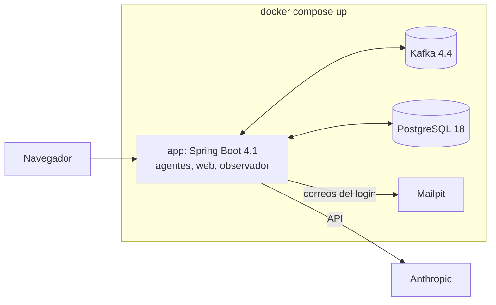
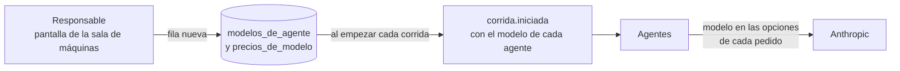

# 0003. Elección del stack

- Estado: aceptado
- Fecha: 2026-11-07

## Contexto

La definición del proyecto da preferencias, no órdenes: Java con Spring Boot y Spring AI, PostgreSQL, mensajes en tópicos, una interfaz web sin framework pesado y todo en contenedores, levantable con un solo comando. Cada preferencia se confirma o se cambia acá, con versiones verificadas.

Además, la verificación de Spring AI dejó tres puntos abiertos: qué versión de Spring AI y de Java usar, qué proyecto de mensajería es compatible con Spring Boot 4 y cómo grabar y repetir respuestas del modelo en las pruebas. [PROVEN: [docs/verificaciones/spring-ai.md](../docs/verificaciones/spring-ai.md), 2026-11-07]

Todas las versiones de abajo son las vigentes al 2026-11-07.

## Decisión

| Pieza | Elección | Evidencia |
|---|---|---|
| Lenguaje | Java 25 | Es LTS (versión con soporte largo) y salió el 2025-09-16. [PROVEN: https://openjdk.org/projects/jdk/25/, 2026-11-07] |
| Marco | Spring Boot 4.1 | La 4.1.2 pide Java 17 o superior y es compatible hasta Java 27. [PROVEN: https://docs.spring.io/spring-boot/system-requirements.html, 2026-11-07] |
| Modelos | Spring AI 2.0.2 | Es la versión estable y soporta Spring Boot 4.0 y 4.1. Se pasa a la 2.1 cuando salga estable, con una entrada en el CHANGELOG. [PROVEN: [docs/verificaciones/spring-ai.md](../docs/verificaciones/spring-ai.md), 2026-11-07] |
| Proveedor | Anthropic, con el starter `spring-ai-starter-model-anthropic` | Usa el SDK oficial de Anthropic para Java. [PROVEN: https://docs.spring.io/spring-ai/reference/api/chat/anthropic-chat.html, 2026-11-07] |
| Modelo chico, valor inicial | Claude Haiku 5.5 (`claude-haiku-5-5`) para exploradores, archivista y editor | 0,10 USD por millón de tokens de entrada y 0,50 USD por millón de salida, con prompts de hasta 100.000 tokens. [PROVEN: https://docs.claude.com/en/docs/about-claude/pricing.md, 2026-11-07] |
| Modelo grande, valor inicial | Claude Sonnet 5.5 (`claude-sonnet-5-5`) para refutador y analista | 2 USD por millón de tokens de entrada y 10 USD por millón de salida. [PROVEN: https://docs.claude.com/en/docs/about-claude/models/overview.md, 2026-11-07] |
| Mensajería | Apache Kafka 4.4.0, un solo nodo, imagen oficial `apache/kafka:4.4.0` | Salió el 2026-10-22 y la imagen está publicada. [PROVEN: https://kafka.apache.org/community/downloads/ y Docker Hub, 2026-11-07] |
| Cliente de mensajería | Spring for Apache Kafka 4.1 | Es la versión que corresponde a Spring Boot 4.1, con el cliente de Kafka 4.2. [PROVEN: matriz de compatibilidad en https://spring.io/projects/spring-kafka, 2026-11-07] |
| Base | PostgreSQL 18, imagen `postgres:18` | La 18 está soportada; la última versión menor es la 18.6. [PROVEN: https://www.postgresql.org/support/versioning/ y Docker Hub, 2026-11-07] |
| Interfaz web | Spring MVC con plantillas Thymeleaf, y htmx 2.0 para las partes dinámicas | Spring Boot configura Thymeleaf solo. htmx es un solo archivo de JavaScript, sin compilación. [PROVEN: https://docs.spring.io/spring-boot/reference/web/servlet.html y https://htmx.org/, 2026-11-07] |
| Login por enlace de correo | Login con token de un solo uso de Spring Security | Spring Security lo trae con `oneTimeTokenLogin()`. [PROVEN: https://docs.spring.io/spring-security/reference/servlet/authentication/onetimetoken.html, 2026-11-07] |
| Correo de prueba | Mailpit, imagen `axllent/mailpit` | Es un servidor SMTP de prueba con interfaz web para ver los correos capturados. [PROVEN: https://mailpit.axllent.org/ y Docker Hub, 2026-11-07] |
| Pruebas de integración | Testcontainers, con el soporte de Spring Boot | Levanta PostgreSQL y Kafka reales en las pruebas. [PROVEN: https://docs.spring.io/spring-boot/reference/testing/testcontainers.html, 2026-11-07] |
| Respuestas grabadas | Un `ChatModel` propio, de reproducción | Ver abajo. |
| Construcción | Maven | Spring Boot lo soporta. [PROVEN: https://docs.spring.io/spring-boot/system-requirements.html, 2026-11-07] |
| Contenedores | Docker Compose: aplicación, Kafka, PostgreSQL y Mailpit; la aplicación sobre `eclipse-temurin:25-jre` | La imagen está publicada. [PROVEN: Docker Hub, 2026-11-07] |
| Código | Una aplicación Spring Boot en `app/`, con un paquete por agente | Va con la regla 4 del [ADR 0002](0002-orquestacion-por-mensajes.md): la frontera es el tópico. |

### El modelo de cada agente se cambia sin reiniciar

Los modelos de la tabla son los valores iniciales. El modelo de cada agente no queda fijo en el código ni en la configuración de arranque: está en la base y se cambia con la aplicación andando.

- **Una tabla con historia.** `parte.modelos_de_agente` guarda qué modelo usa cada agente y desde cuándo ([docs/base-de-afirmaciones.md](../docs/base-de-afirmaciones.md)). Un cambio es una fila nueva y las anteriores no se tocan, así se sabe qué modelo regía en cada momento. Los valores iniciales los carga una migración.
- **Se congela al empezar cada corrida.** El inicio de la corrida lee el modelo vigente de cada agente y lo manda en `corrida.iniciada` ([docs/contratos.md](../docs/contratos.md)), y cada agente usa el de ese mensaje. Un cambio vale desde la corrida siguiente: una corrida nunca mezcla dos modelos en el mismo agente, y repetirla usa los mismos.
- **Se pasa en cada pedido.** El agente pone el modelo en las opciones de cada llamada, que pisan las opciones por defecto del arranque. [PROVEN: https://docs.spring.io/spring-ai/reference/api/chat/anthropic-chat.html, opciones en tiempo de ejecución, Spring AI 2.0.2, 2026-11-14]
- **Solo modelos con precio.** Se puede elegir un modelo solo si tiene precio en la tabla de precios, que también está en la base y también se cambia sin reiniciar ([ADR 0005](0005-presupuesto-por-corrida.md)). Sin precio, el presupuesto no dejaría hacer ninguna llamada.
- **Lo cambia el responsable**, desde una pantalla de la sala de máquinas que solo ve él. La sala de máquinas muestra qué modelo usó cada agente en cada corrida.
- **Las pruebas no leen la tabla.** Fijan sus propios modelos, así sus respuestas grabadas siguen valiendo cuando cambia la configuración real.
- **Mismo proveedor.** Se puede elegir cualquier modelo de Anthropic. Cambiar de proveedor pide otro starter de Spring AI, un despliegue nuevo y un ADR.

### Respuestas grabadas del modelo

Las pruebas automáticas no llaman al modelo real (D4). La aplicación tiene dos modos más, además del normal:

- **Grabación:** un `ChatModel` envuelve al real y guarda cada pedido y su respuesta en un archivo, con una clave calculada a partir del pedido.
- **Reproducción:** un `ChatModel` devuelve la respuesta guardada para cada pedido, sin red y sin costo. Si un pedido no tiene respuesta guardada, la prueba falla y dice cuál falta.

Es posible porque `ChatModel` es una interfaz que cualquier proveedor implementa. [INFERRED: de https://docs.spring.io/spring-ai/reference/api/chatmodel.html] Si Spring AI ofrece algo equivalente que no se encontró en la verificación, se reemplaza. [ASSUMED]

### Retención de los mensajes

Los tópicos guardan los mensajes sin vencimiento en la versión 0, y el observador además los copia a PostgreSQL, donde los consulta la sala de máquinas. [ASSUMED: la configuración de retención de Kafka se verifica al escribir el archivo de Docker Compose]

## Razones

- Todo lo elegido es la versión vigente y está verificado con fuente y fecha.
- Java 25 es la LTS más nueva, y Spring Boot 4.1 la soporta. [INFERRED: de las dos filas de la tabla]
- Kafka da tópicos con historia que se puede volver a leer, que es lo que pide el [ADR 0002](0002-orquestacion-por-mensajes.md). [ASSUMED]
- Spring for Apache Kafka trabaja con los tópicos directamente, así que el código muestra la orquestación sin una capa que la esconda.
- Los dos modelos siguen la decisión D4: uno barato para las tareas mecánicas y uno más capaz donde se decide si algo es verdad.
- Cambiar de modelo es lo que más se va a hacer al calibrar contra el banco de pruebas. Hacerlo sin reiniciar, y con la historia de qué modelo usó cada corrida, deja comparar corridas con modelos distintos. [INFERRED]

## Alternativas rechazadas

- **Java 21.** También es LTS, pero más vieja. Spring AI 2.0 corre igual con cualquiera de las dos.
- **Spring AI 2.1.** Hoy es una versión candidata (la RC2 salió el 2026-11-05). Se adopta cuando salga estable.
- **Spring Cloud Stream** sobre Kafka. Agrega una capa que esconde los tópicos detrás de "bindings", contra el objetivo didáctico. [INFERRED]
- **Redpanda.** Es compatible con Kafka y más liviano, pero se prefiere la implementación de referencia de Apache. [ASSUMED]
- **RabbitMQ.** Su modelo central son colas que se consumen, no un registro que se vuelve a leer. [ASSUMED]
- **Un framework de frontend** (React, Angular). La definición pide una interfaz simple, sin framework pesado.
- **Opus 5.5 o Fable 5.1 para el refutador.** Cuestan el doble o cinco veces lo que Sonnet 5.5 por token de entrada. [PROVEN: https://docs.claude.com/en/docs/about-claude/models/overview.md, 2026-11-07] Se reconsidera si la medición contra el banco de pruebas muestra que el refutador falla.
- **El modelo en la configuración de arranque**, con `spring.ai.anthropic.chat.model` o una propiedad por agente. Cambiarlo pide reiniciar la aplicación. [PROVEN: https://docs.spring.io/spring-ai/reference/api/chat/anthropic-chat.html, 2026-11-14]
- **Recargar la configuración en caliente con Spring Cloud.** Agrega una pieza para algo que resuelve una tabla, y no deja la historia de qué modelo usó cada corrida. [INFERRED]
- **Grabar respuestas con un simulador de HTTP** frente a la API de Anthropic. Ata las pruebas al formato de la API, no a la interfaz de Spring AI. [INFERRED]

## Costos

- Kafka es la pieza más pesada del stack para una máquina común.
- Cambiar los modelos sin reiniciar suma dos tablas, una pantalla y un rol de responsable en la lista de invitados ([ADR 0008](0008-datos-personales.md)).
- Haiku 5.5 cuesta cinco veces más por token cuando el prompt pasa los 100.000 tokens. Los prompts de los agentes tienen que quedar por debajo de ese límite. [PROVEN: https://docs.claude.com/en/docs/about-claude/pricing.md, 2026-11-07]
- Los precios cambian: el presupuesto por corrida ([ADR 0005](0005-presupuesto-por-corrida.md)) los lee de una tabla con fecha, que hay que mantener.

## Qué la haría reversar

- Que la aplicación con Kafka no levante con un solo comando en una máquina común: se pasa a una alternativa más liviana, con un ADR nuevo.
- Que el modo de reproducción no alcance para que las pruebas sean deterministas.
- Que la medición contra el banco de pruebas muestre que un agente necesita un modelo de otro proveedor. Cambiar a otro modelo de Anthropic no pide un ADR: es un cambio de configuración.
