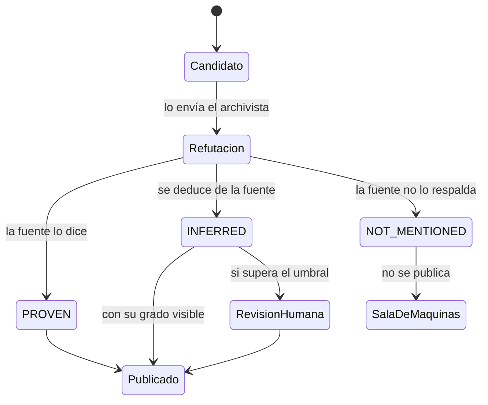

# 0004. Grados de evidencia

- Estado: aceptado
- Fecha: 2026-11-07

## Contexto

El objetivo del proyecto es un sistema que corre solo y no miente. Para eso, cada afirmación tiene que decir cuánto respaldo tiene, tanto en los hechos que El Parte publica sobre el Estado como en los documentos del propio proyecto. La definición del proyecto ya nombra los grados: PROVEN, INFERRED y "las fuentes no lo mencionan" para los hechos; PROVEN, INFERRED y ASSUMED para los documentos. Falta fijar qué exige cada uno, quién lo pone y cómo se muestra.

## Decisión

Hay dos escalas con palabras parecidas y alcances distintos.

### Grados de un hecho

Los pone solo el refutador, y nadie después los cambia: el analista los usa y el editor los muestra.

| Grado | Qué quiere decir | Qué evidencia exige |
|---|---|---|
| PROVEN | La fuente lo dice de manera explícita. | La URL, la fecha de publicación verificada y el fragmento de la fuente que lo dice. |
| INFERRED | Se deduce de lo que dice la fuente, pero la fuente no lo dice con esas palabras. | Los fragmentos de los que se deduce y el razonamiento, en una o dos frases. |
| NOT_MENTIONED ("las fuentes no lo mencionan") | Las fuentes no respaldan lo que afirma el candidato. | Qué se buscó y dónde. |

Reglas:

1. **Un hecho NOT_MENTIONED no se publica como hecho.** Queda en la sala de máquinas, con lo que se buscó.
2. **La fecha se califica aparte.** Que la fuente diga algo (grado) es distinto de que lo haya dicho hace poco (fecha confirmada o no). Un hecho puede ser PROVEN con la fecha sin confirmar, y la página lo dice.
3. **La página de la mañana muestra el grado de cada hecho** y explica qué quiere decir INFERRED la primera vez que aparece.
4. **El umbral de "demasiado INFERRED"** que manda un hecho a revisión humana se define en `docs/contratos.md` (T03), y mientras nadie revisa el hecho se muestra marcado (D6).

### Grados de un documento del proyecto

Los usa toda afirmación técnica de los documentos (regla 2), con el formato de [arranque/como-se-trabaja.md](../arranque/como-se-trabaja.md):

| Grado | Qué quiere decir | Qué evidencia exige |
|---|---|---|
| PROVEN | Verificado. | URL de la documentación oficial o descripción de la comprobación hecha, con fecha. |
| INFERRED | Se deduce de algo verificado. | De qué se deduce. |
| ASSUMED | Supuesto de trabajo, sin verificar. | Si sostiene una decisión, una tarjeta en el tablero para verificarlo. |

## Razones

- Tres grados con exigencias concretas se pueden controlar: cada grado pide un campo de evidencia que un programa puede verificar que existe. [INFERRED]
- Separar quién pone el grado (refutador) de quién interpreta (analista) evita que la interpretación suba el grado de un hecho.
- Separar el grado de la fecha atiende una falla vista en la vigilancia anterior: material viejo que aparece como nuevo. [INFERRED: de la noche de muestra, [arranque/proyecto.md](../arranque/proyecto.md)]
- Que los documentos usen el mismo vocabulario que los hechos enseña el método con el propio repositorio.

## Alternativas rechazadas

- **Un puntaje de confianza numérico** (de 0 a 1). Da una precisión falsa: nadie puede explicar la diferencia entre 0,72 y 0,78.
- **Más niveles** (por ejemplo, "probable" o "dudoso"). Hacen más difícil decidir y no cambian qué se publica.
- **Que cada agente ponga su propio grado.** Habría grados contradictorios para el mismo hecho y nadie responsable de ellos.

## Costos

- INFERRED cubre casos muy distintos, desde una deducción obvia hasta una arriesgada. El razonamiento escrito es lo que los distingue.
- El refutador necesita el modelo más capaz y es el agente más caro de cada corrida ([ADR 0003](0003-eleccion-del-stack.md)).

## Qué la haría reversar

Que la revisión humana muestre que INFERRED mezcla casos que deberían tratarse distinto, o que muchos hechos PROVEN resulten falsos en la medición contra el banco de pruebas.
