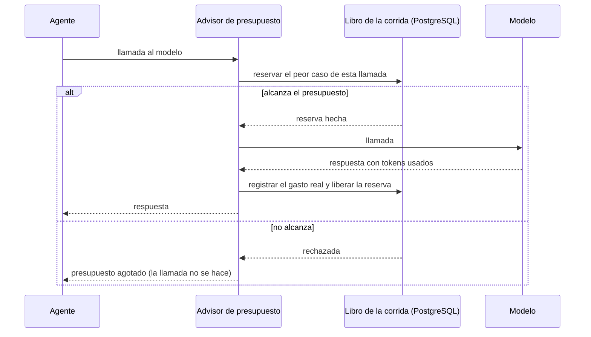

# 0005. Presupuesto por corrida

- Estado: propuesto
- Fecha: 2026-11-07

## Contexto

La versión 0 incluye un presupuesto por corrida que la corta cuando se pasa, en pasos, tiempo y costo. La decisión D4 fijó un tope de 0,50 USD por corrida, para que una pasada completa por las setenta noches del banco de pruebas no supere los 35 USD. Un sistema que corre solo, de noche, sin nadie mirando, tiene que tener un límite que no dependa de que alguien lo vigile.

## Decisión

### Los tres límites

Cada corrida arranca con un presupuesto, que viaja en el mensaje `corrida.iniciada`:

| Límite | Valor inicial | Qué cuenta |
|---|---|---|
| Costo | 0,50 USD | Tokens de entrada, de salida y de caché de cada llamada, por su precio. |
| Pasos | 200 llamadas al modelo | Toda llamada, incluidas las vueltas del ciclo de herramientas. |
| Tiempo | 45 minutos | Desde que arranca la corrida. |

Los valores de pasos y tiempo son un punto de partida, y se calibran con la medición contra el banco de pruebas (T12). [ASSUMED]

### Cómo se controla

Todas las llamadas al modelo pasan por un advisor de presupuesto, registrado en el `ChatClient` de cada agente. Un advisor es un interceptor de Spring AI que envuelve cada llamada al modelo. [PROVEN: [docs/verificaciones/spring-ai.md](../docs/verificaciones/spring-ai.md), 2026-11-07]

1. **Se reserva antes de llamar.** Antes de cada llamada, el advisor reserva en el libro de la corrida el peor caso: los tokens de entrada estimados más el máximo de tokens de salida pedido, por su precio. Si no alcanza, la llamada no se hace. Así el tope no se puede pasar, ni siquiera por una sola llamada.
2. **Se registra lo real después.** Con la respuesta, el advisor anota los tokens usados de verdad y libera la diferencia. Spring AI cuenta los tokens de entrada, de salida y de caché de cada llamada. [PROVEN: https://docs.spring.io/spring-ai/reference/observability/index.html, 2026-11-07] Cómo los recibe el advisor se verifica al escribirlo. [ASSUMED]
3. **El libro de la corrida es una fila en PostgreSQL** que se actualiza con una operación atómica, porque varios agentes gastan del mismo presupuesto a la vez.
4. **Los precios salen de una tabla versionada en el repositorio**, con la URL de la fuente y la fecha de consulta de cada precio. Si un modelo no está en la tabla, la llamada no se hace.
5. **El tiempo lo controla el inicio de la corrida**: al vencer, publica `corrida.cortada` y los agentes dejan de tomar mensajes nuevos de esa corrida.

### Qué pasa cuando se corta

- La corrida queda como "cortada por presupuesto", con el límite que se alcanzó.
- Se publica lo que ya pasó por el refutador. Nunca se publica un candidato a medio verificar.
- Los candidatos sin terminar quedan en la sala de máquinas como "sin procesar", y la página de la mañana lo dice: cuántos quedaron y por qué.
- Mientras sobre presupuesto, se procesan primero los candidatos sobre entidades con suscriptores.

### Cuánto alcanzan 0,50 USD

Con los precios del 2026-11-07, cada millón de tokens cuesta 0,10 USD de entrada y 0,50 USD de salida en Haiku 5.5, y 2 USD de entrada y 10 USD de salida en Sonnet 5.5. [PROVEN: https://docs.claude.com/en/docs/about-claude/pricing.md, 2026-11-07]

Una estimación con tamaños razonables de prompt (todos los números de este párrafo son INFERRED):

- Un candidato en Haiku (explorador y archivista, unos 3.000 tokens de entrada y 400 de salida) cuesta unos 0,0005 USD.
- Un candidato que llega al refutador y al analista en Sonnet (unos 7.000 tokens de entrada y 1.400 de salida entre los dos) cuesta unos 0,028 USD.
- Con 0,50 USD alcanza para unos 17 candidatos completos por noche, más todo el trabajo de los exploradores.

Para un organismo, alcanza: en la noche de muestra del banco de pruebas casi no hubo novedades. Con las seis fuentes, puede quedar corto. La medición contra el banco de pruebas (T12) dice si hay que subir el tope o bajar el costo, por ejemplo con la caché de prompts, que en Sonnet 5.5 cobra las lecturas a la vigésima parte del precio de entrada. [PROVEN para la caché: https://docs.claude.com/en/docs/about-claude/pricing.md, 2026-11-07]

## Razones

- Reservar el peor caso antes de llamar es la única forma de garantizar que el tope no se pase. Controlar solo después deja pasar la última llamada. [INFERRED]
- Un solo advisor por llamada pone el control en un lugar, igual para todos los agentes, en vez de repartirlo por el código. [INFERRED]
- El costo solo no alcanza: un ciclo que se traba gasta poco pero no termina nunca. Por eso hay también pasos y tiempo.
- La tabla de precios con fecha hace que el costo de la sala de máquinas sea verificable y deja claro cuándo hay que actualizarla.

## Alternativas rechazadas

- **Controlar el gasto después de cada llamada, sin reservar.** La última llamada puede pasar el tope.
- **Los límites de gasto de la cuenta del proveedor.** Son mensuales y de toda la cuenta, no por corrida. [ASSUMED] Se pueden configurar como red de seguridad, además.
- **La API de lotes de Anthropic**, con 50% de descuento. [PROVEN: https://docs.claude.com/en/docs/about-claude/pricing.md, 2026-11-07] Las respuestas llegan de forma asíncrona, lo que complica el control por llamada y el orden de la cadena. Se reconsidera cuando el costo esté medido.
- **Solo un límite de pasos.** No refleja que una llamada a Sonnet cuesta veinte veces lo que una a Haiku. [PROVEN: precios de entrada de https://docs.claude.com/en/docs/about-claude/pricing.md, 2026-11-07]

## Costos

- Estimar los tokens de entrada antes de llamar es aproximado. El margen de la reserva lo cubre, pero puede cortar una corrida un poco antes de lo necesario.
- La tabla de precios hay que actualizarla a mano cuando cambian.
- El libro de la corrida es un punto de contención entre agentes. Con una corrida por noche, no debería notarse. [ASSUMED]

## Qué la haría reversar

Que la mayoría de las noches se corten por presupuesto (el tope está bajo) o ninguna se acerque (el control no aporta), o que el advisor no vea alguna de las llamadas al modelo.
