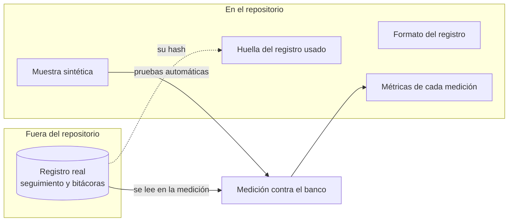

# 0007. El registro del banco de pruebas no entra al repositorio

- Estado: aceptado
- Fecha: 2026-11-07

## Contexto

El banco de pruebas es el registro de una vigilancia anterior del BPS, hecha con un solo agente: su seguimiento acumulado y una bitácora por noche ([arranque/proyecto.md](../arranque/proyecto.md)). Hay dos reglas del proyecto en tensión:

- La regla 10 pide que el repositorio alcance para que una sesión nueva retome el trabajo sin nada más.
- La regla 11 excluye los datos personales y el material de otros proyectos.

El registro es material de otro proyecto. La noche de muestra incluye además el nombre de una persona en una búsqueda y resúmenes de notas de prensa. [INFERRED: de la bitácora del 2026-11-06, que no está en el repositorio] Y el repositorio es público. [PROVEN: la API de GitHub devuelve `private: false`, 2026-11-07]

La decisión D2 ya resolvió esto de forma provisoria. Este ADR la formaliza.

## Decisión

El registro no se versiona. Se lee desde una ruta configurable, por defecto `banco-de-pruebas/privado/`, que está excluida en `.gitignore`.

En el repositorio van:

- **El formato** del registro, para que se entienda qué se compara (T12).
- **Una muestra sintética** con la misma forma, para que las pruebas automáticas corran sin el registro real (T12).
- **Las métricas de cada medición**, con conteos y costos, sin contenido del registro.
- **La huella (hash) del registro** usado en cada medición, para saber con qué versión exacta se midió sin publicarla.

## Razones

- Cumple la regla 11 sin excepciones.
- La huella deja trazar cada resultado al registro exacto que lo produjo, que es lo que importa para comparar mediciones.
- La muestra sintética mantiene la regla 10 para todo lo que no sea la medición real: una sesión nueva puede correr las pruebas y entender el formato.

## Alternativas rechazadas

- **Versionarlo tal cual.** Publica material de otro proyecto y datos personales en un repositorio público.
- **Versionar una copia depurada.** Depurarlo a mano lleva tiempo y es fácil que se escape algo; se reconsidera si se automatiza (ver "Qué la haría reversar").
- **Un repositorio privado aparte, enlazado como submódulo.** Agrega una pieza de infraestructura y deja igual a una sesión nueva sin acceso.

## Costos

- Una sesión sin acceso al registro no puede repetir la medición real, solo la sintética. Es una excepción acotada a la regla 10, escrita como tal.
- La medición real depende de que el registro esté en la máquina donde se corre (T11).

## Qué la haría reversar

Que se pueda generar automáticamente una versión del registro sin datos personales ni material del otro proyecto, verificable por el propio verificador del repositorio.
