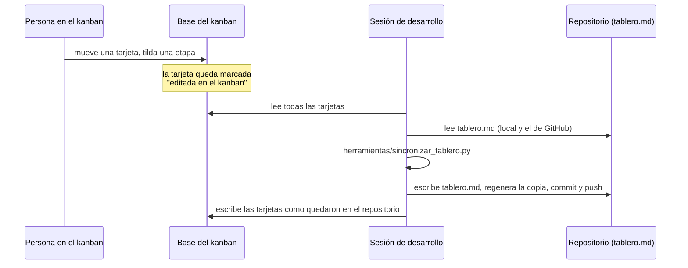

# 0009. Kanban editable, sincronizado con el tablero

- Estado: propuesto
- Fecha: 2026-11-14
- Reemplaza a: [0001](0001-tablero-fuente-unica-kanban-generado.md)

## Contexto

El [ADR 0001](0001-tablero-fuente-unica-kanban-generado.md) hizo de `tablero.md` la única fuente y del kanban una vista de solo lectura, generada. En la práctica, el responsable del proyecto necesita mover tarjetas, tildar etapas y anotar cosas desde el kanban, sin pasar por una sesión de desarrollo para cada cambio. Al mismo tiempo, todo el contenido del tablero tiene que seguir guardado en el repositorio, que es el único handoff (regla 10).

Una página publicada puede guardar datos en una base propia (la capacidad `db`), pero no puede escribir en GitHub: las páginas no pueden hacer pedidos a otros sitios. [PROVEN: guía de páginas del servidor de artifacts, 2026-11-07, y descripción de la capacidad `db`, 2026-11-14] Así que la página y el repositorio no se pueden hablar directamente: hace falta alguien que copie de uno al otro.

## Decisión

El kanban publicado es editable y guarda sus cambios en su base. **Las sesiones de desarrollo sincronizan** esa base con `tablero.md` cada vez que leen o escriben el repositorio, y cuando se les pide. `tablero.md` sigue siendo lo que manda.

Reglas:

1. **Qué se puede editar en el kanban:** columna y orden, título, dueño, dependencias, "espera a", fecha, etapas, lista (sumar y tildar), notas y registro, y sumar tarjetas nuevas en "Para empezar". No se borran tarjetas (regla 9) ni se cambian los enlaces de "Detalle".
2. **El kanban aplica las mismas reglas de columnas que el verificador.** No deja pasar a "Hecho" una tarjeta con etapas sin tildar, ni a "Para empezar" una con dependencias abiertas, ni a "Esperando" una que no dice qué espera. Cuando una tarjeta pasa a "Hecho", las que solo esperaban por ella pasan solas a "Para empezar".
3. **Cada tarjeta lleva la huella de su versión en GitHub.** Al editarla en el kanban queda marcada. Al sincronizar:
   - si en GitHub la tarjeta no cambió desde esa huella, el cambio del kanban se aplica a `tablero.md`;
   - si cambió en los dos lados, **gana el repositorio**: el cambio del kanban no se aplica y se anota en el registro de la tarjeta;
   - si un cambio del kanban rompe una regla del tablero, no se aplica y se informa.
4. **Las tarjetas nuevas del kanban** reciben el próximo número libre al sincronizar.
5. **Una tarjeta sigue marcada como "editada en el kanban" hasta que su cambio está en GitHub.** Si una sesión aplica el cambio pero no llega a subirlo, la próxima sincronización lo vuelve a aplicar. Así ningún cambio del kanban se pierde por una sesión que se cortó.
6. **Commit y push automáticos, solo del tablero.** Cuando la sincronización cambia `tablero.md`, la sesión hace commit y push sin esperar pedido, con un mensaje fijo, tocando solo `tablero.md`, `kanban/index.html` y `CHANGELOG.md`. Es la única excepción a la regla de no hacer commits sin un pedido explícito. Cualquier otro cambio sigue esperando el pedido.
7. **La copia del repositorio sigue existiendo.** `kanban/index.html` se genera desde `tablero.md` y funciona sin conexión, en solo lectura, como hasta ahora. La misma página, publicada y con su base, es la versión editable.

## Razones

- Mantiene a `tablero.md` como fuente: todo cambio del kanban termina en el repositorio, con su historia en git.
- La huella de GitHub por tarjeta permite detectar conflictos sin bloquear a nadie, y la regla "gana el repositorio" es simple de explicar y de auditar.
- Mantener la marca hasta que el cambio está en GitHub hace que la sincronización se pueda repetir sin riesgo: aplicar dos veces el mismo cambio da lo mismo.
- Aplicar las reglas de columnas en el kanban evita que el responsable haga un cambio que después la sincronización rechace.

## Alternativas rechazadas

- **Que la página escriba en GitHub.** Las páginas publicadas no pueden hacer pedidos a otros sitios. [PROVEN: guía de páginas, 2026-11-07]
- **Que la base del kanban sea la fuente y el repositorio una copia.** El contenido dejaría de estar en el repositorio entre sincronizaciones, contra la regla 10.
- **Sincronizar en intervalos fijos con una tarea programada.** Agrega una pieza que corre sin nadie mirando y que hace commits; se reconsidera si las sesiones resultan muy espaciadas.
- **Fusionar campo por campo en los conflictos.** Más fino, pero más difícil de entender cuando algo sale mal. Con una sola persona editando el kanban, los conflictos deberían ser raros. [INFERRED]

## Costos

- El kanban solo se pone al día cuando corre una sesión: entre sesiones, los cambios del kanban esperan en su base y la página lo muestra.
- Solo las sesiones con acceso a la base del kanban (las de claude.ai con las herramientas de artifacts) pueden sincronizar. Una persona que clona el repositorio trabaja con `tablero.md` y su copia, como antes.
- Las reglas de columnas están escritas dos veces: en Python (verificador) y en JavaScript (kanban). Si una cambia, hay que cambiar la otra, y el verificador sigue siendo el que decide.
- `tablero.md` tiene que estar siempre en formato canónico, para que la sincronización no reescriba de más. El verificador lo exige.

## Qué la haría reversar

Que haya conflictos seguido, que haga falta que varias personas editen el kanban a la vez, o que aparezca una forma soportada de que la página escriba directamente en el repositorio.
