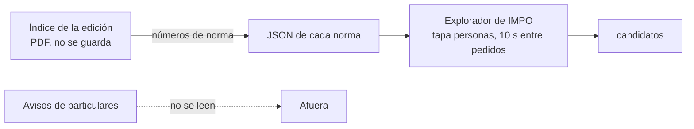

# 0010. IMPO entra como quinta fuente de la versión 0

- Estado: aceptado
- Fecha: 2026-11-14

## Contexto

El [ADR 0006](0006-fuentes-de-la-version-0.md) dejó afuera al Diario Oficial (IMPO) hasta que IMPO aclarara por escrito si su JSON se puede reutilizar (tablero, T18), porque su permiso es contradictorio ([docs/fuentes/impo.md](../docs/fuentes/impo.md)):

- Su página de datos abiertos ofrece el JSON de cada norma para que lo use cualquier persona, con la Licencia de Datos Abiertos de Uruguay. [PROVEN: https://www.impo.com.uy/datos-abiertos/, 2026-11-07]
- Las condiciones generales de uso de su banco de datos prohíben copiarlo, reproducirlo o cederlo a terceros. [PROVEN: https://www.impo.com.uy/politica-de-privacidad-y-seguridad/, 2026-11-07]

Después llegó el registro del banco de pruebas. De sus 19 hallazgos, 2 salen de IMPO, y con las otras fuentes de la versión 0 solo 1 queda al alcance de El Parte. [PROVEN: lectura del registro, 2026-11-14; el detalle está en [arranque/proyecto.md](../arranque/proyecto.md)]

## Decisión

IMPO entra como quinta fuente de la versión 0. Se toma como permiso la licencia de datos abiertos que IMPO ofrece para el JSON de las normas, con estos límites:

1. **Solo normas, en JSON.** Del Diario Oficial se lee el índice de cada edición para saber qué normas salieron ese día, y de cada norma, su JSON (`?json=true`). Los PDF no se guardan.
2. **Sin avisos.** Los avisos de particulares (sucesiones, edictos, sociedades) no se leen: son casi todos datos personales.
3. **Personas tapadas.** El explorador descarta el campo de firmantes y tapa los nombres de personas en el texto de cada norma, igual que en la normativa de Presidencia ([ADR 0008](0008-datos-personales.md)).
4. **Con la fuente citada.** Cada hecho lleva la URL de la norma en IMPO, como pide la licencia.
5. **A ritmo bajo.** Diez segundos entre pedidos, como pide su robots.txt, y nada de lo que ese archivo prohíbe: la búsqueda y los avisos puntuales. [PROVEN: https://www.impo.com.uy/robots.txt, 2026-11-07]

Lo demás del ADR 0006 sigue vigente. T18 se cierra sin enviar el pedido de aclaración.

## Razones

- Una licencia ofrecida a propósito para un conjunto de datos debería pesar más que una condición general del sitio. [INFERRED: es una interpretación, no una opinión legal]
- La página de datos abiertos de IMPO invita de forma explícita a usar el JSON. [PROVEN: https://www.impo.com.uy/datos-abiertos/, 2026-11-07]
- Con IMPO, los hallazgos del banco de pruebas al alcance de la versión 0 pasan de 1 a 3, y la medición dice algo más que "fuera de alcance". [INFERRED: de la lista de hallazgos del registro]
- Las normas tienen identificador estable (`/bases/{tipo}/{número}-{año}`), así que la identidad de cada hecho no depende de huellas de texto. [PROVEN: [docs/fuentes/impo.md](../docs/fuentes/impo.md), 2026-11-07]

## Alternativas rechazadas

- **Esperar la aclaración por escrito (T18).** No tiene plazo, y la versión 0 cierra el 29 de noviembre.
- **Dejar IMPO para después de la versión 0.** La medición perdería dos de los tres hallazgos del registro que puede alcanzar.
- **Leer también los avisos.** Son casi todos datos personales, contra la regla 11.

## Costos

- El permiso se apoya en una interpretación, no en una aclaración de IMPO. Si IMPO dice lo contrario, la fuente sale.
- Leer el índice obliga a procesar un PDF a dos columnas, y la cadena de índice, número de norma y JSON solo se probó con un decreto. [PROVEN para el decreto, 2026-11-07]
- El JSON viene en ISO-8859-1, y su esquema publicado no trae el campo de firmantes, que sí aparece en las respuestas. [PROVEN: https://www.impo.com.uy/resources/basesIMPO.json, 2026-11-07]
- Es la fuente con más datos personales de las verificadas, así que su explorador es el que más tiene que tapar.
- El último fin de semana del plan suma una fuente (T30).

## Qué la haría reversar

- Que IMPO diga por escrito, o en sus condiciones, que el JSON no se puede reutilizar.
- Que tapar los nombres de personas en el texto de las normas falle seguido.
