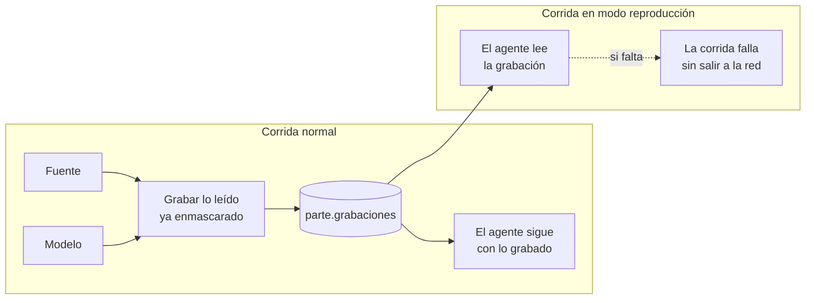

# 0011. Las corridas se graban en la base y se repiten desde ahí

- Estado: aceptado
- Fecha: 2026-11-14

## Contexto

El plan pide mostrar, al final de la primera rebanada, una corrida sobre una noche real de ARCE y la misma corrida repetida sin red ni costo, con los mismos mensajes ([docs/plan.md](../docs/plan.md)). El [ADR 0003](0003-eleccion-del-stack.md), en "Respuestas grabadas del modelo", resolvió solo la mitad del modelo: un `ChatModel` que envuelve al real y guarda cada pedido y su respuesta en un archivo, y otro que los devuelve sin red.

Al construir la rebanada (T08) aparecieron tres cosas que ese diseño no cubre:

- **El modelo no es lo único que viene de afuera.** El explorador y el refutador leen ARCE. Si la repetición vuelve a leer la fuente, no es sin red, y no da lo mismo: ARCE publica con atraso [PROVEN: el feed de noviembre leído el 2026-11-14 terminaba el 13 a las 12:25; [docs/fuentes/compras-estatales.md](../docs/fuentes/compras-estatales.md)], así que la misma noche leída unos días después puede traer más publicaciones. [INFERRED]
- **Las fallas también son parte de la corrida.** Una fuente que no respondió o un modelo que devolvió algo ilegible cambian los mensajes de esa noche. Si la repetición no falla en el mismo lugar, no produce los mismos mensajes.
- **Un archivo por corrida no viaja con la aplicación.** Las corridas reales corren en Docker Compose, en otra máquina, y la sala de máquinas tiene que poder repetir cualquiera desde su página.

## Decisión

Todo lo que una corrida lee de afuera se graba en la base, en `parte.grabaciones`, ya enmascarado, y una corrida en modo reproducción lee solo de las grabaciones de la corrida que repite. La grabación la hacen dos piezas: el servicio por el que pasan todas las llamadas al modelo y un componente que envuelve cada lectura de una fuente. Esto reemplaza la sección "Respuestas grabadas del modelo" del ADR 0003; el resto de ese ADR sigue vigente.

1. **Se graba lo leído y también las fallas.** Una fuente que no respondió se graba con su tipo de falla, y el modelo que no respondió, con su error. La repetición falla en el mismo lugar y emite los mismos `fuente.fallida`.
2. **El agente sigue con lo grabado, no con lo leído.** PostgreSQL guarda el JSON en `jsonb`, que reordena las claves; si la corrida original siguiera con lo leído y la repetición con lo grabado, el pedido al modelo cambiaría y su clave no coincidiría. [PROVEN: la primera prueba de punta a punta falló por eso, 2026-11-14; [docs/como-se-hizo/primera-rebanada.md](../docs/como-se-hizo/primera-rebanada.md)]
3. **La clave de una respuesta del modelo sale del pedido**: el agente, el modelo y una huella del texto del sistema y del usuario. Un pedido distinto no encuentra respuesta, y la repetición lo dice.
4. **La repetición no escribe la base de afirmaciones.** Emite los mismos mensajes, pero el editor no guarda hechos ni informes, y el archivista coteja contra los hechos de las corridas que empezaron antes de la original.
5. **Las pruebas automáticas no usan grabaciones.** Usan un modelo de mentira y un ARCE de mentira, con datos inventados, porque las grabaciones de corridas reales no se versionan: son datos de una noche de la fuente, y las del banco de pruebas son material privado ([ADR 0007](0007-registro-del-banco-fuera-del-repositorio.md)).

## Razones

- Repetir con la misma entrada es la única forma de que una repetición dé los mismos mensajes, y la entrada incluye las fuentes, no solo el modelo. [INFERRED: del primer punto del contexto]
- Grabar en la base deja repetir desde la sala de máquinas cualquier corrida guardada, en la máquina donde corrió. [PROVEN: repetición en Docker Compose desde la página `/corridas`, 2026-11-14]
- Grabar en el servicio del modelo, y no en un `ChatModel` que envuelve al real, deja la clave en manos de quien conoce la corrida: el servicio sabe de qué corrida es cada pedido y qué modelo le fijó, y un `ChatModel` solo ve el pedido. [INFERRED]
- Las grabaciones guardan lo mismo que ya se permite guardar: lo leído, después de tapar los datos personales ([ADR 0008](0008-datos-personales.md)). [PROVEN: `PrimeraRebanadaTest` busca nombres y correos inventados en `parte.grabaciones` y no los encuentra, 2026-11-14]

## Alternativas rechazadas

- **Grabar solo el modelo, en archivos (lo del ADR 0003).** La repetición vuelve a leer la fuente: no es sin red y, con la publicación atrasada de ARCE, no da lo mismo.
- **Repetir desde los mensajes de la corrida**, inyectando los `candidatos` guardados en vez de volver a explorar. No prueba al explorador, que es donde están el filtro por comprador, la ventana de fechas y el enmascarado. [INFERRED]
- **Un simulador de HTTP delante de ARCE y de Anthropic.** Ata la grabación al formato de cada API y pide otra pieza que mantener. [INFERRED]

## Costos

- La base crece con cada corrida: una noche de ARCE graba el comprador de unas 700 publicaciones y el contenido de las de las entidades seguidas. [INFERRED: de los conteos de [docs/fuentes/compras-estatales.md](../docs/fuentes/compras-estatales.md)] Cuándo se borran grabaciones viejas queda para cuando pese.
- Cada lectura grabada se vuelve a leer de la base, una consulta más por lectura.
- Una repetición solo sirve mientras el código pida lo mismo: si cambia el texto de un pedido al modelo, las corridas anteriores ya no se pueden repetir.

## Qué la haría reversar

- Que el tamaño de las grabaciones complique la base antes de que haga falta borrarlas.
- Que haga falta repetir corridas en otra máquina sin copiar la base: se vuelve a pensar un formato de archivo.
