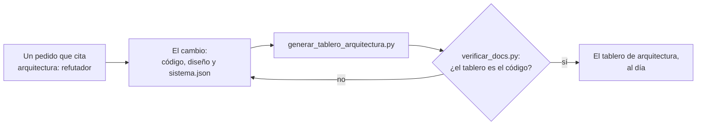

# 0012. El tablero de arquitectura refleja el sistema y es la referencia de los pedidos

- Estado: aceptado
- Fecha: 2026-11-14

## Contexto

La arquitectura de El Parte está repartida en varios documentos: la arquitectura general con su lámina ([docs/arquitectura.md](../docs/arquitectura.md)), los contratos entre agentes ([docs/contratos.md](../docs/contratos.md)), la base ([docs/base-de-afirmaciones.md](../docs/base-de-afirmaciones.md)) y los ADRs. Con la primera rebanada (T08) apareció el código, y con él dos problemas:

- **Los documentos explican el porqué, pero ninguno muestra el sistema entero.** Para saber quién escribe una tabla o quién escucha un tópico hay que leer varios documentos o el código.
- **Un dibujo hecho a mano se desactualiza sin que nadie lo note.** La lámina de la arquitectura es una vista general; nada controla que cada flecha siga siendo cierta.

Además, cuando se pide un cambio hay que nombrar la pieza con precisión, y cada pieza tiene varios nombres: el de la clase, el del agente, el del documento.

## Decisión

El sistema se representa objeto por objeto en el **tablero de arquitectura**, en [`docs/tablero-de-arquitectura/`](../docs/tablero-de-arquitectura/README.md), con estas reglas:

1. **Refleja el sistema con precisión en todo momento.** Cada agente, servicio, tópico, tabla, página y servicio de afuera es un objeto; cada relación entre ellos es una flecha que dice qué pasa por ahí. Lo construido va en trazo lleno; lo diseñado y sin construir, en punteado violeta y con la tarjeta que lo construye.
2. **Todo cambio se hace en el tablero en el mismo momento.** Un cambio del código o del diseño que toca la arquitectura cambia `sistema.json` en el mismo cambio, y se anota en su historial.
3. **Los pedidos se hacen citando el tablero.** Cada objeto y cada flecha tiene una referencia estable (`arquitectura: refutador`, `arquitectura: refutador>modelo`) y una dirección propia (`index.html?objeto=refutador`).
4. **El verificador lo compara con el código.** Falla si una clase o una plantilla no está en ningún objeto, si los tópicos o las tablas no son los del código, si una flecha de emitir, escuchar, escribir, leer o usar está en el código y no en el tablero, o al revés, si una página no atiende las rutas que dice, o si lo diseñado no tiene una tarjeta viva.
5. **La fuente es `sistema.json`.** La página se genera desde ese archivo y una plantilla, y no se edita a mano, como el kanban y las láminas.

Para qué existe y cómo se conecta cada pieza, manda el tablero; por qué se decidió así, los ADRs y los documentos. Si un documento y el tablero se contradicen, se corrige el que está mal en el mismo cambio (regla 1).

## Razones

- Un modelo que el verificador compara con el código no se puede desactualizar en silencio, que es lo que pasa con un dibujo. [PROVEN: `herramientas/pruebas/prueba_tablero_arquitectura.py` cambia una cosa por vez, en el modelo o en lo leído del código, y cada cambio da su error, 2026-11-14]
- La primera versión del tablero ya encontró un hueco: el expediente de cada entidad estaba diseñado en la arquitectura y en la base, pero ninguna tarjeta lo construía. Ahora es T33. [PROVEN: el control de lo diseñado sin tarjeta, 2026-11-14]
- Una referencia por objeto deja los pedidos sin ambigüedad: el mismo id está en el tablero, en su dirección y en el verificador. [INFERRED]
- Una página estática, sin dependencias, se abre desde cualquier clon y se puede mostrar en el portafolio sin servidor. [PROVEN: `herramientas/pruebas/prueba_tablero_arquitectura.mjs` la abre como archivo local en Chrome, 2026-11-14]

## Alternativas rechazadas

- **Solo la lámina y los documentos.** Explican, pero nada los compara con el código.
- **Generar el tablero entero desde el código.** El código no sabe lo que todavía está diseñado, ni para qué sirve cada pieza, ni los recorridos. Se generan desde el código los controles, no el tablero. [INFERRED]
- **Una herramienta de modelado de arquitectura**, con su propio lenguaje. Suma una dependencia y un formato más, y el control contra el código de este repositorio igual habría que escribirlo. [INFERRED]

## Costos

- Cada cambio de la arquitectura suma una edición de `sistema.json`, con su lugar en la grilla y sus textos.
- El verificador lee el código Java con expresiones regulares, sin compilarlo: no ve una relación escrita de una forma que no espera, como un SQL armado por partes. Cuando no puede leer algo que espera, como un tópico que no es una constante de `Tipos`, lo dice. [INFERRED: de cómo está escrito `herramientas/tablero_arquitectura.py`]
- Lo que el verificador no puede controlar se revisa a mano en cada cambio: los textos de cada objeto, los recorridos y las llamadas afuera.

## Qué la haría reversar

- Que mantener el tablero cueste más de lo que ayuda a entender y a pedir cambios, por ejemplo con falsas alarmas frecuentes del verificador.
- Que el código crezca en formas que la lectura con expresiones regulares no alcanza: se pasa a leer las clases compiladas o el contexto de Spring.
