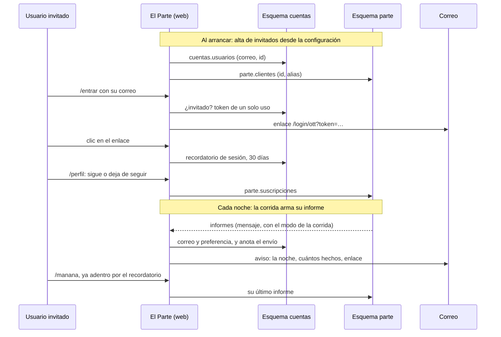

# 0013. Cómo entra cada usuario, dónde queda su perfil y cómo lee su parte cada mañana

- Estado: aceptado
- Fecha: 2026-11-14

## Contexto

La primera rebanada arma cada noche un informe por cliente y lo muestra en la página de la mañana, pero solo para la cuenta de demostración (T08). Falta todo lo que hace una persona: entrar, elegir qué entidades seguir y enterarse cada mañana de lo que hay. Ya estaba decidido:

- **El login es por enlace de correo**, con el token de un solo uso de Spring Security, para cuatro usuarios invitados y una cuenta de demostración de solo lectura ([ADR 0003](0003-eleccion-del-stack.md), [docs/arquitectura.md](../docs/arquitectura.md)).
- **Los correos viven en un esquema aparte**, `cuentas`, con un rol de base propio; el esquema `parte` no tiene datos personales y su rol no ve `cuentas` ([ADR 0008](0008-datos-personales.md)).
- **Las tablas del cliente ya están**: `parte.clientes` (un identificador y un alias), `parte.suscripciones` (qué entidades sigue), `parte.informes` (su informe de cada noche) y `cuentas.usuarios` (su correo, con el mismo identificador) ([docs/base-de-afirmaciones.md](../docs/base-de-afirmaciones.md)).

No estaba decidido cómo llega una persona a tener cuenta, dónde elige lo que sigue, cómo se entera cada mañana, ni cómo se cruzan los dos esquemas sin que un mismo componente vea correos y hechos.

## Decisión

El diseño está en el [tablero de arquitectura](../docs/tablero-de-arquitectura/README.md), en la vista del usuario (`docs/tablero-de-arquitectura/usuarios.html`) y en los recorridos "Un usuario nuevo" y "Cada día, su parte".

1. **Alta por invitación.** La lista de invitados (correo y alias) está en la configuración (`elparte.invitados`). Al arrancar, el alta crea la cuenta de cada invitado nuevo: el correo en `cuentas.usuarios` y el cliente en `parte.clientes`, con el mismo identificador. Nadie se registra solo.
2. **Entrar por enlace.** En `/entrar` la persona pone su correo. Si está invitada, Spring Security genera un token de un solo uso (`POST /ott/generate`), lo guarda en `cuentas.one_time_tokens` con `JdbcOneTimeTokenService` y le manda el enlace `/login/ott?token=…`. Si no está invitada, la respuesta es la misma y no sale nada, así no se puede averiguar quién tiene cuenta. El token vence a los 5 minutos y se usa una vez.
3. **Sesión recordada.** Al entrar, la aplicación guarda un recordatorio de sesión en `cuentas.persistent_logins` (`JdbcTokenRepositoryImpl`) por 30 días: cada mañana la persona abre su página sin pedir otro enlace.
4. **El perfil.** En `/perfil` la persona ve lo que sigue y el catálogo de lo que se puede seguir, sigue o deja de seguir con un botón (`parte.suscripciones`) y elige si quiere el aviso diario (una columna nueva en `cuentas.usuarios`). Los cambios valen desde la corrida siguiente, que arma la lista de entidades seguidas al empezar. La cuenta de demostración ve el perfil pero no lo cambia.
5. **El catálogo es lo que se puede seguir de verdad.** En la versión 0 el explorador de ARCE filtra por comprador, así que se pueden seguir los organismos con su código de comprador en `parte.entidades`. Seguir una empresa necesita que el explorador filtre también por proveedor, y queda afuera.
6. **El parte de cada mañana.** La corrida ya usa las suscripciones y ya guarda un informe por cliente. El **aviso del parte** escucha el mensaje `informes`, que suma el modo de la corrida para que el aviso salga solo en las normales. Busca el correo y la preferencia, anota el envío en `cuentas.envios_del_parte` para no mandar dos veces, y manda un aviso corto: la noche, cuántos hechos hay, cuántos esperan revisión, si la corrida se cortó y el enlace a `/manana`. El aviso no lleva el contenido de los hechos: el parte es la página.
7. **La página de la mañana** muestra, con sesión, el último informe de quien entró; sin sesión, el de la cuenta de demostración.
8. **Dos roles, sin cruces.** El alta, el login, el aviso y la preferencia del perfil usan el rol de `cuentas`; las suscripciones y las páginas, el de `parte`. El identificador del cliente pasa de un lado al otro dentro de la sesión. Ningún componente lee correos y hechos a la vez: el aviso sabe cuántos hechos hay por el mensaje, no por la base.
9. **El correo sale por SMTP** con Spring Boot Mail: en local lo captura Mailpit, y el servicio real para los invitados se decide con el despliegue (T27).

## Razones

- Spring Security trae el login por token de un solo uso: el token por omisión se guarda en memoria, y para producción recomienda `JdbcOneTimeTokenService`; vence a los 5 minutos por omisión; el pedido va a `POST /ott/generate` y la página para usarlo es `GET /login/ott`; y cómo se entrega el token lo decide la aplicación, con un `OneTimeTokenGenerationSuccessHandler` que manda el enlace por correo. [PROVEN: https://docs.spring.io/spring-security/reference/servlet/authentication/onetimetoken.html, versión 7.1.2, 2026-11-14]
- La tabla de `JdbcOneTimeTokenService` es `one_time_tokens(token_value, username, expires_at)`. [PROVEN: `one-time-tokens-schema.sql` dentro de spring-security-core 7.1.2, 2026-11-14] Como `username` es el correo, va en el esquema `cuentas`.
- El recordatorio con tokens persistentes guarda en `persistent_logins(username, series, token, last_used)` y se engancha en `AbstractAuthenticationProcessingFilter`. [PROVEN: https://docs.spring.io/spring-security/reference/servlet/authentication/rememberme.html, versión 7.1.2, 2026-11-14] El filtro del token de un solo uso, `OneTimeTokenAuthenticationFilter`, extiende esa clase. [PROVEN: `javap` sobre spring-security-web 7.1.2, 2026-11-14] Que los dos se combinen sin código extra se deduce de eso, y se prueba en T25. [INFERRED]
- Spring Boot 4.1.2 trae Spring Security 7.1.2 y los arrancadores de seguridad y de correo. [PROVEN: spring-boot-dependencies 4.1.2, 2026-11-14]
- Que las clases de Spring encuentren sus tablas en el esquema `cuentas` sin nombrarlo depende del `search_path` del rol de cuentas. [INFERRED: las dos clases nombran sus tablas sin esquema, según los SQL de arriba; se prueba en T25]
- Un aviso corto con un enlace, y no el informe entero en el correo, deja una sola versión del parte, la de la página, con su evidencia y su traza. [INFERRED]

## Alternativas rechazadas

- **Un enlace para entrar en cada aviso diario.** Ahorra el recordatorio, pero deja en el correo un enlace que sirve para entrar durante horas, en vez de 5 minutos.
- **El informe entero en el correo.** Son dos lugares donde mirar el mismo parte, y el correo no puede mostrar la evidencia ni la traza.
- **Registro abierto.** La versión 0 es para cuatro personas invitadas.
- **Que el perfil y el aviso lean los dos esquemas con un solo rol.** Rompe la separación del [ADR 0008](0008-datos-personales.md).
- **Solo la sesión, sin recordatorio.** La sesión vence y se pierde con cada reinicio de la aplicación, así que la persona tendría que pedir un enlace casi cada mañana. [INFERRED: las sesiones viven en la memoria de la aplicación]

## Costos

- La aplicación necesita dos fuentes de datos, una por rol, y un `UserDetailsService` que lea `cuentas.usuarios`.
- Tres tablas nuevas en `cuentas` (`one_time_tokens`, `persistent_logins` y `envios_del_parte`), una columna nueva en `cuentas.usuarios` y un campo nuevo en el contrato de `informes`.
- El catálogo de la versión 0 es chico: hoy solo el BPS tiene su código de comprador. Sumar organismos es cargar y verificar sus códigos.
- Para que los invitados reciban correos de verdad hace falta un servicio de correo real (T27).

## Qué la haría reversar

- Que el recordatorio no funcione con el login por token sin reescribir el filtro: se pasa a sesiones largas en la base, con Spring Session.
- Que las personas invitadas prefieran el parte entero en el correo.
- Que haya que abrir el registro a más gente: hace falta un alta con confirmación y límites.
