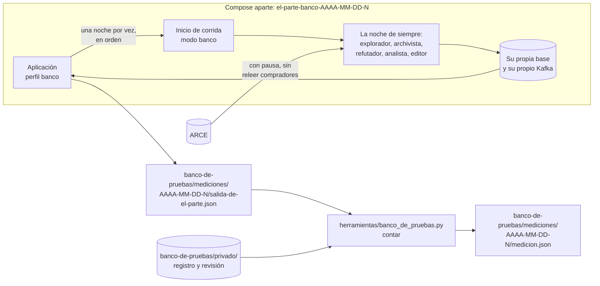

# 0014. La medición contra el banco corre en un Compose aparte, noche por noche

- Estado: aceptado
- Fecha: 2026-11-15

## Contexto

La medición contra el banco de pruebas es parte de la versión 0 ([docs/plan.md](../docs/plan.md)). Ya está escrito qué se lee y cómo se cuenta: el formato del registro, la revisión y la salida de El Parte en [banco-de-pruebas/formato.md](../banco-de-pruebas/formato.md), y las métricas en [banco-de-pruebas/metricas.md](../banco-de-pruebas/metricas.md). Falta cómo se producen las corridas que se miden.

Los contratos ya prevén el modo `banco`: una corrida cuya fecha objetivo es la noche del registro que se repite ([docs/contratos.md](../docs/contratos.md), `corrida.iniciada`), y la tabla de corridas lo acepta ([docs/base-de-afirmaciones.md](../docs/base-de-afirmaciones.md)). Pero la aplicación hoy solo inicia corridas normales y repeticiones. [PROVEN: `app/src/main/java/io/github/andresdiegolanda/elparte/corrida/InicioDeCorrida.java`, 2026-11-15]

Hay cuatro cosas que resolver:

- **Separación.** Lo que se mide no se puede mezclar con lo que ven los invitados. El archivista coteja contra todos los hechos de la base, así que un hecho de una corrida del banco cambiaría lo que decide una corrida normal, y al revés.
- **Orden y memoria.** El Parte recuerda: lo que vio una noche es conocido la siguiente. Una medición que corre las noches sueltas, o sobre una base con historia, no mide lo mismo que pasaría noche a noche.
- **El volumen sobre ARCE.** Una noche lee el feed del mes y cada publicación de la noche y del día de margen, con cuatro lecturas en paralelo, para saber quién compra. [PROVEN: `app/src/main/java/io/github/andresdiegolanda/elparte/fuentes/arce/ExploradorArce.java`, 2026-11-15] En los días hábiles de octubre de 2026 se publicaron entre 550 y 670 por día. [PROVEN: [docs/fuentes/compras-estatales.md](../docs/fuentes/compras-estatales.md), conteo del 2026-11-07] El registro tiene 78 noches: lo que en producción se reparte en 78 días, la medición lo pide en horas.
- **El costo.** Cada noche llama al modelo, y todavía no se sabe cuánto cuesta una. El tope de costo por corrida llega con T22; hoy cortan la corrida el tiempo y un máximo de 60 candidatos. [PROVEN: `app/src/main/resources/application.yaml`, 2026-11-15]

## Decisión

Cada medición corre en su propio Docker Compose, con una base vacía, y la aplicación, con el perfil `banco`, recorre las noches del registro en orden, una por vez. Al terminar deja la salida de El Parte, y el conteo de [`herramientas/banco_de_pruebas.py`](../herramientas/banco_de_pruebas.py) escribe la medición al lado.

1. **Un Compose aparte por medición.** Se levanta con `docker compose -p el-parte-banco-<medición> -f compose.yaml -f compose.banco.yaml up`. El nombre del proyecto separa los entornos, y cada proyecto tiene sus propios volúmenes, así que la base y Kafka de la medición nacen vacíos y no tocan los de todos los días. [PROVEN: https://docs.docker.com/compose/how-tos/project-name/ y `docker compose config` con `-p`, que nombra los volúmenes `<proyecto>_datos-de-la-base`, 2026-11-15] `compose.banco.yaml` no publica los puertos de la base, de Kafka ni del correo, y publica la aplicación en el 8081, así puede correr al lado de la de todos los días. [PROVEN: la etiqueta `!reset` de Compose, https://docs.docker.com/reference/compose-file/merge/, y `docker compose config` con esa regla, 2026-11-15] Las migraciones cargan, como en cualquier base nueva, la fuente, el organismo del banco, los modelos y los precios.
2. **Las noches en orden, una por vez.** Con el perfil `banco`, la aplicación inicia una corrida en modo banco por cada noche, de `elparte.banco.desde` a `elparte.banco.hasta`, espera a que termine y sigue con la siguiente. Así el archivista recuerda las noches anteriores como lo haría en producción. Si la medición se interrumpe, al volver a levantarla saltea las noches que ya terminaron en esa base.
3. **Qué es una corrida en modo banco.** Es una corrida normal con tres diferencias: su fecha objetivo es la noche del registro; sigue solo la entidad medida, `elparte.banco.entidad` (por omisión `organismo:bps`), y no las suscripciones; y su modo es `banco`. Graba lo que lee como cualquier corrida ([adrs/0011-grabacion-y-repeticion-de-corridas.md](0011-grabacion-y-repeticion-de-corridas.md)), así que cada noche se puede repetir sin red ni costo dentro de su base: la repetición acepta como original una corrida normal o una del banco.
4. **Cuidar a ARCE.** En el perfil `banco`, el lector de ARCE espera entre pedidos (`elparte.arce.pausa-ms`, 250 ms por omisión en ese perfil [ASSUMED: hasta medir la duración de las primeras noches]). Y el explorador no vuelve a leer el comprador de una publicación que otra corrida de la misma medición ya leyó: lo toma de esa grabación, y lo graba de nuevo en la corrida actual para que se pueda repetir. Como cada noche lee también el día de margen, eso evita leer dos veces casi la mitad de las publicaciones. [INFERRED: con un día de margen, cada día se lee en dos noches seguidas]
5. **Un tope para toda la medición.** Entre una noche y la siguiente, la aplicación suma el costo de los `uso.modelo` de la medición, y si pasa `elparte.banco.costo-maximo-usd` (5 USD por omisión [ASSUMED: hasta saber cuánto cuesta una noche]) no inicia la siguiente y lo anota. El tope es mucho menor que el mensual de 20 USD del espacio de trabajo de la clave (T14). La primera vez se corren tres noches, para conocer el costo, la duración y la cantidad de pedidos antes de correr las 78.
6. **La salida, al terminar.** La aplicación escribe `banco-de-pruebas/mediciones/<medición>/salida-de-el-parte.json`, con la forma de [banco-de-pruebas/formato.md](../banco-de-pruebas/formato.md), desde su base: el estado, el costo (de `corrida.terminada`) y la duración de cada corrida; las fuentes no repetibles y las lecturas fallidas, de `fuente.fallida`; y cada clave de hecho de `candidatos.graduados`, con la primera noche en que salió PROVEN o INFERRED y ese grado, o si nunca salió así, la primera en que salió NOT_MENTIONED. El commit lo da la variable `ELPARTE_COMMIT` al levantar el Compose.
7. **La medición, al lado.** `python3 herramientas/banco_de_pruebas.py contar banco-de-pruebas/privado banco-de-pruebas/mediciones/<medición>/salida-de-el-parte.json` escribe `medicion.json` en la misma carpeta. Las dos se versionan: llevan claves de hechos de fuentes públicas, fechas, conteos y huellas, y nada del registro.
8. **Una fuente que no deja pedir una fecha** emite `fuente.fallida` con un tipo de falla nuevo, `sinFecha`, y la salida la lista en las fuentes no repetibles de esa noche (D1). ARCE siempre deja: su feed es por mes. [PROVEN: [docs/fuentes/compras-estatales.md](../docs/fuentes/compras-estatales.md), 2026-11-15]

## Razones

- Un Compose aparte separa la medición sin una línea de código: la base, Kafka y los volúmenes son otros. Separar dentro de la misma base obligaría a filtrar por modo en el archivista, en las páginas y en cada consulta, y una consulta que se olvide mezclaría las dos cosas. [INFERRED]
- Correr las noches en orden sobre una base vacía es lo único que reproduce lo que habría pasado noche a noche desde el 2026-08-29.
- Grabar como cualquier corrida deja volver a correr el conteo, o repetir una noche para entender un resultado, sin volver a pagar ni a pedirle nada a ARCE.
- El tope de la medición y las tres primeras noches acotan el riesgo de un costo que todavía no se conoce, mientras no exista el tope por corrida de T22.

## Alternativas rechazadas

- **La misma base, con las corridas del banco marcadas.** Habría que filtrar por modo en todas partes; un olvido mezcla lo medido con lo que ven los invitados.
- **Una base vacía por noche.** Cada noche vería todo como nuevo: mediría un El Parte sin memoria, que no es el que corre.
- **Leer los archivos mensuales de ARCE del catálogo de datos en vez de su API.** Serían muchos menos pedidos, pero el explorador de la medición no sería el de todas las noches, y lo que se mide es ese. [INFERRED]
- **Correr la medición en la nube.** La clave del modelo vive solo en la máquina del responsable (T14), y la nube no inyecta secretos en `api.anthropic.com`. [PROVEN: tablero, T14, 2026-11-14]

## Costos

- **Lo que mide de más.** El Parte lee hoy lo que ARCE tiene de una noche pasada, ya completo; una noche real ve menos, porque ARCE publica con atraso ([adrs/0011-grabacion-y-repeticion-de-corridas.md](0011-grabacion-y-repeticion-de-corridas.md)). La cobertura medida puede salir mejor que la real. [INFERRED] La medición lo dice en [banco-de-pruebas/metricas.md](../banco-de-pruebas/metricas.md).
- **Una sola muestra.** El modelo no responde siempre igual, y una medición es una pasada. Repetirla desde las grabaciones da los mismos mensajes, no una muestra nueva.
- **Tiempo.** Con pausa y una noche por vez, la medición completa tarda horas en la máquina del responsable; las tres primeras noches dicen cuántas.
- **Espacio.** Cada medición deja su base, con sus grabaciones, en volúmenes de Docker. Se borran con `docker compose -p <proyecto> down -v` cuando ya no hace falta repetirla.

## Qué la haría reversar

- Que la medición tarde tanto que no entre en un fin de semana: se piensa leer ARCE de otra forma solo para el banco, sabiendo que mide un explorador distinto.
- Que el costo de una noche haga imposible correr las 78 dentro del tope mensual: se mide sobre una muestra de noches, elegida antes de ver los resultados.
