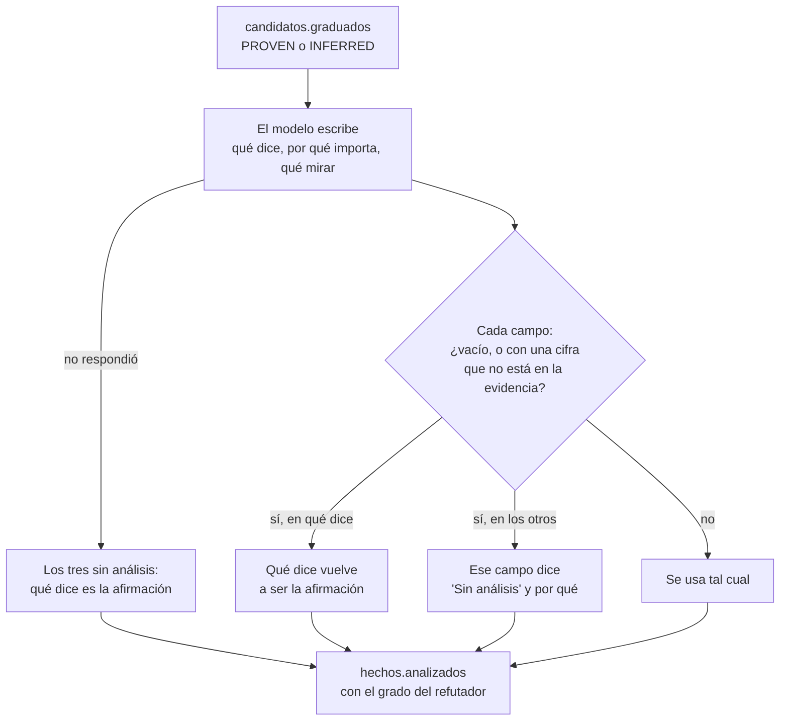

# 0015. Qué puede escribir el analista

- Estado: aceptado
- Fecha: 2026-11-16

## Contexto

El analista recibe lo que el refutador graduó PROVEN o INFERRED y escribe tres cosas para quien sigue a las entidades del hecho: qué dice, por qué importa y qué mirar ([docs/contratos.md](../docs/contratos.md), `hechos.analizados`). En la primera rebanada solo pasaba la afirmación y marcaba "sin análisis". [PROVEN: `app/src/main/java/io/github/andresdiegolanda/elparte/analista/Analista.java`, commit 652aa9a]

El análisis es lo único de la noche que no se puede controlar contra la fuente: "por qué importa" es una interpretación, no un dato. Ahí está el riesgo que el [ADR 0004](0004-grados-de-evidencia.md) quiso evitar al separar quién pone el grado de quién interpreta: que la interpretación le agregue al hecho algo que el refutador no vio, y que quien lee lo tome con el grado del hecho.

Hay tres cosas que resolver:

- **Qué puede agregar el modelo.** Una cifra, una fecha o un plazo que no está en la publicación es un dato inventado, aunque esté bien escrito.
- **Qué pasa si el modelo falla.** El refutador, sin veredicto, no publica. Pero el hecho ya está graduado: el análisis ayuda a leerlo, no lo prueba.
- **Cómo lo ve quien lee.** La página de la mañana muestra la afirmación con su grado y su evidencia. El análisis tiene que verse como análisis.

## Decisión

El analista le pide al modelo los tres campos con la afirmación, el grado, la fecha, las entidades, lo que cambió si es una actualización, el razonamiento si es INFERRED y los fragmentos de la evidencia. No vuelve a leer la fuente: trabaja sobre lo que el refutador dejó.

Lo que responde el modelo pasa por un control en código antes de salir:

- **El grado se copia.** El modelo no recibe un campo para el grado ni lo devuelve.
- **Las cifras se comparan con la evidencia.** Cada número de un campo tiene que estar en la afirmación, en los fragmentos, en el razonamiento o en las fechas de la publicación y de la noche. Se comparan sin separadores ni ceros a la izquierda, así "1.250.000" es lo mismo que "1250000" y "04/2026" lo mismo que "4/2026", y de una fecha valen sus partes, para que "2026-11-06" se pueda decir "6 de noviembre".
- **Sin análisis, el hecho se publica igual.** Si el modelo no responde, o un campo no pasa el control, ese campo dice "Sin análisis" y por qué. Con eso empiezan `porQueImporta` y `queMirar` cuando no hay análisis, y la página lo usa para no mostrar el bloque.
- **La página lo muestra aparte.** La afirmación graduada sigue arriba, con su evidencia. El análisis va debajo, en un bloque que dice que lo escribe el analista y que no cambia el grado. "En pocas palabras" aparece solo si dice algo distinto de la afirmación.

## Razones

- Un número inventado es el error de análisis más fácil de ver y el más dañino: un monto o un plazo falso se lee como un hecho. Y es el único que un programa puede detectar sin otro modelo. [INFERRED]
- Que el control no use el modelo lo hace gratis, igual en cada repetición y fácil de probar sin red.
- Publicar sin análisis cuando falla el modelo respeta el ADR 0004: el grado lo decide el refutador, y lo que pasa después no puede bajar ni subir lo que se publica.
- Mostrar la afirmación arriba y el análisis aparte deja ver siempre qué está probado y qué es lectura.

## Alternativas rechazadas

- **Que el refutador también controle el análisis.** Sería otra llamada al modelo más cara por hecho, y el refutador gradúa afirmaciones, no interpretaciones: "por qué importa" no está en la publicación, así que siempre saldría NOT_MENTIONED.
- **Que el modelo escriba solo "por qué importa" y "qué mirar", y "qué dice" sea siempre la afirmación.** Más seguro, pero la afirmación del refutador está escrita para ser comparable con la fuente ("adjudicó la compra 1200007 en 2 adjudicaciones..."), y quien no conoce las compras del Estado la entiende peor. El control de cifras cubre el riesgo principal.
- **Pedirle al modelo que marque él lo inventado.** El modelo que inventa un dato no es el mejor para encontrarlo.
- **No publicar el hecho sin análisis.** Un hecho probado se perdería por una falla que no tiene que ver con su evidencia.

## Costos

- **El control no ve todo.** Detecta cifras, no nombres ni afirmaciones sin números: "el BPS renovó el contrato" cuando la fuente no lo dice pasa el control. La instrucción al modelo lo prohíbe, la revisión humana (T23) y la medición contra el banco lo pueden encontrar, pero no lo para el código. [INFERRED]
- **Falsos rechazos.** Una cifra bien calculada que la fuente no escribe, como el total de dos montos, no pasa, y el campo sale sin análisis.
- **Una llamada más por hecho.** Con Sonnet 5.5 y unos 900 tokens de entrada y 250 de salida, cerca de 0,004 USD por hecho; los 800 hechos de la medición de 78 noches habrían costado unos 3,4 USD más. [INFERRED: con los precios de [adrs/0003-eleccion-del-stack.md](0003-eleccion-del-stack.md) y el tamaño del pedido, sin medir]

## Qué la haría reversar

- Que la medición contra el banco o la revisión humana muestren análisis que dicen cosas falsas sin cifras: haría falta un control más, quizás con el modelo.
- Que muchos campos salgan sin análisis por falsos rechazos: se afloja la comparación, por ejemplo con los números escritos en letras.
