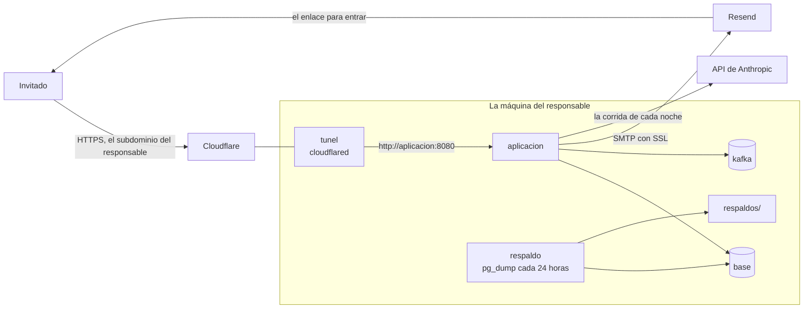

# 0016. El Parte se publica desde la máquina del responsable, con un túnel de Cloudflare y el correo por Resend

- Estado: propuesto
- Fecha: 2026-11-16

## Contexto

Hasta ahora El Parte corre en una máquina con `docker compose up`, y los correos del login caen en Mailpit (D9, [ADR 0003](0003-eleccion-del-stack.md)). Para que los invitados lo usen cada mañana hace falta resolver lo que pide la tarjeta T27:

- una máquina prendida para la corrida de cada noche y las páginas de cada mañana;
- un dominio público con HTTPS, al que apuntan el enlace para entrar y el aviso diario;
- un servicio de correo real, con la configuración que pida en el dominio;
- la base y Kafka en almacenamiento persistente, y copias de la base;
- las claves fuera del repositorio;
- el tamaño de la máquina, con lo medido.

Lo medido:

- **Memoria.** A mitad de una medición contra el banco, la aplicación usa unos 830 MiB, Kafka 840 MiB y PostgreSQL 80 MiB: alrededor de 1,7 GB en total. [PROVEN: `docker stats` de la medición `2026-11-16-2`, 2026-11-16]
- **Costo del modelo.** Con el analista completo, las 22 noches que la medición `2026-11-16-1` llegó a correr antes de quedarse sin crédito costaron 6,11 USD, unos 0,28 USD por noche. Esa medición no cuenta para la precisión, pero el gasto fue real. [INFERRED: registro de T20 en `tablero.md`, 2026-11-16]
- **Uso.** Son cuatro invitados y la cuenta de demostración (`arranque/proyecto.md`): pocas visitas por día y pocos correos.

El responsable ya tiene un dominio administrado en Cloudflare. Su nombre va solo en el `.env`, como los correos de los invitados ([ADR 0008](0008-datos-personales.md)): este ADR dice "el subdominio del responsable".

## Alternativas

| | La máquina del responsable con un túnel | Un servidor virtual chico | Una plataforma administrada |
|---|---|---|---|
| Costo por mes | 0 USD de infraestructura | Unos 5,49 EUR sin IVA por 2 vCPU y 4 GB (un CX23 de Hetzner, después del ajuste de junio de 2026) [INFERRED: [bitdoze.com](https://www.bitdoze.com/hetzner-cloud-review/), 2026-11-16] | Más: Kafka y PostgreSQL administrados se cobran aparte [ASSUMED: no se cotizó] |
| Disponibilidad | La de la máquina: si está apagada a la hora de la corrida, esa noche no corre sola | Siempre prendida | Siempre prendida |
| Trabajo | Los mismos archivos de Docker Compose, más un conector | Los mismos archivos, más administrar un servidor: actualizaciones, firewall, acceso | Rearmar el despliegue para la plataforma |
| Puertos abiertos | Ninguno: el conector sale hacia Cloudflare | Los de la web, con HTTPS a cargo nuestro | Ninguno de nuestra parte |

Para el correo se miró Resend: su plan gratis permite 100 correos por día y 3.000 por mes [PROVEN: [resend.com/pricing](https://resend.com/pricing), 2026-11-16], y acepta SMTP con el usuario `resend` y la clave de la API, por SSL en los puertos 465 y 2465 [PROVEN: [resend.com/changelog/smtp-service](https://resend.com/changelog/smtp-service), 2026-11-16]. Con cinco cuentas, entre enlaces para entrar y avisos diarios (T35), no se pasa de unas decenas por día [INFERRED: cinco cuentas, un aviso por día cada una, más los enlaces]. Otros servicios, como Postmark o Amazon SES, también hablan SMTP: cambiar de servicio es cambiar cuatro variables.

## Decisión

El Parte se publica desde la máquina del responsable, con los mismos archivos de Docker Compose y uno más, `compose.publicado.yaml`, que se suma a `compose.yaml` con un nombre de proyecto propio (`el-parte-publicado`): su base y su Kafka son otros que los de las pruebas en local y los de las mediciones.

- **El túnel.** Un conector de Cloudflare (`cloudflare/cloudflared:2026.11.0`) corre como un servicio más del Compose, con el token del túnel en el `.env`. El túnel se crea en el panel de Cloudflare, que también dice adónde lleva el subdominio: a `http://aplicacion:8080`, dentro de la red del Compose [PROVEN: [developers.cloudflare.com/tunnel/setup](https://developers.cloudflare.com/tunnel/setup/), 2026-11-16]. El HTTPS lo pone Cloudflare. El túnel es gratis [PROVEN: [blog.cloudflare.com/tunnel-for-everyone](https://blog.cloudflare.com/tunnel-for-everyone), 2021-04-15, leído el 2026-11-16]. El conector lee el token de `TUNNEL_TOKEN` [PROVEN: `cloudflared tunnel run --help` de esa imagen, 2026-11-16].
- **Ningún puerto hacia afuera.** En `compose.yaml` todos los puertos se abren solo en la máquina (`127.0.0.1`), también en local: la base, Kafka y Mailpit no se ven desde la red. La salud de la aplicación va en otro puerto, al que el túnel no lleva, y queda en `http://localhost:8090/actuator/health`. Así nadie desde afuera ve el detalle de la base ni hace que la aplicación se conecte a Resend o a Kafka cada vez que consulta la salud.
- **El correo.** Resend por SMTP, con SSL en el puerto 2465, el usuario `resend` y la clave en el `.env`. No el 465: el antivirus de la máquina del responsable se mete en las conexiones a ese puerto con un certificado propio, que Java no acepta; en el 2465 llega el certificado de Resend [PROVEN: `openssl s_client` a los dos puertos desde la red del Compose, 2026-11-16]. El remitente es de un subdominio verificado en Resend, aparte del dominio principal del responsable, para que el correo de El Parte no afecte la reputación del dominio principal. Mailpit queda solo para local.
- **La corrida de cada noche.** `ELPARTE_CORRIDA_CRON` se prende: la noche de ayer, a las 6 de la mañana de Uruguay. Si la máquina estaba apagada o dormida, esa noche se corre a mano desde `/corridas`.
- **Que vuelva sola.** Todos los servicios tienen `restart: unless-stopped`, y Docker Desktop arranca con la sesión del responsable: si la máquina se reinicia, El Parte vuelve sin tocar nada.
- **Las copias.** Un servicio `respaldo` hace `pg_dump` de la base entera en `respaldos/` al arrancar, en cuanto la aplicación terminó de crear sus tablas, y después cada 24 horas. Guarda las de los últimos 14 días. `respaldos/` no se versiona: tiene los correos de los invitados.
- **Las claves.** El token del túnel, la clave de Resend, la dirección pública, el remitente y los invitados van en el `.env` de la raíz, que no se versiona. Si falta uno de los cuatro primeros, Docker Compose no arranca y dice cuál.

## Qué se probó

Con un Mailpit que exige SSL y usuario en lugar de Resend, y un token falso en lugar del de Cloudflare [PROVEN: prueba en un Docker local, 2026-11-16]:

- La aplicación levanta con la configuración publicada, y su indicador de salud del correo se conecta con SSL y usuario.
- Un invitado del `.env` pide el enlace con su correo escrito de otra forma y le llega desde el remitente del `.env`, con la dirección pública.
- `/actuator/health` no responde por el puerto de la web, y sí por el de la salud.
- La copia de la base tiene los datos de todas sus tablas, también las del esquema `cuentas`. Se recuperó dos veces: en una base nueva, después de que la aplicación arrancó una vez para crear los roles y las tablas, y en la misma base, donde un cliente agregado después de la copia desapareció. En las dos, con la aplicación apagada y `pg_restore --clean --if-exists`, y la aplicación volvió a arrancar sana.
- El conector del túnel lee el token del `.env` y rechaza uno falso.

Falta probarlo con el túnel y Resend reales, con las claves del responsable (T40).

## Costo

- **Depende de la máquina.** Si está apagada o dormida a la hora de la corrida, esa mañana no hay parte nuevo hasta que se corra a mano. Si la máquina se rompe, se pierde lo que haya desde la última copia, y las copias están en el mismo disco: conviene copiar `respaldos/` a otro lado cada tanto. Pasar a un servidor virtual es llevar los mismos archivos a otra máquina.
- **Cloudflare ve el tráfico.** El HTTPS termina en Cloudflare, que lo lleva por el túnel hasta la máquina. Las páginas no muestran correos (ADR 0008), pero el enlace para entrar pasa por ahí.
- **La aplicación recibe todo el `.env`**, también el token del túnel, que no necesita: la lista de invitados tiene un largo variable y entra con el `.env` entero. Separarlo pide un segundo archivo de configuración; con una sola máquina, no se hizo.
- **El plan gratis de Resend tiene un tope de 100 correos por día.** Alcanza para cinco cuentas; si se suman muchas, hay que pagar el plan siguiente.
