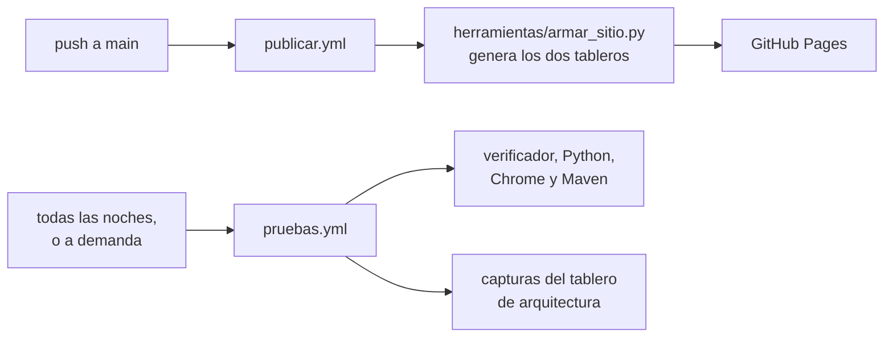

# 0017. Una forma de trabajo más liviana: un lugar por dato, ritual según el tamaño, integración continua y tableros publicados

- Estado: aceptado
- Fecha: 2026-11-17
- Reemplaza a: [0009](0009-kanban-editable-sincronizado.md)

## Contexto

La forma de trabajo del proyecto (`arranque/como-se-trabaja.md`) funciona, pero el 2026-11-17 mostró lo que cuesta:

- **Fijar el tope de costo de cada noche** cambió 17 archivos, porque las mismas cifras de la medición estaban repetidas en el tablero, los README, el ADR, dos páginas "cómo se hizo" y el plan. [PROVEN: `git status` antes del commit `81b0791`, 2026-11-17]
- **Mover tres tarjetas** cambió 366 líneas de `kanban/index.html`, un archivo que nadie escribe a mano, y pidió 38 operaciones contra la base del kanban publicado, con control de versiones, para sincronizarlo. [PROVEN: `git show --stat 81b0791` y la sincronización del 2026-11-17]
- **Cada cambio, chico o grande, lleva el ritual completo:** tarjeta, CHANGELOG, página "cómo se hizo", tablero de arquitectura y sincronización del kanban.
- **Cada commit espera un pedido explícito** en el último mensaje, aunque la tarea ya se haya aprobado al empezar.
- **Las pruebas solo corren en una sesión de desarrollo.** Nadie las corre si nadie abre una.
- **Que el tablero de arquitectura se vea bien** lo controla solo una persona mirándolo: la prueba en Chrome comprueba que la página ande, no que se lea.

## Decisión

### 1. Un solo lugar por dato

Cada cifra, valor o decisión vive en un solo documento, su dueño; los demás lo enlazan sin repetirlo.

| Qué | Dónde vive |
|---|---|
| El resultado de una medición | Su sección en `docs/como-se-hizo/medicion-contra-el-banco.md` y su `banco-de-pruebas/mediciones/<medición>/medicion.json` |
| Un valor decidido y su porqué | Su ADR |
| El estado de una tarea | Su tarjeta en `tablero.md` |
| Cómo se construyó un componente | Su página "cómo se hizo" |
| Qué cambió y cuándo | `CHANGELOG.md` y el registro de cada tarjeta, que son historia |

La nota de arriba de `tablero.md`, los README y el plan dicen dónde mirar, no repiten la cifra. El verificador avisa, sin fallar, cuando la misma cifra con unidad (por ejemplo, `0,245 USD` o `95 %`) aparece en más de un documento vigente. No cuenta la historia, que cuenta lo que pasó con las cifras de su momento: `CHANGELOG.md`, los ADRs y las decisiones iniciales, `obsoletos/`, y el registro y las tarjetas hechas de `tablero.md`. Tampoco cuenta lo que está entre comillas invertidas, que son ejemplos.

### 2. Un ritual según el tamaño del cambio

| Tamaño | Qué es | Qué lleva |
|---|---|---|
| Chico | Un arreglo, un texto, un valor de configuración. No cambia contratos, decisiones ni la arquitectura. | Commit y una línea en `CHANGELOG.md`. Si es parte de una tarjeta, una línea en su registro. |
| Mediano | Un componente nuevo o un cambio de comportamiento dentro de lo decidido. | Lo del chico, más la tarjeta con sus etapas, la página "cómo se hizo" y, si toca la arquitectura, el tablero de arquitectura con sus capturas (regla 13). |
| Grande | Cambia una decisión, un contrato o la forma de trabajo. | Lo del mediano, más un ADR aceptado antes del código. |

La sesión dice el tamaño al empezar la tarea, y el responsable lo puede cambiar.

### 3. Integración continua, de noche y a demanda

Un workflow de GitHub Actions, `.github/workflows/pruebas.yml`, corre todo lo que hoy corre una sesión:

- el verificador, `herramientas/verificar_docs.py`, con mermaid-cli;
- las pruebas de Python y las de Chrome, de `herramientas/pruebas/`;
- `mvn test` de `app/`, con Testcontainers.

Corre todas las noches, si `main` cambió en el último día, y a demanda. No corre en cada push. No necesita secretos: las pruebas usan respuestas grabadas del modelo y no gastan (D4). Cada corrida guarda las capturas del tablero de arquitectura (punto 7).

### 4. El HTML generado sale del repositorio y se publica en GitHub Pages

`kanban/index.html` y las páginas de `docs/tablero-de-arquitectura/` se generan desde `tablero.md` y `sistema.json` con scripts que dan siempre el mismo resultado. Dejan de versionarse. Un workflow, `.github/workflows/publicar.yml`, los genera en cada push a `main` y los publica en GitHub Pages, en <https://andresdiegolanda.github.io/el-parte/>. No corre pruebas y tarda alrededor de un minuto. [ASSUMED]

El verificador ya no compara el archivo generado con su fuente: controla que la fuente se pueda generar. En una sesión, las páginas se generan en el mismo lugar de siempre para mirarlas, y git las ignora. La regla 9 no las alcanza, porque se vuelven a generar. Las láminas SVG (`docs/laminas/`, `docs/presentacion/imagenes/`) siguen versionadas, porque GitHub las muestra dentro de los Markdown.

### 5. Commit y push autorizados por tarea

Al empezar una tarea, el responsable dice si incluye commit y push al terminar, y eso se anota en el registro de su tarjeta. Con esa autorización, la sesión hace commit y push al terminar, sin volver a pedirlos. Sin ella, se piden como hasta ahora.

### 6. El kanban, de solo lectura

El kanban vuelve a ser una vista de `tablero.md`, como en el [ADR 0001](0001-tablero-fuente-unica-kanban-generado.md), publicada en GitHub Pages. No tiene base ni sincronización. Las tarjetas se cambian en `tablero.md`, a mano o por medio de una sesión. Se van a `obsoletos/` la sincronización (`herramientas/sincronizar_tablero.py`), su prueba y la plantilla editable. La página publicada en Claude queda con un aviso que manda al kanban de GitHub Pages. Con la sincronización se va la excepción del ADR 0009, que hacía commit y push del tablero sin esperar pedido.

### 7. Controles visuales del tablero de arquitectura

La prueba en Chrome (`herramientas/pruebas/prueba_tablero_arquitectura.mjs`) mide dónde quedó dibujado cada objeto. Falla si dos cajas se pisan, si una caja se sale de su franja o si la etiqueta de una flecha queda encima de una caja o de otra etiqueta. Si un texto queda cortado, avisa sin fallar.

Lo que no se puede medir, que el tablero se entienda, se mira en capturas. La prueba saca una captura de cada vista ("Todo el sistema" y "El usuario"):

- en una sesión, en `tmp/capturas/`. Un cambio de `sistema.json` no se sube sin mirarlas;
- en la integración continua, como artefacto de cada corrida.

### Lo que no entra

- **Que el alta avise cuando un invitado no es un correo** es un arreglo de este proyecto, no de la forma de trabajo. Va como tarjeta (T44).
- **Copiar los respaldos fuera de la máquina** se descarta: el proyecto no usa más servicios que el repositorio y Claude, y al repositorio no pueden ir, porque tienen los correos de los invitados (regla 11). Queda como riesgo aceptado en el [ADR 0016](0016-despliegue-en-la-maquina-del-responsable.md).

## Razones

- Una cifra en un solo lugar no se contradice consigo misma, y cambiarla es cambiar un archivo. [INFERRED]
- Un ritual que no distingue tamaños hace caro lo chico, y entonces lo chico se junta hasta ser grande. [INFERRED]
- De noche alcanza para un proyecto con un responsable y pocas sesiones por día. Correr en cada push sería demasiado.
- Un archivo generado en el repositorio no aporta nada que su fuente no tenga, y ensucia cada diff. [PROVEN: `git show --stat 81b0791`]
- La autorización por tarea deja el control en el responsable, tarea por tarea, sin pedirlo de nuevo en cada cierre.
- Editar el kanban desde el navegador costaba una base, un script de sincronización de 363 líneas con su prueba, y una excepción a la regla de los commits. [PROVEN: `herramientas/sincronizar_tablero.py`, 2026-11-17] Ver el estado alcanza con una página de solo lectura.
- Medir posiciones atrapa los errores de dibujo más comunes sin que nadie mire, y las capturas dejan a la vista el resto.

## Alternativas rechazadas

- **Integración continua en cada push.** Demasiado para este proyecto.
- **Publicar los tableros solo de noche.** Quedarían hasta un día atrasados respecto del repositorio.
- **Dejar editable solo el cambio de columna del kanban.** Sigue necesitando la base y la sincronización, que es lo que cuesta.
- **Comparar las capturas píxel por píxel con la versión anterior.** Cualquier cambio legítimo del tablero la haría fallar; queda para cuando haga falta.
- **Copiar los respaldos a un servicio externo.** Ver "Lo que no entra".

## Costos

- Lo publicado depende de GitHub Pages y de GitHub Actions.
- El kanban ya no se edita desde el navegador: cada cambio pasa por `tablero.md`.
- Una sesión que quiere ver un tablero tiene que generarlo primero.
- Un push que rompe las pruebas se ve recién a la mañana siguiente, o cuando se corran a demanda.
- El aviso de cifras repetidas es una aproximación: puede marcar cifras que coinciden por casualidad, y no ve las que se escriben distinto.

## Qué la haría reversar

Que las pruebas de noche dejen pasar demasiados errores hasta el día siguiente, que el kanban de solo lectura haga falta editarlo seguido desde el navegador, o que GitHub Pages deje de servir para publicar los tableros.
