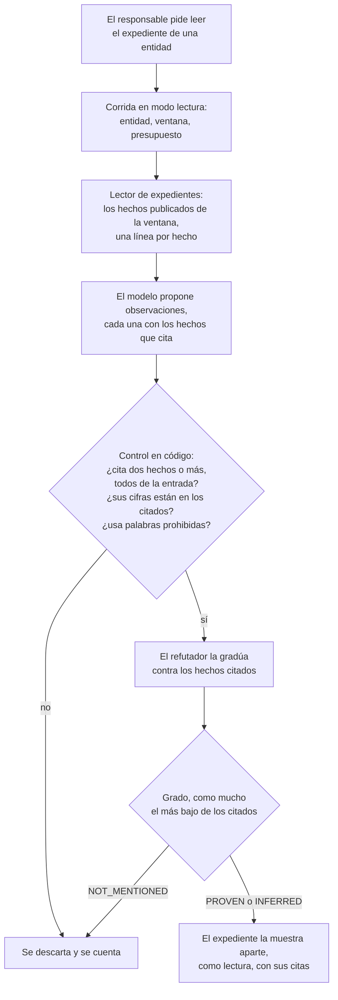

# 0018. Qué puede escribir el modelo cuando lee un expediente entero

- Estado: propuesto
- Fecha: 2026-11-18

## Contexto

El expediente muestra todos los hechos de una entidad a lo largo del tiempo, sin el modelo ([docs/como-se-hizo/expediente.md](../docs/como-se-hizo/expediente.md)). Nadie lo lee entero, y algunas cosas solo se ven así: un objeto que se compra una y otra vez, un llamado que se prorroga en cadena, un proveedor que vuelve. La tarjeta T47 quiere que el modelo las busque, con el expediente en un solo pedido.

Un expediente es grande. En la medición `2026-11-16-2`, el BPS juntó 851 hechos en 78 noches, y una afirmación tiene en promedio unos 150 caracteres. [PROVEN: `banco-de-pruebas/mediciones/2026-11-16-2/salida-de-el-parte.json` y la base de El Parte publicado, 2026-11-18] Noventa días de BPS son unos mil hechos, unos 70.000 tokens. [INFERRED: con unos 220 caracteres por hecho, contando la clave y la fecha]

Hay que resolver cuatro cosas antes del código:

- **Qué puede escribir el modelo** sobre muchos hechos juntos. Lo que sale de juntar hechos no está en ninguna publicación: no lo puede refutar contra la fuente nadie.
- **Cómo se gradúa** una afirmación que sale de varios hechos, sin romper el [ADR 0004](0004-grados-de-evidencia.md): quien interpreta no pone el grado.
- **Qué se guarda** en la base y qué en el repositorio.
- **Cuándo corre y cuánto cuesta.**

## Decisión

Una lectura de expediente es una corrida aparte, en un modo nuevo, que pide quien sigue la entidad. El modelo lee los hechos publicados, propone observaciones que citan hechos, y el refutador las gradúa contra esos hechos:

- **Lo que lee.** Las últimas versiones publicadas de los hechos de la entidad en una ventana, por omisión los últimos 90 días: clave, noche, grado y afirmación, una línea por hecho. No las fuentes, que ya se leyeron y se taparon, y no las versiones rechazadas en la revisión. Si la ventana no entra en el tope de entrada del pedido, se cortan los hechos más viejos y la lectura lo dice.
- **Lo que puede escribir.** Observaciones de cuatro clases: un objeto que se repite, una cadena de cambios de un mismo proceso, un proveedor que vuelve, y "otra". Cada una cita por su clave dos hechos o más. No puede calificar ("irregular", "sospechoso", "favorece"), recomendar ni explicar causas: dice qué se repite, cuántas veces y cuándo.
- **El control en código, antes del refutador.** Cada clave citada tiene que estar en la entrada; cada cifra tiene que estar en las afirmaciones citadas, con la misma comparación del [ADR 0015](0015-que-puede-escribir-el-analista.md); y una lista de palabras de juicio la descarta entera. Lo descartado no se publica y se cuenta en la sala de máquinas.
- **El grado lo pone el refutador.** Le llegan la observación y las afirmaciones citadas, como si fueran la fuente. PROVEN si la observación se lee en esas afirmaciones (tres adjudicaciones al mismo proveedor, contadas); INFERRED si hay que deducirla; NOT_MENTIONED si no sale de ellas, y no se publica. El grado nunca supera al más bajo de los hechos citados: una observación que cita un hecho deducido queda deducida como mucho.
- **Dónde se ve.** En el expediente, en un bloque propio que dice que es una lectura del modelo sobre hechos ya publicados, con la fecha, la ventana, el modelo y el costo, y cada observación con su grado y enlaces a los hechos que cita. No va en la página de la mañana ni en el aviso: no es una noticia de la noche.
- **Qué se guarda.** En la base, cada lectura (entidad, ventana, modelo, costo, la huella de los hechos leídos) y cada observación (clase, texto, grado, claves citadas), y la traza en la sala de máquinas, como cualquier corrida. Se graba y se repite sin red como las corridas de la noche ([ADR 0011](0011-grabacion-y-repeticion-de-corridas.md)). En el repositorio, nada de lo leído: solo el conteo de una medición con su sorteo juzgado.
- **Cuándo corre.** Solo cuando el responsable la pide, desde el expediente, con un presupuesto propio por lectura, por omisión 0,50 USD, con el mismo libro de corrida que corta ([ADR 0005](0005-presupuesto-por-corrida.md)).

## Razones

- Citar hechos por su clave hace que cada observación se pueda controlar: el refutador tiene algo contra qué compararla, y quien lee puede abrir cada hecho citado. Una observación sin citas no se puede refutar. [INFERRED]
- Que gradúe el refutador mantiene la separación del ADR 0004: quien propone no se pone la nota.
- Limitar el grado al más bajo de los citados evita que juntar hechos deducidos produzca algo que parezca probado.
- Leer hechos y no fuentes es más barato, ya está tapado, y es lo que la entidad ya tiene publicado: la lectura no agrega datos, los ordena.
- Pedirla a mano, con presupuesto propio, evita que un pedido de 70.000 tokens corra todas las noches para decir casi lo mismo.

## Alternativas rechazadas

- **Que el modelo gradúe sus observaciones.** Rompe el ADR 0004, y el modelo que encuentra un patrón no es el mejor para dudar de él.
- **Leer todas las noches, después del editor.** Cuesta lo mismo cada noche, y un patrón de 90 días cambia poco de una noche a otra.
- **Darle las fuentes y no los hechos.** Más caro, habría que volver a tapar los datos personales, y las observaciones citarían publicaciones que el parte nunca mostró.
- **Buscar con recuperación por similitud en lugar de contexto largo.** Encuentra hechos parecidos a una pregunta, pero los patrones de T47 son de conjunto: cuántas veces, en qué orden. Queda para si el expediente deja de entrar en un pedido.
- **Publicarlas en la página de la mañana.** Mezclaría hechos de una noche con lecturas de tres meses, con grados que no significan lo mismo.

## Costos

- **Un modo de corrida, un agente y dos tablas nuevos**, y una rama del refutador para graduar contra hechos.
- **Unos 0,30 USD por lectura** del BPS a 90 días con Sonnet 5.5: unos 70.000 tokens de entrada y 3.000 de salida para el lector, y una llamada del refutador por observación. [INFERRED: con los precios de `app/src/main/resources/db/migration/V3__datos_iniciales.sql` y el tamaño estimado, sin medir]
- **Lo que el refutador no ve.** Gradúa la observación contra los hechos citados: si un hecho citado está mal, la observación hereda el error. Y no sabe si faltan hechos que la desmienten.
- **El banco no la mide.** El registro tiene hallazgos de una publicación, no patrones. La precisión se mide juzgando un sorteo de observaciones; la cobertura, por ahora, no.

## Qué la haría reversar

- Que el juicio de un sorteo muestre observaciones que dicen más de lo que los hechos citados sostienen: haría falta un control más, o lecturas más chicas.
- Que el expediente de una entidad deje de entrar en un pedido: se lee por proceso o por clase de hecho, o con recuperación.
- Que casi todas las observaciones salgan NOT_MENTIONED o descartadas: el pedido al modelo está mal planteado.
