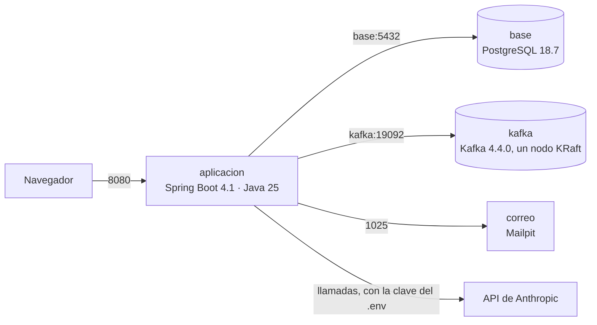

# La aplicación

El código de El Parte: una aplicación Spring Boot donde corren todos los agentes, el observador y la web ([ADR 0003](../adrs/0003-eleccion-del-stack.md)). Hoy tiene la primera rebanada (tablero, T08): una fuente, ARCE, del explorador a la página de la mañana, con la sala de máquinas de cada corrida. Cómo se hizo, qué se probó y qué falló, en [docs/como-se-hizo/primera-rebanada.md](../docs/como-se-hizo/primera-rebanada.md). Cómo se conecta cada pieza, objeto por objeto, en el [tablero de arquitectura](../docs/tablero-de-arquitectura/README.md).

## Levantarla

En la máquina hace falta solo Docker. Desde la raíz del repositorio:

```
docker compose up --build
```

La primera vez baja las imágenes y compila la aplicación dentro de Docker, con Java 25, así que tarda unos minutos. Después quedan:

| Qué | Dónde |
|---|---|
| La aplicación | http://localhost:8080 |
| La página de la mañana de la cuenta de demostración | http://localhost:8080/manana |
| La sala de máquinas: las corridas, y el botón para correr una noche o repetir una corrida | http://localhost:8080/corridas |
| La cola de revisión humana de los hechos INFERRED (D6) | http://localhost:8080/revision |
| Su estado, el de la base y el de Kafka | http://localhost:8080/actuator/health |
| El buzón de prueba de los correos del login | http://localhost:8025 |
| PostgreSQL | `localhost:5432`, base `elparte`. El dueño es `elparte`; la aplicación entra con `elparte_agentes`. |
| Kafka | `localhost:9092` |

La clave del modelo se lee del archivo `.env` de la raíz, que no se versiona (tablero, T14). Sin clave, la aplicación arranca igual: las llamadas al modelo fallan y el refutador gradúa NOT_MENTIONED lo que no pudo revisar.

Las claves de la base tienen valores por omisión para usar en local. Para cambiarlas, se agregan al mismo `.env` antes de la primera vez que arranca la base: `BASE_DUENO_CLAVE` (el dueño), `BASE_CLAVE` (el rol de los agentes) y `BASE_CLAVE_CUENTAS` (el del login). Las de los roles se fijan cuando los crea la migración; cambiarlas después no las cambia en la base.

### Correr una noche

En `/corridas` se elige la noche (por omisión, ayer en hora de Uruguay) y se aprieta "Correr". La corrida lee todas las publicaciones de la noche y del día de margen (unas 700 por día hábil), llama al modelo en el refutador y en el analista, una vez cada uno por compra nueva del BPS, y tarda unos minutos; la página de la corrida muestra cómo avanza al recargarla. Lo que limita el gasto es el presupuesto de cada corrida (`elparte.corrida.costo-maximo-usd`, `pasos-maximos` y `minutos-maximos`, [ADR 0005](../adrs/0005-presupuesto-por-corrida.md)): antes de cada llamada se reserva el peor caso, y si no alcanza la llamada no se hace y la corrida termina cortada. Las compras de la fecha objetivo pasan primero, así lo que queda sin procesar es del día de margen. Por encima está el tope de gasto del espacio de trabajo de la clave (T14). Cuando termina, la página de la mañana muestra lo encontrado. "Repetir" vuelve a correr una corrida terminada desde sus grabaciones, sin red ni costo, y su página dice si los mensajes son idénticos a los de la original ([ADR 0011](../adrs/0011-grabacion-y-repeticion-de-corridas.md)).

Para que corra sola todas las noches se fija `ELPARTE_CORRIDA_CRON` (por ejemplo `0 0 6 * * *`, las 6 de la mañana en Uruguay). Viene apagado hasta que se decida dónde corre la aplicación (T27).

Para apagar todo: `docker compose down`. Para apagar y además borrar los datos de la base y de Kafka: `docker compose down -v`.



## Medir contra el banco

La medición contra el banco de pruebas corre en un Docker Compose aparte, con su propia base y su propio Kafka, que nacen vacíos y no tocan los de todos los días ([adrs/0014-medicion-contra-el-banco.md](../adrs/0014-medicion-contra-el-banco.md)). La aplicación, con el perfil `banco`, corre una corrida por cada noche, en orden, y al terminar deja la salida de El Parte en `banco-de-pruebas/mediciones/<medición>/salida-de-el-parte.json`. Cómo se hizo: [docs/como-se-hizo/medicion-contra-el-banco.md](../docs/como-se-hizo/medicion-contra-el-banco.md).

Usa la clave del modelo del `.env`, así que corre en la máquina que tiene la clave (tablero, T14). Desde la raíz del repositorio, en PowerShell:

```
$env:ELPARTE_BANCO_MEDICION = "2026-11-21-1"
$env:ELPARTE_BANCO_DESDE = "2026-09-17"
$env:ELPARTE_BANCO_HASTA = "2026-09-19"
$env:ELPARTE_COMMIT = git rev-parse --short HEAD
docker compose -p el-parte-banco-2026-11-21-1 -f compose.yaml -f compose.banco.yaml up --build -d
```

En bash es lo mismo con `export ELPARTE_BANCO_MEDICION=2026-11-21-1` y así con cada variable. Las variables se pueden poner también en el `.env`.

| Variable | Qué es |
|---|---|
| `ELPARTE_BANCO_MEDICION` | El nombre de la medición, `AAAA-MM-DD-N`: la fecha en que se mide y un número de orden. Es también el nombre de su carpeta y va en el nombre del proyecto de Compose. |
| `ELPARTE_BANCO_DESDE` y `ELPARTE_BANCO_HASTA` | La primera y la última noche, `AAAA-MM-DD`. El registro va del 2026-08-29 al 2026-11-14 ([banco-de-pruebas/formato.md](../banco-de-pruebas/formato.md)). |
| `ELPARTE_BANCO_COSTO_MAXIMO_USD` | El tope de gasto en el modelo para toda la medición. Por omisión, 5. Al llegar, no se inicia ninguna noche más. |
| `ELPARTE_CORRIDA_COSTO_MAXIMO_USD` y `ELPARTE_CORRIDA_PASOS_MAXIMOS` | El presupuesto de cada noche ([ADR 0005](../adrs/0005-presupuesto-por-corrida.md)). Por omisión, 0,50 USD y 200 llamadas al modelo, los de `app/src/main/resources/application.yaml`. Una noche que no alcanza termina cortada. |
| `ELPARTE_COMMIT` | El commit de El Parte que corre, para la salida. |

Mientras corre:

- **Cómo va:** `docker compose -p el-parte-banco-2026-11-21-1 logs -f aplicacion` muestra cada noche que termina y, al final, dónde quedó la salida. La sala de máquinas de la medición está en http://localhost:8081/corridas.
- **Si se corta:** se vuelve a levantar con el mismo comando y sigue donde quedó: saltea las noches que ya terminaron.
- **Si el modelo falla:** la medición se detiene en la primera noche con llamadas al modelo con error, por ejemplo sin crédito en la API, y no escribe la salida. El registro dice el primer error. Esa noche no se puede volver a correr en la misma base: se corrige la causa y se mide de nuevo con otro nombre.
- **Lo que pide a ARCE:** espera 250 ms antes de cada pedido, y no vuelve a pedir lo que la noche anterior ya leyó.

Cuando termina, la medición se cuenta con el registro y su revisión ([banco-de-pruebas/metricas.md](../banco-de-pruebas/metricas.md)):

```
python herramientas/banco_de_pruebas.py contar banco-de-pruebas/privado banco-de-pruebas/mediciones/2026-11-21-1/salida-de-el-parte.json banco-de-pruebas/mediciones/2026-11-21-1/medicion.json
```

El último argumento es el archivo de la medición, que el conteo escribe en UTF-8. No conviene redirigir con `>`: en Windows PowerShell 5.1 el archivo sale en UTF-16.

Mientras haga falta repetir alguna noche, el Compose de la medición se deja; para borrarlo, con su base y sus grabaciones: `docker compose -p el-parte-banco-2026-11-21-1 -f compose.yaml -f compose.banco.yaml down -v`.

La aplicación de la medición corre como root dentro de su contenedor, para poder escribir la salida en la carpeta del clon también en Linux; la de todos los días sigue con un usuario sin privilegios.

### Crédito de la API

La API de Claude se paga con crédito prepago de la organización de la clave. Sin crédito, cada llamada al modelo falla, y la medición se detiene en la primera noche con errores. Para cargarlo [PROVEN: [centro de ayuda de Claude, "How do I pay for my Claude API usage?"](https://support.claude.com/en/articles/8977456-how-do-i-pay-for-my-claude-api-usage), 2026-11-16]:

1. Entrar a la consola de Claude, <https://platform.claude.com>, con un usuario que tenga el rol Admin o Billing.
2. Abrir la página de facturación, <https://platform.claude.com/settings/billing>.
3. `Buy credits`, poner el monto y confirmar. El crédito queda disponible enseguida, y el saldo se ve en la misma página.

En la misma página, `Set up auto-reload` compra crédito solo cuando el saldo baja de un umbral. El crédito vence un año después de la compra y no se devuelve. Las 78 noches del registro, con el analista y 2 USD por noche, cuestan unos 21 USD. [INFERRED: [docs/como-se-hizo/presupuesto.md](../docs/como-se-hizo/presupuesto.md)] Los mismos pasos están en el botón "Cargar crédito de la API" del kanban.

## Las versiones

Todas fijas, para que dos máquinas levanten lo mismo:

| Pieza | Versión | Fuente |
|---|---|---|
| Spring Boot | 4.1.2 | La última de la línea 4.1. [PROVEN: https://repo1.maven.org/maven2/org/springframework/boot/spring-boot-starter-parent/maven-metadata.xml, 2026-11-14] |
| Spring AI | 2.0.2 | La estable ([docs/verificaciones/spring-ai.md](../docs/verificaciones/spring-ai.md)). La propiedad del modelo es `spring.ai.anthropic.chat.model`; `spring.ai.anthropic.chat.options.model` está marcada como obsoleta. [PROVEN: metadatos de configuración de `spring-ai-autoconfigure-model-anthropic-2.0.2.jar`, 2026-11-14] |
| Spring for Apache Kafka y cliente de Kafka | 4.1.2 y 4.2.2 | Los que trae Spring Boot 4.1.2. [PROVEN: https://repo1.maven.org/maven2/org/springframework/boot/spring-boot-dependencies/4.1.2/spring-boot-dependencies-4.1.2.pom, 2026-11-14] |
| Testcontainers | 2.0.5 | El que trae Spring Boot 4.1.2. [PROVEN: misma fuente] |
| Imagen para compilar | `maven:3.9.13-eclipse-temurin-25` | [PROVEN: Docker Hub, 2026-11-14] |
| Imagen para correr | `eclipse-temurin:25-jre` | [PROVEN: Docker Hub, 2026-11-14] |
| Kafka | `apache/kafka:4.4.0` | La configuración de un nodo sale del ejemplo oficial de Apache Kafka. [PROVEN: https://raw.githubusercontent.com/apache/kafka/trunk/docker/examples/docker-compose-files/single-node/plaintext/docker-compose.yml, 2026-11-14] |
| PostgreSQL | `postgres:18.7` | Desde la 18, la imagen guarda los datos bajo `/var/lib/postgresql`, y ahí se monta el volumen. [PROVEN: `docker image inspect postgres:18.7`, 2026-11-14] |
| Mailpit | `axllent/mailpit:v1.33.1` | [PROVEN: Docker Hub, 2026-11-14] |

En Spring Boot 4, el starter web se llama `spring-boot-starter-webmvc`; `spring-boot-starter-web` sigue existiendo pero está marcado como obsoleto. [PROVEN: descripción del POM de `spring-boot-starter-web` 4.1.2, 2026-11-14]

## Las pruebas

Corren contra un PostgreSQL y un Kafka de verdad, en contenedores, con las mismas imágenes que `compose.yaml`, un ARCE de mentira y un modelo de mentira, con datos inventados. Hace falta Docker y Java 25:

```
cd app
mvn test
```

| Prueba | Qué controla |
|---|---|
| `PrimeraRebanadaTest` | Una noche de punta a punta con el refutador y el analista, su repetición sin red ni modelo con mensajes idénticos, la revisión humana del hecho INFERRED, la misma noche otra vez con todo conocido, que ningún dato personal llegue a la base, y las páginas. Deja una copia de cada página en `target/paginas/`. |
| `banco.MedicionContraElBancoTest` | La medición contra el banco sobre tres noches de octubre: en orden, sin volver a pedir a ARCE lo que la noche anterior ya leyó, la salida con la forma del formato, el salteo de lo ya medido, el tope de gasto y la repetición de una noche del banco. Deja la salida en `target/banco/`. |
| `PermisosDeLaBaseTest` | Cada rol ve solo su esquema y ninguno cambia el esquema. |
| `ElParteAplicacionTest` | La salud de Kafka y los tópicos: uno por tipo de mensaje, con una partición y sin vencimiento. |
| `fuentes.arce.*Test` | La lectura de ARCE con su pausa, el enmascarado y el armado de los candidatos. |
| `analista.AnalistaTest` | El control de lo que escribe el modelo para el analista: una cifra que no está en la evidencia no se usa ([ADR 0015](../adrs/0015-que-puede-escribir-el-analista.md)). |
| `presupuesto.PresupuestoQueCortaTest` | El libro de la corrida con reservas a la vez, y una noche de setiembre que se queda sin presupuesto, se corta y se repite igual. |

Las pruebas grandes comparten la base: cada una cuenta solo lo suyo, la primera rebanada con su noche de noviembre, la medición con sus noches de octubre y el presupuesto con su noche de setiembre, así pasan en cualquier orden.

El verificador de la documentación (`python3 herramientas/verificar_docs.py`, desde la raíz) controla además que la primera migración sea igual al DDL de [docs/base-de-afirmaciones.md](../docs/base-de-afirmaciones.md).

## Qué hay adentro

| Paquete | Qué hace |
|---|---|
| `io.github.andresdiegolanda.elparte` | La clase que arranca la aplicación. |
| `...mensajes` | Los tipos de mensaje y su contenido como `record`, el sobre, el emisor (identificadores deterministas) y el registro de mensajes, donde los agentes buscan y esperan la causa de lo que reciben ([docs/contratos.md](../docs/contratos.md)). |
| `...corrida` | El inicio de una corrida normal, del banco o de una repetición, el cierre, la comparación entre una corrida y su repetición, y la corrida por reloj, apagada por omisión. |
| `...banco` | La medición contra el banco: las noches en orden con su tope de gasto, la salida y el arranque con el perfil `banco` ([ADR 0014](../adrs/0014-medicion-contra-el-banco.md)). |
| `...fuentes.arce` | El lector de la API de ARCE, el enmascarado, el armado de candidatos y el explorador. |
| `...archivista`, `...refutador`, `...analista`, `...editor` | Un agente por paquete. El editor arma además los informes. |
| `...modelo` | El servicio por el que pasan todas las llamadas al modelo: elige el modelo de la corrida, graba la respuesta, o el rechazo por presupuesto, y emite `uso.modelo`. |
| `...presupuesto` | El presupuesto que corta: el advisor del `ChatClient`, el libro de la corrida y la tabla de precios ([ADR 0005](../adrs/0005-presupuesto-por-corrida.md)). |
| `...grabaciones` | Lo que cada corrida leyó de afuera, para repetirla ([ADR 0011](../adrs/0011-grabacion-y-repeticion-de-corridas.md)). |
| `...observador` | Copia cada mensaje al registro de la base. |
| `...infraestructura` | Los tópicos, el reloj, el manejo de errores de los consumidores, las huellas, el registro de lo procesado y `SaludDeKafka`, que agrega la salud de Kafka a `/actuator/health`. |
| `...web` | Las páginas: inicio, mañana, corridas, sala de máquinas y cola de revisión, con plantillas Thymeleaf. |

Las migraciones están en `src/main/resources/db/migration/`: `V1__base.sql` es el DDL de [docs/base-de-afirmaciones.md](../docs/base-de-afirmaciones.md), `V2__roles.sql` crea los dos roles y reparte los permisos, y `V3__datos_iniciales.sql` carga la fuente, el organismo, la cuenta de demostración, los modelos y los precios.
