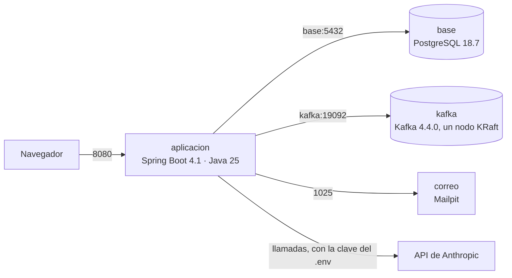

# La aplicación

El código de El Parte: una aplicación Spring Boot donde corren todos los agentes, el observador y la web ([ADR 0003](../adrs/0003-eleccion-del-stack.md)). Hoy tiene la primera rebanada (tablero, T08): una fuente, ARCE, del explorador a la página de la mañana, con la sala de máquinas de cada corrida. Cómo se hizo, qué se probó y qué falló, en [docs/como-se-hizo/primera-rebanada.md](../docs/como-se-hizo/primera-rebanada.md).

## Levantarla

En la máquina hace falta solo Docker. Desde la raíz del repositorio:

```
docker compose up --build
```

La primera vez baja las imágenes y compila la aplicación dentro de Docker, con Java 25, así que tarda unos minutos. Después quedan:

| Qué | Dónde |
|---|---|
| La aplicación | http://localhost:8080 |
| La página de la mañana de la cuenta de demostración | http://localhost:8080/manana |
| La sala de máquinas: las corridas, y el botón para correr una noche o repetir una corrida | http://localhost:8080/corridas |
| Su estado, el de la base y el de Kafka | http://localhost:8080/actuator/health |
| El buzón de prueba de los correos del login | http://localhost:8025 |
| PostgreSQL | `localhost:5432`, base `elparte`. El dueño es `elparte`; la aplicación entra con `elparte_agentes`. |
| Kafka | `localhost:9092` |

La clave del modelo se lee del archivo `.env` de la raíz, que no se versiona (tablero, T14). Sin clave, la aplicación arranca igual: las llamadas al modelo fallan y el refutador gradúa NOT_MENTIONED lo que no pudo revisar.

Las claves de la base tienen valores por omisión para usar en local. Para cambiarlas, se agregan al mismo `.env` antes de la primera vez que arranca la base: `BASE_DUENO_CLAVE` (el dueño), `BASE_CLAVE` (el rol de los agentes) y `BASE_CLAVE_CUENTAS` (el del login). Las de los roles se fijan cuando los crea la migración; cambiarlas después no las cambia en la base.

### Correr una noche

En `/corridas` se elige la noche (por omisión, ayer en hora de Uruguay) y se aprieta "Correr". La corrida lee todas las publicaciones de la noche y del día de margen (unas 700 por día hábil), llama al modelo solo en el refutador, una vez por compra nueva del BPS, y tarda unos minutos; la página de la corrida muestra cómo avanza al recargarla. Mientras no esté el presupuesto que corta (T22), lo que limita el gasto es un tope de 60 candidatos por corrida (`elparte.corrida.maximo-candidatos`) y el tope de gasto del espacio de trabajo de la clave (T14). Cuando termina, la página de la mañana muestra lo encontrado. "Repetir" vuelve a correr una corrida terminada desde sus grabaciones, sin red ni costo, y su página dice si los mensajes son idénticos a los de la original ([ADR 0011](../adrs/0011-grabacion-y-repeticion-de-corridas.md)).

Para que corra sola todas las noches se fija `ELPARTE_CORRIDA_CRON` (por ejemplo `0 0 6 * * *`, las 6 de la mañana en Uruguay). Viene apagado hasta que se decida dónde corre la aplicación (T27).

Para apagar todo: `docker compose down`. Para apagar y además borrar los datos de la base y de Kafka: `docker compose down -v`.



## Las versiones

Todas fijas, para que dos máquinas levanten lo mismo:

| Pieza | Versión | Fuente |
|---|---|---|
| Spring Boot | 4.1.2 | La última de la línea 4.1. [PROVEN: https://repo1.maven.org/maven2/org/springframework/boot/spring-boot-starter-parent/maven-metadata.xml, 2026-11-14] |
| Spring AI | 2.0.2 | La estable ([docs/verificaciones/spring-ai.md](../docs/verificaciones/spring-ai.md)). La propiedad del modelo es `spring.ai.anthropic.chat.model`; `spring.ai.anthropic.chat.options.model` está marcada como obsoleta. [PROVEN: metadatos de configuración de `spring-ai-autoconfigure-model-anthropic-2.0.2.jar`, 2026-11-14] |
| Spring for Apache Kafka y cliente de Kafka | 4.1.2 y 4.2.2 | Los que trae Spring Boot 4.1.2. [PROVEN: https://repo1.maven.org/maven2/org/springframework/boot/spring-boot-dependencies/4.1.2/spring-boot-dependencies-4.1.2.pom, 2026-11-14] |
| Testcontainers | 2.0.5 | El que trae Spring Boot 4.1.2. [PROVEN: misma fuente] |
| Imagen para compilar | `maven:3.9.13-eclipse-temurin-25` | [PROVEN: Docker Hub, 2026-11-14] |
| Imagen para correr | `eclipse-temurin:25-jre` | [PROVEN: Docker Hub, 2026-11-14] |
| Kafka | `apache/kafka:4.4.0` | La configuración de un nodo sale del ejemplo oficial de Apache Kafka. [PROVEN: https://raw.githubusercontent.com/apache/kafka/trunk/docker/examples/docker-compose-files/single-node/plaintext/docker-compose.yml, 2026-11-14] |
| PostgreSQL | `postgres:18.7` | Desde la 18, la imagen guarda los datos bajo `/var/lib/postgresql`, y ahí se monta el volumen. [PROVEN: `docker image inspect postgres:18.7`, 2026-11-14] |
| Mailpit | `axllent/mailpit:v1.33.1` | [PROVEN: Docker Hub, 2026-11-14] |

En Spring Boot 4, el starter web se llama `spring-boot-starter-webmvc`; `spring-boot-starter-web` sigue existiendo pero está marcado como obsoleto. [PROVEN: descripción del POM de `spring-boot-starter-web` 4.1.2, 2026-11-14]

## Las pruebas

Corren contra un PostgreSQL y un Kafka de verdad, en contenedores, con las mismas imágenes que `compose.yaml`, un ARCE de mentira y un modelo de mentira, con datos inventados. Hace falta Docker y Java 25:

```
cd app
mvn test
```

| Prueba | Qué controla |
|---|---|
| `PrimeraRebanadaTest` | Una noche de punta a punta, su repetición sin red ni modelo con mensajes idénticos, la misma noche otra vez con todo conocido, que ningún dato personal llegue a la base, y las páginas. Deja una copia de cada página en `target/paginas/`. |
| `PermisosDeLaBaseTest` | Cada rol ve solo su esquema y ninguno cambia el esquema. |
| `ElParteAplicacionTest` | La salud de Kafka y los tópicos: uno por tipo de mensaje, con una partición y sin vencimiento. |
| `fuentes.arce.*Test` | La lectura de ARCE, el enmascarado y el armado de los candidatos. |

El verificador de la documentación (`python3 herramientas/verificar_docs.py`, desde la raíz) controla además que la primera migración sea igual al DDL de [docs/base-de-afirmaciones.md](../docs/base-de-afirmaciones.md).

## Qué hay adentro

| Paquete | Qué hace |
|---|---|
| `io.github.andresdiegolanda.elparte` | La clase que arranca la aplicación. |
| `...mensajes` | Los tipos de mensaje y su contenido como `record`, el sobre, el emisor (identificadores deterministas) y el registro de mensajes, donde los agentes buscan y esperan la causa de lo que reciben ([docs/contratos.md](../docs/contratos.md)). |
| `...corrida` | El inicio de una corrida normal o de una repetición, el cierre, la comparación entre una corrida y su repetición, y la corrida por reloj, apagada por omisión. |
| `...fuentes.arce` | El lector de la API de ARCE, el enmascarado, el armado de candidatos y el explorador. |
| `...archivista`, `...refutador`, `...analista`, `...editor` | Un agente por paquete. El editor arma además los informes. |
| `...modelo` | El servicio por el que pasan todas las llamadas al modelo: elige el modelo de la corrida, graba la respuesta y emite `uso.modelo`. |
| `...grabaciones` | Lo que cada corrida leyó de afuera, para repetirla ([ADR 0011](../adrs/0011-grabacion-y-repeticion-de-corridas.md)). |
| `...observador` | Copia cada mensaje al registro de la base. |
| `...infraestructura` | Los tópicos, el reloj, el manejo de errores de los consumidores, las huellas, el registro de lo procesado y `SaludDeKafka`, que agrega la salud de Kafka a `/actuator/health`. |
| `...web` | Las páginas: inicio, mañana, corridas y sala de máquinas, con plantillas Thymeleaf. |

Las migraciones están en `src/main/resources/db/migration/`: `V1__base.sql` es el DDL de [docs/base-de-afirmaciones.md](../docs/base-de-afirmaciones.md), `V2__roles.sql` crea los dos roles y reparte los permisos, y `V3__datos_iniciales.sql` carga la fuente, el organismo, la cuenta de demostración, los modelos y los precios.
