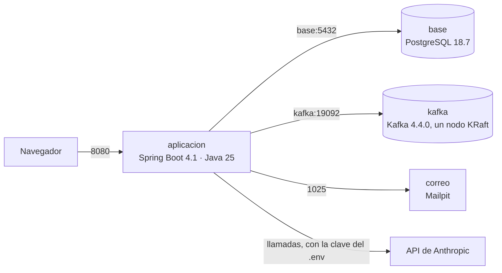

# La aplicación

El código de El Parte: una aplicación Spring Boot donde corren todos los agentes, el observador y la web ([ADR 0003](../adrs/0003-eleccion-del-stack.md)). Se construye con la primera rebanada (tablero, T08). Por ahora es el esqueleto: arranca, se conecta a PostgreSQL y a Kafka, y lo informa.

## Levantarla

En la máquina hace falta solo Docker. Desde la raíz del repositorio:

```
docker compose up --build
```

La primera vez baja las imágenes y compila la aplicación dentro de Docker, con Java 25, así que tarda unos minutos. Después quedan:

| Qué | Dónde |
|---|---|
| La aplicación | http://localhost:8080 |
| Su estado, el de la base y el de Kafka | http://localhost:8080/actuator/health |
| El buzón de prueba de los correos del login | http://localhost:8025 |
| PostgreSQL | `localhost:5432`, base y usuario `elparte` |
| Kafka | `localhost:9092` |

La clave del modelo se lee del archivo `.env` de la raíz, que no se versiona (tablero, T14). Sin clave, la aplicación arranca igual y solo fallan las llamadas al modelo.

Para apagar todo: `docker compose down`. Para apagar y además borrar los datos de la base y de Kafka: `docker compose down -v`.



## Las versiones

Todas fijas, para que dos máquinas levanten lo mismo:

| Pieza | Versión | Fuente |
|---|---|---|
| Spring Boot | 4.1.2 | La última de la línea 4.1. [PROVEN: https://repo1.maven.org/maven2/org/springframework/boot/spring-boot-starter-parent/maven-metadata.xml, 2026-11-14] |
| Spring AI | 2.0.2 | La estable ([docs/verificaciones/spring-ai.md](../docs/verificaciones/spring-ai.md)). La propiedad del modelo es `spring.ai.anthropic.chat.model`; `spring.ai.anthropic.chat.options.model` está marcada como obsoleta. [PROVEN: metadatos de configuración de `spring-ai-autoconfigure-model-anthropic-2.0.2.jar`, 2026-11-14] |
| Spring for Apache Kafka y cliente de Kafka | 4.1.2 y 4.2.2 | Los que trae Spring Boot 4.1.2. [PROVEN: https://repo1.maven.org/maven2/org/springframework/boot/spring-boot-dependencies/4.1.2/spring-boot-dependencies-4.1.2.pom, 2026-11-14] |
| Testcontainers | 2.0.5 | El que trae Spring Boot 4.1.2. [PROVEN: misma fuente] |
| Imagen para compilar | `maven:3.9.13-eclipse-temurin-25` | [PROVEN: Docker Hub, 2026-11-14] |
| Imagen para correr | `eclipse-temurin:25-jre` | [PROVEN: Docker Hub, 2026-11-14] |
| Kafka | `apache/kafka:4.4.0` | La configuración de un nodo sale del ejemplo oficial de Apache Kafka. [PROVEN: https://raw.githubusercontent.com/apache/kafka/trunk/docker/examples/docker-compose-files/single-node/plaintext/docker-compose.yml, 2026-11-14] |
| PostgreSQL | `postgres:18.7` | Desde la 18, la imagen guarda los datos bajo `/var/lib/postgresql`, y ahí se monta el volumen. [PROVEN: `docker image inspect postgres:18.7`, 2026-11-14] |
| Mailpit | `axllent/mailpit:v1.33.1` | [PROVEN: Docker Hub, 2026-11-14] |

En Spring Boot 4, el starter web se llama `spring-boot-starter-webmvc`; `spring-boot-starter-web` sigue existiendo pero está marcado como obsoleto. [PROVEN: descripción del POM de `spring-boot-starter-web` 4.1.2, 2026-11-14]

## Las pruebas

Corren contra un PostgreSQL y un Kafka de verdad, en contenedores, con las mismas imágenes que `compose.yaml`. Hace falta Docker y Java 25:

```
cd app
mvn test
```

## Qué hay adentro

| Paquete | Qué hace |
|---|---|
| `io.github.andresdiegolanda.elparte` | La clase que arranca la aplicación. |
| `...infraestructura` | `SaludDeKafka`: Spring Boot informa la salud de la base pero no la de Kafka; este indicador la agrega en `/actuator/health`. |
| `...web` | La página de inicio. |

Los paquetes de los agentes llegan con la primera rebanada.
