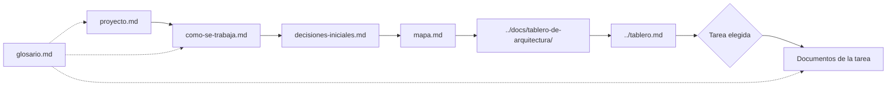

# Arranque

Esta carpeta es lo único que tiene que leer una sesión nueva, de una persona o de un asistente, para trabajar en El Parte. El contexto es el repositorio: no hace falta ninguna conversación previa, y lo que no está escrito acá o en lo que esto enlaza no se da por sabido.

## Qué leer y en qué orden

1. [proyecto.md](proyecto.md): qué es El Parte, para qué existe, qué entra en la versión 0 y qué no, y qué enseña el banco de pruebas.
2. [como-se-trabaja.md](como-se-trabaja.md): las reglas del proyecto llevadas a la práctica. Cómo empieza, avanza y termina una sesión.
3. [decisiones-iniciales.md](decisiones-iniciales.md): lo que ya se decidió y está vigente, aunque todavía no tenga su ADR.
4. [mapa.md](mapa.md): qué hay en cada carpeta del repositorio y qué va a haber.
5. [El tablero de arquitectura](../docs/tablero-de-arquitectura/README.md): el sistema objeto por objeto, construido y diseñado. Refleja la arquitectura en todo momento: se cambia en el mismo momento que el sistema, y los pedidos citan sus objetos (regla 13). Está publicado en <https://andresdiegolanda.github.io/el-parte/docs/tablero-de-arquitectura/>.
6. [../tablero.md](../tablero.md): qué está en curso, qué falta y de quién es cada cosa, en tarjetas. La próxima tarea es la primera de "Para empezar". Se ve como kanban, de solo lectura, en <https://andresdiegolanda.github.io/el-parte/kanban/>.
7. [glosario.md](glosario.md): los términos técnicos. Se consulta cuando aparece uno que no conocés.

Después de eso, cada tarea del tablero enlaza a los documentos que necesita. El [mapa](mapa.md) dice dónde está cada uno.

## Estado en una línea

Spring AI y las fuentes verificados (T09 y T10), los ADRs 0002 a 0017 aceptados (T19, T31, T32, T36, T37, T21, T41 y T45), con IMPO como quinta fuente, y el registro del banco de pruebas entregado (T11). La arquitectura está en [docs/arquitectura.md](../docs/arquitectura.md) (T02). Los contratos entre agentes están en [docs/contratos.md](../docs/contratos.md) (T03). El modelo de la base está en [docs/base-de-afirmaciones.md](../docs/base-de-afirmaciones.md) (T04). El plan está en [docs/plan.md](../docs/plan.md) (T07). La primera rebanada (T08) anda de punta a punta, con una fuente (ARCE), y se repite sin red ni costo ([docs/como-se-hizo/primera-rebanada.md](../docs/como-se-hizo/primera-rebanada.md)), con las corridas grabadas en la base ([ADR 0011](../adrs/0011-grabacion-y-repeticion-de-corridas.md)). El sistema, objeto por objeto, está en el [tablero de arquitectura](../docs/tablero-de-arquitectura/README.md), que el verificador compara con el código ([ADR 0012](../adrs/0012-tablero-de-arquitectura.md)). El acceso, el perfil y el parte diario de cada usuario están diseñados ([ADR 0013](../adrs/0013-acceso-perfil-y-parte-diario.md)) y se ven en su vista del tablero de arquitectura, <https://andresdiegolanda.github.io/el-parte/docs/tablero-de-arquitectura/usuarios.html>; T25 y T34 están hechas, y sigue T35. El formato del banco de pruebas, su muestra sintética y sus métricas están en [`banco-de-pruebas/`](../banco-de-pruebas/README.md) (T12). La medición de la rebanada contra el banco (T20) corre en un Docker Compose aparte, noche por noche ([ADR 0014](../adrs/0014-medicion-contra-el-banco.md), [docs/como-se-hizo/medicion-contra-el-banco.md](../docs/como-se-hizo/medicion-contra-el-banco.md)), y ya corrió las 78 noches del registro en la máquina del responsable, que tiene la clave; falta confirmar la revisión. El analista escribe con el modelo qué dice, por qué importa y qué mirar ([ADR 0015](../adrs/0015-que-puede-escribir-el-analista.md), [docs/como-se-hizo/analista.md](../docs/como-se-hizo/analista.md)), y el presupuesto que corta reserva el peor caso de cada llamada y corta la corrida si no alcanza ([docs/como-se-hizo/presupuesto.md](../docs/como-se-hizo/presupuesto.md)), los dos medidos contra el banco (T21 y T22). La cola de revisión humana de los hechos INFERRED está en la sala de máquinas ([docs/como-se-hizo/revision.md](../docs/como-se-hizo/revision.md), T23), y se entra con un enlace de correo: correr y revisar son solo del responsable ([docs/como-se-hizo/login.md](../docs/como-se-hizo/login.md), T25). En su perfil, cada invitado elige qué organismos seguir y si quiere el aviso diario ([docs/como-se-hizo/perfil.md](../docs/como-se-hizo/perfil.md), T34). Se publica desde la máquina del responsable, con un túnel de Cloudflare y el correo por Resend ([ADR 0016](../adrs/0016-despliegue-en-la-maquina-del-responsable.md), [docs/como-se-hizo/despliegue.md](../docs/como-se-hizo/despliegue.md)), y el responsable ya entró desde afuera (T40). La forma de trabajo se alivianó con el [ADR 0017](../adrs/0017-forma-de-trabajo-mas-liviana.md): un solo lugar por dato, un ritual según el tamaño del cambio, tableros publicados en GitHub Pages y pruebas de noche (T45). Esa forma de trabajo, separada del proyecto para usarla en otro, está en [`metodologia/`](../metodologia/README.md) (T46). El detalle está en el [tablero](../tablero.md).

Esta línea se actualiza en cada entrega.

## Si algo no cierra

Si un documento contradice a otro, o al código, no se elige en silencio: se anota en el tablero, se corrige el que está mal y se deja constancia en el [CHANGELOG](../CHANGELOG.md). Si falta algo para poder trabajar, eso también es un pendiente del tablero, con dueño.
