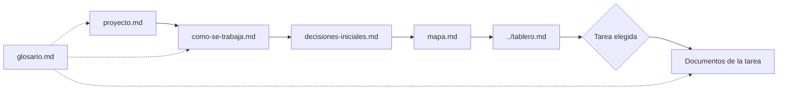

# Arranque

Esta carpeta es lo único que tiene que leer una sesión nueva, de una persona o de un asistente, para trabajar en El Parte. El contexto es el repositorio: no hace falta ninguna conversación previa, y lo que no está escrito acá o en lo que esto enlaza no se da por sabido.

## Qué leer y en qué orden

1. [proyecto.md](proyecto.md): qué es El Parte, para qué existe, qué entra en la versión 0 y qué no, y qué enseña el banco de pruebas.
2. [como-se-trabaja.md](como-se-trabaja.md): las reglas del proyecto llevadas a la práctica. Cómo empieza, avanza y termina una sesión.
3. [decisiones-iniciales.md](decisiones-iniciales.md): lo que ya se decidió y está vigente, aunque todavía no tenga su ADR.
4. [mapa.md](mapa.md): qué hay en cada carpeta del repositorio y qué va a haber.
5. [../tablero.md](../tablero.md): qué está en curso, qué falta y de quién es cada cosa, en tarjetas. La próxima tarea es la primera de "Para empezar". La misma información, como kanban, está en [../kanban/index.html](../kanban/index.html).
6. [glosario.md](glosario.md): los términos técnicos. Se consulta cuando aparece uno que no conocés.

Después de eso, cada tarea del tablero enlaza a los documentos que necesita. El [mapa](mapa.md) dice dónde está cada uno.

## Estado en una línea

Spring AI y las fuentes verificados (T09 y T10), y seis ADRs propuestos esperando revisión (T19). La arquitectura está en [docs/arquitectura.md](../docs/arquitectura.md) (T02). Los contratos entre agentes están en [docs/contratos.md](../docs/contratos.md) (T03). El modelo de la base está en [docs/base-de-afirmaciones.md](../docs/base-de-afirmaciones.md) (T04). El plan está en [docs/plan.md](../docs/plan.md) (T07). Lo próximo es la primera rebanada (T08), que espera la revisión de los ADRs (T19), la clave del proveedor (T14) y el registro del banco (T11). El detalle está en el [tablero](../tablero.md).

Esta línea se actualiza en cada entrega.

## Si algo no cierra

Si un documento contradice a otro, o al código, no se elige en silencio: se anota en el tablero, se corrige el que está mal y se deja constancia en el [CHANGELOG](../CHANGELOG.md). Si falta algo para poder trabajar, eso también es un pendiente del tablero, con dueño.
