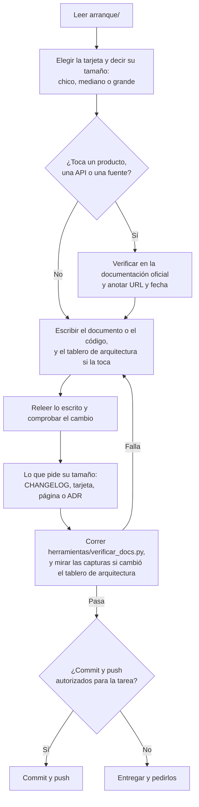

# Cómo se trabaja

Las catorce reglas están en el [README](../README.md). Acá está cómo se cumplen en una sesión de trabajo, sea de una persona o de un asistente.

## El ciclo de una sesión



## Al empezar

1. Traer la última versión del repositorio.
2. Leer la carpeta `arranque/` en el orden de su [README](README.md).
3. Abrir el [tablero de arquitectura](../docs/tablero-de-arquitectura/README.md) y ubicar los objetos que toca el trabajo. Si el pedido los cita (`arquitectura: <id>`), se parte de ahí.
4. Elegir la tarjeta en el [tablero](../tablero.md): la primera de "Para empezar", salvo que haya un motivo para otra. Si lo que hay que hacer no está en el tablero, primero se agrega la tarjeta, con dueño.
5. Decir su tamaño (ver "El tamaño de cada cambio") y si el responsable autoriza commit y push al terminar.
6. Mover su bloque a "En curso" y anotar en su registro el tamaño y, si la hay, la autorización.

## Mientras se trabaja

### Grados de evidencia en los documentos (regla 2)

Toda afirmación técnica lleva su grado entre corchetes, al final de la frase o del punto:

- `[PROVEN: <URL o comprobación>, <fecha>]`: está verificado. La fuente es la documentación oficial (con su URL) o una comprobación hecha y descrita (un comando que se corrió y lo que devolvió).
- `[INFERRED: <de qué se deduce>]`: se deduce de algo verificado, pero no se comprobó directamente.
- `[ASSUMED]`: es un supuesto de trabajo. Todo ASSUMED que sostenga una decisión tiene una tarea en el tablero para verificarlo.

Ejemplo:

> En el espacio de trabajo en la nube, el daemon de Docker no arranca solo y hay que levantarlo a mano. [PROVEN: `docker info` falló por falta de daemon y `docker run --rm hello-world` anduvo después de levantar `dockerd`, 2026-11-07]

Cuando una sección entera tiene el mismo grado y la misma fuente, se dice una vez al principio de la sección.

Ojo con un nombre parecido: los agentes también ponen grados a los hechos que encuentran (PROVEN, INFERRED, NOT_MENTIONED). Son las mismas palabras con otro alcance: unos califican lo que dicen los documentos del proyecto, los otros califican lo que dicen las fuentes del Estado. Los dos usos están en el [glosario](glosario.md).

### El tablero de arquitectura (regla 13)

El [tablero de arquitectura](../docs/tablero-de-arquitectura/README.md) refleja el sistema con precisión y exactitud en todo momento ([ADR 0012](../adrs/0012-tablero-de-arquitectura.md)). En la práctica:

- **Se cambia en el mismo momento que el sistema.** Si un cambio del código o del diseño toca la arquitectura (un agente, un servicio, un tópico, una tabla, una página, una conexión entre ellos, o algo que pasa de diseñado a construido), en el mismo cambio se edita `docs/tablero-de-arquitectura/sistema.json` y se suma una entrada a su historial. No hay "después lo actualizo".
- **Los pedidos lo citan.** Un pedido nombra los objetos por su referencia, que la ficha de cada objeto deja copiar: `arquitectura: refutador`, `arquitectura: refutador>modelo`. Así no hay dudas sobre de qué pieza se habla.
- **El verificador lo compara con el código.** Si una clase nueva no está en ningún objeto, si falta o sobra una flecha, si una página atiende otras rutas o si algo diseñado ya se construyó, el verificador falla y dice qué corregir.
- **Se mira antes de subir.** `python3 herramientas/generar_tablero_arquitectura.py` genera las páginas en `docs/tablero-de-arquitectura/`, donde git las ignora, y `herramientas/pruebas/prueba_tablero_arquitectura.mjs` las abre en Chrome: falla si dos cajas se pisan, si una caja se sale de su franja o si una etiqueta queda encima de otra cosa, y deja una captura de cada vista en `tmp/capturas/`. Un cambio de `sistema.json` no se sube sin mirar esas capturas ([ADR 0017](../adrs/0017-forma-de-trabajo-mas-liviana.md)).
- **Lo que ni el verificador ni las capturas muestran se revisa a mano**: los textos de cada objeto, los recorridos y las llamadas afuera. Se releen en cada cambio que toque esos objetos.

### Nada de memoria

Lo que se afirma sobre un producto (Spring AI, PostgreSQL, el sistema de mensajería), una API o una fuente del Estado se contrasta con la documentación oficial antes de escribirlo, y se anota la URL y la fecha de consulta. Lo que se sabía de antes no cuenta como fuente.

Al verificar una fuente del Estado, primero se leen sus términos de uso y su robots.txt, y recién después se hace la primera consulta. Esta práctica sale de un error: en la verificación de las fuentes se consultó el sitio del BPS antes de leer sus términos, que prohíben la consulta automática ([docs/fuentes/bps.md](../docs/fuentes/bps.md)).

### Decisiones (regla 3)

Toda decisión significativa es un ADR (registro de decisión de arquitectura) en `adrs/`, con nombre `NNNN-titulo-corto.md` y número correlativo. Cada ADR tiene estas secciones:

```markdown
# NNNN. Título

- Estado: propuesto | aceptado | reemplazado por NNNN
- Fecha: AAAA-MM-DD

## Contexto
Qué problema hay y qué lo condiciona.

## Decisión
Qué se decidió, en una o dos frases.

## Razones
Por qué, con grados de evidencia.

## Alternativas rechazadas
Cada una con el motivo.

## Costos
Lo que se paga por esta decisión.

## Qué la haría reversar
La señal concreta que obligaría a revisarla.
```

Un ADR aceptado no se edita: si cambia la decisión, se escribe uno nuevo que lo reemplaza y el viejo pasa a "reemplazado por".

El índice está en [`adrs/README.md`](../adrs/README.md). Las decisiones de arranque que todavía no tienen ADR están en [decisiones-iniciales.md](decisiones-iniciales.md), y el tablero dice cuáles tienen que pasar a ADR.

### Diagramas (regla 5)

- Flujos, secuencias y estados: Mermaid dentro del Markdown.
- Láminas de arquitectura: SVG generado desde una fuente JSON en `docs/laminas/` con `python3 herramientas/generar_laminas.py`. El SVG nunca se edita a mano, y el verificador falla si una lámina no coincide con lo que genera su fuente o si un SVG no tiene fuente.

### La página "cómo se hizo" de cada componente (regla 6)

Cada componente tiene su página en `docs/como-se-hizo/<componente>.md` con seis secciones: qué hace, por qué existe, cómo se construyó, qué se probó, qué falló y qué se cambió. Lo que falló se escribe con el mismo cuidado que lo que anduvo: qué se esperaba, qué pasó, cómo se detectó y qué se cambió.

### Estilo (regla 7)

- Español rioplatense, con voseo. La única excepción es el texto de [`LICENSE`](../LICENSE), que queda en inglés porque es el que tiene validez legal.
- Sin guiones largos en ningún archivo. El verificador lo controla. Para cortar una frase se usan dos puntos, coma, punto o paréntesis.
- Cada término técnico se explica la primera vez que aparece en un documento, o se enlaza al [glosario](glosario.md). Si el término no está en el glosario, se agrega.
- En el código, los nombres van en español sin tildes ni eñes (`Afirmacion`, `explorador.candidatos`), salvo lo que imponga cada framework (decisión D7).
- Los documentos versionados describen decisiones y objetivos del proyecto, no conversaciones entre quienes trabajan en él.

### Datos (regla 11)

Sin datos personales en la base ni en la demo. Solo fuentes públicas y datos sintéticos para las pruebas. Cómo se tratan los nombres de personas que aparecen en las fuentes y los correos de los usuarios está en [decisiones-iniciales.md](decisiones-iniciales.md) (D3).

### Un solo lugar por dato

Cada cifra, valor o decisión vive en un solo documento, y los demás lo enlazan sin repetirlo ([ADR 0017](../adrs/0017-forma-de-trabajo-mas-liviana.md)): el resultado de una medición, en su sección de `docs/como-se-hizo/medicion-contra-el-banco.md`; un valor decidido, en su ADR; el estado de una tarea, en su tarjeta; cómo se construyó algo, en su página "cómo se hizo". La nota de arriba del tablero, los README y el plan dicen dónde mirar. `CHANGELOG.md`, los ADRs, las decisiones iniciales y el registro y las tarjetas hechas del tablero son historia: cuentan qué pasó, con las cifras de su momento. El verificador avisa, sin fallar, cuando la misma cifra con unidad aparece en más de un documento vigente; si es el mismo dato, se deja en su lugar y los demás lo enlazan.

### El tamaño de cada cambio

| Tamaño | Qué es | Qué lleva |
|---|---|---|
| Chico | Un arreglo, un texto, un valor de configuración. No cambia contratos, decisiones ni la arquitectura. | Commit y una línea en `CHANGELOG.md`. Si es parte de una tarjeta, una línea en su registro. |
| Mediano | Un componente nuevo o un cambio de comportamiento dentro de lo decidido. | Lo del chico, más la tarjeta con sus etapas, la página "cómo se hizo" y, si toca la arquitectura, el tablero de arquitectura con sus capturas (regla 13). |
| Grande | Cambia una decisión, un contrato o la forma de trabajo. | Lo del mediano, más un ADR aceptado antes del código. |

La sesión dice el tamaño al empezar, y el responsable lo puede cambiar.

### El tablero y el kanban (regla 8)

[`tablero.md`](../tablero.md) es lo que manda sobre lo pendiente. Cada pendiente es una tarjeta: un bloque `###` debajo de la columna en la que está. El propio tablero explica el formato, los tipos con sus etapas y las reglas de cada columna.

- Mover una tarjeta es mover su bloque a otra columna y sumar una línea a su registro.
- `tablero.md` tiene que estar en formato canónico: leerlo y volver a escribirlo con `herramientas/tablero_md.py` da el mismo archivo. El verificador lo controla.
- El kanban es una vista de solo lectura de `tablero.md` ([ADR 0017](../adrs/0017-forma-de-trabajo-mas-liviana.md)), publicada en <https://andresdiegolanda.github.io/el-parte/kanban/>. Las tarjetas se cambian en `tablero.md`; el diseño, en `kanban/plantilla.html`. Para verlo en una sesión, `python3 herramientas/generar_kanban.py` lo genera en `kanban/index.html`, que no se versiona. Su prueba en Chrome es `herramientas/pruebas/prueba_kanban.mjs` (necesita Puppeteer, que viene con mermaid-cli).

### Lo publicado y la integración continua

Dos workflows de GitHub Actions, en `.github/workflows/` ([ADR 0017](../adrs/0017-forma-de-trabajo-mas-liviana.md)):

- **`publicar.yml`**, en cada push a `main`: `herramientas/armar_sitio.py` genera el kanban y el tablero de arquitectura y los publica en GitHub Pages, en <https://andresdiegolanda.github.io/el-parte/>, con un enlace a la aplicación publicada. Esa dirección no va en el repositorio: es la variable `URL_DE_LA_APLICACION` del repositorio en GitHub Actions ([ADR 0016](../adrs/0016-despliegue-en-la-maquina-del-responsable.md)). No corre pruebas.
- **`pruebas.yml`**, todas las noches si `main` cambió en el último día, y a demanda: el verificador, las pruebas de Python y de Chrome de `herramientas/pruebas/` y `mvn test` de `app/`. Deja las capturas del tablero de arquitectura como artefacto de la corrida. No usa secretos: las pruebas no llaman al modelo.

### Nada se borra (regla 9)

Lo que sobra se mueve a [`obsoletos/`](../obsoletos/README.md), manteniendo su ruta relativa debajo de esa carpeta, y se anota en el índice de `obsoletos/README.md`: qué era, cuándo se movió, por qué y qué lo reemplaza.

### Lo temporal (regla 14)

Todo lo temporal de una sesión va en `tmp/`, en la raíz del clon, sea el de la máquina del responsable o el de un espacio de trabajo en la nube. La carpeta está en `.gitignore` y el verificador no la revisa.

- **Va en `tmp/`:** los parches, los registros de arranque de la aplicación y de las mediciones, las capturas de pantalla y las del tablero de arquitectura (`tmp/capturas/`), el sitio armado para mirarlo (`tmp/sitio/`), las copias locales de una medición, los scripts de un solo uso y las listas o tablas para mirar, como `tmp/mejoras.md`.
- **No va en `tmp/`, porque tiene su lugar:** los secretos, en `.env`; el registro del banco de pruebas, en `banco-de-pruebas/privado/` (D2); los respaldos de la base publicada, en `respaldos/` ([ADR 0016](../adrs/0016-despliegue-en-la-maquina-del-responsable.md)), y lo que las herramientas generan donde lo esperan, como `app/target/` y `__pycache__/`.
- **Lo que está en `tmp/` se puede volver a armar o ya no hace falta.** Lo que se aprende o se decide pasa al repositorio. Por eso la regla 9 no alcanza a `tmp/`: se puede vaciar cuando lo que tiene ya no sirve.
- **Una herramienta que necesita una carpeta temporal propia** usa la del sistema y la borra al terminar, como `herramientas/verificar_docs.py` y las pruebas de `herramientas/pruebas/`.

### Releer (regla 12)

Después de cada escritura se relee el archivo y se comprueba que el cambio quedó como se quería. Antes de entregar se corre el verificador:

```sh
python3 herramientas/verificar_docs.py
```

Controla que no haya guiones largos, que los enlaces relativos de los Markdown apunten a archivos que existen, que el tablero respete su formato y sus reglas, que el kanban y el tablero de arquitectura se puedan generar, que las láminas coincidan con sus fuentes, que toda tarjeta o decisión citada exista, que cada diagrama Mermaid se pueda dibujar, que la primera migración sea igual al DDL del documento de la base y que el tablero de arquitectura coincida con el código. Si algo falla, termina con código 1 y dice dónde.

Para dibujar los diagramas usa mermaid-cli (el programa `mmdc`), que busca en la variable de entorno `MMDC` o en el `PATH`. Si no lo encuentra, avisa y sigue; con `EXIGIR_MERMAID=1` falla. Los diagramas que ya pasaron se guardan por su hash en `tmp/mermaid-verificados.txt`, que no se versiona, así que las corridas siguientes son instantáneas.

## Al terminar

Lo que lleva cada cambio depende de su tamaño (ver "El tamaño de cada cambio"). Lo que corresponda de esta lista:

1. Una entrada corta en el [CHANGELOG](../CHANGELOG.md): qué cambió, dónde, y el enlace al documento que tiene el porqué.
2. El [tablero](../tablero.md) al día: la tarjeta en su columna, con sus etapas, su lista y su registro, y una tarjeta nueva por cada cosa que quedó pendiente.
3. Si se tomó una decisión significativa, su ADR.
4. Si el trabajo tocó la arquitectura, el [tablero de arquitectura](../docs/tablero-de-arquitectura/README.md) al día, con su entrada en el historial (regla 13).
5. Si el trabajo enseñó algo que contradice un documento, se corrige el documento (regla 1).
6. La línea de estado de [arranque/README.md](README.md) al día, y la etiqueta "estado" del [README](../README.md) si cambió la fase del proyecto.

### Commits

Commit y push se autorizan por tarea ([ADR 0017](../adrs/0017-forma-de-trabajo-mas-liviana.md)): al empezar, el responsable del proyecto dice si la tarea incluye commit y push al terminar, y se anota en el registro de su tarjeta. Con esa autorización, la sesión hace commit y push al terminar, sin volver a pedirlos. Sin ella, no se hacen commits ni push sin un pedido explícito. Los mensajes van en español: una primera línea corta con qué cambió y, si hace falta, un cuerpo que enlace al documento con el porqué.

## Entorno de trabajo

- El repositorio vive en <https://github.com/andresdiegolanda/el-parte>. La rama principal es `main`.
- mermaid-cli se instala con `npm install -g @mermaid-js/mermaid-cli` y necesita un Chrome; si no encuentra uno, se le indica con la variable `PUPPETEER_EXECUTABLE_PATH`. En el espacio de trabajo en la nube usado el 2026-11-07 ya estaba instalado. [PROVEN: el verificador dibujó los 13 diagramas del repositorio, 2026-11-07]
- El código está en `app/` y se levanta con `docker compose up --build` desde la raíz; las versiones y los puertos están en [app/README.md](../app/README.md). En la máquina hace falta solo Docker.
- En un espacio de trabajo en la nube con Java 21, el JDK 25 se saca de su imagen oficial: `docker create --name jdk25 eclipse-temurin:25-jdk`, `sudo docker cp jdk25:/opt/java/openjdk /opt/jdk25` y `docker rm jdk25`; después, `JAVA_HOME=/opt/jdk25` para Maven. [PROVEN: comprobado el 2026-11-14]
- En esos espacios, lo que corre dentro de `docker build` no pasa por el proxy de salida ni confía en su certificado, así que la compilación de Maven de `app/Dockerfile` falla. Para probarla ahí se usa una copia en `tmp/` que suma el almacén de certificados del sistema y el proxy, con `docker buildx build --load --network host --build-context sistema=/etc/ssl/certs/java -f tmp/nube/Dockerfile -t el-parte-aplicacion:nube app`, y un `tmp/compose.nube.yaml` que usa esa imagen. En una máquina común, `app/Dockerfile` anda tal cual. [PROVEN: comprobado el 2026-11-14] Para la medición contra el banco se suma `-f tmp/compose.nube.yaml` después de `-f compose.banco.yaml`. Desde los contenedores de esos espacios ARCE no se alcanza, así que las noches terminan con la fuente fallida: sirve para probar el armado, no para medir. [PROVEN: dos mediciones de prueba, 2026-11-15]
- En un espacio de trabajo en la nube puede pasar que Docker esté instalado pero sin el daemon andando. Se levanta con `sudo dockerd > /tmp/dockerd.log 2>&1 &` y se prueba con `docker run --rm hello-world`. [PROVEN: comprobado en un espacio de trabajo en la nube con Docker 29.9.2 y Java 21, 2026-11-07] En esos espacios los procesos que quedan en segundo plano pueden no sobrevivir entre una sesión y otra, así que se vuelve a levantar cuando haga falta. [ASSUMED]
