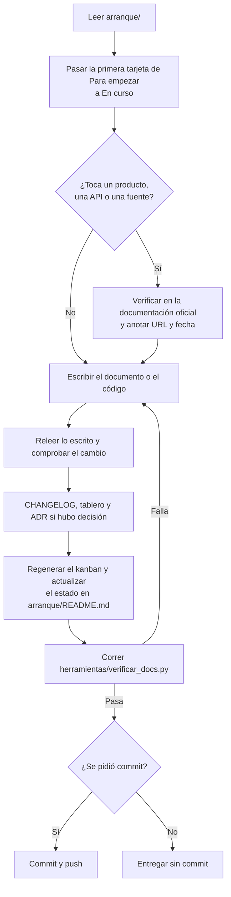

# Cómo se trabaja

Las doce reglas están en el [README](../README.md). Acá está cómo se cumplen en una sesión de trabajo, sea de una persona o de un asistente.

## El ciclo de una sesión



## Al empezar

1. Traer la última versión del repositorio.
2. Leer la carpeta `arranque/` en el orden de su [README](README.md).
3. Elegir la tarjeta en el [tablero](../tablero.md): la primera de "Para empezar", salvo que haya un motivo para otra. Si lo que hay que hacer no está en el tablero, primero se agrega la tarjeta, con dueño.
4. Mover su bloque a "En curso" y anotarlo en su registro.

## Mientras se trabaja

### Grados de evidencia en los documentos (regla 2)

Toda afirmación técnica lleva su grado entre corchetes, al final de la frase o del punto:

- `[PROVEN: <URL o comprobación>, <fecha>]`: está verificado. La fuente es la documentación oficial (con su URL) o una comprobación hecha y descrita (un comando que se corrió y lo que devolvió).
- `[INFERRED: <de qué se deduce>]`: se deduce de algo verificado, pero no se comprobó directamente.
- `[ASSUMED]`: es un supuesto de trabajo. Todo ASSUMED que sostenga una decisión tiene una tarea en el tablero para verificarlo.

Ejemplo:

> En el espacio de trabajo en la nube, el daemon de Docker no arranca solo y hay que levantarlo a mano. [PROVEN: `docker info` falló por falta de daemon y `docker run --rm hello-world` anduvo después de levantar `dockerd`, 2026-11-07]

Cuando una sección entera tiene el mismo grado y la misma fuente, se dice una vez al principio de la sección.

Ojo con un nombre parecido: los agentes también ponen grados a los hechos que encuentran (PROVEN, INFERRED, "las fuentes no lo mencionan"). Son las mismas palabras con otro alcance: unos califican lo que dicen los documentos del proyecto, los otros califican lo que dicen las fuentes del Estado. Los dos usos están en el [glosario](glosario.md).

### Nada de memoria

Lo que se afirma sobre un producto (Spring AI, PostgreSQL, el sistema de mensajería), una API o una fuente del Estado se contrasta con la documentación oficial antes de escribirlo, y se anota la URL y la fecha de consulta. Lo que se sabía de antes no cuenta como fuente.

Al verificar una fuente del Estado, primero se leen sus términos de uso y su robots.txt, y recién después se hace la primera consulta. Esta práctica sale de un error: en la verificación de las fuentes se consultó el sitio del BPS antes de leer sus términos, que prohíben la consulta automática ([docs/fuentes/bps.md](../docs/fuentes/bps.md)).

### Decisiones (regla 3)

Toda decisión significativa es un ADR (registro de decisión de arquitectura) en `adrs/`, con nombre `NNNN-titulo-corto.md` y número correlativo. Cada ADR tiene estas secciones:

```markdown
# NNNN. Título

- Estado: propuesto | aceptado | reemplazado por NNNN
- Fecha: AAAA-MM-DD

## Contexto
Qué problema hay y qué lo condiciona.

## Decisión
Qué se decidió, en una o dos frases.

## Razones
Por qué, con grados de evidencia.

## Alternativas rechazadas
Cada una con el motivo.

## Costos
Lo que se paga por esta decisión.

## Qué la haría reversar
La señal concreta que obligaría a revisarla.
```

Un ADR aceptado no se edita: si cambia la decisión, se escribe uno nuevo que lo reemplaza y el viejo pasa a "reemplazado por".

El índice está en [`adrs/README.md`](../adrs/README.md). Las decisiones de arranque que todavía no tienen ADR están en [decisiones-iniciales.md](decisiones-iniciales.md), y el tablero dice cuáles tienen que pasar a ADR.

### Diagramas (regla 5)

- Flujos, secuencias y estados: Mermaid dentro del Markdown.
- Láminas de arquitectura: SVG generado desde una fuente JSON en `docs/laminas/` con `python3 herramientas/generar_laminas.py`. El SVG nunca se edita a mano, y el verificador falla si una lámina no coincide con lo que genera su fuente o si un SVG no tiene fuente.

### La página "cómo se hizo" de cada componente (regla 6)

Cada componente tiene su página en `docs/como-se-hizo/<componente>.md` con seis secciones: qué hace, por qué existe, cómo se construyó, qué se probó, qué falló y qué se cambió. Lo que falló se escribe con el mismo cuidado que lo que anduvo: qué se esperaba, qué pasó, cómo se detectó y qué se cambió.

### Estilo (regla 7)

- Español rioplatense, con voseo. La única excepción es el texto de [`LICENSE`](../LICENSE), que queda en inglés porque es el que tiene validez legal.
- Sin guiones largos en ningún archivo. El verificador lo controla. Para cortar una frase se usan dos puntos, coma, punto o paréntesis.
- Cada término técnico se explica la primera vez que aparece en un documento, o se enlaza al [glosario](glosario.md). Si el término no está en el glosario, se agrega.
- En el código, los nombres van en español sin tildes ni eñes (`Afirmacion`, `explorador.candidatos`), salvo lo que imponga cada framework (decisión D7).
- Los documentos versionados describen decisiones y objetivos del proyecto, no conversaciones entre quienes trabajan en él.

### Datos (regla 11)

Sin datos personales en la base ni en la demo. Solo fuentes públicas y datos sintéticos para las pruebas. Cómo se tratan los nombres de personas que aparecen en las fuentes y los correos de los usuarios está en [decisiones-iniciales.md](decisiones-iniciales.md) (D3).

### El tablero y el kanban (regla 8)

[`tablero.md`](../tablero.md) es la única fuente de lo pendiente ([ADR 0001](../adrs/0001-tablero-fuente-unica-kanban-generado.md)). Cada pendiente es una tarjeta: un bloque `###` debajo de la columna en la que está. El propio tablero explica el formato, los tipos con sus etapas y las reglas de cada columna.

- Mover una tarjeta es mover su bloque a otra columna y sumar una línea a su registro.
- Después de tocar el tablero se regenera el kanban con `python3 herramientas/generar_kanban.py`. `kanban/index.html` no se edita a mano: lo que se cambia a mano es `kanban/plantilla.html` (el diseño) o `tablero.md` (el contenido).
- Si hay una copia publicada del kanban, se vuelve a publicar desde `kanban/index.html`.

### Nada se borra (regla 9)

Lo que sobra se mueve a [`obsoletos/`](../obsoletos/README.md), manteniendo su ruta relativa debajo de esa carpeta, y se anota en el índice de `obsoletos/README.md`: qué era, cuándo se movió, por qué y qué lo reemplaza.

### Releer (regla 12)

Después de cada escritura se relee el archivo y se comprueba que el cambio quedó como se quería. Antes de entregar se corre el verificador:

```sh
python3 herramientas/verificar_docs.py
```

Controla que no haya guiones largos, que los enlaces relativos de los Markdown apunten a archivos que existen, que el tablero respete su formato y sus reglas, que el kanban y las láminas coincidan con sus fuentes, que toda tarjeta o decisión citada exista y que cada diagrama Mermaid se pueda dibujar. Si algo falla, termina con código 1 y dice dónde.

Para dibujar los diagramas usa mermaid-cli (el programa `mmdc`), que busca en la variable de entorno `MMDC` o en el `PATH`. Si no lo encuentra, avisa y sigue; con `EXIGIR_MERMAID=1` falla. Los diagramas que ya pasaron se guardan por su hash en `tmp/mermaid-verificados.txt`, que no se versiona, así que las corridas siguientes son instantáneas.

## Al terminar

1. Una entrada corta en el [CHANGELOG](../CHANGELOG.md): qué cambió, dónde, y el enlace al documento que tiene el porqué.
2. El [tablero](../tablero.md) al día: la tarjeta en su columna, con sus etapas, su lista y su registro, y una tarjeta nueva por cada cosa que quedó pendiente. Después, el kanban regenerado.
3. Si se tomó una decisión significativa, su ADR.
4. Si el trabajo enseñó algo que contradice un documento, se corrige el documento (regla 1).
5. La línea de estado de [arranque/README.md](README.md) al día, y la etiqueta "estado" del [README](../README.md) si cambió la fase del proyecto.

### Commits

No se hacen commits ni push sin un pedido explícito del responsable del proyecto. Los mensajes van en español: una primera línea corta con qué cambió y, si hace falta, un cuerpo que enlace al documento con el porqué.

## Entorno de trabajo

- El repositorio vive en <https://github.com/andresdiegolanda/el-parte>. La rama principal es `main`.
- mermaid-cli se instala con `npm install -g @mermaid-js/mermaid-cli` y necesita un Chrome; si no encuentra uno, se le indica con la variable `PUPPETEER_EXECUTABLE_PATH`. En el espacio de trabajo en la nube usado el 2026-11-07 ya estaba instalado. [PROVEN: el verificador dibujó los 13 diagramas del repositorio, 2026-11-07]
- El código y sus requisitos (versiones de Java, de la base y del sistema de mensajería) se fijan con el ADR del stack, todavía pendiente.
- En un espacio de trabajo en la nube puede pasar que Docker esté instalado pero sin el daemon andando. Se levanta con `sudo dockerd > /tmp/dockerd.log 2>&1 &` y se prueba con `docker run --rm hello-world`. [PROVEN: comprobado en un espacio de trabajo en la nube con Docker 29.9.2 y Java 21, 2026-11-07] En esos espacios los procesos que quedan en segundo plano pueden no sobrevivir entre una sesión y otra, así que se vuelve a levantar cuando haga falta. [ASSUMED]
