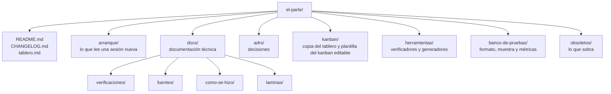

# Mapa del repositorio

Qué hay en cada lugar y qué va a haber. Cuando se crea una carpeta o un documento nuevo, se agrega acá.

## Lo que ya existe

| Ruta | Qué tiene |
|---|---|
| [`README.md`](../README.md) | Qué es el proyecto, sus etiquetas y sus doce reglas. |
| [`LICENSE`](../LICENSE) | Licencia MIT (D13). |
| [`CHANGELOG.md`](../CHANGELOG.md) | Cada cambio, corto, con enlace al porqué. |
| [`tablero.md`](../tablero.md) | Todo lo pendiente, en tarjetas con dueño, etapas y registro. Es la única fuente del kanban. |
| [`arranque/README.md`](README.md) | Puerta de entrada: qué leer y en qué orden, y el estado en una línea. |
| [`arranque/proyecto.md`](proyecto.md) | Qué es, para qué, los agentes, la versión 0, el banco de pruebas, la tecnología y los entregables. |
| [`arranque/como-se-trabaja.md`](como-se-trabaja.md) | Las reglas llevadas a la práctica: el ciclo de una sesión, los grados, los ADR, el estilo, los commits, el entorno. |
| [`arranque/decisiones-iniciales.md`](decisiones-iniciales.md) | Las decisiones de arranque vigentes hasta que tengan su ADR. |
| [`arranque/mapa.md`](mapa.md) | Este archivo. |
| [`arranque/glosario.md`](glosario.md) | Los términos técnicos. |
| [`adrs/README.md`](../adrs/README.md) | Índice de los ADRs. |
| [`adrs/0001-tablero-fuente-unica-kanban-generado.md`](../adrs/0001-tablero-fuente-unica-kanban-generado.md) | Kanban generado de solo lectura; reemplazado por el 0009. |
| [`adrs/0009-kanban-editable-sincronizado.md`](../adrs/0009-kanban-editable-sincronizado.md) | Kanban editable, sincronizado con el tablero por las sesiones. |
| [`adrs/0002-orquestacion-por-mensajes.md`](../adrs/0002-orquestacion-por-mensajes.md) a [`0005`](../adrs/0005-presupuesto-por-corrida.md) | Orquestación por mensajes, stack, grados de evidencia y presupuesto por corrida (T05). |
| [`adrs/0006-fuentes-de-la-version-0.md`](../adrs/0006-fuentes-de-la-version-0.md) | Qué fuentes entran en la versión 0 y cuál usa la primera rebanada (T10). |
| [`adrs/0007-registro-del-banco-fuera-del-repositorio.md`](../adrs/0007-registro-del-banco-fuera-del-repositorio.md) y [`0008`](../adrs/0008-datos-personales.md) | Registro del banco de pruebas fuera del repositorio y datos personales (T06). |
| [`kanban/plantilla.html`](../kanban/plantilla.html) | Diseño del kanban. Se edita a mano. |
| [`kanban/index.html`](../kanban/index.html) | Copia sin conexión del kanban, generada desde el tablero. Publicada con su base, es el kanban editable. No se edita a mano. |
| [`herramientas/tablero_md.py`](../herramientas/tablero_md.py) | Lee y valida `tablero.md`. Lo usan el generador y el verificador. |
| [`herramientas/generar_kanban.py`](../herramientas/generar_kanban.py) | Genera `kanban/index.html` desde `tablero.md`. |
| [`herramientas/sincronizar_tablero.py`](../herramientas/sincronizar_tablero.py) | Sincroniza la base del kanban publicado con `tablero.md` (ADR 0009). |
| [`herramientas/pruebas/`](../herramientas/pruebas/prueba_sincronizacion.py) | Pruebas de la sincronización y del kanban editable. |
| [`herramientas/generar_laminas.py`](../herramientas/generar_laminas.py) | Genera cada lámina SVG desde su fuente JSON. |
| [`herramientas/verificar_docs.py`](../herramientas/verificar_docs.py) | Verificador: guiones largos, enlaces relativos, reglas del tablero, kanban y láminas al día, y referencias a tarjetas y decisiones. |
| [`docs/arquitectura.md`](../docs/arquitectura.md) | La arquitectura de la versión 0: lámina, agentes, una noche paso a paso, fallas y despliegue (T02). |
| [`docs/base-de-afirmaciones.md`](../docs/base-de-afirmaciones.md) | El modelo de datos: dos esquemas, el DDL probado contra PostgreSQL 18 y de dónde sale cada vista (T04). |
| [`docs/contratos.md`](../docs/contratos.md) | Los mensajes entre agentes con esquema y ejemplo, la identidad de un hecho, la idempotencia y el umbral de revisión (T03). |
| [`docs/laminas/`](../docs/laminas/arquitectura.json) | Fuente JSON de cada lámina y su SVG generado. El SVG no se edita a mano. |
| [`docs/plan.md`](../docs/plan.md) | Los cuatro fines de semana: qué se hace, qué se muestra y cómo se comprueba cada uno (T07). |
| [`docs/verificaciones/spring-ai.md`](../docs/verificaciones/spring-ai.md) | Qué ofrece hoy Spring AI, verificado con URL y fecha (T09). |
| [`docs/fuentes/README.md`](../docs/fuentes/README.md) | Resumen de las siete fuentes candidatas y una página por fuente (T10). |
| [`obsoletos/README.md`](../obsoletos/README.md) | Índice de lo que se movió a obsoletos. |
| [`.gitignore`](../.gitignore) | Lo que no se versiona: el registro real del banco de pruebas y los secretos. |

## Lo que va a haber

| Ruta | Qué va a tener | Tarea |
|---|---|---|
| `banco-de-pruebas/` | Formato del registro, muestra sintética y métricas de cada medición. El registro real va en `banco-de-pruebas/privado/`, que no se versiona. | T12 |
| `docs/como-se-hizo/` | Una página por componente. | T08 en adelante |
| `app/` | El código: una aplicación Spring Boot con un paquete por agente ([ADR 0003](../adrs/0003-eleccion-del-stack.md)). | T08 |
