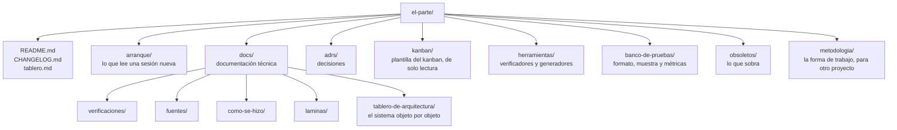

# Mapa del repositorio

Qué hay en cada lugar y qué va a haber. Cuando se crea una carpeta o un documento nuevo, se agrega acá.

## Lo que ya existe

| Ruta | Qué tiene |
|---|---|
| [`README.md`](../README.md) | Qué es el proyecto, sus etiquetas y sus catorce reglas. |
| [`LICENSE`](../LICENSE) | Licencia MIT (D13). |
| [`CHANGELOG.md`](../CHANGELOG.md) | Cada cambio, corto, con enlace al porqué. |
| [`tablero.md`](../tablero.md) | Todo lo pendiente, en tarjetas con dueño, etapas y registro. Es la única fuente del kanban. |
| [`arranque/README.md`](README.md) | Puerta de entrada: qué leer y en qué orden, y el estado en una línea. |
| [`arranque/proyecto.md`](proyecto.md) | Qué es, para qué, los agentes, la versión 0, el banco de pruebas, la tecnología y los entregables. |
| [`arranque/como-se-trabaja.md`](como-se-trabaja.md) | Las reglas llevadas a la práctica: el ciclo de una sesión, los grados, los ADR, el estilo, los commits, el entorno. |
| [`arranque/decisiones-iniciales.md`](decisiones-iniciales.md) | Las decisiones de arranque vigentes hasta que tengan su ADR. |
| [`arranque/mapa.md`](mapa.md) | Este archivo. |
| [`arranque/glosario.md`](glosario.md) | Los términos técnicos. |
| [`metodologia/README.md`](../metodologia/README.md) | La forma de trabajar de El Parte, separada del proyecto para usarla en otro: la idea, las piezas, los pasos para adoptarla y lo que se aprendió. |
| [`metodologia/plantillas/`](../metodologia/plantillas/README.md) | Los archivos que se copian a un proyecto nuevo: el README con las reglas, `arranque/`, el tablero, el CHANGELOG y los índices. |
| [`adrs/README.md`](../adrs/README.md) | Índice de los ADRs. |
| [`adrs/0001-tablero-fuente-unica-kanban-generado.md`](../adrs/0001-tablero-fuente-unica-kanban-generado.md) | Kanban generado de solo lectura; reemplazado por el 0009. |
| [`adrs/0009-kanban-editable-sincronizado.md`](../adrs/0009-kanban-editable-sincronizado.md) | Kanban editable, sincronizado con el tablero por las sesiones. Reemplazado por el 0017. |
| [`adrs/0017-forma-de-trabajo-mas-liviana.md`](../adrs/0017-forma-de-trabajo-mas-liviana.md) | Un lugar por dato, ritual según el tamaño, integración continua, tableros en GitHub Pages, kanban de solo lectura y commits autorizados por tarea. |
| [`adrs/0002-orquestacion-por-mensajes.md`](../adrs/0002-orquestacion-por-mensajes.md) a [`0005`](../adrs/0005-presupuesto-por-corrida.md) | Orquestación por mensajes, stack, grados de evidencia y presupuesto por corrida (T05). |
| [`adrs/0006-fuentes-de-la-version-0.md`](../adrs/0006-fuentes-de-la-version-0.md) y [`0010`](../adrs/0010-impo-como-quinta-fuente.md) | Qué fuentes entran en la versión 0 y cuál usa la primera rebanada (T10); IMPO entra como quinta. |
| [`adrs/0007-registro-del-banco-fuera-del-repositorio.md`](../adrs/0007-registro-del-banco-fuera-del-repositorio.md) y [`0008`](../adrs/0008-datos-personales.md) | Registro del banco de pruebas fuera del repositorio y datos personales (T06). |
| [`kanban/README.md`](../kanban/README.md) | Qué es el kanban y qué archivo se edita a mano. |
| [`kanban/plantilla.html`](../kanban/plantilla.html) | Diseño del kanban. Se edita a mano. |
| `kanban/index.html` | El kanban generado desde el tablero, de solo lectura. No se versiona: se genera con `herramientas/generar_kanban.py` y se publica en <https://andresdiegolanda.github.io/el-parte/kanban/>. |
| [`herramientas/README.md`](../herramientas/README.md) | Qué hace cada script, cómo se corre y sus pruebas. |
| [`herramientas/tablero_arquitectura.py`](../herramientas/tablero_arquitectura.py) y [`generar_tablero_arquitectura.py`](../herramientas/generar_tablero_arquitectura.py) | Leen el modelo del tablero de arquitectura, lo comparan con el código y generan su página. |
| [`herramientas/tablero_md.py`](../herramientas/tablero_md.py) | Lee y valida `tablero.md`. Lo usan el generador y el verificador. |
| [`herramientas/generar_kanban.py`](../herramientas/generar_kanban.py) | Genera `kanban/index.html` desde `tablero.md`. |
| [`herramientas/armar_sitio.py`](../herramientas/armar_sitio.py) | Arma el sitio de GitHub Pages con los dos tableros (ADR 0017). |
| [`herramientas/pruebas/`](../herramientas/pruebas/prueba_kanban.mjs) | Pruebas del kanban, del tablero de arquitectura y del banco de pruebas. |
| [`herramientas/generar_laminas.py`](../herramientas/generar_laminas.py) | Genera cada lámina SVG desde su fuente JSON. |
| [`herramientas/banco_de_pruebas.py`](../herramientas/banco_de_pruebas.py) | Valida un registro del banco de pruebas y su revisión, y cuenta una medición (T12). |
| [`herramientas/verificar_docs.py`](../herramientas/verificar_docs.py) | Verificador: guiones largos, enlaces relativos, reglas del tablero, kanban y tablero de arquitectura que se puedan generar, láminas al día, referencias a tarjetas y decisiones, la primera migración igual al DDL del documento de la base, el tablero de arquitectura igual al código y la muestra del banco de pruebas. |
| [`docs/README.md`](../docs/README.md) | Qué hay en `docs/` y cuál manda. |
| [`docs/tablero-de-arquitectura/`](../docs/tablero-de-arquitectura/README.md) | El sistema objeto por objeto: `sistema.json` (la fuente), `plantilla.html` y las páginas que se generan, `index.html` (todo el sistema) y `usuarios.html` (la vista del usuario), que no se versionan y se publican en GitHub Pages. Refleja la arquitectura en todo momento (ADR 0012, T32). |
| [`docs/arquitectura.md`](../docs/arquitectura.md) | La arquitectura de la versión 0: lámina, agentes, una noche paso a paso, fallas y despliegue (T02). |
| [`docs/base-de-afirmaciones.md`](../docs/base-de-afirmaciones.md) | El modelo de datos: dos esquemas, el DDL probado contra PostgreSQL 18 y de dónde sale cada vista (T04). |
| [`docs/contratos.md`](../docs/contratos.md) | Los mensajes entre agentes con esquema y ejemplo, la identidad de un hecho, la idempotencia y el umbral de revisión (T03). |
| [`docs/laminas/`](../docs/laminas/arquitectura.json) | Fuente JSON de cada lámina y su SVG generado. El SVG no se edita a mano. |
| [`docs/plan.md`](../docs/plan.md) | Los cuatro fines de semana: qué se hace, qué se muestra y cómo se comprueba cada uno (T07). |
| [`docs/marca/README.md`](../docs/marca/README.md) | El logo: la hoja con el tilde, sus colores, sus archivos en SVG y PNG, el favicon, cómo se usa y dónde está (el README, la aplicación, GitHub Pages y el tablero de arquitectura). |
| [`docs/presentacion/README.md`](../docs/presentacion/README.md) | La presentación para quien no conoce el proyecto, en Marp: `docs/presentacion/el-parte.md`, su tema y sus dibujos, cómo se exporta y de dónde sale cada cifra (T38). |
| [`docs/verificaciones/comparacion-con-una-sesion.md`](../docs/verificaciones/comparacion-con-una-sesion.md) | El Parte contra una sesión con el modelo, sin agentes, sobre diez noches del banco: cobertura, hechos, cifras, costo y tiempo (T42). |
| [`docs/verificaciones/spring-ai.md`](../docs/verificaciones/spring-ai.md) | Qué ofrece hoy Spring AI, verificado con URL y fecha (T09). |
| [`docs/fuentes/README.md`](../docs/fuentes/README.md) | Resumen de las siete fuentes candidatas y una página por fuente (T10). |
| [`docs/como-se-hizo/primera-rebanada.md`](../docs/como-se-hizo/primera-rebanada.md) | Cómo se hizo la primera rebanada: qué hace, por qué, cómo se construyó, qué se probó, qué falló y qué se cambió (T08). |
| [`adrs/0011-grabacion-y-repeticion-de-corridas.md`](../adrs/0011-grabacion-y-repeticion-de-corridas.md) | Las corridas se graban en la base y se repiten desde ahí (T08, T31). |
| [`adrs/0012-tablero-de-arquitectura.md`](../adrs/0012-tablero-de-arquitectura.md) | El tablero de arquitectura refleja el sistema y es la referencia de los pedidos (T32). |
| [`adrs/0013-acceso-perfil-y-parte-diario.md`](../adrs/0013-acceso-perfil-y-parte-diario.md) | Cómo entra cada usuario, dónde queda su perfil y cómo lee su parte cada mañana (T36). |
| [`adrs/0014-medicion-contra-el-banco.md`](../adrs/0014-medicion-contra-el-banco.md) | La medición contra el banco corre en un Compose aparte, noche por noche (T20, T37). |
| [`adrs/0015-que-puede-escribir-el-analista.md`](../adrs/0015-que-puede-escribir-el-analista.md) | Qué puede escribir el analista: el grado se copia y una cifra que no está en la evidencia no se usa (T21). |
| [`adrs/0018-lectura-del-expediente-con-contexto-largo.md`](../adrs/0018-lectura-del-expediente-con-contexto-largo.md) | Qué puede escribir el modelo cuando lee un expediente entero, y cómo se gradúa (T47). |
| [`app/`](../app/README.md) | El código: una aplicación Spring Boot con un paquete por agente ([ADR 0003](../adrs/0003-eleccion-del-stack.md)), sus migraciones, sus páginas y sus pruebas. Cómo se levanta y qué hay adentro, en [app/README.md](../app/README.md). |
| [`compose.yaml`](../compose.yaml) | Levanta en local la aplicación, PostgreSQL, Kafka y el buzón de correo de prueba. Con `compose.banco.yaml`, una medición contra el banco. |
| [`obsoletos/README.md`](../obsoletos/README.md) | Índice de lo que se movió a obsoletos. |
| [`.gitignore`](../.gitignore) | Lo que no se versiona: el registro real del banco de pruebas y los secretos. |
| [`.gitattributes`](../.gitattributes) | La muestra del banco de pruebas, siempre con saltos de línea LF, porque se compara por su huella. |
| [`banco-de-pruebas/README.md`](../banco-de-pruebas/README.md) | Qué hay del banco de pruebas en el repositorio y cómo se controla un registro. |
| [`banco-de-pruebas/formato.md`](../banco-de-pruebas/formato.md) | La forma del registro, de su revisión y de la salida de El Parte, y la huella de cada registro (T12). |
| [`banco-de-pruebas/metricas.md`](../banco-de-pruebas/metricas.md) | Cómo se mide El Parte contra el registro: resultados, descartes, cuentas y la forma de una medición (T12). |
| `banco-de-pruebas/muestra/` | Un registro inventado con su revisión, una salida de El Parte inventada y la medición que tienen que dar (T12). |
| [`banco-de-pruebas/mediciones/README.md`](../banco-de-pruebas/mediciones/README.md) | Qué hay en cada carpeta de medición, y qué mediciones hay: una prueba de tres noches y las 78 noches del registro (T20). |
| [`compose.banco.yaml`](../compose.banco.yaml) | Lo que cambia del Compose de todos los días para una medición contra el banco: sin puertos de la base, de Kafka ni del correo, la aplicación en el 8081 con el perfil `banco` y sin los invitados del `.env` (ADR 0014, T20). |
| [`compose.publicado.yaml`](../compose.publicado.yaml) | Lo que cambia para publicar El Parte desde la máquina del responsable: el túnel de Cloudflare, el correo por Resend, la corrida de cada noche, la salud fuera del túnel y la copia diaria de la base (ADR 0016, T40). |
| [`docs/como-se-hizo/medicion-contra-el-banco.md`](../docs/como-se-hizo/medicion-contra-el-banco.md) | Cómo se hizo la medición contra el banco: qué hace, cómo se construyó, qué se probó y qué falló (T20). |
| [`docs/como-se-hizo/analista.md`](../docs/como-se-hizo/analista.md) | Cómo se hizo el analista: qué le pide al modelo, el control de cifras y qué se probó (T21). |
| [`docs/como-se-hizo/presupuesto.md`](../docs/como-se-hizo/presupuesto.md) | Cómo se hizo el presupuesto que corta: el advisor, el libro de la corrida y qué se probó (T22). |
| [`docs/como-se-hizo/revision.md`](../docs/como-se-hizo/revision.md) | Cómo se hizo la cola de revisión humana y lo que cambia en la página de la mañana (T23). |
| [`docs/como-se-hizo/login.md`](../docs/como-se-hizo/login.md) | Cómo se hizo el login por enlace de correo, el alta de invitados y quién puede hacer qué (T25). |
| [`docs/como-se-hizo/README.md`](../docs/como-se-hizo/README.md) | El índice de las páginas "cómo se hizo", una por componente, que la aplicación enlaza desde `/como-funciona` (T26). |
| [`docs/como-se-hizo/bid.md`](../docs/como-se-hizo/bid.md) | Cómo se hizo el explorador del BID: las operaciones para Uruguay aprobadas cada noche (T24). |
| [`docs/como-se-hizo/banco-mundial.md`](../docs/como-se-hizo/banco-mundial.md) | El explorador del Banco Mundial (T24). |
| [`docs/como-se-hizo/presidencia.md`](../docs/como-se-hizo/presidencia.md) | El explorador de Presidencia y el tapado de nombres en texto libre (T24). |
| [`docs/como-se-hizo/aviso-diario.md`](../docs/como-se-hizo/aviso-diario.md) | Cómo se hizo el aviso diario por correo: escucha los informes de las corridas normales, uno por invitado y noche, sin el contenido de los hechos (T35). |
| [`docs/como-se-hizo/expediente.md`](../docs/como-se-hizo/expediente.md) | Cómo se hizo el expediente de cada entidad: cada hecho con todas sus versiones, mes por mes (T33). |
| [`docs/como-se-hizo/impo.md`](../docs/como-se-hizo/impo.md) | Cómo se hizo el explorador de IMPO: el índice de cada edición, el JSON de cada ley y decreto, el tapado y el filtro por entidad (T30). |
| [`docs/como-se-hizo/modelos.md`](../docs/como-se-hizo/modelos.md) | Cómo se hizo la página de modelos y precios: el responsable cambia el modelo de cada agente y carga precios sin reiniciar (T29). |
| [`docs/como-se-hizo/perfil.md`](../docs/como-se-hizo/perfil.md) | Cómo se hizo el perfil: el catálogo de organismos con su código en ARCE, seguir y dejar de seguir, y el aviso diario sí o no (T34). |
| [`docs/como-se-hizo/veredictos-cortados.md`](../docs/como-se-hizo/veredictos-cortados.md) | Los veredictos del refutador que se cortaban en el máximo de tokens de salida, cómo se vio y cómo se arregló (T48). |
| [`docs/como-se-hizo/despliegue.md`](../docs/como-se-hizo/despliegue.md) | Cómo se hizo El Parte publicado: el túnel, el correo, la salud fuera del túnel y las copias de la base (T27, T40). |

## Lo que va a haber

| Ruta | Qué va a tener | Tarea |
|---|---|---|
| `banco-de-pruebas/mediciones/<medición>/` | La primera medición real: la salida de El Parte y la medición, sin texto del registro. El registro real está en `banco-de-pruebas/privado/`, que no se versiona. | T20 |
| `docs/como-se-hizo/` | Las páginas de los componentes que faltan. | T24 en adelante, T26 |
