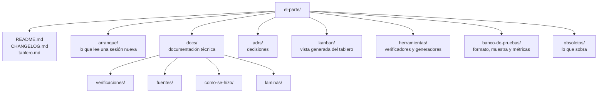

# Mapa del repositorio

Qué hay en cada lugar y qué va a haber. Cuando se crea una carpeta o un documento nuevo, se agrega acá.

## Lo que ya existe

| Ruta | Qué tiene |
|---|---|
| [`README.md`](../README.md) | Qué es el proyecto, sus etiquetas y sus doce reglas. |
| [`LICENSE`](../LICENSE) | Licencia MIT (D13). |
| [`CHANGELOG.md`](../CHANGELOG.md) | Cada cambio, corto, con enlace al porqué. |
| [`tablero.md`](../tablero.md) | Todo lo pendiente, en tarjetas con dueño, etapas y registro. Es la única fuente del kanban. |
| [`arranque/README.md`](README.md) | Puerta de entrada: qué leer y en qué orden, y el estado en una línea. |
| [`arranque/proyecto.md`](proyecto.md) | Qué es, para qué, los agentes, la versión 0, el banco de pruebas, la tecnología y los entregables. |
| [`arranque/como-se-trabaja.md`](como-se-trabaja.md) | Las reglas llevadas a la práctica: el ciclo de una sesión, los grados, los ADR, el estilo, los commits, el entorno. |
| [`arranque/decisiones-iniciales.md`](decisiones-iniciales.md) | Las decisiones de arranque vigentes hasta que tengan su ADR. |
| [`arranque/mapa.md`](mapa.md) | Este archivo. |
| [`arranque/glosario.md`](glosario.md) | Los términos técnicos. |
| [`adrs/README.md`](../adrs/README.md) | Índice de los ADRs. |
| [`adrs/0001-tablero-fuente-unica-kanban-generado.md`](../adrs/0001-tablero-fuente-unica-kanban-generado.md) | Por qué el tablero es la fuente y el kanban se genera. |
| [`kanban/plantilla.html`](../kanban/plantilla.html) | Diseño del kanban. Se edita a mano. |
| [`kanban/index.html`](../kanban/index.html) | El kanban, generado desde el tablero. No se edita a mano. |
| [`herramientas/tablero_md.py`](../herramientas/tablero_md.py) | Lee y valida `tablero.md`. Lo usan el generador y el verificador. |
| [`herramientas/generar_kanban.py`](../herramientas/generar_kanban.py) | Genera `kanban/index.html` desde `tablero.md`. |
| [`herramientas/verificar_docs.py`](../herramientas/verificar_docs.py) | Verificador: guiones largos, enlaces relativos, reglas del tablero, kanban al día y referencias a tarjetas y decisiones. |
| [`docs/verificaciones/spring-ai.md`](../docs/verificaciones/spring-ai.md) | Qué ofrece hoy Spring AI, verificado con URL y fecha (T09). |
| [`obsoletos/README.md`](../obsoletos/README.md) | Índice de lo que se movió a obsoletos. |
| [`.gitignore`](../.gitignore) | Lo que no se versiona: el registro real del banco de pruebas y los secretos. |

## Lo que va a haber

| Ruta | Qué va a tener | Tarea |
|---|---|---|
| `docs/arquitectura.md` | Visión general, agentes, secuencia de una noche, enlace a la lámina. | T02 |
| `docs/laminas/` | Fuente de cada lámina y su SVG generado. | T02 |
| `docs/contratos.md` | Mensajes entre agentes con esquema y ejemplo; identidad e idempotencia de cada hecho. | T03 |
| `docs/base-de-afirmaciones.md` | Modelo de datos con diagrama. | T04 |
| `adrs/` (más ADRs) | Los primeros ADRs de base y los de las decisiones de arranque. | T05, T06 |
| `docs/plan.md` | Los cuatro fines de semana y qué se muestra al final de cada uno. | T07 |
| `docs/fuentes/` | Una página por fuente: permiso de uso, formato, si deja consultar por fecha, con URL y fecha de verificación. | T10 |
| `banco-de-pruebas/` | Formato del registro, muestra sintética y métricas de cada medición. El registro real va en `banco-de-pruebas/privado/`, que no se versiona. | T12 |
| `docs/como-se-hizo/` | Una página por componente. | T08 en adelante |
| Código | Su ubicación se fija con el ADR del stack. | T05 |
