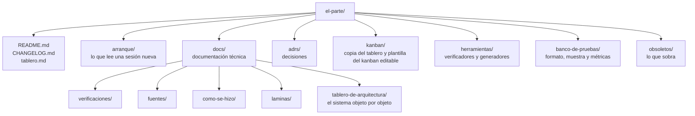

# Mapa del repositorio

Qué hay en cada lugar y qué va a haber. Cuando se crea una carpeta o un documento nuevo, se agrega acá.

## Lo que ya existe

| Ruta | Qué tiene |
|---|---|
| [`README.md`](../README.md) | Qué es el proyecto, sus etiquetas y sus trece reglas. |
| [`LICENSE`](../LICENSE) | Licencia MIT (D13). |
| [`CHANGELOG.md`](../CHANGELOG.md) | Cada cambio, corto, con enlace al porqué. |
| [`tablero.md`](../tablero.md) | Todo lo pendiente, en tarjetas con dueño, etapas y registro. Es la única fuente del kanban. |
| [`arranque/README.md`](README.md) | Puerta de entrada: qué leer y en qué orden, y el estado en una línea. |
| [`arranque/proyecto.md`](proyecto.md) | Qué es, para qué, los agentes, la versión 0, el banco de pruebas, la tecnología y los entregables. |
| [`arranque/como-se-trabaja.md`](como-se-trabaja.md) | Las reglas llevadas a la práctica: el ciclo de una sesión, los grados, los ADR, el estilo, los commits, el entorno. |
| [`arranque/decisiones-iniciales.md`](decisiones-iniciales.md) | Las decisiones de arranque vigentes hasta que tengan su ADR. |
| [`arranque/mapa.md`](mapa.md) | Este archivo. |
| [`arranque/glosario.md`](glosario.md) | Los términos técnicos. |
| [`adrs/README.md`](../adrs/README.md) | Índice de los ADRs. |
| [`adrs/0001-tablero-fuente-unica-kanban-generado.md`](../adrs/0001-tablero-fuente-unica-kanban-generado.md) | Kanban generado de solo lectura; reemplazado por el 0009. |
| [`adrs/0009-kanban-editable-sincronizado.md`](../adrs/0009-kanban-editable-sincronizado.md) | Kanban editable, sincronizado con el tablero por las sesiones. |
| [`adrs/0002-orquestacion-por-mensajes.md`](../adrs/0002-orquestacion-por-mensajes.md) a [`0005`](../adrs/0005-presupuesto-por-corrida.md) | Orquestación por mensajes, stack, grados de evidencia y presupuesto por corrida (T05). |
| [`adrs/0006-fuentes-de-la-version-0.md`](../adrs/0006-fuentes-de-la-version-0.md) y [`0010`](../adrs/0010-impo-como-quinta-fuente.md) | Qué fuentes entran en la versión 0 y cuál usa la primera rebanada (T10); IMPO entra como quinta. |
| [`adrs/0007-registro-del-banco-fuera-del-repositorio.md`](../adrs/0007-registro-del-banco-fuera-del-repositorio.md) y [`0008`](../adrs/0008-datos-personales.md) | Registro del banco de pruebas fuera del repositorio y datos personales (T06). |
| [`kanban/README.md`](../kanban/README.md) | Qué es el kanban y qué archivo se edita a mano. |
| [`kanban/plantilla.html`](../kanban/plantilla.html) | Diseño del kanban. Se edita a mano. |
| [`kanban/index.html`](../kanban/index.html) | Copia sin conexión del kanban, generada desde el tablero. Publicada con su base, es el kanban editable. No se edita a mano. |
| [`herramientas/README.md`](../herramientas/README.md) | Qué hace cada script, cómo se corre y sus pruebas. |
| [`herramientas/tablero_arquitectura.py`](../herramientas/tablero_arquitectura.py) y [`generar_tablero_arquitectura.py`](../herramientas/generar_tablero_arquitectura.py) | Leen el modelo del tablero de arquitectura, lo comparan con el código y generan su página. |
| [`herramientas/tablero_md.py`](../herramientas/tablero_md.py) | Lee y valida `tablero.md`. Lo usan el generador y el verificador. |
| [`herramientas/generar_kanban.py`](../herramientas/generar_kanban.py) | Genera `kanban/index.html` desde `tablero.md`. |
| [`herramientas/sincronizar_tablero.py`](../herramientas/sincronizar_tablero.py) | Sincroniza la base del kanban publicado con `tablero.md` (ADR 0009). |
| [`herramientas/pruebas/`](../herramientas/pruebas/prueba_sincronizacion.py) | Pruebas de la sincronización, del kanban editable, del tablero de arquitectura y del banco de pruebas. |
| [`herramientas/generar_laminas.py`](../herramientas/generar_laminas.py) | Genera cada lámina SVG desde su fuente JSON. |
| [`herramientas/banco_de_pruebas.py`](../herramientas/banco_de_pruebas.py) | Valida un registro del banco de pruebas y su revisión, y cuenta una medición (T12). |
| [`herramientas/verificar_docs.py`](../herramientas/verificar_docs.py) | Verificador: guiones largos, enlaces relativos, reglas del tablero, kanban y láminas al día, referencias a tarjetas y decisiones, la primera migración igual al DDL del documento de la base, el tablero de arquitectura igual al código y la muestra del banco de pruebas. |
| [`docs/README.md`](../docs/README.md) | Qué hay en `docs/` y cuál manda. |
| [`docs/tablero-de-arquitectura/`](../docs/tablero-de-arquitectura/README.md) | El sistema objeto por objeto: `sistema.json` (la fuente), `plantilla.html` y las páginas generadas, `index.html` (todo el sistema) y `usuarios.html` (la vista del usuario). Refleja la arquitectura en todo momento (ADR 0012, T32). |
| [`docs/arquitectura.md`](../docs/arquitectura.md) | La arquitectura de la versión 0: lámina, agentes, una noche paso a paso, fallas y despliegue (T02). |
| [`docs/base-de-afirmaciones.md`](../docs/base-de-afirmaciones.md) | El modelo de datos: dos esquemas, el DDL probado contra PostgreSQL 18 y de dónde sale cada vista (T04). |
| [`docs/contratos.md`](../docs/contratos.md) | Los mensajes entre agentes con esquema y ejemplo, la identidad de un hecho, la idempotencia y el umbral de revisión (T03). |
| [`docs/laminas/`](../docs/laminas/arquitectura.json) | Fuente JSON de cada lámina y su SVG generado. El SVG no se edita a mano. |
| [`docs/plan.md`](../docs/plan.md) | Los cuatro fines de semana: qué se hace, qué se muestra y cómo se comprueba cada uno (T07). |
| [`docs/verificaciones/spring-ai.md`](../docs/verificaciones/spring-ai.md) | Qué ofrece hoy Spring AI, verificado con URL y fecha (T09). |
| [`docs/fuentes/README.md`](../docs/fuentes/README.md) | Resumen de las siete fuentes candidatas y una página por fuente (T10). |
| [`docs/como-se-hizo/primera-rebanada.md`](../docs/como-se-hizo/primera-rebanada.md) | Cómo se hizo la primera rebanada: qué hace, por qué, cómo se construyó, qué se probó, qué falló y qué se cambió (T08). |
| [`adrs/0011-grabacion-y-repeticion-de-corridas.md`](../adrs/0011-grabacion-y-repeticion-de-corridas.md) | Las corridas se graban en la base y se repiten desde ahí (T08, T31). |
| [`adrs/0012-tablero-de-arquitectura.md`](../adrs/0012-tablero-de-arquitectura.md) | El tablero de arquitectura refleja el sistema y es la referencia de los pedidos (T32). |
| [`adrs/0013-acceso-perfil-y-parte-diario.md`](../adrs/0013-acceso-perfil-y-parte-diario.md) | Cómo entra cada usuario, dónde queda su perfil y cómo lee su parte cada mañana (T36). |
| [`adrs/0014-medicion-contra-el-banco.md`](../adrs/0014-medicion-contra-el-banco.md) | La medición contra el banco corre en un Compose aparte, noche por noche (T20, T37). |
| [`app/`](../app/README.md) | El código: una aplicación Spring Boot con un paquete por agente ([ADR 0003](../adrs/0003-eleccion-del-stack.md)), sus migraciones, sus páginas y sus pruebas. Cómo se levanta y qué hay adentro, en [app/README.md](../app/README.md). |
| [`compose.yaml`](../compose.yaml) | Levanta en local la aplicación, PostgreSQL, Kafka y el buzón de correo de prueba. Con `compose.banco.yaml`, una medición contra el banco. |
| [`obsoletos/README.md`](../obsoletos/README.md) | Índice de lo que se movió a obsoletos. |
| [`.gitignore`](../.gitignore) | Lo que no se versiona: el registro real del banco de pruebas y los secretos. |
| [`.gitattributes`](../.gitattributes) | La muestra del banco de pruebas, siempre con saltos de línea LF, porque se compara por su huella. |
| [`banco-de-pruebas/README.md`](../banco-de-pruebas/README.md) | Qué hay del banco de pruebas en el repositorio y cómo se controla un registro. |
| [`banco-de-pruebas/formato.md`](../banco-de-pruebas/formato.md) | La forma del registro, de su revisión y de la salida de El Parte, y la huella de cada registro (T12). |
| [`banco-de-pruebas/metricas.md`](../banco-de-pruebas/metricas.md) | Cómo se mide El Parte contra el registro: resultados, descartes, cuentas y la forma de una medición (T12). |
| `banco-de-pruebas/muestra/` | Un registro inventado con su revisión, una salida de El Parte inventada y la medición que tienen que dar (T12). |
| [`banco-de-pruebas/mediciones/README.md`](../banco-de-pruebas/mediciones/README.md) | Qué hay en cada carpeta de medición. Todavía no hay ninguna real (T20). |
| [`compose.banco.yaml`](../compose.banco.yaml) | Lo que cambia del Compose de todos los días para una medición contra el banco: sin puertos de la base, de Kafka ni del correo, la aplicación en el 8081 con el perfil `banco` (ADR 0014, T20). |
| [`docs/como-se-hizo/medicion-contra-el-banco.md`](../docs/como-se-hizo/medicion-contra-el-banco.md) | Cómo se hizo la medición contra el banco: qué hace, cómo se construyó, qué se probó y qué falló (T20). |

## Lo que va a haber

| Ruta | Qué va a tener | Tarea |
|---|---|---|
| `banco-de-pruebas/mediciones/<medición>/` | La primera medición real: la salida de El Parte y la medición, sin texto del registro. El registro real está en `banco-de-pruebas/privado/`, que no se versiona. | T20 |
| `docs/como-se-hizo/` | Las páginas de los componentes que faltan. | T21 en adelante, T26 |
