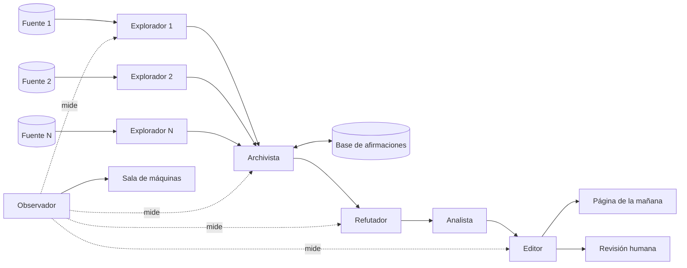

# El proyecto

## Qué es

El Parte es un servicio web. Un grupo de agentes orquestados lee todas las noches lo que publica el Estado uruguayo en sus fuentes públicas, extrae hechos (quién, qué, cuándo, con qué fuente) y los guarda en una base común, la base de afirmaciones. Cada cliente tiene una página donde se suscribe a entidades: organismos, empresas, programas, licitaciones. Cada mañana esa página muestra lo que se encontró la noche anterior sobre sus suscripciones, con la fuente de cada hecho, y dice con claridad cuándo no hubo nada nuevo.

Un *agente* es un programa que usa un modelo de lenguaje para cumplir un rol acotado; *orquestados* quiere decir que cada uno hace su parte y se pasan el trabajo con reglas fijas. El [glosario](glosario.md) tiene estos términos y los demás.

## Para qué es

Es un proyecto didáctico y de portafolio. Su objetivo es mostrar cómo se construye un sistema de agentes orquestados que corre solo y no miente. Mostrar cómo se hizo pesa tanto como el resultado: quien entre al repositorio o a la aplicación tiene que poder entender, sin hablar con nadie, qué hace cada pieza, por qué está, cómo se construyó y qué falló en el camino.

No es un negocio: no hay pagos, planes ni soporte.

## Cómo es una noche

El diagrama es la idea general. La arquitectura formal, con el diagrama de secuencia de una noche y la lámina en SVG, va en `docs/arquitectura.md` (pendiente, ver el [tablero](../tablero.md)).

## Los agentes y por qué existe cada uno

| Agente | Qué hace | Por qué existe |
|---|---|---|
| Explorador (uno por fuente) | Devuelve candidatos con la evidencia cruda: URL, texto, fecha de publicación detectada. | Cada fuente tiene su formato, sus permisos y sus fallas. Un explorador por fuente aísla esas diferencias y permite medir cada fuente por separado. |
| Archivista | Es el dueño de la memoria. Coteja cada candidato contra la base de afirmaciones y lo marca como conocido, actualización o nuevo. | Si cada agente recordara a su manera, el mismo hecho aparecería como nuevo todas las noches. La memoria tiene un solo dueño. |
| Refutador | Intenta tirar abajo cada candidato: si la fecha es real o es material viejo indexado como nuevo, si es el mismo hecho que uno conocido, si la fuente dice eso o es una deducción. Sale con un grado: PROVEN, INFERRED o "las fuentes no lo mencionan". | Es la pieza que hace que el sistema no mienta. Nada llega a un cliente sin que alguien haya intentado probar que es falso. |
| Analista | Para lo que sobrevive, escribe qué dice, por qué importa y qué mirar. | Un hecho suelto no le sirve a nadie. Separar el análisis de la verificación evita que la interpretación contamine el grado. |
| Editor | Aplica las reglas de redacción, arma el informe de cada cliente y manda a revisión humana lo que tenga demasiado INFERRED. | Lo que lee el cliente tiene que ser parejo y honesto sobre su propia incertidumbre. |
| Observador | Mide precisión por fuente, costo y duración por corrida y por agente, y fuentes bloqueadas. | Un sistema que corre solo tiene que medirse solo. Sin esto no hay sala de máquinas ni forma de saber si mejora. |

## Versión 0

Entra:

- Entre cuatro y seis fuentes públicas con permiso de uso (datos abiertos, API o descargas oficiales). Las candidatas son compras estatales, el diario oficial (IMPO), las resoluciones de directorio de los organismos que las publican, Presidencia y las novedades de gub.uy, y las carteras de proyectos para Uruguay de los bancos multilaterales (BID, Banco Mundial, CAF). Nada de raspar sitios que lo prohíben ni de copiar prensa textual. Cuáles entran está en [decisiones-iniciales.md](decisiones-iniciales.md) (D5).
- Los seis agentes de la tabla de arriba.
- La base de afirmaciones: hechos con entidad, estado, fecha, grado, fuente y la traza de qué agente los produjo. Es una base de datos, no un documento.
- Suscripciones por entidad y la página de la mañana de cada cliente: lo que cambió desde ayer, más el expediente de cada entidad para consultar cuando se quiera.
- La sala de máquinas: por cada corrida y cada hallazgo, qué agente hizo qué, qué refutó el refutador y por qué, contra qué se cotejó, cuánto costó y cuánto tardó. Es la pieza más importante para el propósito del proyecto. La aplicación la muestra junto con una sección "Cómo funciona" que enlaza a la documentación.
- Un presupuesto por corrida (pasos, tiempo y costo) que corta la corrida cuando se pasa.
- Login simple por enlace de correo: cuatro usuarios invitados y una cuenta de demostración de solo lectura.

No entra: audio, pagos, WhatsApp, planificador dinámico de fuentes, más de un idioma, escalado.

## El banco de pruebas

Existe un registro de una vigilancia anterior de un organismo, hecha todas las noches con un solo agente, con los hallazgos reales y los descartes anotados. Es el banco de pruebas de la versión 0: el sistema orquestado tiene que correr sobre esas noches y medirse contra ese registro (hallazgos encontrados, falsos positivos, costo). La medición es parte de la versión 0, no algo para después.

El registro no se versiona, porque es material de otro proyecto (regla 11). Se lee desde una ruta configurable; en el repositorio van su formato, las métricas y una muestra sintética. Ver [decisiones-iniciales.md](decisiones-iniciales.md) (D1 y D2).

### Lo que ya enseña una noche de muestra

Se analizó la bitácora de una noche (la corrida del 2026-11-06), que no está en el repositorio. Todo lo de esta sección es INFERRED a partir de esa única noche, y se confirma o se corrige cuando llegue el registro completo (tablero, T11).

- **Qué trae.** Un documento de seguimiento acumulado (lo ya conocido con su fecha de reconfirmación, los hallazgos por día y el detalle de lo revisado en cada corrida) y una bitácora por corrida con las búsquedas hechas y un resumen de sus resultados, las páginas leídas (URL, qué se buscaba, resultado o falla), la actualización del seguimiento, el informe final y las herramientas usadas.
- **Qué no trae.** El contenido crudo de lo que se leyó. Para repetir una noche, los exploradores tienen que pedirle a cada fuente lo que publicó en esa fecha. Si una fuente no deja consultar por fecha, esa noche no se puede repetir para esa fuente, y la medición lo dice en lugar de esconderlo.
- **De dónde salían los hallazgos.** La vigilancia anterior buscaba con un buscador web y también leía prensa. El Parte lee fuentes oficiales y no copia prensa, así que algunos hallazgos del registro pueden venir de lugares que El Parte no lee. La medición los cuenta aparte, como "fuera de alcance", y no como hallazgos perdidos.
- **Cuántas noches.** La muestra indica un seguimiento que arranca el 2026-09-17, unas cincuenta noches hasta el 2026-11-06. La definición del proyecto habla de unas setenta. Se confirma con el registro completo.

Y las fallas que muestra esa noche, cada una con la pieza de El Parte que la atiende:

| Lo que pasó en la muestra | Qué pieza lo atiende |
|---|---|
| Resultados sin relación porque la sigla del organismo coincide con la de otra cosa. | Refutador y archivista: se coteja la entidad, no el texto. |
| Material viejo (normas de ejercicios anteriores) que aparece entre los resultados como si fuera nuevo. | Refutador: verifica la fecha de publicación. |
| Listados sin fecha visible, donde no se pudo confirmar si algo era de los últimos días. | Refutador: "no se pudo confirmar la fecha" es un resultado válido, no un hallazgo. |
| Una fuente bloqueada por su robots.txt y otra que falló porque un permiso de lectura no se aprobó en una corrida sin nadie mirando, una falla que se repetía. | Observador: cuenta las fuentes bloqueadas por noche. Las fuentes de El Parte se eligen por tener API o descarga oficial. |
| Días sin novedad documentados como tales, sin inflarlos. | Editor: la página de la mañana dice "no hubo nada nuevo". |

## Tecnología

Son preferencias, no órdenes. Cada una se confirma o se cambia con un ADR (pendientes en el [tablero](../tablero.md)):

- Java con Spring Boot y Spring AI para los agentes y la orquestación. El estado actual de los patrones de orquestación de Spring AI se verifica en su documentación oficial antes de apoyarse en ellos (tablero, T09).
- PostgreSQL para la base de afirmaciones.
- Los agentes se comunican por mensajes en tópicos, para que cada corrida sea reproducible y la sala de máquinas se arme desde los mensajes.
- Una interfaz web simple, sin framework pesado.
- Todo en contenedores, levantable con un solo comando.

## Lo que se entrega, en orden

| Orden | Entregable | Estado |
|---|---|---|
| 1 | Preguntas de arranque | Hecho: sus respuestas están en [decisiones-iniciales.md](decisiones-iniciales.md) |
| 2 | Carpeta `arranque/` (antes prevista como `docs/arranque.md`) | Hecho |
| 3 | `README.md` con las reglas | Hecho |
| 4 | `docs/arquitectura.md`: visión general en Mermaid, agentes, secuencia de una noche, lámina SVG con su generador | Pendiente |
| 5 | `docs/contratos.md`: mensajes entre agentes con esquema y ejemplo, identidad e idempotencia de cada hecho | Pendiente |
| 6 | `docs/base-de-afirmaciones.md`: modelo de datos con diagrama | Pendiente |
| 7 | `adrs/`: orquestación por mensajes, stack, grados de evidencia, presupuesto por corrida | Pendiente |
| 8 | `tablero.md` y `CHANGELOG.md` | Hecho |
| 9 | Plan de cuatro fines de semana, con qué se muestra al final de cada uno | Pendiente |
| 10 | Primera rebanada de punta a punta: una fuente, un explorador, el archivista, el refutador, el editor, una página de la mañana y la sala de máquinas de esa corrida | Pendiente |

Chico y completo le gana a grande y a medias.
