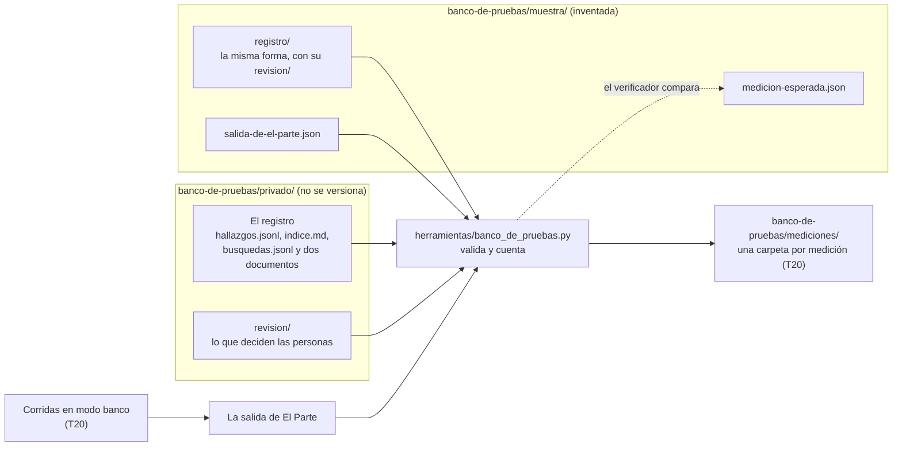

# El formato del registro del banco de pruebas

El registro es lo que dejó la vigilancia anterior del BPS ([arranque/proyecto.md](../arranque/proyecto.md), "El banco de pruebas"). No se versiona, porque es material de otro proyecto y tiene datos personales ([adrs/0007-registro-del-banco-fuera-del-repositorio.md](../adrs/0007-registro-del-banco-fuera-del-repositorio.md)). Este documento dice qué forma tiene: así la medición (tablero, T20) sabe qué leer, y la muestra sintética tiene la misma forma.

El formato lo controla [`herramientas/banco_de_pruebas.py`](../herramientas/banco_de_pruebas.py). El registro real se validó con las reglas de ese control el 2026-11-14: cumple el formato y da un aviso, descrito más abajo. [PROVEN: las reglas de lectura del registro de `herramientas/banco_de_pruebas.py`, corridas sobre `banco-de-pruebas/privado/`, 2026-11-14] Los conteos de este documento salen de esa validación y de lecturas de la estructura del registro, sin copiar su contenido. [PROVEN: misma fecha]

## Dónde está cada cosa

- **El registro real** está en `banco-de-pruebas/privado/`, que `.gitignore` deja afuera. La medición lo lee desde una ruta configurable, que por omisión es esa.
- **La revisión** va en la subcarpeta `revision/` de la carpeta del registro. La escriben personas que leen el registro, así que tampoco se versiona.
- **La muestra sintética** está en `banco-de-pruebas/muestra/`: un registro inventado con su revisión, una salida de El Parte inventada y la medición que tiene que dar.

## Los archivos del registro

| Archivo | Qué tiene | Lo usa la medición |
|---|---|---|
| `hallazgos.jsonl` | Una línea por cada cosa que la vigilancia vio y clasificó. | Sí: es lo que se compara. |
| `indice.md` | Qué noches cubre el registro y con cuánto detalle. | Sí: el período, y la duración de la vigilancia donde consta. |
| `busquedas.jsonl` | Algunas consultas puntuales de la vigilancia, con su resultado. | No. Queda como contexto. |
| `web-watch-bps.md` | El documento original de la vigilancia, acumulado y condensado. | No. De acá se extrajeron los otros. |
| `limitaciones.md` | Qué datos no existen y por qué. | No. |

Los dos primeros son obligatorios; `busquedas.jsonl` es opcional. Los documentos no tienen formato: el control no los lee, pero entran en la huella.

## hallazgos.jsonl

Una línea JSON por entrada, con estos diez campos, siempre todos:

| Campo | Tipo | Qué es |
|---|---|---|
| `id` | texto `AAAA-MM-DD-N` | Identificador, único en el archivo. Si la entrada tiene noche, empieza con ella. |
| `noche` | fecha o `null` | La noche en que la vigilancia la vio. Un hallazgo siempre la tiene. |
| `clasificacion` | `nuevo`, `actualizacion`, `ya_conocido` o `descartado` | Lo que hizo la vigilancia. Los hallazgos son `nuevo` y `actualizacion`. |
| `organismo` | texto | De quién habla, en texto libre. |
| `sitio` | texto o `null` | El dominio donde se leyó, a veces con una aclaración entre paréntesis. |
| `tipo_de_fuente` | `oficial`, `prensa` u `otro` | |
| `url` | texto o `null` | Empieza con `http://` o `https://`. |
| `publicado` | fecha o `null` | La fecha de publicación, cuando el documento original la da. |
| `que_dice` | texto | Un resumen de una o dos líneas. |
| `motivo` | texto o `null` | Por qué se descartó o por qué ya se conocía. Todo descarte lo tiene. |

Las fechas son `AAAA-MM-DD`. El control da error si falta o sobra un campo, si un valor no es del tipo de la tabla, si un `id` se repite o no empieza con su noche, si un hallazgo no tiene noche o si un descarte no tiene motivo.

**Datos personales.** `organismo`, `que_dice`, `motivo`, `url` y `sitio` son texto del otro proyecto y pueden nombrar personas ([adrs/0008-datos-personales.md](../adrs/0008-datos-personales.md)). La medición usa solo `id`, `noche`, `clasificacion` y `publicado`; los otros campos los leen las personas que hacen la revisión. Nada de esos campos sale del registro.

**En el registro real** hay 84 entradas: 17 nuevas, 2 actualizaciones, 2 ya conocidas y 63 descartes. Las noches van del 2026-09-09 al 2026-11-14; 5 descartes no tienen noche, y en esos casos la fecha del `id` es otra fecha del documento original. Tienen URL 34 entradas, y 18 de los 19 hallazgos; tienen fecha de publicación 63. Son 56 de fuentes oficiales, 23 de prensa y 5 de otras. [PROVEN: lectura del registro, 2026-11-14]

Entre la fecha de publicación y la noche en que la vigilancia lo vio, en los 13 hallazgos nuevos que tienen las dos fechas, pasaron de 0 a 324 días, con una mediana de 22. [PROVEN: misma lectura] La vigilancia buscaba por tema y encontraba tarde; El Parte lee lo publicado cada día. Por eso la medición coteja por la cosa encontrada y no por la noche ([banco-de-pruebas/metricas.md](metricas.md)).

## indice.md

Un documento Markdown con tres secciones `##`, que se reconocen por cómo empiezan:

- **`## A.`** Las noches con registro propio, en una tabla con estas columnas: `fecha`, `hallazgos`, `estado`, `duracion`, `costo`, `notas`. La fecha es `AAAA-MM-DD` y no se repite; `hallazgos` es un número entero, la cantidad de nuevos y actualizaciones de esa noche; `duracion` es `hh:mm:ss` o `null`; `costo` es un número o `null`.
- **`## B.`** Los tramos condensados, en una tabla con estas columnas: `tramo`, `noches en el tramo`, `noches del tramo con fila propia en A`, `hallazgos adicionales en el tramo (mas alla de las filas de A)`, `estado`, `duracion`, `costo`. El tramo es `AAAA-MM-DD a AAAA-MM-DD`. La tercera columna es una lista de fechas separadas por coma, o `(ninguna)`. Un tramo puede incluir noches que también tienen fila en A.
- **`## Totales`** Una lista con `- Primera noche: AAAA-MM-DD`, `- Ultima noche: AAAA-MM-DD` y `- Total de noches en el periodo: N`. Las dos primeras son obligatorias: definen el período del registro.

Los encabezados de las tablas tienen que ser esos, sin importar mayúsculas. El control da error si una tabla falta, tiene otro encabezado o una fila con otra cantidad de columnas, o si una fecha, una duración o un número no tienen la forma de arriba.

**En el registro real**, A tiene 13 noches y B tiene 6 tramos que suman 73 noches; 8 de esas también están en A, así que el período tiene 78 noches, del 2026-08-29 al 2026-11-14, sin huecos. Solo una noche tiene duración, la del 2026-11-14, y ninguna tiene costo. [PROVEN: validación del registro, 2026-11-14]

## busquedas.jsonl

Una línea JSON por consulta, con tres campos: `noche` (una fecha, o un rango `AAAA-MM-DD/AAAA-MM-DD` cuando el documento original habla de un tramo), `consulta_o_url` (el texto buscado o la URL leída) y `resultado` (`nada`, `fallo`, `encontro` o `null`).

No es la lista de todo lo que se consultó: el documento original no la guardaba. [PROVEN: `banco-de-pruebas/privado/limitaciones.md`, 2026-11-14] Por eso la medición no la compara. **En el registro real** hay 52 consultas, 28 de ellas URLs: 26 sin novedad, 19 fallidas, 6 con algo encontrado y 1 sin resultado. [PROVEN: lectura del registro, 2026-11-14]

## Errores y avisos

El control separa dos cosas:

- **Error:** el archivo no cumple el formato y no se puede leer como dice este documento. Con un error no se mide.
- **Aviso:** el registro se contradice, por ejemplo cuando el índice dice un número de hallazgos y `hallazgos.jsonl` tiene otro. Se mide igual, y la medición cuenta los avisos.

Los avisos que busca: una noche de A con otra cantidad de hallazgos que `hallazgos.jsonl`; un tramo con otra cantidad de noches que las de su rango, o con otros hallazgos adicionales; una fecha de la tercera columna de B que no es una fila de A dentro del tramo; noches del período que no están en A ni en un tramo, o noches de las tablas fuera del período; un total de noches distinto del período; una entrada con su noche fuera del período.

**El registro real da un aviso:** el tramo del 2026-10-01 al 2026-10-16 dice 0 hallazgos adicionales, y `hallazgos.jsonl` tiene uno con noche 2026-10-01, que no es una noche de A. Es un hallazgo de prensa, fuera del alcance de El Parte, así que no cambia lo que se mide. [PROVEN: validación del registro, 2026-11-14]

## La huella

Para saber con qué registro exacto se hizo cada medición, sin publicarlo, se guarda su huella ([adrs/0007-registro-del-banco-fuera-del-repositorio.md](../adrs/0007-registro-del-banco-fuera-del-repositorio.md)). Se calcula así:

1. Se toman los archivos que están directamente en la carpeta del registro, sin las subcarpetas.
2. Se ordenan por nombre y se escribe una línea por archivo: el nombre, un tabulador, el sha256 de sus bytes en hexadecimal y un salto de línea.
3. La huella es `sha256:` seguido del sha256 de ese texto en UTF-8.

La revisión tiene su propia huella, calculada igual sobre los archivos de `revision/`. Como la huella depende de cada byte, los archivos de la muestra se guardan con saltos de línea LF en cualquier sistema, por la regla de [`.gitattributes`](../.gitattributes).

La huella del registro real validado el 2026-11-14 es `sha256:7d142fe895a672ac13a01aa57ee9f3c3e89f0315b0545977c9250d2d2c0b3bd6`. [PROVEN: validación del registro, 2026-11-14]

## La revisión

El registro dice qué hizo la vigilancia, pero no qué fuente de El Parte publica cada cosa, ni si un descarte es un hecho que El Parte tendría que publicar. Eso lo decide una persona leyendo el registro, y queda en tres archivos JSON por línea dentro de `revision/`. Cómo los usa la medición está en [banco-de-pruebas/metricas.md](metricas.md).

**`entradas.jsonl`**, una línea por entrada del registro:

| Campo | Qué es |
|---|---|
| `id` | El de la entrada en `hallazgos.jsonl`. Cada una se revisa una sola vez. |
| `fuente` | La fuente de El Parte que publica esa cosa: `arce`, `bid`, `banco-mundial`, `presidencia` o `impo`, los identificadores de `parte.fuentes`. `null` si ninguna la publica. |
| `etiqueta` | Solo en descartes y ya conocidos: `publicable` (un hecho real y nuevo de la entidad, que la vigilancia descartó por tema), `otra-entidad` (no es de la entidad: una sigla que coincide, una mención al pasar), `no-nuevo` (material viejo o repetido) o `sin-decidir`. |
| `nota` | Opcional, para quien revisa. |

Las entradas que no están en el archivo cuentan como sin revisar, y el control da un aviso.

Para elegir la fuente sirve el sitio, pero decide la cosa: una operación del BID leída en un sitio espejo es de la fuente `bid`.

| Dónde se leyó | Fuente de El Parte |
|---|---|
| `comprasestatales.gub.uy` | `arce` |
| `impo.com.uy`, solo las normas | `impo` |
| `data.iadb.org` o un espejo de sus operaciones | `bid` |
| `projects.worldbank.org` o `search.worldbank.org` | `banco-mundial` |
| `gub.uy/presidencia/institucional/normativa` | `presidencia` |
| El sitio del BPS, la prensa y el resto | `null` |

Las fuentes salen de [docs/fuentes/README.md](../docs/fuentes/README.md) y del ADR 0010 ([adrs/0010-impo-como-quinta-fuente.md](../adrs/0010-impo-como-quinta-fuente.md)).

**`correspondencias.jsonl`**, una línea por cada par de una entrada y un hecho de El Parte que hablan de la misma cosa: `registro` (el `id`), `hecho` (la clave del hecho, `fuente:identificador:tipoDeHecho`, de [docs/contratos.md](../docs/contratos.md)) y, opcional, `juicio`: `correcto`, que es lo que vale si falta, o `contenido-equivocado`, si El Parte encontró la cosa pero dice algo que la fuente no dice. Una entrada puede corresponder a varios hechos, por ejemplo el llamado y la adjudicación de la misma compra. Las claves de los hechos son deterministas, así que las correspondencias sirven para las mediciones siguientes.

**`extras.jsonl`**, una línea por hecho de El Parte que no corresponde a nada del registro y que una persona juzgó: `hecho` (la clave) y `juicio`: `correcto`, `otra-entidad`, `no-nuevo` o `contenido-equivocado`.

**`sorteo.json`**, opcional: los extras elegidos al azar para juzgar a mano cuando son demasiados para juzgarlos todos. Lo escribe `python3 herramientas/banco_de_pruebas.py sortear carpeta salida.json tamaño semilla`, y tiene `salida` (la huella de la salida de la que se sortearon), `semilla`, `tamano`, `poblacion` (cuántos extras había) y `claves` (las de los sorteados). Con la misma salida, las mismas correspondencias y la misma semilla, el sorteo da lo mismo. Cuando hay sorteo, se juzgan en `extras.jsonl` los sorteados; cómo se cuenta está en [banco-de-pruebas/metricas.md](metricas.md).

El control da error si un `id` o una clave no existen o no tienen la forma, si un valor no es de las listas, si una línea se repite o si el sorteo no tiene sus campos. Da aviso si una correspondencia une una entrada de una fuente con un hecho de otra, si un extra también tiene correspondencia o si hay extras juzgados fuera del sorteo.

## La salida de El Parte

Es lo que producen las corridas en modo banco (T20), un JSON con estos campos. Se guarda en `banco-de-pruebas/mediciones/<medición>/salida-de-el-parte.json`, y cómo se produce está en el [ADR 0014](../adrs/0014-medicion-contra-el-banco.md) (`adrs/0014-medicion-contra-el-banco.md`).

| Campo | Qué es |
|---|---|
| `commit` | El commit de El Parte que corrió. |
| `entidad` | La entidad medida, por ejemplo `organismo:bps`. |
| `fuentes` | Las fuentes que leyó esta medición. |
| `modelos` | Opcional: el modelo de cada agente. |
| `corridas` | Una por noche: `noche`, `corrida` (su id), `estado` (`completa`, `cortada` o `fallida`), `noRepetibles` (las fuentes que no dejaron pedir esa fecha, D1), `costoUsd`, `duracionSegundos` y `lecturasFallidas`. |
| `hechos` | Uno por clave de hecho de la entidad: `clave`, `noche` y `grado`. Son la primera noche en que salió PROVEN o INFERRED, con ese grado; si nunca salió así, la primera en que salió `NOT_MENTIONED`. |

Cada corrida en modo banco tiene como fecha objetivo la noche que repite ([docs/contratos.md](../docs/contratos.md), `corrida.iniciada`).
