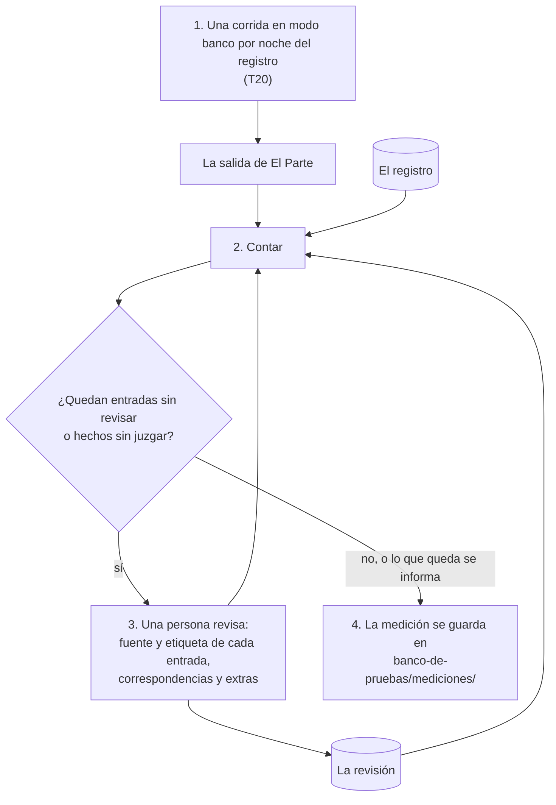
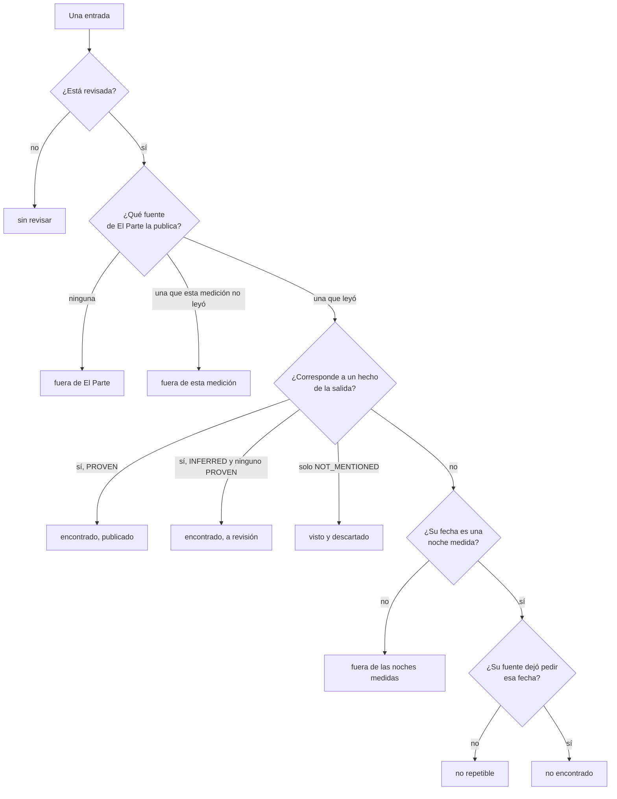
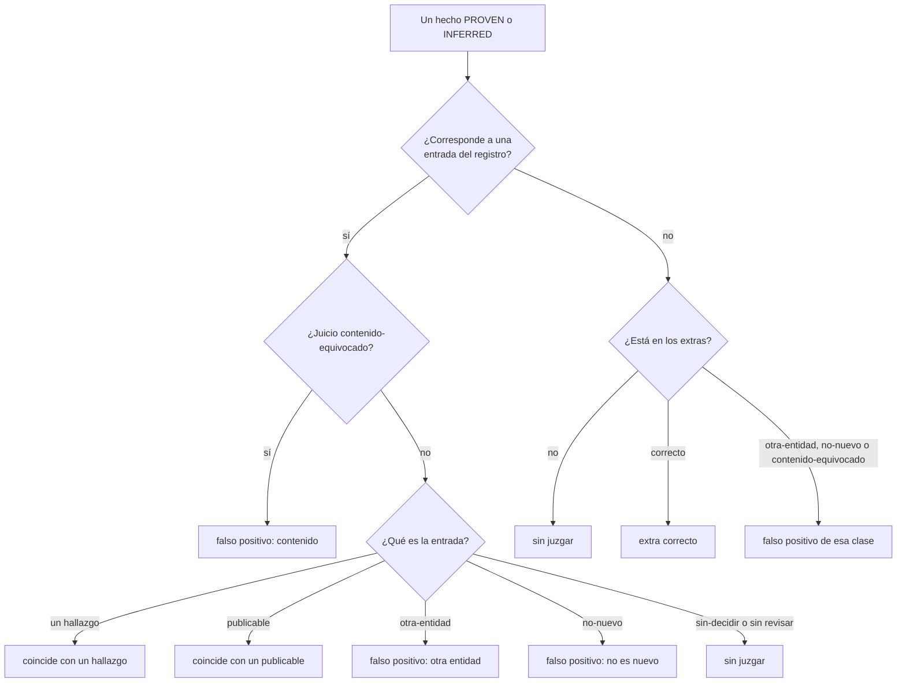

# Las métricas del banco de pruebas

Cómo se mide El Parte contra el registro de la vigilancia anterior: qué se cuenta, cómo se decide cada caso y qué forma tiene una medición. Correr la medición es la tarjeta T20 del tablero. El formato de lo que se lee está en [banco-de-pruebas/formato.md](formato.md), y el cómputo de referencia, en [`herramientas/banco_de_pruebas.py`](../herramientas/banco_de_pruebas.py).

Una medición responde tres preguntas:

- **Cobertura:** de lo que la vigilancia encontró, y de lo publicable que descartó, ¿cuánto encontró El Parte?
- **Precisión:** de lo que El Parte publicó o mandó a revisión, ¿cuánto está bien?
- **Costo y duración** de cada noche.

## Cómo se arma una medición

1. **Correr.** Una corrida en modo banco por cada noche del período del registro, en orden, con esa noche como fecha objetivo ([docs/contratos.md](../docs/contratos.md), `corrida.iniciada`), en un Docker Compose aparte con su propia base ([adrs/0014-medicion-contra-el-banco.md](../adrs/0014-medicion-contra-el-banco.md)). Lo que producen es la salida de El Parte ([banco-de-pruebas/formato.md](formato.md), "La salida de El Parte").
2. **Contar** el registro, la revisión y la salida, con `python3 herramientas/banco_de_pruebas.py contar <carpeta del registro> <salida>`.
3. **Revisar.** Lo que el cómputo no puede decidir solo lo decide una persona que lee el registro: a qué fuente de El Parte corresponde cada entrada y qué etiqueta lleva cada descarte, qué hecho corresponde a qué entrada, y si cada hecho que no corresponde a nada está bien o mal. Después se vuelve a contar; no hace falta volver a correr, porque la salida queda guardada.
4. **Guardar** la medición en `banco-de-pruebas/mediciones/`, en la carpeta de la medición y al lado de su salida. Lo que no se revisó no se esconde: se informa como "sin revisar" o "sin juzgar", y nunca cuenta como acierto ni como error.

## Qué pasa con cada entrada del registro

Se evalúan los hallazgos (las entradas `nuevo` y `actualizacion`) y los descartes y ya conocidos que la revisión etiquetó `publicable`. Cada uno termina en uno de nueve resultados, en este orden:

| Resultado | Qué quiere decir |
|---|---|
| encontrado, publicado | El Parte sacó al menos un hecho PROVEN que corresponde: va a la página de la mañana. |
| encontrado, a revisión | Lo que sacó es INFERRED: va a la revisión humana (D6). |
| visto y descartado | El Parte lo leyó, pero el refutador lo graduó NOT_MENTIONED. Sirve para ver dónde se le escapa. |
| no encontrado | Estaba a su alcance, en una noche medida y repetible, y no lo sacó. |
| no repetible | Su fuente no dejó pedir lo publicado esa fecha (D1). |
| fuera de las noches medidas | Su fecha, la de publicación o si no consta la noche, no es una de las que corrió esta medición: por ejemplo, algo publicado antes de la primera noche del registro. |
| fuera de esta medición | Lo publica una fuente de El Parte que esta medición no leyó, como el BID para la primera rebanada. |
| fuera de El Parte | Ninguna fuente de El Parte lo publica: el sitio del BPS, la prensa. |
| sin revisar | Falta su línea en la revisión. |

La entrada y el hecho se cotejan por la cosa, no por la noche. El Parte lee lo publicado cada día, y la vigilancia encontraba cosas días o meses después: la mitad de sus hallazgos nuevos, más de 22 días después de publicados ([banco-de-pruebas/formato.md](formato.md)). Para cada entrada encontrada se informa cuántos días antes que la vigilancia la vio El Parte (`diasDeAdelanto`: la noche de la entrada menos la primera noche en que salió el hecho; si es negativo, la vio después).

## Cómo se cuentan los descartes

- **Decisión.** Un descarte del registro no es, por sí solo, un falso positivo de El Parte. La revisión le pone una etiqueta, y lo mismo a los ya conocidos:
  - **`publicable`**: un hecho real y nuevo de la entidad, que la vigilancia descartó porque no era de su tema. Se mide como un hallazgo, en su propio bloque, "publicables". Si El Parte lo publica, acierta.
  - **`otra-entidad`**: no es de la entidad. Si El Parte lo publica para la entidad, es un falso positivo de entidad.
  - **`no-nuevo`**: material viejo o repetido. Si El Parte lo publica como nuevo, es un falso positivo de novedad.
  - **`sin-decidir`**: si El Parte lo publica, queda sin juzgar.
- **Por qué.** La vigilancia seguía un tema puntual y El Parte no filtra por tema: publica los hechos de las entidades que alguien sigue ([arranque/proyecto.md](../arranque/proyecto.md), "Lo que trae el registro"). En el registro hay 63 descartes y 2 ya conocidos; 6 de esos descartes y 1 de los ya conocidos son de ARCE, la fuente de la primera rebanada, y ninguno de los hallazgos lo es. [PROVEN: lectura del registro, 2026-11-14] Contar esos descartes como errores castigaría a El Parte justo por hacer lo que tiene que hacer.
- **Costo.** Una persona tiene que etiquetar cada descarte leyendo el registro. Mientras no lo haga, el descarte queda sin revisar.
- **Qué la haría cambiar.** Que El Parte filtre por tema: entonces lo descartado por tema volvería a ser un falso positivo.

## Qué pasa con cada hecho de El Parte

Se juzga cada hecho de la salida que salió PROVEN o INFERRED. Los NOT_MENTIONED no se publican y se cuentan aparte, como descartados por El Parte.

Son **verdaderos** los que coinciden con un hallazgo o con un publicable y los extras correctos. Los **falsos positivos** son de tres clases: de entidad, de novedad y de contenido. Lo que queda **sin juzgar** se informa y no entra en la precisión.

Los INFERRED se cuentan aparte de los PROVEN. Los INFERRED no llegan a la página de la mañana sin revisión humana (D6), y medir cuánto aciertan es lo que dice cuándo se puede aflojar el umbral ([docs/contratos.md](../docs/contratos.md), "Umbral de revisión").

## Las cuentas

- **Cobertura** = encontrados / (encontrados + vistos y descartados + no encontrados), una para los hallazgos y otra para los publicables. Lo no repetible, lo que está fuera de las noches medidas, de esta medición o de El Parte, y lo sin revisar no entran: no dicen nada de cómo trabaja El Parte. Si el divisor es cero, la cobertura es `null`: no se puede medir.
- **Precisión** = verdaderos / (verdaderos + falsos positivos), para los PROVEN, para los INFERRED y para todos juntos. Si el divisor es cero, `null`.
- **Días de adelanto:** la mediana de los de cada entrada encontrada.
- **Costo y duración:** el total y el promedio por noche de lo que informan las corridas. El registro no tiene costos, y tiene la duración de una sola noche; donde la tiene, va al lado de la de El Parte.

Las proporciones se redondean a cuatro decimales.

### Cuando los extras son demasiados

Una medición larga deja muchos más extras de los que se pueden juzgar uno por uno: las 78 noches del registro dejaron 789. Entonces se juzga un sorteo: `herramientas/banco_de_pruebas.py sortear` elige al azar, con una semilla, los extras que se juzgan, y los deja en `revision/sorteo.json` ([banco-de-pruebas/formato.md](formato.md)). La precisión de arriba sigue contando solo lo juzgado, y la medición suma una estimación:

- **Precisión de los extras** = correctos del sorteo / juzgados del sorteo, con su intervalo de Wilson al 95 %.
- **Precisión de todo lo publicado** = (verdaderos con correspondencia + precisión de los extras × extras) / (juzgados con correspondencia + extras). Los hechos con correspondencia se juzgan uno por uno; los extras, por el sorteo. El intervalo se arma igual, con los extremos del de los extras.

La estimación va en `hechos.sorteoDeExtras` y solo aparece si hay sorteo. Si el sorteo es de otra salida, el conteo da error: hay que sortear de nuevo. Un extra juzgado fuera del sorteo cuenta en la precisión de lo juzgado pero no en la estimación, que vale porque el sorteo es al azar.

## La forma de una medición

Una medición es un JSON, el que escribe `herramientas/banco_de_pruebas.py contar`. Cada medición tiene su carpeta, `banco-de-pruebas/mediciones/AAAA-MM-DD-N/` (la fecha en que se midió y un número de orden), con dos archivos: `salida-de-el-parte.json`, lo que produjeron las corridas, y `medicion.json`, lo que dio el conteo. Con la salida guardada, cualquiera que tenga el registro puede volver a contar sin volver a correr.

| Campo | Qué tiene |
|---|---|
| `registro` | La huella del registro, su primera y su última noche, y cuántas entradas tiene. |
| `revision` | La huella de la revisión y cuántas entradas quedaron sin revisar. |
| `elParte` | El commit, la entidad, las fuentes leídas y los modelos, copiados de la salida. |
| `noches` | Cuántas se midieron, cuántas terminaron completas, cortadas o fallidas, cuántas tuvieron fuentes no repetibles, el costo total y por noche, y la duración por noche. |
| `hallazgos` y `publicables` | Para cada bloque: el total, los encontrados (publicados y a revisión), los vistos y descartados, los no encontrados, los no repetibles, los que quedan fuera de las noches medidas, de esta medición y de El Parte, los sin revisar, la cobertura y la mediana de días de adelanto. |
| `hechos` | Para `PROVEN`, `INFERRED` y `todos`: el total, los verdaderos, los falsos positivos por clase, los sin juzgar y la precisión; cuántos descartó El Parte; y, si hay sorteo, `sorteoDeExtras`: la población, el tamaño, la semilla, los juzgados, los correctos, los falsos por clase, la precisión de los extras y la de todo, cada una con su intervalo al 95 %. |
| `detalle` | El resultado de cada entrada evaluada, por `id`, con las claves de sus hechos; el de cada hecho, con el `id` con el que coincide; y cada noche, con su costo, su duración y la de la vigilancia si consta. |

Una medición lleva solo huellas, identificadores, claves de hechos, fechas, clasificaciones y conteos. Nunca lleva texto del registro ni de la revisión: ni `organismo`, ni `que_dice`, ni `motivo`, ni `url`, ni `sitio`, ni las notas. Así se puede versionar sin publicar el registro ([adrs/0007-registro-del-banco-fuera-del-repositorio.md](../adrs/0007-registro-del-banco-fuera-del-repositorio.md)).

## Lo que la medición no dice

- **Mide un poco de más.** Las corridas leen hoy lo que la fuente tiene de una noche pasada, ya completo; una noche real ve menos, porque ARCE publica con atraso. La cobertura medida puede salir mejor que la de todas las noches. [INFERRED: del atraso de ARCE, [adrs/0011-grabacion-y-repeticion-de-corridas.md](../adrs/0011-grabacion-y-repeticion-de-corridas.md)]
- **Es una sola pasada.** El modelo no responde siempre igual. Repetir una medición desde sus grabaciones da los mismos mensajes, no otra muestra.

## El ejemplo de la muestra

La muestra sintética tiene un caso de cada resultado. Su registro, su revisión y su salida están en `banco-de-pruebas/muestra/`, y lo que tiene que dar, en [`banco-de-pruebas/muestra/medicion-esperada.json`](muestra/medicion-esperada.json). El verificador controla que lo dé (punto 11 de [`herramientas/verificar_docs.py`](../herramientas/verificar_docs.py)), y la medición de T20 tiene que dar lo mismo con esa entrada.

| Bloque | Resultado |
|---|---|
| Hallazgos (9) | 1 encontrado y publicado, 1 encontrado a revisión, 1 visto y descartado, 1 no encontrado, 1 no repetible, 1 fuera de las noches medidas, 1 fuera de esta medición y 2 fuera de El Parte. Cobertura: 2 de 4, 0,5. |
| Publicables (3) | 2 encontrados y publicados y 1 no encontrado. Cobertura: 2 de 3, 0,6667. |
| Hechos PROVEN (5) | 3 verdaderos, 1 falso positivo de entidad y 1 de contenido. Precisión: 3 de 5, 0,6. |
| Hechos INFERRED (4) | 1 verdadero, 1 falso positivo de entidad, 1 de novedad y 1 sin juzgar. Precisión: 1 de 3, 0,3333. |
| Noches (8) | 7 completas y 1 cortada, una con IMPO no repetible; 0,84 USD en total y 287,5 segundos por noche. |

## Lo que puede decir la medición de la primera rebanada

La primera rebanada lee solo ARCE. Ninguno de los 19 hallazgos del registro sale de ARCE ([arranque/proyecto.md](../arranque/proyecto.md)), así que, si la revisión lo confirma, su cobertura de hallazgos va a ser `null`: no se puede medir. Lo que sí se mide es la cobertura de los publicables de ARCE, hasta 7 si la revisión etiqueta así sus 6 descartes y su ya conocido, y la precisión de todo lo que publique. [INFERRED: de los conteos del registro, antes de la revisión]
