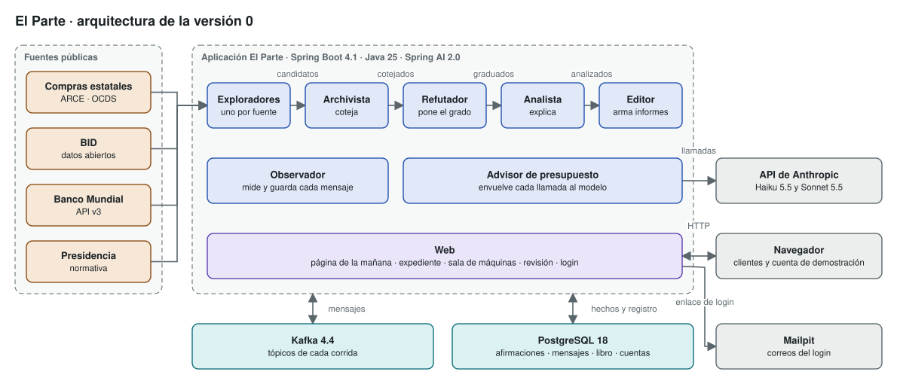
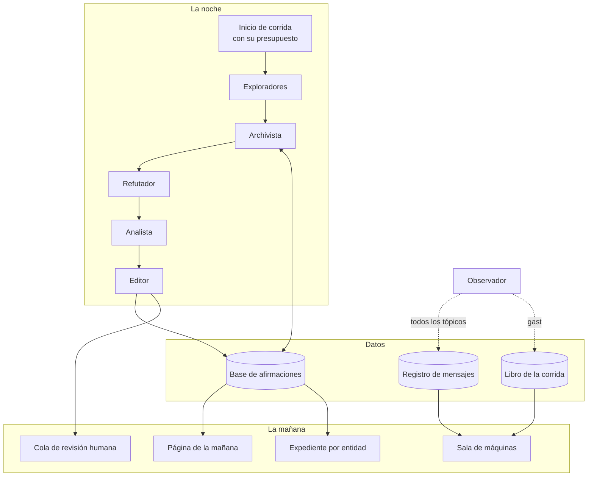
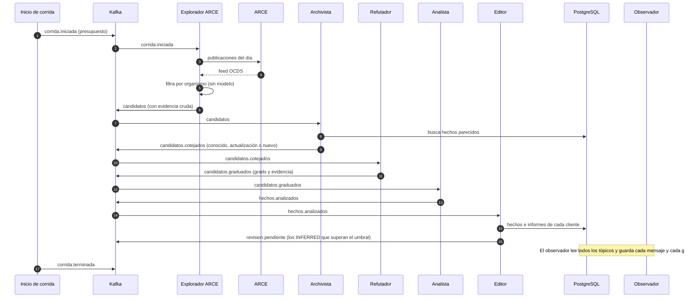
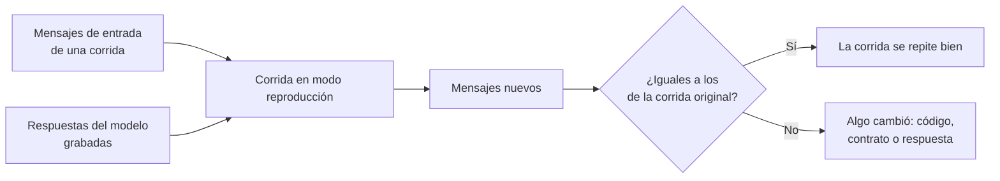

# Arquitectura

Cómo está armado El Parte en la versión 0: qué piezas tiene, cómo se pasan el trabajo durante una noche, qué ve cada persona a la mañana y qué pasa cuando algo falla. Se apoya en los ADRs [0002](../adrs/0002-orquestacion-por-mensajes.md) a [0008](../adrs/0008-datos-personales.md), todos aceptados salvo el 0006, que sigue propuesto: si alguno cambia, este documento cambia con él.

## La lámina

La lámina se genera con `python3 herramientas/generar_laminas.py` desde [laminas/arquitectura.json](laminas/arquitectura.json), y no se edita a mano (regla 5). El verificador falla si el SVG no coincide con su fuente.

## Tres ideas que ordenan todo

1. **El camino de la noche es fijo.** Los agentes no deciden a quién pasarle el trabajo: lo define la topología de tópicos. El modelo de lenguaje trabaja adentro de cada agente, nunca entre ellos ([ADR 0002](../adrs/0002-orquestacion-por-mensajes.md)).
2. **Solo los exploradores salen a la red.** Todo lo que viene después (archivista, refutador, analista, editor) trabaja con lo que está en los mensajes y en la base. Por eso una corrida se puede repetir sin red: alcanza con sus mensajes de entrada y las respuestas del modelo grabadas.
3. **Todo queda registrado.** El observador guarda cada mensaje, cada llamada al modelo y cada gasto. La sala de máquinas se arma con ese registro, así que no puede contar algo distinto de lo que pasó.

## Visión general

## Los agentes

Por qué existe cada uno está en [arranque/proyecto.md](../arranque/proyecto.md). Acá va qué recibe, qué produce y con qué modelo trabaja.

| Agente | Lee de | Publica en | Modelo | Toca la base |
|---|---|---|---|---|
| Explorador (uno por fuente) | `corrida.iniciada` | `candidatos` | Haiku 5.5 | No |
| Archivista | `candidatos` | `candidatos.cotejados` | Haiku 5.5 | Lee hechos conocidos |
| Refutador | `candidatos.cotejados` | `candidatos.graduados` | Sonnet 5.5 | Lee la evidencia de hechos conocidos |
| Analista | `candidatos.graduados` | `hechos.analizados` | Sonnet 5.5 | No |
| Editor | `hechos.analizados` | `informes`, `revision.pendiente` | Haiku 5.5 | Escribe hechos e informes |
| Observador | todos los tópicos | nada | ninguno | Escribe el registro y el libro |

Los modelos de la tabla son los valores iniciales del [ADR 0003](../adrs/0003-eleccion-del-stack.md): el de cada agente se cambia sin reiniciar la aplicación y vale desde la corrida siguiente. El contenido de cada mensaje está en [contratos.md](contratos.md) y las tablas en [base-de-afirmaciones.md](base-de-afirmaciones.md).

Dos decisiones de diseño que no se ven en la tabla:

- **El explorador de ARCE filtra con código antes de usar el modelo.** ARCE publica unas 600 compras por día hábil. El explorador descarta con un filtro común las que no son de organismos seguidos, y recién lo que queda pasa por el modelo ([ADR 0006](../adrs/0006-fuentes-de-la-version-0.md)).
- **Solo el editor escribe hechos en la base.** El archivista y el refutador la leen para cotejar, pero un hecho existe recién cuando pasó por toda la cadena. Así, una corrida cortada nunca deja hechos a medio verificar.

## Una noche, paso a paso

Los candidatos marcados como **conocidos** por el archivista no siguen al refutador: solo se registra que se volvieron a ver. Las **actualizaciones** y los **nuevos** siguen la cadena. Los que el refutador gradúa como **NOT_MENTIONED** no llegan al analista ([ADR 0004](../adrs/0004-grados-de-evidencia.md)).

## La mañana

- **Página de la mañana.** Cada cliente ve lo nuevo de la noche sobre sus suscripciones, con la fuente y el grado de cada hecho. Si no hubo nada, lo dice con claridad. Si la corrida se cortó por presupuesto, dice cuántos candidatos quedaron sin revisar.
- **Expediente.** Todo lo que la base sabe de una entidad, con su historia, para consultar cuando se quiera.
- **Revisión humana.** Una cola, en la sala de máquinas, con los hechos INFERRED que pasaron el umbral. Mientras nadie los revisa, se muestran marcados como pendientes de revisión (D6).
- **Sala de máquinas.** Por cada corrida y cada hallazgo: qué agente hizo qué, qué refutó el refutador y por qué, contra qué se cotejó, cuánto costó y cuánto tardó. Al lado, la sección "Cómo funciona", que enlaza a esta documentación.
- **Acceso.** Login por enlace de correo con el token de un solo uso de Spring Security: cuatro usuarios invitados y una cuenta de demostración de solo lectura ([ADR 0003](../adrs/0003-eleccion-del-stack.md)).

## Repetir una corrida

Repetir una corrida sirve para dos cosas: probar el sistema sin red ni costo, y medirlo contra las noches del banco de pruebas.

- **Para probar:** se inyectan los mensajes de entrada guardados y el modelo de reproducción devuelve las respuestas grabadas ([ADR 0003](../adrs/0003-eleccion-del-stack.md)). Una corrida repetida tiene que producir los mismos mensajes.
- **Para medir contra el banco de pruebas:** los exploradores piden a cada fuente lo publicado en la fecha de cada noche, y lo que encuentra El Parte se compara con lo que encontró la vigilancia anterior (D1). La forma de las métricas va en T12.

## Cuando algo falla

| Qué falla | Qué hace el sistema | Dónde se ve |
|---|---|---|
| Una fuente no responde o bloquea | El explorador publica que la fuente falló y la corrida sigue con las demás. | Sala de máquinas: fuentes bloqueadas por noche. |
| Se acaba el presupuesto | La llamada que no entra no se hace, la corrida queda cortada y lo pendiente queda sin procesar ([ADR 0005](../adrs/0005-presupuesto-por-corrida.md)). | Página de la mañana y sala de máquinas. |
| El modelo devuelve algo que no cumple el contrato | Spring AI valida la salida contra su esquema y la vuelve a pedir; si sigue fallando, el candidato queda sin procesar. | Sala de máquinas. |
| Un mensaje llega dos veces | Se procesa una sola vez, por su identificador y la identidad del hecho ([contratos.md](contratos.md)). | Nada que mostrar: no cambia el resultado. |
| Un agente se cae a mitad de corrida | Al volver, sigue desde el último mensaje que no confirmó. [ASSUMED: se verifica con Spring for Apache Kafka al construir la rebanada] | Sala de máquinas: duración de la corrida. |

## Despliegue

Todo corre con `docker compose up`: la aplicación, Kafka, PostgreSQL y Mailpit. El diagrama está en el [ADR 0003](../adrs/0003-eleccion-del-stack.md). Dónde se publica el servicio para los usuarios invitados se decide con un ADR en el cuarto fin de semana (D9).

## Dónde sigue

- El contenido de cada mensaje, la identidad de un hecho y el umbral de revisión: [contratos.md](contratos.md).
- Las tablas de la base: [base-de-afirmaciones.md](base-de-afirmaciones.md).
- Qué datos personales se descartan en cada fuente: [ADR 0008](../adrs/0008-datos-personales.md).
