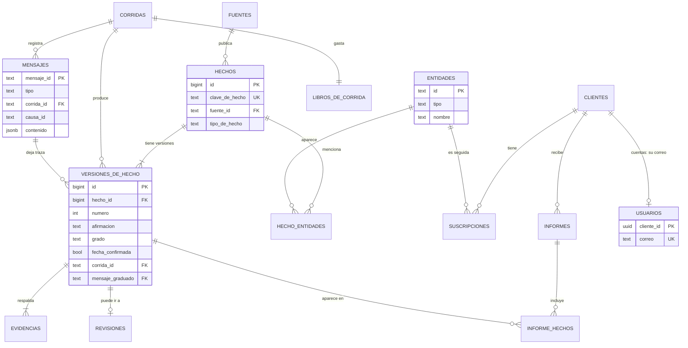

# Base de afirmaciones

El modelo de datos de El Parte en PostgreSQL 18 ([ADR 0003](../adrs/0003-eleccion-del-stack.md)): qué tablas hay, qué guarda cada una y cómo salen de ellas la página de la mañana, el expediente y la sala de máquinas. Implementa los [contratos](contratos.md) y las decisiones sobre datos personales del [ADR 0008](../adrs/0008-datos-personales.md).

## Dos esquemas separados

- **`parte`**: hechos, entidades, corridas, mensajes, suscripciones e informes. Es la base de afirmaciones. No tiene ningún dato personal.
- **`cuentas`**: los correos de los usuarios y los tokens del login. Solo lo usa el módulo de login ([ADR 0008](../adrs/0008-datos-personales.md)).

La aplicación se conecta con dos roles de base distintos: el de los agentes y la web no tiene permiso sobre `cuentas`, y el del login no tiene permiso sobre `parte`. [ASSUMED: el reparto de permisos por esquema se prueba al escribir las migraciones de la primera rebanada (T08)]

## Diagrama



## Las tablas

El DDL de abajo es el modelo de la versión 0. Las migraciones de la primera rebanada (T08) parten de acá. Se probó entero contra PostgreSQL 18.6 el 2026-11-07, en un contenedor de la imagen oficial `postgres:18`: crea las 16 tablas sin errores, la consulta de la página de la mañana corre, y una versión INFERRED sin razonamiento es rechazada por la base. [PROVEN: ejecución del bloque SQL y de una inserción de prueba, 2026-11-07]

```sql
create schema parte;
create schema cuentas;

-- Fuentes: una fila por fuente de la versión 0 (ADR 0006).
create table parte.fuentes (
    id             text primary key,                 -- 'arce', 'bid', 'banco-mundial', 'presidencia'
    nombre         text not null,
    url            text not null,
    licencia       text not null,
    verificada_en  date not null,
    activa         boolean not null default true
);

-- Entidades a las que alguien se puede suscribir. Nunca personas físicas (ADR 0008).
create table parte.entidades (
    id                text primary key,              -- por ejemplo 'organismo:bps'
    tipo              text not null check (tipo in ('organismo', 'persona_juridica', 'programa', 'licitacion', 'proyecto')),
    nombre            text not null,
    identificadores   jsonb not null default '{}',   -- RUT, códigos en cada fuente
    creada_en         timestamptz not null default now()
);

-- Corridas y su libro de gasto (ADR 0005).
create table parte.corridas (
    id                    text primary key,          -- por ejemplo 'c-2026-11-06-normal'
    modo                  text not null check (modo in ('normal', 'reproduccion', 'banco')),
    fecha_objetivo        date not null,
    estado                text not null check (estado in ('en_curso', 'completa', 'cortada', 'fallida')),
    limite_alcanzado      text check (limite_alcanzado in ('costo', 'pasos', 'tiempo')),
    presupuesto_usd       numeric(10, 4) not null,
    presupuesto_pasos     integer not null,
    presupuesto_minutos   integer not null,
    iniciada_en           timestamptz not null,
    terminada_en          timestamptz
);

create table parte.libros_de_corrida (
    corrida_id      text primary key references parte.corridas (id),
    gastado_usd     numeric(10, 6) not null default 0,
    reservado_usd   numeric(10, 6) not null default 0,
    pasos           integer not null default 0,
    actualizado_en  timestamptz not null default now()
);

-- Registro de mensajes: lo escribe el observador (ADR 0002). La sala de máquinas sale de acá.
create table parte.mensajes (
    mensaje_id   text primary key,
    tipo         text not null,
    version      integer not null,
    corrida_id   text not null references parte.corridas (id),
    causa_id     text,
    agente       text not null,
    emitido_en   timestamptz not null,
    contenido    jsonb not null
);
create index mensajes_por_corrida on parte.mensajes (corrida_id, emitido_en);
create index mensajes_por_causa on parte.mensajes (causa_id);

-- Lo que procesó cada agente, para la idempotencia (docs/contratos.md).
create table parte.mensajes_procesados (
    consumidor    text not null,
    mensaje_id    text not null,
    procesado_en  timestamptz not null default now(),
    primary key (consumidor, mensaje_id)
);

-- Hechos: la identidad. Su contenido está en las versiones.
create table parte.hechos (
    id               bigint generated always as identity primary key,
    clave_de_hecho   text not null unique,           -- fuente:identificador:tipoDeHecho
    fuente_id        text not null references parte.fuentes (id),
    tipo_de_hecho    text not null,
    creado_en        timestamptz not null default now()
);

create table parte.hecho_entidades (
    hecho_id    bigint not null references parte.hechos (id),
    entidad_id  text not null references parte.entidades (id),
    rol         text not null,                       -- comprador, proveedor, prestatario...
    primary key (hecho_id, entidad_id, rol)
);

-- Cada versión de un hecho, con su grado y la traza de los agentes que la produjeron.
create table parte.versiones_de_hecho (
    id                   bigint generated always as identity primary key,
    hecho_id             bigint not null references parte.hechos (id),
    numero               integer not null,
    afirmacion           text not null,
    grado                text not null check (grado in ('PROVEN', 'INFERRED')),
    razonamiento         text,
    fecha_publicacion    text not null,              -- como la da la fuente
    fecha_confirmada     boolean not null,
    que_dice             text not null,
    por_que_importa      text not null,
    que_mirar            text not null,
    estado_revision      text not null check (estado_revision in ('no_requiere', 'pendiente', 'aceptado', 'rechazado')),
    corrida_id           text not null references parte.corridas (id),
    mensaje_candidato    text not null references parte.mensajes (mensaje_id),
    mensaje_cotejado     text not null references parte.mensajes (mensaje_id),
    mensaje_graduado     text not null references parte.mensajes (mensaje_id),
    mensaje_analizado    text not null references parte.mensajes (mensaje_id),
    creada_en            timestamptz not null default now(),
    unique (hecho_id, numero),
    check (grado <> 'INFERRED' or razonamiento is not null)
);

create table parte.evidencias (
    id               bigint generated always as identity primary key,
    version_id       bigint not null references parte.versiones_de_hecho (id),
    url              text not null,
    fragmento        text not null,                  -- ya enmascarado (ADR 0008)
    hash_contenido   text
);

create table parte.revisiones (
    version_id    bigint primary key references parte.versiones_de_hecho (id),
    estado        text not null check (estado in ('aceptado', 'rechazado')),
    nota          text,
    revisada_en   timestamptz not null default now()
);

-- Clientes: identificador opaco y nada más (ADR 0008).
create table parte.clientes (
    cliente_id   uuid primary key,
    alias        text not null,                      -- por ejemplo 'Cliente 2' o 'Demostración'
    es_demo      boolean not null default false
);

create table parte.suscripciones (
    cliente_id   uuid not null references parte.clientes (cliente_id),
    entidad_id   text not null references parte.entidades (id),
    creada_en    timestamptz not null default now(),
    primary key (cliente_id, entidad_id)
);

create table parte.informes (
    id                bigint generated always as identity primary key,
    cliente_id        uuid not null references parte.clientes (cliente_id),
    fecha_objetivo    date not null,
    corrida_id        text not null references parte.corridas (id),
    sin_novedades     boolean not null,
    corrida_cortada   boolean not null,
    creado_en         timestamptz not null default now(),
    unique (cliente_id, fecha_objetivo, corrida_id)
);

create table parte.informe_hechos (
    informe_id   bigint not null references parte.informes (id),
    version_id   bigint not null references parte.versiones_de_hecho (id),
    primary key (informe_id, version_id)
);

-- Esquema aparte: los correos (ADR 0008). Los tokens del login se guardan como los defina
-- la implementación de Spring Security que se use, también en este esquema.
create table cuentas.usuarios (
    cliente_id   uuid primary key,                   -- el mismo identificador que parte.clientes
    correo       text not null unique,
    creado_en    timestamptz not null default now()
);
```

Algunas decisiones que se ven en el DDL:

- **Los grados guardados son solo PROVEN e INFERRED.** Un candidato NO_MENCIONADO no es un hecho: queda en el registro de mensajes, donde lo muestra la sala de máquinas ([ADR 0004](../adrs/0004-grados-de-evidencia.md)).
- **Un INFERRED sin razonamiento no entra.** Lo impide una restricción de la tabla, no solo el código.
- **La traza es parte de cada versión.** Cada versión apunta a los cuatro mensajes que la produjeron: candidato, cotejo, graduación y análisis. Desde ahí, siguiendo `causa_id`, se llega a la corrida.
- **`cuentas.usuarios` no tiene clave foránea hacia `parte.clientes`.** Los dos esquemas comparten el identificador, pero ninguno depende del otro, así se pueden separar en bases distintas si hace falta.

## Cómo salen las vistas

| Vista | De dónde sale |
|---|---|
| Página de la mañana | Las versiones de hecho de la última corrida sobre entidades a las que el cliente está suscripto, con su grado, su evidencia y su estado de revisión. Si no hay ninguna, el informe tiene `sin_novedades`. |
| Expediente | Todas las versiones de todos los hechos de una entidad, en orden, con su historia. |
| Revisión humana | Las versiones con `estado_revision = 'pendiente'`. Al revisarlas se crea una fila en `revisiones` y se actualiza el estado. |
| Sala de máquinas | Los mensajes de una corrida, encadenados por `causa_id`, más su libro de gasto. El costo por agente sale de los mensajes `uso.modelo`. |

Por ejemplo, la página de la mañana de un cliente es, en esencia, esta consulta:

```sql
select h.clave_de_hecho, v.afirmacion, v.grado, v.que_dice, v.por_que_importa,
       v.que_mirar, v.estado_revision, v.fecha_confirmada
from parte.informes i
join parte.informe_hechos ih on ih.informe_id = i.id
join parte.versiones_de_hecho v on v.id = ih.version_id
join parte.hechos h on h.id = v.hecho_id
where i.cliente_id = :cliente and i.fecha_objetivo = :fecha
order by v.grado, h.tipo_de_hecho;
```

## Lo que no está en la base

- **La tabla de precios de los modelos** está en un archivo versionado del repositorio, con la fuente y la fecha de cada precio ([ADR 0005](../adrs/0005-presupuesto-por-corrida.md)).
- **El registro del banco de pruebas** está fuera del repositorio y fuera de la base ([ADR 0007](../adrs/0007-registro-del-banco-fuera-del-repositorio.md)). Las métricas de cada medición se guardan en el repositorio (T12).
- **Los textos crudos completos de las fuentes**: solo se guarda el fragmento enmascarado de la evidencia y la huella del contenido. La URL lleva al original.
