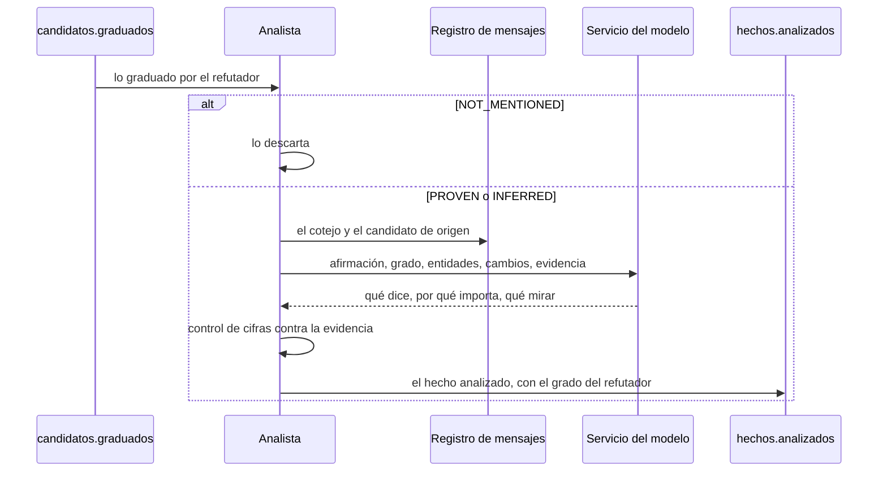

# Cómo se hizo: el analista

El agente que escribe, para quien sigue a una entidad, qué dice un hecho, por qué importa y qué mirar después (tablero, T21). El diseño está en [adrs/0015-que-puede-escribir-el-analista.md](../../adrs/0015-que-puede-escribir-el-analista.md), el mensaje que emite en [docs/contratos.md](../contratos.md) (`hechos.analizados`), y el código, en `app/src/main/java/io/github/andresdiegolanda/elparte/analista/Analista.java`.

## Qué hace

1. Recibe cada candidato graduado. Los NOT_MENTIONED no siguen ([adrs/0004-grados-de-evidencia.md](../../adrs/0004-grados-de-evidencia.md)).
2. Busca en el registro de mensajes el cotejo del archivista y el candidato del explorador, por la cadena de causas: de ahí saca el tipo de hecho, la fecha de publicación, las entidades y, si es una actualización, lo que cambió.
3. Le pide al modelo un `Analisis` con los tres campos. El modelo es el que la corrida fijó para el analista, Sonnet 5.5 por ahora ([adrs/0003-eleccion-del-stack.md](../../adrs/0003-eleccion-del-stack.md)), y la llamada se graba como todas, así la corrida se repite sin costo.
4. Controla lo que volvió: un campo vacío, o con una cifra que no está en la afirmación, en la evidencia, en el razonamiento ni en las fechas, no se usa.
5. Emite `hechos.analizados` con el grado copiado del refutador.

La página de la mañana muestra el análisis debajo de la afirmación graduada, en un bloque que dice que lo escribe el analista y que no cambia el grado.

## Por qué existe

La afirmación del refutador está escrita para compararla con la fuente: "Banco de Previsión Social adjudicó la compra 1200007 en 2 adjudicaciones, a Laboratorio Uno S.A., Laboratorio Dos S.A.: Ácido fólico; Vitamina D; Hierro y otros ítems." Es exacta, pero quien sigue al BPS y no conoce las compras del Estado no sabe qué hacer con ella. El analista la pone en lenguaje llano y dice por qué le puede importar, sin tocar lo que está probado.

## Cómo se construyó

- **El pedido al modelo** lleva lo que el refutador ya dejó, y nada de la fuente original: el analista no sale a la red ni vuelve a leer la publicación ([docs/arquitectura.md](../arquitectura.md), "Solo los exploradores salen a la red"). El razonamiento va solo si el grado es INFERRED, y la instrucción pide decir que se deduce.
- **El control de cifras** es código, no otra llamada al modelo. Las cifras se comparan sin separadores ni ceros a la izquierda, y de una fecha valen sus partes, para que el modelo pueda decir "6 de noviembre de 2026" de "2026-11-06".
- **Sin análisis no es sin hecho.** Si el modelo falla, o un campo no pasa el control, el campo empieza con "Sin análisis" y dice por qué, y el hecho se publica igual. La página usa ese comienzo para no mostrar el bloque cuando no hay nada que mostrar.
- **El modelo de mentira de las pruebas** (`app/src/test/java/io/github/andresdiegolanda/elparte/ModeloDePrueba.java`) responde también como analista: reconoce el pedido por su primera línea, "Hecho graduado (tipo, grado):".

## Qué se probó

- **El control** (`app/src/test/java/io/github/andresdiegolanda/elparte/analista/AnalistaTest.java`): un análisis sin datos inventados sale tal cual y con el grado del refutador; un monto que no está en la evidencia hace que "qué dice" vuelva a ser la afirmación, y un plazo inventado deja "qué mirar" sin análisis; sin respuesta del modelo, el hecho sale igual; un campo vacío no se usa; y las cifras se comparan sin separadores.
- **La noche de punta a punta** (`app/src/test/java/io/github/andresdiegolanda/elparte/PrimeraRebanadaTest.java`): ahora hay seis llamadas al modelo, tres del refutador y tres del analista, y la noche cuesta 0,024 USD; cada hecho analizado tiene el grado de su candidato graduado; la repetición no llama al modelo y da los mismos mensajes; y la página de la mañana muestra "Por qué importa" y "Qué mirar".
- **La medición** (`app/src/test/java/io/github/andresdiegolanda/elparte/banco/MedicionContraElBancoTest.java`): las tres noches de prueba hacen seis llamadas y gastan 0,024 USD, y el tope de la medición se cuenta con eso.

## Qué falló

- **El control al revés.** La primera versión usaba la afirmación cuando "qué dice" pasaba el control, y el texto del modelo cuando no pasaba. Lo encontraron las pruebas del control antes de llegar a la noche de punta a punta.

## Qué falta

- **Un sorteo de análisis**, como el de los extras, para saber si los análisis dicen algo falso sin cifras, que es lo que el control no ve.

Medido contra el banco en la medición `2026-11-16-2`: el analista costó más que lo estimado en el ADR 0015, y el control dejó "Sin análisis" algunos campos, cuando citaban una cifra que no está en la evidencia o el modelo no los escribió. Las cifras están en [docs/como-se-hizo/medicion-contra-el-banco.md](medicion-contra-el-banco.md), "Lo que cuesta el analista". [PROVEN: base de la medición, 2026-11-17]
- **La revisión humana** (T23) es la otra forma de encontrar un análisis equivocado.
