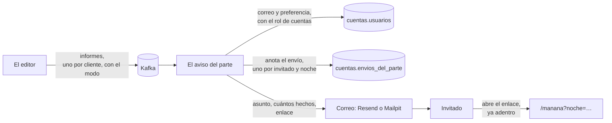

# Cómo se hizo: el aviso diario

El correo corto que le llega cada mañana a cada invitado que lo quiere (tablero, T35). El diseño está en [adrs/0013-acceso-perfil-y-parte-diario.md](../../adrs/0013-acceso-perfil-y-parte-diario.md), punto 6, y el mensaje que escucha, en [docs/contratos.md](../contratos.md), `informes`.

## Qué hace

- **Escucha `informes`**, el mensaje que el editor emite por cada cliente al cerrar la corrida. Solo avisa si la corrida es normal: el mensaje trae su modo, y una medición del banco o una repetición no mandan nada.
- **Busca el correo y la preferencia** en `cuentas.usuarios`, con el rol de las cuentas. La cuenta de demostración no tiene correo, y un invitado desactivado o que apagó el aviso en su perfil no lo recibe.
- **Anota el envío** en `cuentas.envios_del_parte` antes de mandar, uno por invitado y por noche. Si ya estaba, no manda: un mensaje que llega dos veces, o una noche que se corre otra vez a mano, avisa una sola vez.
- **Manda un aviso corto.** El asunto dice la noche y cuántos hechos hay ("El Parte de la noche del 2026-11-16: 3 hechos", o "sin novedades"). El cuerpo suma cuántos esperan revisión, si la corrida se cortó por su presupuesto, el enlace a la página de esa noche y el del perfil para apagarlo. No lleva lo que dice cada hecho: el parte es la página, con su evidencia y su traza.
- **Si el correo no sale**, borra la anotación y deja un aviso en el registro de la aplicación, sin el correo.

## Por qué existe

El Parte se lee a la mañana, y sin aviso cada invitado tiene que acordarse de entrar. El aviso es cómo el parte llega a cada uno; la página sigue siendo el parte.

## Cómo se construyó

- **El modo, en el mensaje.** `informes` suma el campo `modo`, como pedía el ADR 0013, así el aviso no lee nada del esquema `parte`: usa solo el rol de las cuentas, y ningún componente lee correos y hechos a la vez ([ADR 0008](../../adrs/0008-datos-personales.md)). Una repetición emite sus informes con el modo `reproduccion`, y la comparación con la original deja ese campo afuera, como ya dejaba afuera `corrida.iniciada` (`app/src/main/java/io/github/andresdiegolanda/elparte/corrida/ComparacionDeCorridas.java`).
- **Uno por noche, no por corrida.** El diseño anotaba un envío por cliente y corrida. Se anota por cliente y noche: si el responsable vuelve a correr una noche a mano, los invitados no reciben un segundo aviso de la misma noche.
- **Nada viejo.** El aviso escucha `informes` desde el principio del tópico, como los demás consumidores. Al prenderlo por primera vez leería todos los informes guardados, así que un informe de hace más de 36 horas no se avisa.
- **Apagado si no se prende.** `elparte.aviso.prendido` viene en falso. En local, `compose.yaml` lo prende, porque el correo va a Mailpit y no le llega a nadie. Publicado, `compose.publicado.yaml` lo deja apagado hasta que el responsable lo prenda en el `.env` con `ELPARTE_AVISO_PRENDIDO=true`.
- **El mismo correo que el enlace.** Sale por SMTP con el mismo remitente y la misma configuración que el enlace para entrar: Resend publicado ([ADR 0016](../../adrs/0016-despliegue-en-la-maquina-del-responsable.md)), Mailpit en local.

El código está en `app/src/main/java/io/github/andresdiegolanda/elparte/acceso/AvisoDelParte.java`, `app/src/main/java/io/github/andresdiegolanda/elparte/acceso/CorreoDelAviso.java` y la migración `app/src/main/resources/db/migration/V7__aviso.sql`.

## Qué se probó

`app/src/test/java/io/github/andresdiegolanda/elparte/acceso/AvisoDelParteTest.java`, con noches de agosto en las que ARCE de prueba no publica nada:

- Una noche normal manda un aviso a cada invitado y ninguno a la demostración, con el asunto "sin novedades", el enlace a esa noche y el del perfil, y sin claves de hechos.
- La misma noche otra vez no vuelve a avisar.
- Una repetición no avisa, aunque se borren los envíos anotados de esa noche.
- Una invitada que apagó el aviso no lo recibe; el responsable, sí.
- El asunto y el cuerpo dicen cuántos hechos hay, cuántos esperan revisión y si la corrida se cortó.

Las pruebas de la primera rebanada siguen viendo que una repetición produce los mismos mensajes que la original.

## Qué falló

Nada en el código. La primera versión sacaba el modo del `corrida.iniciada` de la misma corrida, para no tocar el mensaje `informes` y que las repeticiones siguieran idénticas. Eso hacía que el aviso leyera el registro de mensajes del esquema `parte`, contra el diseño de dos roles sin cruces. Se volvió a lo que dice el ADR: el modo va en el mensaje, y la comparación lo deja afuera.

## Qué falta

- **Ver el primer aviso de verdad.** Está prendido en la aplicación publicada desde el 2026-11-18; el primero sale con el informe de la próxima noche normal.
