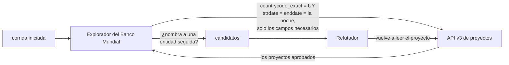

# Cómo se hizo: el explorador del Banco Mundial

Los proyectos del Banco Mundial para Uruguay que el directorio aprueba cada noche, y un candidato por cada uno que nombra a una entidad seguida (tablero, T24). La fuente está en [docs/fuentes/banco-mundial.md](../fuentes/banco-mundial.md), y la decisión de leerla, como fuente secundaria, en [adrs/0006-fuentes-de-la-version-0.md](../../adrs/0006-fuentes-de-la-version-0.md).

## Qué hace

1. **Los aprobados de la noche.** Un pedido a la versión 3 de la API de búsqueda de proyectos, con Uruguay (`UY`) y la noche como fecha de aprobación del directorio. Se piden solo nueve campos: identificador, nombre, fecha de aprobación, prestatario, agencia ejecutora, monto, estado, objetivo y resumen. Lo que llegue de más se descarta antes de guardar nada: el jefe de equipo del banco no se pide ni se guarda.
2. **El filtro.** Busca a cada entidad seguida en el nombre, la agencia ejecutora, el prestatario, el objetivo y el resumen del proyecto, que están en inglés: por su sigla, en mayúsculas y como palabra entera, y por los nombres que tenga para el Banco Mundial en sus identificadores. El BPS tiene "Banco de Previsión Social", que se encuentra también sin tildes, "Social Security Bank", "Social Security Institute" y "BPS".
3. **El candidato.** Uno por proyecto, con el tipo de hecho `aprobacion` y la clave `banco-mundial:P513691:aprobacion`. La evidencia es el identificador, el nombre, la fecha y el pedazo del primer campo que nombra a la entidad. La URL es la página pública del proyecto.
4. **El refutador** vuelve a pedir el proyecto por su identificador, con los mismos campos, y se lo muestra al modelo, con el resumen recortado a 4.000 caracteres.

## Por qué existe

Es una de las fuentes de la versión 0, como fuente secundaria ([ADR 0006](../../adrs/0006-fuentes-de-la-version-0.md)). Uruguay tiene muy poco movimiento en el Banco Mundial: el último proyecto se aprobó el 2026-09-10, y el anterior, el 2024-09-30. Casi todas las noches no trae nada. En el registro del banco de pruebas no hay ninguna entrada del Banco Mundial.

## Cómo se construyó

- **Con la API de verdad primero.** Se volvió a probar la versión 3: el filtro por fecha de aprobación da el proyecto P513691 el 2026-09-10 y nada el día siguiente, un día sin proyectos responde `"projects": {}`, y el pedido por identificador trae un proyecto o ninguno. [PROVEN: consultas a https://search.worldbank.org/api/v3/projects, 2026-11-18] Una búsqueda de "BPS" en los proyectos de Uruguay da tres, todos de 2007.
- **Los campos acotados.** El parámetro `fl` limita lo que se pide, pero la API igual agrega campos propios, como `proj_id`. El lector copia solo los nueve campos de la lista, así la huella del contenido y lo grabado no dependen de lo que la API agregue (ADR 0008).
- **El mismo molde que el BID.** Lector, explorador y una rama del refutador, y el reconocimiento de entidades compartido con IMPO y el BID (`app/src/main/java/io/github/andresdiegolanda/elparte/fuentes/NombresDeEntidad.java`).

El código está en `app/src/main/java/io/github/andresdiegolanda/elparte/fuentes/bancomundial/`.

## Qué se probó

- **Con un Banco Mundial de mentira**, en `app/src/test/java/io/github/andresdiegolanda/elparte/fuentes/bancomundial/ExploradorBancoMundialTest.java`: de dos proyectos aprobados una noche, sale un candidato, el que tiene al BPS como agencia ejecutora, y se publica; el otro no sigue. Los dos traen un jefe de equipo inventado, que no queda en ninguna grabación ni en ningún mensaje. La repetición da los mismos mensajes sin pedirle nada al Banco Mundial.
- **Contra el banco**, con Presidencia: [docs/como-se-hizo/presidencia.md](presidencia.md), "Qué se probó".

## Qué falló

- **El User-Agent con tilde.** En la medición 2026-11-18-4, cada pedido al Banco Mundial dio 403 y cada noche terminó con `fuente.fallida`. El lector se presentaba como "El Parte (proyecto didáctico; ...)": el cliente HTTP de Java manda la tilde tal cual por HTTP/2, y el Banco Mundial rechaza el pedido. El mismo pedido con "didactico" da 200, y con un signo de pregunta en el lugar de la tilde, también. [PROVEN: pedidos a https://search.worldbank.org/api/v3/projects desde la máquina de la medición, 2026-11-18] Las pruebas no lo vieron porque el Banco Mundial de mentira habla HTTP/1.1, donde Java cambia la tilde por un signo de pregunta antes de mandarla. Se cambió el User-Agent a ASCII en los cuatro lectores que lo mandan, y `app/src/test/java/io/github/andresdiegolanda/elparte/fuentes/AgenteDeUsuarioTest.java` lee el código y falla si alguno no es ASCII. IMPO, el BID y Presidencia lo aceptaban con tilde.
- **Lo que la fuente no tiene**: como en el BID, da el estado de hoy de cada proyecto y no el de esa noche (D1).

## Qué falta

- **Los avisos de adquisiciones**, que siguen en la versión 2 de la API, no se filtran por fecha y traen datos de contacto que hay que tapar.
- **Que la versión 3 cambie.** No está documentada: si cambia, el lector falla con `fuente.fallida` de tipo `formato` y lo dice la sala de máquinas.
