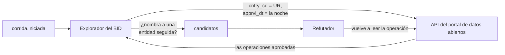

# Cómo se hizo: el explorador del BID

Las operaciones del Banco Interamericano de Desarrollo para Uruguay aprobadas cada noche, y un candidato por cada una que nombra a una entidad seguida (tablero, T24). La fuente está en [docs/fuentes/bid.md](../fuentes/bid.md), y la decisión de leerla, en [adrs/0006-fuentes-de-la-version-0.md](../../adrs/0006-fuentes-de-la-version-0.md).

## Qué hace

1. **Las aprobadas de la noche.** Un pedido a la tabla de proyectos del portal, un CKAN, con Uruguay (`UR`) y la fecha de aprobación de la noche. La fecha va como la guarda el BID, en texto (`2026-11-04 00:00:00.000000000`).
2. **El filtro.** Busca a cada entidad seguida en el nombre y el objetivo de la operación, que están en inglés: por su sigla, en mayúsculas y como palabra entera, y por los nombres que tenga para el BID en sus identificadores. El BPS tiene "Social Security Bank" y "BPS".
3. **El candidato.** Uno por operación, con el tipo de hecho `aprobacion` y la clave `bid:UR-L1222:aprobacion`. La evidencia es el número, el nombre, la fecha y el pedazo del objetivo que nombra a la entidad. La URL es la página pública de la operación.
4. **El refutador** vuelve a pedir la operación por su número y se la muestra al modelo, con el objetivo recortado a 4.000 caracteres.

La tabla de proyectos no tiene datos de personas, así que no hay nada que tapar. Las adjudicaciones, que nombran a consultores individuales, no se leen.

## Por qué existe

Es una de las cinco fuentes de la versión 0 ([ADR 0006](../../adrs/0006-fuentes-de-la-version-0.md)). En el registro del banco de pruebas hay cuatro entradas del BID: una es un hallazgo, el perfil de una operación de modernización del BPS leído en un espejo, y las otras tres son operaciones de otras entidades.

## Cómo se construyó

- **Con la API de verdad primero.** Se volvió a leer el robots.txt del portal, que deja la API abierta y explica cómo usarla, y se probó el filtro por fecha: la noche del 2026-11-04 da una operación, la UR-L1222, que es la aprobada ese día. [PROVEN: consultas a https://data.iadb.org/api/3/action/datastore_search, 2026-11-17]
- **La operación del hallazgo no está en la tabla.** Pedida por su número, la UR-L1191 no trae nada, y una búsqueda de "BPS" en las operaciones de Uruguay da dos, de 2008 y 2011. [PROVEN: consultas a la API, 2026-11-17] El hallazgo del registro sale de un documento de la operación en preparación, que esta tabla no tiene: por fecha de aprobación, El Parte no lo puede ver.
- **El mismo molde que IMPO.** Lector, explorador y una rama del refutador, y el reconocimiento de entidades compartido entre las dos fuentes (`app/src/main/java/io/github/andresdiegolanda/elparte/fuentes/NombresDeEntidad.java`).

El código está en `app/src/main/java/io/github/andresdiegolanda/elparte/fuentes/bid/`.

## Qué se probó

`app/src/test/java/io/github/andresdiegolanda/elparte/fuentes/bid/ExploradorBidTest.java`, con un BID de mentira: de dos operaciones aprobadas una noche, sale un candidato, la que nombra al BPS por su sigla, y se publica; la otra no sigue. La repetición da los mismos mensajes sin pedirle nada al BID.

## Qué falló

Nada en el código. Lo que no anda es lo que la fuente no tiene: el estado de una operación en preparación y su historia (D1). Repetir una noche vieja trae lo que hoy se sabe de las operaciones aprobadas ese día.

## Qué falta

- **Medirlo contra el banco** con las 78 noches, cuando la clave tenga crédito otra vez. Se espera que no encuentre ninguna operación del BPS en esas noches.
- **Los avisos de adquisiciones**, que nombran adjudicatarios y necesitan su tapado.
