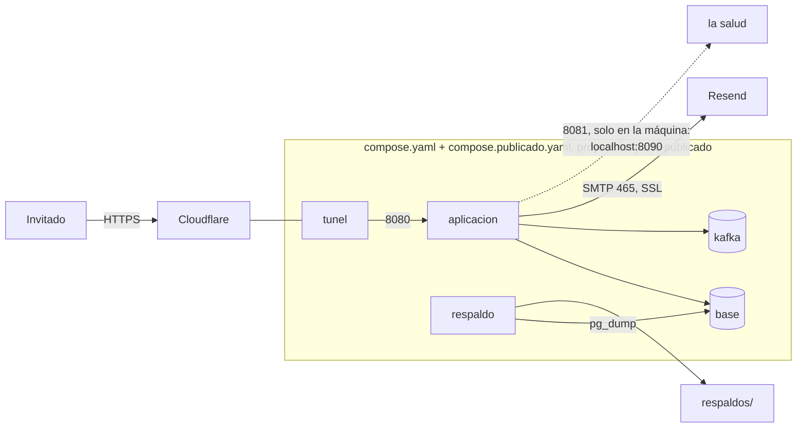

# Cómo se hizo: El Parte publicado

Cómo llega El Parte a los invitados desde la máquina del responsable (tablero, T27 y T40). La decisión está en [adrs/0016-despliegue-en-la-maquina-del-responsable.md](../../adrs/0016-despliegue-en-la-maquina-del-responsable.md), y los pasos para levantarlo, en [app/README.md](../../app/README.md), "Publicarla".

## Qué hace

`compose.publicado.yaml` no repite nada de `compose.yaml`: le suma lo que cambia al publicar.

- **El túnel.** Un servicio `tunel` con el conector de Cloudflare, que lee el token del túnel del `.env`. Adónde lleva el subdominio se configura en el panel de Cloudflare: a `http://aplicacion:8080`, el nombre del servicio dentro de la red del Compose.
- **El correo.** La aplicación pasa de Mailpit a Resend: servidor, puerto 465, usuario `resend`, la clave del `.env`, con usuario y SSL. Mailpit queda en un perfil que nunca se prende.
- **La corrida de cada noche**, prendida a las 6 de Uruguay.
- **Que vuelva sola**: `restart: unless-stopped` en todos los servicios.
- **La salud en otro puerto.** `MANAGEMENT_SERVER_PORT` la pasa al 8081, que en la máquina queda en `localhost:8090` y al que el túnel no llega.
- **Las copias.** Un servicio `respaldo` con la misma imagen de PostgreSQL espera a que existan las tablas, hace `pg_dump` en `respaldos/` y repite cada 24 horas.

## Por qué existe

Sin publicar, los invitados no pueden entrar: el login (T25) manda un enlace que tiene que abrirse desde afuera, y el aviso diario (T35) lleva a la página de cada uno. La máquina del responsable alcanza para cinco cuentas, y el túnel evita abrir puertos y administrar HTTPS.

## Cómo se construyó

- **Un archivo que se suma, no una copia.** Docker Compose combina los archivos en orden. Lo que no cambia queda en `compose.yaml`, y en `compose.publicado.yaml` va solo lo distinto. Para sacar o reemplazar listas heredadas se usan `!reset` y `!override`, como ya hacía `compose.banco.yaml`.
- **Los puertos, solo en la máquina, también en local.** Antes, `compose.yaml` abría la base, Kafka y Mailpit a toda la red, con las claves por omisión. Ahora todo va a `127.0.0.1`.
- **La dirección del enlace en local.** El `.env` es el mismo para local y publicado. Si `compose.yaml` tomara `ELPARTE_URL_PUBLICA` del `.env`, los enlaces de prueba en local apuntarían al subdominio público. En local quedan fijos `http://localhost:8080` y un remitente de prueba.
- **Las mediciones no ven a los invitados.** `compose.banco.yaml` le saca a su aplicación el `.env` entero (`env_file: !reset []`): su base tiene solo la cuenta de demostración, como antes del login.
- **El correo por propiedades de JavaMail.** `spring.mail.username` y `password` alcanzan para tener las credenciales, pero JavaMail solo se autentica con `mail.smtp.auth` y solo usa SSL con `mail.smtp.ssl.enable`. Las dos vienen apagadas, para Mailpit, y `compose.publicado.yaml` las prende. Se sumaron tiempos máximos de 10 segundos: el enlace se manda mientras la persona espera la página.
- **La salud no se publica.** Con el túnel, `/actuator/health` quedaba a la vista de cualquiera, con el detalle de la base y del disco, y cada consulta abría una conexión a Resend y otra a Kafka. Mostrar el detalle solo al responsable no resolvía lo segundo. Por eso va en otro puerto.
- **La primera copia esperaba la base vacía.** El servicio de copias dependía de que la base estuviera sana, no de que la aplicación hubiera creado las tablas. La primera prueba dejó una copia de 884 bytes. Ahora espera a que exista `parte.corridas`.

## Qué se probó

Todo en un Docker local, con un Mailpit que exige SSL y usuario en lugar de Resend y un token falso en lugar del de Cloudflare:

- `docker compose config` falla y dice qué falta si no están el token, la clave del correo, la dirección o el remitente.
- La aplicación levanta, y su indicador de salud del correo se conecta con SSL y usuario.
- Un invitado del `.env` pide el enlace y le llega desde el remitente del `.env`, con la dirección pública.
- `/actuator/health` no responde por el 8080 y sí por el 8090.
- La copia tiene los datos de las 22 tablas, también las tres del esquema `cuentas`. Se recuperó en una base nueva y en la misma base, donde lo agregado después de la copia desapareció.
- El conector lee el token y rechaza uno falso.
- Las pruebas de la aplicación siguen pasando.

## Qué falló

- **La copia vacía**, ver arriba.
- **La salud a la vista**, ver arriba. Se vio al mirar qué respondía la aplicación publicada por el puerto de la web.

## Qué falta

- **Probarlo con el túnel y Resend reales** (T40): el túnel creado, el dominio del correo verificado y sus claves en el `.env`.
- **Copiar las copias a otro disco.** Hoy quedan en la misma máquina.
