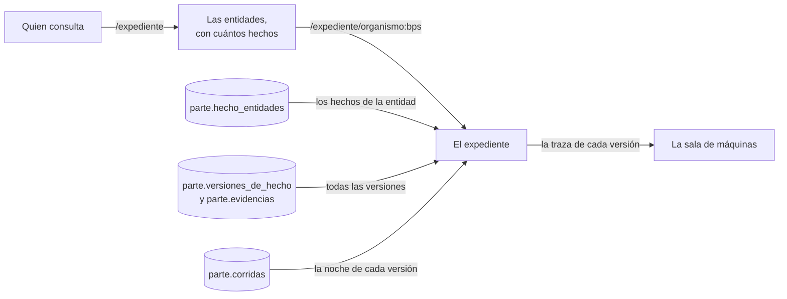

# Cómo se hizo: el expediente

Todo lo que la base sabe de una entidad: cada hecho con todas sus versiones, en orden, para consultar cuando se quiera y no solo lo de anoche (tablero, T33). Está en la arquitectura desde el principio ([docs/arquitectura.md](../arquitectura.md), "Expediente") y sale de las tablas de hechos ([docs/base-de-afirmaciones.md](../base-de-afirmaciones.md)).

## Qué hace

- **La lista** (`/expediente`, en el menú) tiene cada entidad, cuántos hechos hay de ella y la última noche con uno.
- **El expediente de una entidad** ordena sus hechos por la noche en que aparecieron: la más vieja de las corridas de sus versiones. Arriba, mes por mes, cuántos hechos nuevos hubo, de qué tipo, cuántas versiones y cuántas deducidas. Abajo, los hechos del mes elegido, por omisión el más reciente.
- **Cada hecho trae todas sus versiones**, en orden, cada una con su grado, su revisión, su análisis, su evidencia y el enlace a su traza en la sala de máquinas. Una versión rechazada en la revisión se ve tachada, como en la página de la mañana.
- **Se ve sin entrar.** Son hechos de fuentes públicas, ya enmascarados ([ADR 0008](../../adrs/0008-datos-personales.md)).

## Por qué existe

La página de la mañana muestra una noche, y los agentes de la noche ven un candidato por vez, a propósito, para que el grado no se contamine con el resto ([ADR 0004](../../adrs/0004-grados-de-evidencia.md)). Para ver a un organismo a lo largo del tiempo hace falta otra vista: qué compró, qué cambió de una versión a otra, qué quedó deducido.

## Cómo se construyó

- **Sin tablas nuevas.** Todo sale de lo que el editor ya guardaba: `parte.hechos`, `parte.hecho_entidades`, `parte.versiones_de_hecho`, `parte.evidencias`, `parte.revisiones` y la noche de cada corrida.
- **Por mes, no todo junto.** Un organismo que compra mucho junta cientos de hechos en pocas semanas. El resumen de arriba da la forma de todo el expediente, y abajo se lee un mes por vez.
- **Sin el modelo.** El expediente muestra lo que la base sabe; no le pide a nadie que lo lea. Leer el expediente con contexto largo, para ver patrones que una publicación sola no muestra, es otra cosa: necesita decidir qué puede escribir el modelo sobre muchos hechos juntos y cómo se gradúa eso, y queda en su propia tarjeta (T47).

El código está en `app/src/main/java/io/github/andresdiegolanda/elparte/web/ExpedienteControlador.java`, `app/src/main/resources/templates/expedientes.html` y `app/src/main/resources/templates/expediente.html`.

## Qué se probó

`app/src/test/java/io/github/andresdiegolanda/elparte/web/ExpedienteTest.java`, con una entidad que solo existe en la prueba y dos corridas de junio y julio que ninguna otra prueba usa:

- La lista tiene la entidad y el menú la enlaza.
- Sin mes, el expediente muestra el más reciente, con la adjudicación de julio y su traza, y no el llamado de junio.
- En junio, el llamado aparece con sus dos versiones en orden, la segunda deducida y pendiente de revisión, con su razonamiento.
- Una entidad que no existe da 404.

La página se miró en un navegador, desde las copias en `app/target/paginas/`.

## Qué falló

Nada en el código. En la primera mirada, cada versión sin revisión dejaba un renglón vacío, y la clave del hecho quedaba pegada al número de versiones.

## Qué falta

- **Leer el expediente con contexto largo** (T47).
