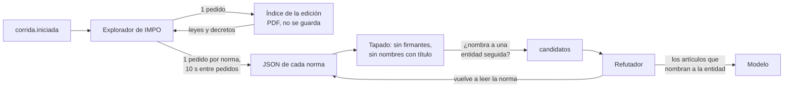

# Cómo se hizo: el explorador de IMPO

La quinta fuente de la versión 0: las leyes y los decretos del Diario Oficial que nombran a una entidad seguida, sin avisos y con las personas tapadas (tablero, T30). La decisión está en [adrs/0010-impo-como-quinta-fuente.md](../../adrs/0010-impo-como-quinta-fuente.md), y la fuente, en [docs/fuentes/impo.md](../fuentes/impo.md).

## Qué hace

1. **El índice.** El explorador pide el índice de la edición de la noche (`/diariooficial/AAAA/MM/DD/indice.pdf`). Si ese día no hubo edición, IMPO responde con un texto o sin nada, y no hay nada que leer. Del PDF saca las leyes y los decretos nacionales, hasta donde empiezan los gobiernos departamentales; del índice se graba esa lista, no el PDF.
2. **Cada norma.** Pide el JSON de cada ley y cada decreto, en ISO-8859-1, a diez segundos del pedido anterior. La pausa es una para toda la aplicación: el refutador tampoco pide más rápido.
3. **El tapado.** Antes de mirarla, saca los firmantes y cambia por `[persona]` los nombres que siguen a un título ("Sra.", "Dr. Mag.", "Esc."), a un tratamiento ("señora", "ciudadano") o que van en mayúsculas antes de un cargo, como en la firma de una ley.
4. **El filtro.** Busca cada entidad seguida en el nombre, los vistos y los artículos de la norma: por su nombre, sin importar tildes ni mayúsculas, y por su sigla, en mayúsculas y como palabra entera. Si no nombra a ninguna, no sigue: todo esto pasa antes de cualquier llamada al modelo.
5. **El candidato.** Uno por norma, con el tipo de hecho `norma` y la clave `impo:decretos-223-2026:norma`. El resumen sale del sumario del índice, y la evidencia, del campo que nombra a la entidad. La URL es la pública de la norma en IMPO, como pide la licencia.
6. **El refutador** vuelve a leer la norma, la tapa y le muestra al modelo sus datos, los vistos y hasta doce artículos que nombran a la entidad, cada uno de hasta 4.000 caracteres.

## Por qué existe

De los 19 hallazgos del registro del banco de pruebas, 2 son de IMPO: un decreto que reglamenta el régimen de facilidades de pago ante el BPS y la Ley de Rendición de Cuentas. Sin IMPO, quedan fuera del alcance de El Parte ([ADR 0010](../../adrs/0010-impo-como-quinta-fuente.md)).

## Cómo se construyó

- **Primero la fuente real.** Antes de escribir código se volvió a leer el robots.txt y se bajaron, a diez segundos entre pedidos, tres índices y dos normas, las de los dos hallazgos. Lo que mostraron está en [docs/fuentes/impo.md](../fuentes/impo.md), "Lo que se aprendió al construir el explorador": dónde está cada clase de norma, cómo se lee el índice, que la fecha de publicación no es la de promulgación y cómo firman las leyes.
- **PDFBox para el índice.** El índice es el único PDF que se lee. PDFBox, sin ordenar por posición, da cada documento en una línea que empieza con su número de orden, aunque el PDF esté a dos columnas.
- **El tapado, por reglas.** Como el de ARCE, sin el modelo. Se probó contra las dos normas reales: el decreto no tiene nombres en el texto, y la ley tenía dos en su firma, que la primera versión tapaba a medias.
- **El refutador, por fuente.** El mismo agente vuelve a leer ARCE o IMPO según de dónde viene el candidato. El pedido al modelo para ARCE no cambió, así las corridas grabadas se siguen repitiendo igual.
- **Una medición con algunas fuentes.** `ELPARTE_BANCO_FUENTES` acota la medición contra el banco a las fuentes que se nombran, para medir IMPO sin volver a pagar las 78 noches de ARCE ([app/README.md](../../app/README.md), "Medir contra el banco").

El código está en `app/src/main/java/io/github/andresdiegolanda/elparte/fuentes/impo/`.

## Qué se probó

- **Las piezas**, en `app/src/test/java/io/github/andresdiegolanda/elparte/fuentes/impo/PiezasDeImpoTest.java`: el índice da las leyes y los decretos con su identificador, y no las resoluciones; el tapado saca firmantes, nombres con título o tratamiento y firmas en mayúsculas, y no toca los cargos ni "Dirección Gral."; una entidad se reconoce por su nombre sin tildes y por su sigla, y la UTE no se confunde con la UTEC.
- **De punta a punta**, en `app/src/test/java/io/github/andresdiegolanda/elparte/fuentes/impo/ExploradorImpoTest.java`, con un IMPO de mentira que arma su índice en PDF: de una ley, dos decretos y una resolución, sale un candidato, el decreto que nombra al BPS; el que falla queda como `fuente.fallida`; la resolución no se pide; nada de lo grabado ni de los mensajes tiene a las personas; y la repetición da los mismos mensajes sin pedirle nada a IMPO.
- **Contra IMPO de verdad**, en la máquina del responsable, con una medición de una noche, la del 24/09/2026, solo con IMPO: leyó el índice y los tres decretos de esa edición, y se quedó con uno, el Decreto 223/026, el del hallazgo. [PROVEN: medición `2026-11-17-1`, registro de la aplicación, 2026-11-17] La medición no siguió: el modelo respondió que la clave había llegado al tope de gasto de su espacio de trabajo.
- **Contra el banco, las 78 noches**, solo con IMPO y el BID, en la medición `2026-11-18-3`, con los dos arreglos de abajo: 78 noches completas, sin lecturas fallidas, 0,163 USD en total y 22 segundos por noche. [PROVEN: `banco-de-pruebas/mediciones/2026-11-18-3/salida-de-el-parte.json`]
  - **Los dos hallazgos de IMPO, encontrados y publicados:** la Ley 20.531, de Rendición de Cuentas, 27 días antes que la vigilancia, y el Decreto 223/026, 14 días antes. Las dos correspondencias, de la URL de la norma a la clave del hecho, están en borrador hasta que el responsable las confirme. [PROVEN: conteo con las correspondencias del borrador, 2026-11-18]
  - **Seis hechos:** cinco PROVEN y uno INFERRED, ninguno NOT_MENTIONED. Los otros cuatro son decretos que el registro no tiene y que nombran al BPS: el ajuste de jubilaciones por el Índice Medio de Salarios (213/026), la prórroga de aportes por la emergencia agropecuaria (214/026), la residencia por arraigo, que pide la historia laboral del BPS (239/026), y el programa de atracción de talento (257/026). Falta juzgarlos.
  - **Cuánto escribe el refutador:** entre 749 y 1997 tokens por veredicto, y cuatro de los seis pasaron los 1200 que tenía antes de T48.

## Qué falló

- **La firma de las leyes.** Se esperaba que los nombres estuvieran solo en el campo de firmantes. En la ley de verdad, el último artículo trae la firma de la presidenta del Senado y de su secretario, con títulos encadenados ("Dr. Mag."): la primera versión tapó el primer título y dejó el nombre a la vista. Se vio al pasar el tapado por la ley real antes de medir. Ahora se tapan los títulos encadenados y los nombres en mayúsculas antes de un cargo.
- **"Dirección Gral."** La primera versión tomaba "Gral." como título de persona y tapaba nombres de oficinas. Se sacó de la lista.
- **Los fines de semana, como fallas.** Se esperaba que un día sin edición respondiera con un texto de error, como en la verificación de la fuente. Un sábado y un domingo respondieron 200 sin nada, y el lector lo tomaba como una respuesta mal formada: cada fin de semana salía como `fuente.fallida`. Se vio en la base de la primera medición con crédito, la `2026-11-17-2`, que se paró a la tercera noche. Ahora un índice vacío es un día sin edición, y la prueba lo cubre con las dos respuestas.
- **El tope de gasto.** La medición de IMPO se cortó en su primera noche, sin gastar nada, porque la clave llegó al tope de gasto de su espacio de trabajo en la Claude Console. No era una falla del explorador. El responsable subió el tope el 2026-11-18.
- **Los veredictos cortados.** La primera medición de las 78 noches, la `2026-11-17-3`, dejó cuatro de los seis hechos como NOT_MENTIONED, entre ellos el Decreto 223/026: el refutador se quedaba sin tokens de salida a mitad del veredicto. No era de IMPO: pasaba también con ARCE y en la producción. Se arregló en T48 ([docs/como-se-hizo/veredictos-cortados.md](veredictos-cortados.md)), y la medición `2026-11-18-2` ya no tuvo ninguno.
- **Un decreto de Rivera.** En la edición del 09/11/2026, el índice trae, bajo "GOBIERNOS DEPARTAMENTALES", el Decreto 4.049/026 de la Intendencia de Rivera. El explorador lo pedía como si fuera nacional, en `/bases/decretos/4049-2026`, e IMPO respondía una página que no es una norma: una `fuente.fallida` en cada medición. [PROVEN: índice de esa edición y respuesta de IMPO, 2026-11-18] Ahora el índice se lee hasta donde empiezan los gobiernos departamentales, que no son entidades seguidas, y la medición `2026-11-18-3` terminó sin lecturas fallidas.

## Qué falta

- **Confirmar las dos correspondencias** de los hallazgos con sus hechos, para escribir el conteo de la medición `2026-11-18-3` (`medicion.json`).
- **Juzgar los cuatro extras.** Una persona tiene que decir si cada uno es correcto, de otra entidad, no nuevo o con contenido equivocado; con cuatro, se juzgan todos y no hace falta sorteo.
