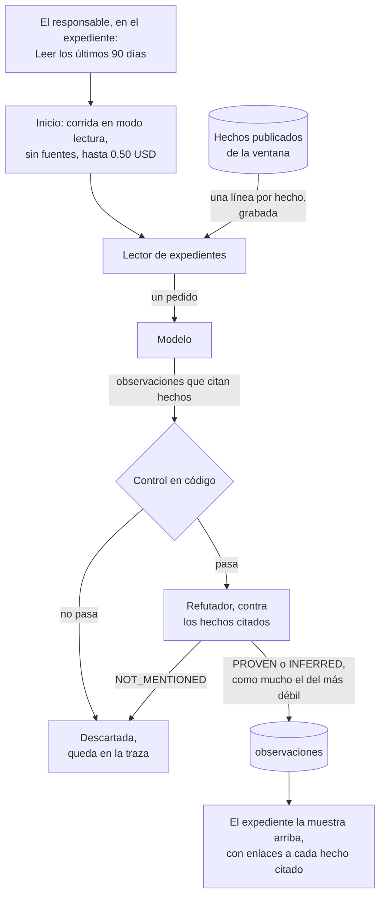

# Cómo se hizo: la lectura del expediente

El modelo lee de una vez el expediente de una entidad y propone observaciones que una publicación sola no muestra: un objeto que se compra una y otra vez, un llamado que se prorroga en cadena, un proveedor que vuelve. El refutador gradúa cada una contra los hechos que cita (tablero, T47). Qué puede escribir el modelo y cómo se gradúa está decidido en [adrs/0018-lectura-del-expediente-con-contexto-largo.md](../../adrs/0018-lectura-del-expediente-con-contexto-largo.md).

## Qué hace

1. **El pedido.** En el expediente de una entidad, el responsable aprieta "Leer los últimos 90 días con el modelo, hasta 0.50 USD". Se abre una corrida en modo `lectura`, sin fuentes, con su propio presupuesto y su libro de gasto, y se anota la ventana en `parte.lecturas_de_expediente`.
2. **La entrada.** El lector de expedientes junta las últimas versiones publicadas de los hechos de la entidad cuya primera noche cae en la ventana, sin las rechazadas en la revisión: clave, noche, grado y afirmación, una línea por hecho. Si no entran en unos 400.000 caracteres, se cortan los más viejos y la lectura lo dice. La entrada se graba como una lectura de fuente, así la repetición lee los mismos hechos aunque la base haya cambiado.
3. **El modelo.** Un solo pedido con todos los hechos y la consigna del ADR: cuatro clases de observación, cada una citando dos hechos o más, sin calificar, recomendar ni explicar causas, y sin cifras que no estén en lo citado. Como mucho diez observaciones.
4. **El control en código**, sin el modelo (`app/src/main/java/io/github/andresdiegolanda/elparte/lectura/ControlDeObservaciones.java`): la clase es una de las cuatro; cita dos hechos distintos o más, todos de la entrada; cada cifra está en las afirmaciones o las noches de los hechos citados, con la comparación del analista, y la cantidad de hechos citados se puede decir; y no usa palabras de juicio. Lo descartado queda en `observaciones.propuestas` con el motivo.
5. **El refutador.** Cada observación que pasó el control va al refutador con los hechos que cita como si fueran la fuente (`app/src/main/java/io/github/andresdiegolanda/elparte/refutador/RefutadorDeObservaciones.java`). Su veredicto se limita al hecho más débil: si cita uno deducido, queda INFERRED aunque el refutador diga PROVEN, y lo dice.
6. **El cierre.** Se guardan las que se sostienen en `parte.observaciones`, se anota lo leído y la corrida se cierra con `corrida.terminada`. No hay candidatos, informes ni avisos: el proceso que cierra las noches solo corta una lectura si pasa su tope de tiempo.
7. **La página.** Arriba del expediente, la última lectura: la ventana, cuántos hechos leyó, cuántas observaciones se propusieron y cuántas se descartaron, el modelo, el costo, y cada observación con su grado y enlaces a los hechos que cita. Lo ve cualquiera; el botón, solo el responsable.

## Por qué existe

La página de la mañana muestra una noche, y el refutador ve un candidato por vez, a propósito ([ADR 0004](../../adrs/0004-grados-de-evidencia.md)). El expediente junta todo, pero nadie lo lee entero ([docs/como-se-hizo/expediente.md](expediente.md)). La lectura es la parte de El Parte que usa el contexto largo del modelo, con los mismos controles que el resto: lo que dice cita hechos, y quien propone no se pone la nota.

## Cómo se construyó

- **Una corrida más, no un sistema aparte.** El modo `lectura` reusa el libro de gasto que corta, las grabaciones, la sala de máquinas y la repetición. Lo nuevo es un agente, dos tópicos y dos tablas (`app/src/main/resources/db/migration/V12__lectura_del_expediente.sql`).
- **Sin cambiar el contrato de inicio.** La ventana no va en `corrida.iniciada`: se anota en la base en la misma transacción que la corrida, y una repetición copia la de su original.
- **El cierre de las noches no la toca.** Con cero fuentes, el cierre habría dado la corrida por terminada al instante y habría armado informes. Ahora reconoce las lecturas y solo las corta por tiempo.
- **Lo que cuesta.** 0,50 USD por lectura como tope. Con unos 900 hechos del BPS en 90 días, el ADR estima unos 0,30 USD. [INFERRED: estimación del ADR 0018, sin medir]

## Qué se probó

- **El control**, en `app/src/test/java/io/github/andresdiegolanda/elparte/lectura/ControlDeObservacionesTest.java`: una observación bien citada pasa, con fechas escritas de otra forma; la cantidad de hechos citados se puede decir; y se descartan una clase que no existe, un texto vacío, un solo hecho, un hecho que no se leyó, una cifra sumada, una palabra de juicio y una causa. El grado máximo es el del hecho más débil.
- **De punta a punta**, en `app/src/test/java/io/github/andresdiegolanda/elparte/lectura/LecturaDelExpedienteTest.java`, con una entidad que solo existe en la prueba: cinco hechos, de los que entran tres, porque uno está rechazado en la revisión y otro es de hace 200 días. Una invitada no ve el botón y su pedido da 403. El responsable pide la lectura; el modelo de mentira propone seis observaciones, el control descarta cuatro con su motivo, y el refutador sostiene dos, una limitada a INFERRED por el hecho deducido que cita. Hay tres llamadas al modelo, ningún informe, y la página muestra las dos con enlaces a los hechos y no las descartadas. La repetición no llama al modelo y da los mismos mensajes.

## Qué falló

Nada en el código todavía.

## Qué falta

- **Una lectura de verdad**, con el BPS en El Parte publicado, y el juicio de una persona sobre sus observaciones: el ADR dice que la precisión se mide así, porque el registro del banco tiene hallazgos de una publicación, no patrones. Está desplegada desde el 2026-11-18, pero con 60 hechos de una sola semana vería poco: queda para cuando haya más (tablero, T50).
- **La cobertura**, que con el registro actual no se puede medir.
