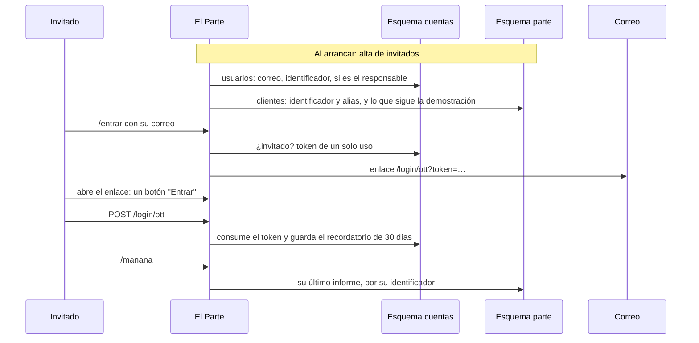

# Cómo se hizo: el login por enlace de correo

Cómo entra cada invitado a El Parte y qué puede hacer adentro (tablero, T25). El diseño está en [adrs/0013-acceso-perfil-y-parte-diario.md](../../adrs/0013-acceso-perfil-y-parte-diario.md), y el código, en `app/src/main/java/io/github/andresdiegolanda/elparte/acceso/`.

## Qué hace

1. **El alta.** Al arrancar, cada invitado de `elparte.invitados`, que va en el `.env` y no en el repositorio, tiene su cuenta en `cuentas.usuarios` y su cliente en `parte.clientes`, con el mismo identificador. El identificador se conserva entre arranques. Un invitado nuevo empieza siguiendo lo mismo que la cuenta de demostración; uno que ya estaba conserva lo que sigue; uno que ya no está en la lista queda desactivado y no puede entrar. El registro de la aplicación dice cuántos son, nunca los correos.
2. **El enlace.** En `/entrar` la persona pone su correo. Si está invitada, Spring Security genera un token de un solo uso, que vence a los 5 minutos, y la aplicación le manda por correo el enlace `/login/ott?token=…`, armado con la dirección pública de la configuración. Si no está invitada, ve la misma página, "Revisá tu correo", y no sale nada.
3. **El botón.** Abrir el enlace no entra: muestra un botón "Entrar" que manda el token. Algunos programas de correo abren los enlaces para revisarlos, y así no gastan el token antes que la persona.
4. **El recordatorio.** Al entrar, la aplicación guarda un recordatorio de sesión por 30 días. A la mañana siguiente la persona abre su página sin pedir otro enlace. Al salir, el recordatorio se borra.
5. **Qué puede hacer cada uno.**
   - Sin entrar se ven la página de la mañana de la cuenta de demostración y la sala de máquinas.
   - Con sesión, la página de la mañana es la de quien entró.
   - Correr o repetir una corrida y la cola de revisión son solo del responsable del proyecto: una corrida gasta crédito del modelo, y una revisión cambia lo que se publica.

## Por qué existe

El Parte se piensa para cuatro usuarios invitados y una cuenta de demostración ([arranque/proyecto.md](../../arranque/proyecto.md)). Sin login, todas verían la misma página, y cualquiera que llegara a la aplicación podría correr una noche y gastar el crédito de la clave. Era lo que faltaba antes de publicarla con un túnel en la máquina del responsable.

## Cómo se construyó

- **Dos fuentes de datos.** La de siempre, con el rol de los agentes, sigue siendo la que configura Spring Boot. La de las cuentas, con su rol, se declara con `@Bean(defaultCandidate = false)`, así Spring Boot no deja de configurar la otra y solo la recibe quien la pide por nombre (`app/src/main/java/io/github/andresdiegolanda/elparte/acceso/FuenteDeCuentas.java`). Su URL lleva `currentSchema=cuentas`: las clases de Spring Security nombran sus tablas sin esquema, y así las encuentran. Lo que el ADR dejaba para probar, se probó.
- **Las tablas de Spring Security** están en `app/src/main/resources/db/migration/V5__login.sql`, con sus nombres y columnas, en el esquema `cuentas`. El rol de los agentes no las ve.
- **Quién toca cada tabla.** El alta de invitados escribe `cuentas.usuarios`, y el login solo la lee (`app/src/main/java/io/github/andresdiegolanda/elparte/acceso/Cuentas.java`). Los tokens y los recordatorios los guarda Spring Security, que el código configura sin nombrar sus tablas. Para que el tablero de arquitectura lo diga sin que el verificador las busque en el código, esas flechas llevan el campo `marco` ([docs/tablero-de-arquitectura/README.md](../tablero-de-arquitectura/README.md)); el verificador, además, ahora lee las tablas de todas las migraciones y no solo de la primera.
- **Los correos se comparan normalizados**, sin mayúsculas ni espacios de más: "Invitada.Uno@Prueba.test" y " invitada.uno@prueba.TEST " son la misma cuenta.
- **Un token solo para los invitados.** El servicio de tokens de Spring Security genera uno para cualquier correo. Una envoltura, `app/src/main/java/io/github/andresdiegolanda/elparte/acceso/TokensDeInvitados.java`, devuelve para un correo no invitado un token que no se guarda ni se manda: la respuesta es la misma, y la tabla no se llena con pedidos de cualquiera.
- **La página para entrar procesaba el token.** En Spring Security, fijar la página de login con `loginPage` hace que esa misma dirección pase a procesar el formulario, salvo que se diga otra. Hubo que fijar `loginProcessingUrl("/login/ott")`. Lo encontraron las pruebas: el formulario del token devolvía 405.
- **El correo no llega a las páginas.** El usuario de la sesión lleva el correo, porque así lo guardan las tablas de Spring Security, pero las páginas solo usan el identificador, con el que leen el alias en el esquema `parte` (ADR 0008).
- **CSRF.** Spring Security lo pide en cada formulario. Los de la sala de máquinas pasaron a `th:action`, y Thymeleaf les agrega el token solo.
- **La sala de máquinas se mira sin entrar.** El ADR no lo decía, y la lista de T25 pedía la sala solo para el responsable. Lo que gasta y lo que cambia lo publicado son correr, repetir y revisar, y eso quedó cerrado. Mirar las corridas y sus mensajes es lo que muestra cómo trabaja El Parte, y en el esquema `parte` no hay datos personales (ADR 0008).

## Qué se probó

`app/src/test/java/io/github/andresdiegolanda/elparte/acceso/LoginTest.java`, con un buzón de mentira en lugar del correo y un navegador de prueba que guarda cookies y manda los formularios con su token CSRF (`app/src/test/java/io/github/andresdiegolanda/elparte/Navegador.java`):

- **Sin entrar** se ve la demostración y la sala, sin sus botones; la cola de revisión manda a entrar, y correr también.
- **El alta:** los dos invitados de las pruebas tienen su cliente con su alias, y la invitada nueva sigue al BPS como la demostración.
- **Un correo no invitado** ve la misma página y no recibe nada.
- **Una invitada** pide el enlace con el correo escrito de otra forma, lo recibe con la dirección pública, ve el botón, entra y ve su parte. El token no sirve dos veces. No puede correr ni revisar. Con solo la cookie del recordatorio, otro navegador entra como ella, y después de salir, ya no.
- **El responsable** entra, ve la cola de revisión y los botones de la sala.

Las pruebas que ya estaban siguen pasando, con dos cambios: la de la primera rebanada revisa la aclaración entrando como responsable, y la que contaba un informe por corrida ahora cuenta uno por cliente que sigue al BPS. Las páginas para entrar y la de una invitada se miraron en un navegador, desde las copias en `app/target/paginas/`.

## Qué falló

- **El formulario del token devolvía 405**, por la página de login que procesaba lo que no debía. Ver arriba.
- **Dos nombres iguales.** La configuración de la fuente de las cuentas y su método se llamaban igual, y Spring no podía registrar los dos.
- **Pruebas que contaban un informe por corrida.** Con los invitados de las pruebas, cada corrida arma tres: la demostración y los dos invitados. Se cambió qué cuentan, no lo que hace la aplicación.
- **El verificador del tablero de arquitectura** no veía las tablas nuevas, porque leía solo la primera migración, ni las flechas que hace Spring Security. Y dos de sus pruebas daban mal desde antes: dependían de una flecha y de una tarjeta que ya se habían construido. Ahora toman las suyas del modelo.
- **Un mensaje que llegaba tarde.** El estado de la corrida cambia en la base antes de que el observador guarde `corrida.terminada`. Con más informes por corrida, una prueba lo leyó antes de tiempo. Ahora lo espera.

## Qué falta

- **El correo real.** En local el enlace llega a Mailpit. Para los invitados hace falta un servicio de correo, Resend con el dominio del responsable, y la dirección pública del túnel (T27).
- **La página del perfil** (T34), para elegir qué seguir y si se quiere el aviso diario: hecha, en [docs/como-se-hizo/perfil.md](perfil.md).
- **El aviso diario** (T35).
