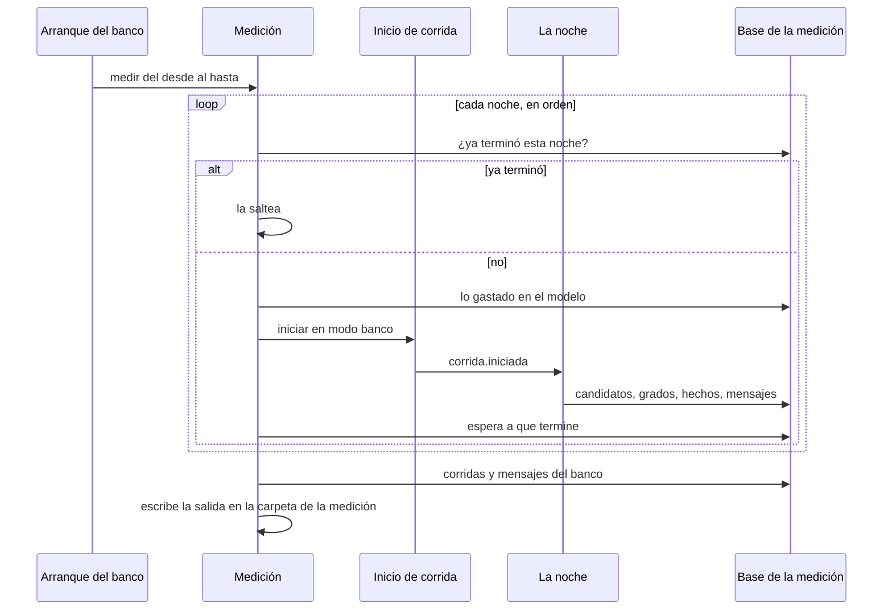

# Cómo se hizo: la medición contra el banco

La parte de El Parte que produce lo que se mide contra el banco de pruebas: las corridas en modo banco, una por cada noche del registro, en un Docker Compose aparte, y la salida que después cuenta [`herramientas/banco_de_pruebas.py`](../../herramientas/banco_de_pruebas.py) (tablero, T20). El diseño está en [adrs/0014-medicion-contra-el-banco.md](../../adrs/0014-medicion-contra-el-banco.md), y el código, en `app/src/main/java/io/github/andresdiegolanda/elparte/banco/`.

## Qué hace

- **Arranca solo.** Con el perfil `banco`, que activa [`compose.banco.yaml`](../../compose.banco.yaml), la aplicación lee la medición y sus noches de las variables de entorno y mide en un hilo aparte. Mientras tanto, su sala de máquinas se puede mirar en el puerto 8081. Si falta una variable, lo dice en el registro y no mide.
- **Una noche por vez, en orden.** Inicia una corrida en modo banco, que sigue solo la entidad medida, y espera a que termine antes de la siguiente. Saltea las noches que ya terminaron en esa base, así una medición cortada se retoma levantándola de nuevo.
- **Tope de gasto.** Antes de cada noche suma lo gastado en el modelo por todas las corridas del banco; si llegó al tope, no inicia más y lo anota.
- **Cuida a ARCE.** El lector espera 250 ms antes de cada pedido en el perfil `banco`, y el explorador no vuelve a pedir lo que la corrida de la noche anterior ya leyó de una publicación: lo toma de su grabación y lo graba igual en la corrida actual, para que se pueda repetir.
- **La salida.** Al terminar escribe `salida-de-el-parte.json` en `banco-de-pruebas/mediciones/<medición>/`, con la forma de [banco-de-pruebas/formato.md](../../banco-de-pruebas/formato.md).

Cómo se corre está en [app/README.md](../../app/README.md), "Medir contra el banco".

## Por qué existe

La medición contra el banco es parte de la versión 0 y es lo que dice si El Parte sirve ([docs/plan.md](../plan.md)). Las reglas de cómo se cuenta ya estaban escritas y probadas (T12); faltaba producir lo que se cuenta sin mezclarlo con lo que ven los invitados, con la memoria que El Parte tendría noche a noche, y sin castigar a ARCE ni al presupuesto.

## Cómo se construyó

- **Sin código para separar.** La separación la da el nombre de proyecto de Compose: otra base, otro Kafka, otros volúmenes. `compose.banco.yaml` cierra los puertos de la base, de Kafka y del correo con `!reset`, y publica la aplicación en el 8081.
- **El modo banco es casi el normal.** Los agentes solo miran si una corrida es de reproducción, así que una del banco hace todo lo que hace una normal, sobre su propia base. Lo nuevo en el inicio es la fecha del registro y la entidad medida en lugar de las suscripciones. La repetición acepta como original una corrida del banco.
- **Reusar sin perder la repetición.** Lo que la noche anterior ya leyó se busca por la clave de la grabación (`arce:comprador:<id>` y `arce:publicacion:<id>`) en la corrida del banco de la fecha anterior, que sale con una sola consulta sobre la clave primaria. Una falla grabada no se reusa: se vuelve a intentar. Lo reusado pasa por la grabación de la corrida actual, así repetirla no necesita la anterior.
- **La salida desde la base.** Las corridas salen de `parte.corridas`; el costo y la duración, de `corrida.terminada`; las fuentes no repetibles y las lecturas fallidas, de `fuente.fallida`; y de cada clave de hecho, la primera noche en que salió PROVEN o INFERRED, o si nunca, la primera en que salió NOT_MENTIONED.

## Qué se probó

- **`MedicionContraElBancoTest`**, contra un PostgreSQL y un Kafka en contenedores, con tres noches de octubre del ARCE de mentira. [PROVEN: `mvn test`, 19 pruebas, 2026-11-15]
  - Las tres noches corren en orden, con tres llamadas al modelo y 0,012 USD.
  - ARCE recibe 14 pedidos; sin reusar lo de la noche anterior serían 17.
  - La salida tiene la forma del formato, y `herramientas/banco_de_pruebas.py` la valida y la cuenta.
  - Medir otra vez saltea las tres noches y no pide nada.
  - Una fuente que no deja pedir la fecha sale como no repetible y no como lectura fallida.
  - Con lo gastado en el tope, no se inicia ninguna noche más.
  - Una noche del banco se repite sin red ni costo, con los mismos mensajes.
- **`LectorArceTest`** controla que el lector espere la pausa antes de cada pedido.
- **En Docker Compose**, en un espacio en la nube, con `compose.banco.yaml`. [PROVEN: dos mediciones de prueba, 2026-11-15]
  - Sin las variables, la aplicación lo dice y no mide.
  - Con ellas, corre dos noches en orden y escribe la salida en la carpeta montada.
  - Al levantarla otra vez, saltea lo hecho.
  - `docker compose down -v` borra todo sin pedir las variables.
  - Ahí ARCE no se alcanza desde los contenedores, así que las noches terminaron con la fuente fallida: esa prueba cubre el armado, no lo que encuentra El Parte.

## Qué falló

- **Las dos pruebas grandes comparten la base.** La de la primera rebanada contaba todos los hechos e informes de la base, y la medición agrega los suyos. Se cambió para que cuente solo lo de su noche de noviembre, y la medición usa noches de octubre con compras distintas. Las dos pasan en cualquier orden. [PROVEN: corridas en orden alfabético e inverso, 2026-11-15]
- **Un bloque de texto de Java se comió un espacio.** Los bloques de texto borran los espacios al final de cada línea, y una consulta armada con uno quedó `andh.clave...`. Se resolvió con `\s`.
- **El control de datos personales vio una URL de prueba.** La prueba agregaba a mano un `fuente.fallida` con una URL de `ejemplo.invalid`, que es justo lo que busca el control de la primera rebanada. Se usó una URL de ARCE.
- **La aplicación no podía escribir la salida en Linux.** La imagen corre con un usuario sin privilegios, y la carpeta montada era de otro usuario. La aplicación de la medición corre como root; la de todos los días sigue sin privilegios.
- **Compose pedía las variables hasta para bajar.** Con `${VARIABLE:?}`, `docker compose down` fallaba si no estaban. Las variables pasaron a ser opcionales para Compose, y la aplicación las controla.

## Las primeras tres noches reales

Corrieron en la máquina del responsable, con la clave, del 2026-11-11 al 2026-11-13, con un tope de 1 USD. La salida está en `banco-de-pruebas/mediciones/2026-11-15-1/salida-de-el-parte.json`. [PROVEN: corrida del 2026-11-15, de la 01:38 a la 01:56]

| Noche | Duración | Costo | Publicaciones leídas | De la noche anterior | Candidatos | Sin procesar | Llamadas al modelo |
|---|---|---|---|---|---|---|---|
| 2026-11-11 | 8,0 min | 0,489 USD | 1.597 | 0 | 60 | 13 | 60 |
| 2026-11-12 | 5,8 min | 0,448 USD | 1.518 | 806 | 60 | 12 | 49 |
| 2026-11-13 | 3,7 min | 0,266 USD | 1.119 | 712 | 55 | 0 | 27 |

- **Costo y tiempo.** 1,20 USD y 18 minutos las tres; unos 0,009 USD por llamada al refutador. La primera noche cuesta más porque todo es nuevo; las siguientes, menos, porque lo del margen ya es conocido.
- **Lo que se ahorra a ARCE.** De 4.234 publicaciones leídas, 1.518 se tomaron de la noche anterior: un 36 % menos de pedidos.
- **El tope de gasto se pasa por una noche.** Se mira antes de empezar cada una: después de la segunda iban 0,94 USD, y la tercera llevó el total a 1,20.
- **El tope de 60 candidatos se quedó corto.** En dos noches quedaron compras del BPS sin procesar, y las del día de margen, que la noche anterior ya había visto, ocupaban lugares. Desde entonces, al tope entran primero las compras de la fecha objetivo (`ExploradorArceTest`).
- **Las 78 noches costarían unos 31 USD** con ese promedio de 0,40 USD por noche, y tardarían unas 8 horas. [INFERRED: de tres noches] Es más que el tope mensual del espacio de trabajo de la clave, de 20 USD (T14).
- **El conteo en PowerShell.** Guardar la medición con `>` en Windows PowerShell 5.1 la dejaba en UTF-16. El conteo ahora escribe el archivo él mismo, en UTF-8.

## Las 78 noches

Corrieron en la máquina del responsable, del 2026-08-29 al 2026-11-14, con un tope de 35 USD, después de subir los topes de gasto de la clave. La salida y el conteo están en `banco-de-pruebas/mediciones/2026-11-15-2/`. [PROVEN: medición del 2026-11-15, de las 20:16 a las 23:41]

| Qué | Cuánto |
|---|---|
| Noches | 78 completas, ninguna cortada ni fallida |
| Costo | 12,71 USD, 0,16 USD por noche |
| Duración | 2,6 minutos por noche, 3 horas y 23 minutos en total |
| Publicaciones de ARCE leídas | 64.700 |
| Candidatos del BPS | 2.139, de los que 196 quedaron sin procesar |
| Llamadas al modelo | 1.333 |
| Hechos que salieron | 800: 725 PROVEN y 75 INFERRED; 51 descartados |

El conteo, con el borrador de la revisión: [PROVEN: `banco-de-pruebas/mediciones/2026-11-15-2/medicion.json`]

- **Publicables: 5 de 5.** Las cinco compras del BPS que la vigilancia vio el 2026-11-01 y descartó por tema salieron en El Parte la noche en que se publicaron, con una mediana de 26 días de adelanto. Las cinco tienen su llamado y su aclaración, y una también su adjudicación.
- **Hallazgos: 0 de 1.** De los 19 hallazgos, el único que esta medición podía encontrar es la compra directa del BPS a ATOS (`2026-09-29-1`), y no está. Ningún hecho ni ninguna publicación grabada la menciona; si ARCE la publicó, no se sabe todavía. [INFERRED: búsqueda en la base, 2026-11-16] Los otros 18 son de fuentes que esta medición no lee, o de ninguna.
- **Precisión: 95 %.** Los 11 hechos con correspondencia están bien. Los otros 789 no corresponden a nada del registro, y de ellos se juzgó un sorteo de 60, con la semilla 20261116 (`banco-de-pruebas/metricas.md`, "Cuando los extras son demasiados"): 57 bien y 3 con el contenido equivocado. La precisión estimada de los extras es 0,95, con un intervalo al 95 % de 0,86 a 0,98, y la de todo lo publicado, 0,95. Ninguno era de otra entidad ni material viejo.
- **El error que encontró el sorteo.** Los tres hechos equivocados son adjudicaciones de compras repartidas entre varios proveedores: El Parte dice que la compra se adjudicó al primero, con sus ítems, y no nombra a los demás. El explorador arma la afirmación solo con la primera adjudicación de la publicación (`app/src/main/java/io/github/andresdiegolanda/elparte/fuentes/arce/CandidatosDeArce.java`), y el refutador la da por PROVEN porque cada pedazo está en la fuente. Se arregla en T39.
- **Más barata que lo estimado.** Las tres noches de prueba hacían esperar unos 31 USD; costó 12,71, porque muchas noches son fines de semana con pocas compras.

Dos problemas que la medición dejó a la vista:

- **Una semana sin datos en ARCE.** El feed de octubre no trae nada publicado del 2026-10-23 al 2026-10-29, cinco días hábiles; el resto del mes trae entre 550 y 670 publicaciones por día hábil. [PROVEN: feed de 2026-10 bajado el 2026-11-15 a las 23:05] Las noches del 24 al 29 terminaron completas y sin leer nada: El Parte no avisa cuando una fuente viene vacía un día hábil.
- **El tope de 60 candidatos.** Dejó 196 compras del BPS sin procesar, casi todas en noviembre; la noche del 2026-11-04, 60.

## Qué falta

- Que el responsable confirme la revisión: la fuente y la etiqueta de cada entrada, las correspondencias y el juicio del sorteo (T20).
- Saber si ARCE publicó la compra directa a ATOS (T20).
- Que el explorador avise cuando un día hábil viene sin publicaciones, y que la afirmación de una adjudicación nombre a todos los proveedores (T39).
- Qué hacer con el tope de candidatos (T22).
