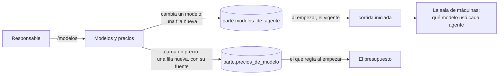

# Cómo se hizo: los modelos y los precios

La página donde se ve qué modelo usa cada agente y cuánto cuesta cada modelo, y donde el responsable los cambia sin reiniciar la aplicación (tablero, T29). Las decisiones están en [adrs/0003-eleccion-del-stack.md](../../adrs/0003-eleccion-del-stack.md) (un modelo por agente, en la base) y [adrs/0005-presupuesto-por-corrida.md](../../adrs/0005-presupuesto-por-corrida.md) (los precios, con su fuente).

## Qué hace

- **Se ve sin entrar**, desde la sala de máquinas: el modelo vigente de cada agente, desde cuándo, los últimos cambios y la tabla de precios con su fuente y la fecha en que se consultó.
- **El responsable cambia el modelo de un agente** eligiéndolo de la lista de los que tienen precio. Un modelo sin precio no se puede elegir: el presupuesto no sabría cuánto reservar antes de cada llamada ([docs/como-se-hizo/presupuesto.md](presupuesto.md)).
- **El responsable carga un precio**: el modelo, entrada, salida y las dos de caché en dólares por millón de tokens, la página donde se leyó y la fecha. La entrada y la salida no pueden ser cero, y la fuente va con `https://`.
- **Cada cambio es una fila nueva** y vale desde la corrida siguiente: la corrida congela sus modelos en `corrida.iniciada` al empezar y usa el precio que regía en ese momento. La página de cada corrida ya mostraba qué modelo usó cada agente.

## Por qué existe

Para calibrar contra el banco de pruebas hay que poder cambiar el modelo de un agente de una corrida a otra (ADR 0003). Las tablas, los valores iniciales, la congelación en `corrida.iniciada` y el modelo en cada pedido ya estaban desde la primera rebanada; faltaba cambiarlos sin una migración.

## Cómo se construyó

- **Las tablas ya tenían historia.** `parte.modelos_de_agente` y `parte.precios_de_modelo` guardan un cambio como una fila nueva con su `desde`, así la página solo inserta. Nada se borra ni se pisa.
- **Mirar es libre, cambiar es del responsable**, como correr una corrida: `POST /modelos/**` pide el rol de responsable (`app/src/main/java/io/github/andresdiegolanda/elparte/acceso/Seguridad.java`).
- **Hoy llaman al modelo el refutador y el analista.** Los demás agentes tienen su modelo anotado para cuando lo usen; la página lo dice.

El código está en `app/src/main/java/io/github/andresdiegolanda/elparte/web/ModelosControlador.java` y `app/src/main/resources/templates/modelos.html`.

## Qué se probó

`app/src/test/java/io/github/andresdiegolanda/elparte/web/ModelosTest.java`:

- Sin entrar se ve la página, sin formularios, y la sala de máquinas la enlaza. Mandar un cambio sin sesión lleva a entrar, y una invitada recibe 403.
- El responsable no puede elegir un modelo sin precio, y un precio de entrada cero no entra.
- Con su precio cargado, el responsable cambia el modelo del refutador, y la corrida siguiente lo congela en su `corrida.iniciada` y lo muestra en su página. Al terminar, la prueba vuelve al modelo de antes con una fila nueva.

La página se miró en un navegador, desde la copia en `app/target/paginas/modelos-responsable.html`.

## Qué falló

Nada en el código. La prueba que manda un cambio sin sesión tomaba el token del formulario de la propia página, que sin sesión no tiene formularios; lo toma de la página de entrar.

## Qué falta

- Nada de esta página. Comparar modelos sobre el banco es medir: cada medición nueva dice en su salida qué modelo usó cada agente.
