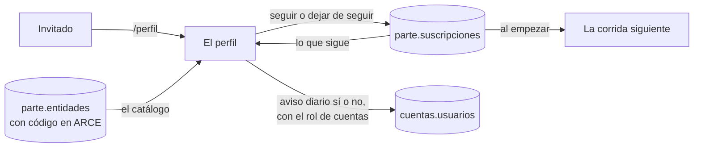

# Cómo se hizo: el perfil

Dónde cada invitado elige qué organismos seguir y si quiere el aviso diario (tablero, T34). El diseño está en [adrs/0013-acceso-perfil-y-parte-diario.md](../../adrs/0013-acceso-perfil-y-parte-diario.md), y el código, en `app/src/main/java/io/github/andresdiegolanda/elparte/web/PerfilControlador.java`, `app/src/main/java/io/github/andresdiegolanda/elparte/web/Seguimientos.java` y `app/src/main/java/io/github/andresdiegolanda/elparte/acceso/AvisoDiario.java`.

## Qué hace

- **El catálogo** son los organismos de `parte.entidades` que tienen su código de comprador en ARCE: lo que el explorador sabe filtrar. Cada uno tiene un botón para seguirlo o dejar de seguirlo.
- **Seguir** escribe en `parte.suscripciones`, con el rol de los agentes. Vale desde la corrida siguiente, que arma al empezar la lista de entidades seguidas. Una entidad que no está en el catálogo no se puede seguir, aunque alguien mande el formulario a mano.
- **El aviso diario** se prende y se apaga en `cuentas.usuarios`, con el rol de las cuentas, buscando por el identificador del cliente: el perfil no lee correos. El aviso en sí sale con T35.
- **Sin sesión** se ve el perfil de la cuenta de demostración, sin botones. Cambiar algo pide entrar.

## Por qué existe

Sin perfil, cada invitado seguía lo mismo que la cuenta de demostración: el BPS. El Parte es para que cada uno siga lo suyo (ADR 0013).

## Cómo se construyó

- **El catálogo inicial.** De las publicaciones que leyó la medición `2026-11-16-2`, que seguía corriendo, se contaron los compradores (`buyer.id`): son las de 62 noches entre el 2026-08-29 y el 2026-10-29, con su día de margen. Después se leyó en ARCE una publicación de cada uno de los 45 con más publicaciones, para tener su nombre (`buyer.name`). [PROVEN: grabaciones de la medición y lectura de ARCE, 2026-11-16] Entraron organismos conocidos que compran con un solo código. ASSE entera no entró: compra con decenas de códigos, uno por hospital o centro, y se sumaron dos de sus hospitales. Los nombres son los de ARCE, con la sigla conocida entre paréntesis [INFERRED: las siglas no están en ARCE].

| Organismo | Código en ARCE | Publicaciones en las 62 noches |
|---|---|---|
| Administración de las Obras Sanitarias del Estado (OSE) | 66-1 | 1.664 |
| Centro Hospitalario Pereira Rossell (ASSE) | 29-4 | 1.058 |
| Administración Nacional de Usinas y Trasmisiones Eléctricas (UTE) | 61-1 | 829 |
| Banco de Previsión Social, que ya estaba | 28-1 | 819 |
| Hospital Maciel (ASSE) | 29-5 | 571 |
| Dirección Nacional de Vialidad | 10-3 | 326 |
| Administración Nacional de Combustible, Alcohol y Portland (ANCAP) | 60-1 | 267 |
| Universidad Tecnológica del Uruguay (UTEC) | 31-1 | 217 |
| Hospital de Clínicas | 26-15 | 217 |
| Instituto del Niño y Adolescente del Uruguay (INAU) | 27-1 | 216 |
| Administración Nacional de Telecomunicaciones (ANTEL) | 65-1 | 185 |
| Poder Judicial | 16-101 | 163 |
| Banco Central del Uruguay | 50-1 | 137 |

- **Lo que cuesta seguir más.** El explorador lee todas las publicaciones de la noche igual, sigan a uno o a diez organismos. Lo que crece son las llamadas al modelo: el refutador y el analista, una vez cada uno por compra nueva de un organismo seguido. Con el BPS solo, una noche cuesta unos 0,28 USD (ADR 0016). Seguir OSE suma alrededor del doble de eso [INFERRED: OSE tiene el doble de publicaciones que el BPS]. El presupuesto de cada corrida (ADR 0005) corta antes de pasarse: las compras de la noche pasan primero, y lo que no alcanza queda sin procesar, con la corrida marcada como cortada.
- **Sumar un organismo** es una migración con su código y su nombre, leídos en una publicación suya de ARCE.
- **Dos clases para el esquema `parte`.** El controlador lee el catálogo y lo que se sigue; `Seguimientos` escribe. Así el tablero de arquitectura muestra las dos flechas que tenía diseñadas.
- **El aviso, prendido de entrada.** Un invitado nuevo lo tiene prendido, porque el aviso de cada mañana es como El Parte llega a cada uno, y lo apaga en un clic. Es una sola columna, `cuentas.usuarios.aviso_diario`, en `app/src/main/resources/db/migration/V6__perfil.sql`, que también trae el catálogo.

## Qué se probó

`app/src/test/java/io/github/andresdiegolanda/elparte/web/PerfilTest.java`:

- El catálogo tiene los 13 organismos, cada uno con su código.
- Sin entrar se ve el perfil de la demostración, con el catálogo y sin botones. Mandar el formulario sin sesión lleva a entrar, y la demostración no cambia.
- Una invitada sigue OSE, no puede seguir algo que no está en el catálogo, deja de seguir el BPS y apaga el aviso. La demostración no cambia. Al terminar, la prueba deja todo como estaba, porque otras pruebas cuentan con que la invitada sigue al BPS.

La página se miró en un navegador, desde la copia en `app/target/paginas/perfil-invitada.html`.

## Qué falló

Nada en el código. El encabezado decía "Lo que sigue Invitada uno", que se leía mal, y pasó a "El perfil de Invitada uno".

## Qué falta

- **El aviso diario** (T35), que usa la preferencia.
- **Seguir empresas**, que pide que el explorador filtre también por proveedor (ADR 0013).
- **Más organismos**, a medida que los pidan los invitados.
