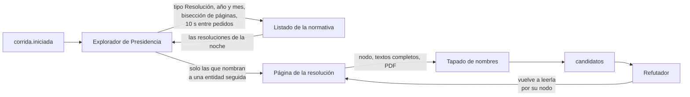

# Cómo se hizo: el explorador de Presidencia

Las resoluciones de la normativa de Presidencia de cada noche, y un candidato por cada una que nombra a una entidad seguida, con los nombres de personas tapados (tablero, T24). La fuente está en [docs/fuentes/presidencia.md](../fuentes/presidencia.md), y la decisión de leerla a ritmo bajo y citándola siempre, en [adrs/0006-fuentes-de-la-version-0.md](../../adrs/0006-fuentes-de-la-version-0.md). Cómo se tratan los datos personales está en [adrs/0008-datos-personales.md](../../adrs/0008-datos-personales.md).

## Qué hace

1. **El listado de la noche.** El listado de la normativa de gub.uy, filtrado por tipo "Resolución", año y mes, trae diez resoluciones por página, de la más nueva a la más vieja: unas 440 por mes. El lector lee la primera página, que dice cuántas hay, y busca por bisección la página donde empieza la noche; después sigue hasta la primera resolución más vieja. Una noche vieja lleva unas ocho páginas, no 44. Las leyes y los decretos no se leen acá: llegan por IMPO, que es la publicación oficial.
2. **El filtro.** Busca a cada entidad seguida en el título y el resumen del listado, por su nombre, sin importar tildes ni mayúsculas, y por su sigla. Las resoluciones que no nombran a ninguna no se guardan.
3. **La página de cada una.** De las que nombran a una entidad lee su página, que trae el número de nodo, el título y el resumen enteros, y el enlace al PDF. El resumen del listado viene cortado con puntos suspensivos; el de la página, no.
4. **El tapado.** Antes de guardar nada cambia por `[persona]` los nombres del título y el resumen (ver abajo). Se guarda el número de nodo y no la ruta del listado, que lleva el título y a veces nombres: "se-designa-mision-oficial-" seguido del nombre de la persona.
5. **El candidato.** Uno por resolución, con el tipo de hecho `resolucion` y la clave `presidencia:235734:resolucion`. La evidencia es el título, la fecha, el pedazo del resumen que nombra a la entidad y el PDF. La URL es `https://www.gub.uy/presidencia/node/235734`, que lleva a la página y no tiene nombres.
6. **El refutador** vuelve a leer la página por su nodo, la tapa igual y se la muestra al modelo, avisando que `[persona]` es un nombre tapado.

## El tapado de nombres

Los títulos de la normativa nombran personas casi siempre: de las 440 resoluciones de octubre de 2026, 153 empiezan con "Se designa en misión oficial a" y siguen con uno o más nombres. [PROVEN: listado de octubre de 2026, leído el 2026-11-18] Es texto libre, sin campos, y el tapado es por reglas, sin el modelo (`app/src/main/java/io/github/andresdiegolanda/elparte/fuentes/presidencia/EnmascaradorPresidencia.java`):

- **Dos o más palabras con mayúscula seguidas** que no son de una institución, un cargo o un lugar se cambian por `[persona]`: "a Ana Inventada y Pedro Ficticio" queda "a [persona] y [persona]". Las palabras de instituciones están en una lista, y las de las entidades seguidas se suman en cada llamada, así "Banco de Previsión Social" nunca se tapa.
- **Una sola palabra con mayúscula** también, si va después de un título o un cargo ("Subsecretario", "Dr.", "Embajador"), y el título se tapa con ella.
- **Una palabra pegada a unos puntos suspensivos**, como queda un nombre en un resumen cortado: "formulada por Ana de..." queda "formulada por [persona]...".

Se probó contra las 880 frases del listado de octubre, los títulos y los resúmenes de las 440 resoluciones. Quedaron 789 tapados, y las palabras con mayúscula que quedaron a la vista se revisaron una por una: son instituciones, empresas, departamentos y cargos, y no queda ningún nombre de persona. La primera versión dejaba cuatro nombres de pila de resúmenes cortados, y por eso existe la tercera regla. [PROVEN: tapado de los textos de octubre de 2026 y revisión a mano, 2026-11-18] El listado de octubre se bajó a una carpeta temporal para esa revisión y se borró después.

Tapa de más: algunos nombres de empresas, programas y países quedan como `[persona]` ("en la República [persona]"). Y tiene un límite que no se arregla con reglas: un apellido solo, sin título ni cargo delante, no se ve. El ADR 0008 prevé una segunda pasada del editor que todavía no existe.

## Por qué existe

Es una de las fuentes de la versión 0 ([ADR 0006](../../adrs/0006-fuentes-de-la-version-0.md)), la de permiso más débil: los términos de uso de gub.uy admiten el acceso por aplicaciones y piden no sobrecargar el sitio, pero no dan una licencia de reutilización. Por eso se lee a diez segundos entre pedidos y se cita siempre. En el registro del banco de pruebas no hay ninguna entrada de Presidencia. Sobre el BPS hay pocas: en octubre de 2026, una de 440, una transferencia al BPS para gastos de las soluciones habitacionales de jubilados y pensionistas.

## Cómo se construyó

- **Primero la fuente real.** Se volvió a leer el robots.txt de gub.uy, que prohíbe la búsqueda y los listados por filtro de otras rutas, pero no la normativa ni sus filtros. Se bajó el listado de octubre a diez segundos entre pedidos y se leyó una página de resolución. [PROVEN: https://www.gub.uy/robots.txt y la normativa de Presidencia, 2026-11-18] El mes va con dos cifras (`month=10`), y el número de nodo de cada página está en sus datos de Drupal (`"currentPath":"node/235734"`).
- **La bisección.** Recorrer las 44 páginas de un mes a diez segundos lleva siete minutos por noche. Como el listado está ordenado por fecha, se busca la página de la noche como en un diccionario. Si mientras se lee entran resoluciones nuevas, las viejas se corren a páginas posteriores, y la lectura hacia adelante las encuentra igual.
- **Lo que no se guarda.** Ni las resoluciones que no nombran a ninguna entidad, ni la ruta del listado. Una falla de lectura nombra el listado y no la ruta, para que una `fuente.fallida` tampoco lleve nombres.

El código está en `app/src/main/java/io/github/andresdiegolanda/elparte/fuentes/presidencia/`.

## Qué se probó

- **El tapado**, en `app/src/test/java/io/github/andresdiegolanda/elparte/fuentes/presidencia/EnmascaradorPresidenciaTest.java`, con nombres inventados y las formas de los títulos reales: nombres de varias palabras, varios nombres unidos por "y", un título o un cargo delante, un nombre cortado, las instituciones y la entidad seguida que no se tocan, y el límite del apellido solo.
- **Una noche de punta a punta**, en `app/src/test/java/io/github/andresdiegolanda/elparte/fuentes/presidencia/ExploradorPresidenciaTest.java`, con una Presidencia de mentira de 25 resoluciones en tres páginas: la noche se lee en tres pedidos, de seis resoluciones sale un candidato, el de la designación en el directorio del BPS, que se publica con el nombre tapado y el resumen entero de la página. Ni el nombre inventado ni la ruta que lo lleva quedan en las grabaciones, los mensajes o las afirmaciones. La repetición da los mismos mensajes sin pedirle nada a Presidencia.

## Qué falló

Nada todavía en el código.

## Qué falta

- **La segunda pasada del editor** que prevé el ADR 0008, para registrar como falla un nombre que se escape.
- **Las resoluciones que se suben tarde.** La fecha es la del listado, que es la de la resolución: una que se sube días después no se ve la noche de su fecha (D1).
- **El PDF.** Es un escaneo con texto reconocido; no se lee, y la evidencia es el título y el resumen de la página.
