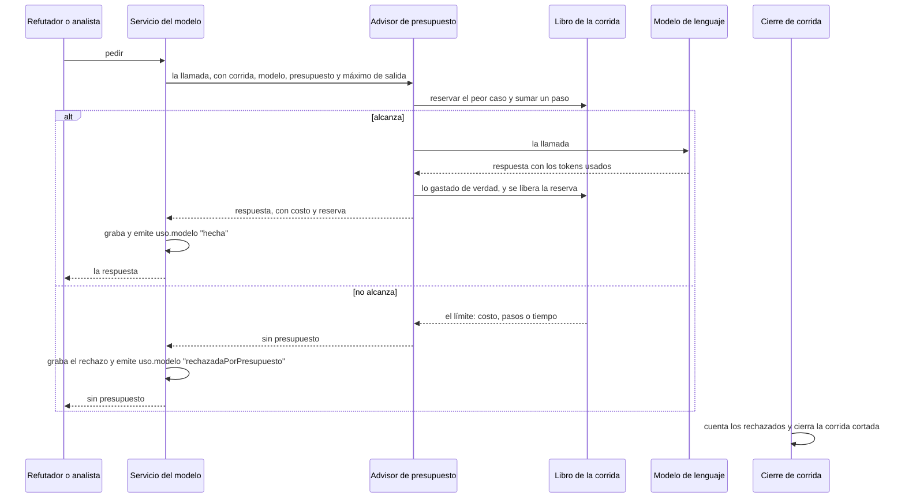

# Cómo se hizo: el presupuesto que corta

La parte de El Parte que no deja que una noche gaste más que su tope: el advisor de presupuesto, el libro de la corrida y la tabla de precios (tablero, T22). El diseño está en [adrs/0005-presupuesto-por-corrida.md](../../adrs/0005-presupuesto-por-corrida.md), y el código, en `app/src/main/java/io/github/andresdiegolanda/elparte/presupuesto/`.

## Qué hace

1. **Toda llamada al modelo pasa por el advisor.** Hay un solo `ChatClient`, el del servicio del modelo, y el advisor está registrado ahí, primero de todos. Lo que necesita de cada llamada viaja en el contexto del pedido.
2. **Antes de llamar, reserva el peor caso**: la entrada estimada, a un token cada tres caracteres, más el máximo de salida que pide el agente, por el precio que regía al empezar la corrida. Si el modelo no tiene precio, la llamada no se hace.
3. **La reserva es un solo `update`** sobre la fila de la corrida en `parte.libros_de_corrida`, que solo pasa si lo gastado más lo reservado más esta reserva entra en el tope, si quedan pasos y si la corrida sigue en curso. PostgreSQL bloquea la fila y vuelve a mirar la condición para cada agente que reserva a la vez. Va en su propia transacción, así se ve enseguida y no se deshace si el agente falla después.
4. **El primer límite que no alcanza queda en el libro**, en la columna `agotado`, y desde ahí se rechaza todo lo que pida esa corrida, aunque alguna llamada más chica cupiera. Una corrida que se cortó, se cortó.
5. **Después de llamar**, anota lo gastado de verdad y libera la reserva. Una llamada que falló libera sin gastar.
6. **Quien llama decide qué hacer sin presupuesto.** El refutador deja el candidato sin procesar: no lo gradúa, porque un candidato a medio verificar nunca se publica. El analista publica el hecho sin análisis, porque el hecho ya está graduado ([adrs/0015-que-puede-escribir-el-analista.md](../../adrs/0015-que-puede-escribir-el-analista.md)).
7. **El cierre corta la corrida.** Cuenta como final cada candidato rechazado en el refutador, y cuando todos llegaron a uno, cierra la corrida cortada, con el límite del primer rechazo y los rechazados entre los sin procesar. La página de la mañana dice por qué se cortó y cuántos quedaron sin procesar.

## Por qué existe

Una noche corre sola, de madrugada, sin nadie mirando. Sin un límite por corrida, lo único que frena el gasto es el tope mensual del espacio de trabajo de la clave, que es de toda la cuenta y llega tarde. La medición de las 78 noches lo mostró: la noche más cara costó 0,56 USD, y eso con un tope de 60 candidatos que dejó 60 compras sin procesar esa misma noche. [PROVEN: base de la medición `2026-11-15-2`, 2026-11-16]

## Cómo se construyó

- **Un advisor de Spring AI** (`CallAdvisor`), como pedía el ADR 0005. En Spring AI 2.0.2 el advisor recibe el pedido con un mapa de contexto y devuelve la respuesta, también con contexto; el servicio del modelo pone la corrida, el modelo, el presupuesto y el máximo de salida con `advisors(a -> a.param(...))`, y el advisor devuelve el costo y la reserva. [PROVEN: `spring-ai-client-chat-2.0.2.jar`, `ChatClientRequest` y `ChatClientResponse`, 2026-11-16] Los tokens de la respuesta salen de `ChatResponse.getMetadata().getUsage()`, lo que el ADR dejaba para verificar al escribirlo.
- **La tabla de precios ya estaba**: `parte.precios_de_modelo`, con fuente y fecha de cada precio, y sus valores iniciales en `app/src/main/resources/db/migration/V3__datos_iniciales.sql`, desde la primera rebanada. Lo nuevo es que el costo lo calcula el advisor, con `app/src/main/java/io/github/andresdiegolanda/elparte/presupuesto/Precios.java`, y no el servicio del modelo.
- **El rechazo se graba como una respuesta**, igual que un error del modelo. La repetición de una corrida cortada lee el rechazo de la grabación y se corta en el mismo lugar, sin llamar al modelo ([adrs/0011-grabacion-y-repeticion-de-corridas.md](../../adrs/0011-grabacion-y-repeticion-de-corridas.md)).
- **El corte por tiempo** ya lo hacía el cierre desde la primera rebanada. Ahora, además, el libro no deja gastar a una corrida que ya no está en curso.
- **Se fue el tope de 60 candidatos.** Era provisorio, hasta que llegara el presupuesto. Los candidatos salen con los de la fecha objetivo primero y la cadena los procesa en ese orden, así, si el presupuesto corta, lo que queda sin procesar es del día de margen, que la noche anterior ya vio.
- **Una migración nueva**, `app/src/main/resources/db/migration/V4__libro_agotado.sql`, para la columna `agotado`.

## Qué se probó

`app/src/test/java/io/github/andresdiegolanda/elparte/presupuesto/PresupuestoQueCortaTest.java`:

- **El libro no deja pasar el tope.** Veinte reservas de 0,10 USD a la vez, en ocho hilos, contra un tope de 1 USD: entran diez, ni una más. Al registrar lo gastado se libera la reserva, pero el libro ya está agotado y no entra ni una de 0,01. El tope de pasos corta en la tercera llamada de dos, y una corrida cortada por tiempo no gasta más.
- **Una noche sin plata.** Tres llamados del BPS y 0,025 USD de presupuesto: la corrida termina cortada por costo, lo gastado no pasa el tope, no queda nada reservado, cada rechazo dice su límite y lo que se reservó, cada candidato que no llegó al refutador está entre los sin procesar y no tiene hecho, y el informe sale marcado. La repetición se corta en el mismo lugar, con los mismos mensajes y sin llamar al modelo.

Las pruebas de siempre siguen pasando con el presupuesto puesto: la noche de punta a punta y la medición de tres noches no llegan a su tope.

## Qué falló

Nada que llegara a las pruebas. Una duda de diseño: el ADR 0005 dibuja al presupuesto emitiendo `corrida.cortada`. Quedó en el cierre, porque solo el cierre sabe cuándo terminaron los candidatos que ya estaban en camino; el presupuesto rechaza, y el cierre corta.

## Qué falta

- **Fijar los valores con lo medido.** En la medición `2026-11-16-2`, con el analista, sin el tope de candidatos y con 2 USD y 400 llamadas por noche, ninguna noche se cortó. La mediana costó 0,21 USD, el 90 % menos de 0,56, y la más cara, la del 2026-11-04, 1,14 USD: menos que los 1,60 que se estimaban. 13 de las 78 noches pasaron los 0,50 USD de la decisión D4 ([arranque/decisiones-iniciales.md](../../arranque/decisiones-iniciales.md)) y se habrían cortado. La que más llamó al modelo hizo 159 llamadas. [PROVEN: [docs/como-se-hizo/medicion-contra-el-banco.md](medicion-contra-el-banco.md), 2026-11-17] Con 1,20 USD y 200 llamadas no se habría cortado ninguna de las 78 [INFERRED]. Seguir más organismos sube el costo de cada noche ([docs/como-se-hizo/perfil.md](perfil.md)), así que el valor depende también de qué sigan los invitados.
- **Que se procesen primero las entidades con suscriptores**, como dice el ADR 0005, cuando haya más de una entidad seguida. Hoy el explorador ya filtra por ellas antes de emitir.
- **La repetición de una corrida cortada por tiempo** puede no dar los mismos mensajes: el corte depende del reloj, y la original se cierra a la hora, con lo que estuviera en camino. [INFERRED] Con el presupuesto no pasa, porque cada rechazo se graba.
