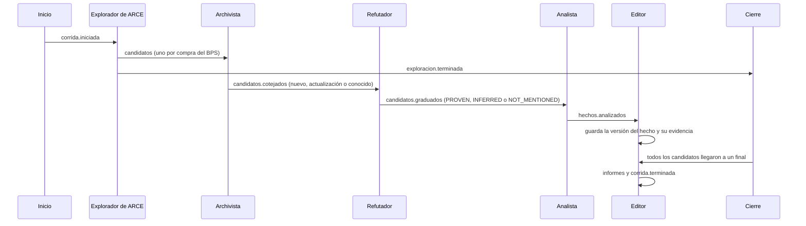

# Cómo se hizo: la primera rebanada

La primera versión de El Parte que anda de punta a punta: una fuente, un organismo, del explorador a la página de la mañana, con la sala de máquinas de cada corrida (tablero, T08). El código está en [`app/`](../../app/README.md).

## Qué hace

Cada corrida lee lo que publicó ARCE, la agencia de compras estatales, en una noche, se queda con las compras del Banco de Previsión Social y publica cada una como un hecho con su grado de evidencia.

1. **El inicio** congela la corrida: la noche, las fuentes, las entidades seguidas, el presupuesto y el modelo de cada agente, y lo manda en `corrida.iniciada` ([contratos](../contratos.md)).
2. **El explorador de ARCE** lee el feed del mes, se queda con la noche y un día de margen, lee cada publicación para saber quién compra, tapa los datos personales de las del BPS y arma un candidato por cada una, sin el modelo ([docs/fuentes/compras-estatales.md](../fuentes/compras-estatales.md)).
3. **El archivista** coteja cada candidato contra los hechos que ya están, por su clave (`arce:<ocid>:<tipo>`) y por la huella del contenido leído.
4. **El refutador** vuelve a leer la publicación por su cuenta y le pide al modelo que la compare con la afirmación. Es el único que pone el grado ([ADR 0004](../../adrs/0004-grados-de-evidencia.md)).
5. **El analista** pasa la afirmación tal cual. El análisis con el modelo llegó después, con T21: [docs/como-se-hizo/analista.md](analista.md).
6. **El editor** guarda cada hecho PROVEN o INFERRED, con su versión, su evidencia y las entidades, y manda a revisión los INFERRED.
7. **El cierre** ve cuándo todos los candidatos llegaron a un final, y el editor arma el informe de cada cliente y cierra la corrida.

Las páginas son tres: la de la mañana de la cuenta de demostración (`/manana`), la lista de corridas con el botón para correr una noche o repetir una corrida (`/corridas`), y la sala de máquinas de cada corrida (`/corridas/<id>`), con la cadena de mensajes de cada candidato, el costo por agente y, si es una repetición, la comparación con la original.

## Por qué existe

Porque chica y completa le gana a grande y a medias ([docs/plan.md](../plan.md)). Con una sola fuente ya aparecen todos los problemas de fondo: cómo se pasan el trabajo los agentes, qué pasa si un mensaje llega dos veces o antes que su causa, cómo se sabe que una corrida terminó, cómo se tapa una persona, cómo se repite una noche sin red. Resolverlos con una fuente deja a las otras cuatro (T24, T30) como trabajo de explorador y nada más.

## Cómo se construyó

En dos pasos: primero el esqueleto (la aplicación, su imagen y Docker Compose, con la salud de la base y de Kafka) y después los agentes, en el orden en que pasa un candidato. Las piezas que sostienen todo:

| Pieza | Qué resuelve |
|---|---|
| Identificadores deterministas | El `mensajeId` es una huella de la corrida, el agente, el tipo, la causa y la posición. Un mensaje procesado dos veces produce los mismos mensajes, y una repetición, los mismos identificadores salvo por la corrida. |
| Registro de lo procesado | Cada agente anota en `parte.mensajes_procesados` lo que procesó, en la misma transacción que sus efectos. |
| El observador | Copia cada mensaje de cada tópico a `parte.mensajes`. Es el registro que leen la sala de máquinas, el cierre y los agentes que necesitan la causa de lo que reciben. |
| Esperar la causa | Entre tópicos no hay orden, así que un agente puede recibir un cotejo antes de que el observador haya guardado el candidato. El agente lo espera en el registro, hasta 30 segundos. |
| Grabaciones | Todo lo que la corrida lee de afuera, fuentes y modelo, se graba ya enmascarado, y la repetición lee solo de ahí ([ADR 0011](../../adrs/0011-grabacion-y-repeticion-de-corridas.md)). |
| El servicio del modelo | Todas las llamadas pasan por él: usa el modelo que fijó la corrida, pide la respuesta con la forma de un `record`, la graba y emite `uso.modelo` con el costo según la tabla de precios. |
| El cierre | Revisa cada dos segundos las corridas en curso y cuenta, desde el registro, cuántos candidatos llegaron a un final contra los que anunció cada explorador. |
| Roles de la base | Las migraciones corren con el dueño; la aplicación, con un rol que no ve las cuentas ni puede cambiar el esquema. |

Las decisiones del camino quedaron en los contratos ("Cuándo termina una corrida", "Repetir una corrida") y en la página de la fuente ("Lo que se aprendió en la primera rebanada").

## Qué se probó

Diecisiete pruebas, que corren con `mvn test` contra un PostgreSQL y un Kafka de verdad, en contenedores, con las mismas imágenes que Docker Compose ([app/README.md](../../app/README.md)). Todo con datos inventados: un ARCE de mentira que sirve un feed y seis publicaciones, y un modelo de mentira que responde como el refutador.

- **ARCE:** la lectura del feed con hora local, la huella de cada publicación y la falla de formato; el enmascarado (contactos afuera, una proveedora sin marca de sociedad tapada en las adjudicaciones y en `parties`); el armado de cada clase de candidato.
- **La base:** el rol de los agentes no ve las cuentas, el del login no ve la base de afirmaciones, y ninguno crea tablas.
- **Kafka:** un tópico por tipo de mensaje, con una partición y sin vencimiento.
- **De punta a punta**, en una sola prueba que encadena tres corridas:
  1. Una noche normal: de las seis publicaciones, una queda fuera de la ventana, una es de otro organismo, una falla en el servidor y tres son del BPS. Salen dos PROVEN y un INFERRED, la aclaración del día de margen queda con la fecha no confirmada y pendiente de revisión, cuesta 0,012 dólares y ningún nombre ni correo inventado llega a los mensajes, las grabaciones ni la base.
  2. Su repetición: mensajes idénticos, ningún pedido al ARCE de mentira, ninguna llamada al modelo, y la base no cambia.
  3. La misma noche otra vez: el archivista da los tres hechos por conocidos, no se llama al modelo, y el informe dice que no hubo nada nuevo.
- **Las páginas:** la de la mañana, la lista de corridas y la sala de máquinas responden y muestran lo que tienen que mostrar. Se miraron además en un navegador sin pantalla.
- **En Docker Compose**, con la imagen de la aplicación: las migraciones crean los roles, la aplicación corre con el de los agentes, una corrida sobre la noche del 2026-11-12 termina (desde el espacio en la nube ARCE no responde, así que la corrida es una falla de la fuente bien registrada) y su repetición da los mismos mensajes.

Lo que falta probar: una noche real con la clave de verdad, en la máquina que corre las noches; que un mensaje entregado dos veces no cambie nada (la regla está, la prueba no); el corte por tiempo; y la medición contra el banco de pruebas (T20).

## Qué falló

**La API de ARCE por HTTP.** Se esperaba que respondiera igual por HTTP y por HTTPS. Respondió 503 por HTTP, en la primera llamada de prueba. Se usa solo HTTPS, y la URL pública de cada hecho también es HTTPS.

**El constructor de `RestClient`.** Se esperaba que Spring Boot lo ofreciera para inyectar, como en versiones anteriores. La aplicación no arrancó en la primera prueba de punta a punta: no había ningún `RestClient.Builder`. El lector de ARCE arma su propio cliente HTTP, que además necesita su propio manejo del proxy y de los tiempos de espera.

**La repetición no encontraba las respuestas del modelo.** Se esperaba que la repetición pidiera al modelo exactamente lo mismo que la original. La prueba de punta a punta esperó dos minutos a una repetición que nunca terminó, y el registro decía que la corrida original "no tiene grabado modelo:refutador:…". La causa: la original le mandaba al modelo la publicación tal como la había leído, y la repetición, tal como volvía de la base, y PostgreSQL guarda el JSON en `jsonb`, que reordena las claves. El pedido cambiaba, y con él su clave. Desde entonces cada lectura grabada se devuelve tal como quedó guardada, también en la corrida original ([ADR 0011](../../adrs/0011-grabacion-y-repeticion-de-corridas.md)).

**Una fuente caída se leía como una noche tranquila.** Se esperaba que la página de la mañana dejara claro qué pasó la noche anterior. En Docker Compose, con ARCE inalcanzable, la página decía "No hubo nada nuevo", lo mismo que en una noche sin compras. Se vio al mirar la página después de esa corrida. Ahora la página avisa cuántas lecturas fallaron, que puede faltar algo y dónde ver el detalle.

**Del esqueleto:** el volumen de Kafka en una carpeta sin permiso de escritura para el usuario de la imagen (se pasó a `/var/lib/kafka/data`), y el cliente de Kafka escribiendo su configuración entera cada vez que el indicador de salud lo creaba (se bajó a advertencias).

## Qué se cambió

Además de lo que se cambió por cada falla:

- **El cierre cuenta lo anunciado, no lo recibido.** La primera versión comparaba los finales con los mensajes `candidatos` del registro. Al releer el código se vio que el observador puede guardar `exploracion.terminada` antes que el último candidato, y entonces la corrida cerraría con un candidato menos. Ahora el total sale de `exploracion.terminada`, que dice cuántos emitió el explorador.
- **Una falla del modelo es un NOT_MENTIONED, no un mensaje perdido.** Sin clave, o con una respuesta ilegible, el refutador tiraba una excepción, Kafka reintentaba dos veces y el candidato quedaba sin final hasta el corte por tiempo, a los 45 minutos. Ahora el error se graba como cualquier respuesta, el candidato sale NOT_MENTIONED con el motivo en `busqueda` y la repetición falla en el mismo lugar.
- **Los contratos crecieron** con lo que la rebanada necesitó: el mensaje `exploracion.terminada`, el campo `proceso` de los candidatos, el campo `reproduceA` de `corrida.iniciada` y el resultado `reproducida` de `uso.modelo`. Son agregados opcionales, así que la versión de cada contrato no cambia.
- **Dos arreglos del explorador después de la medición (T39).** La medición contra el banco mostró que el explorador daba por buena una noche hábil en la que ARCE no traía nada, y que de una compra repartida en varias adjudicaciones nombraba solo al primer proveedor ([docs/como-se-hizo/medicion-contra-el-banco.md](medicion-contra-el-banco.md)). Ahora un día hábil sin publicaciones en el feed emite `fuente.fallida` de tipo `sinPublicaciones`, y el resumen de una adjudicación nombra a todos los proveedores y dice en cuántas adjudicaciones se repartió la compra (`ExploradorArceTest` y `CandidatosDeArceTest`).
- **Las respuestas grabadas** pasaron de un `ChatModel` que graba en archivos ([ADR 0003](../../adrs/0003-eleccion-del-stack.md)) a la base, junto con lo leído de las fuentes ([ADR 0011](../../adrs/0011-grabacion-y-repeticion-de-corridas.md)).
