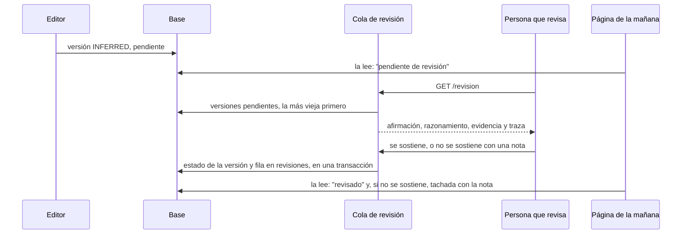

# Cómo se hizo: la cola de revisión humana

La página de la sala de máquinas donde una persona revisa los hechos INFERRED, y lo que esa revisión cambia en la página de la mañana (tablero, T23). Las reglas están en la decisión D6 ([arranque/decisiones-iniciales.md](../../arranque/decisiones-iniciales.md)) y en [docs/contratos.md](../contratos.md), "Umbral de revisión". El código está en `app/src/main/java/io/github/andresdiegolanda/elparte/web/RevisionControlador.java` y `app/src/main/resources/templates/revision.html`.

## Qué hace

1. **El editor deja pendiente cada versión INFERRED**, como desde la primera rebanada: en la versión 0, todo INFERRED va a revisión.
2. **La cola**, en `/revision`, muestra las versiones pendientes, la más vieja primero, con la afirmación, de qué se deduce, los fragmentos de la evidencia con su enlace a la fuente, la fecha de publicación y el enlace a la traza en la sala de máquinas. Abajo, las últimas veinte revisiones.
3. **Quien revisa decide** si la deducción se sostiene o no. Un "no se sostiene" pide una nota, porque la página de la mañana la muestra para explicar por qué.
4. **La revisión se guarda en una transacción**: el estado de la versión pasa de `pendiente` a `aceptado` o `rechazado`, solo si sigue pendiente, y se agrega la fila en `parte.revisiones`. Una versión se revisa una sola vez; una segunda revisión responde 409 y no pisa la primera.
5. **La página de la mañana lee el estado al mostrarse**, así que la revisión se ve enseguida, sin esperar a otra corrida. Un hecho que se sostiene dice "revisado: se sostiene". Uno que no se sostiene sigue en la página, tachado, con la nota y sin el análisis.

## Por qué existe

El refutador deduce. Al principio no hay datos sobre cuánto acierta cuando deduce, y la página sale todas las mañanas, haya revisión o no (D6). La cola es donde una persona confirma o corrige esas deducciones, y donde se juntan los datos para saber cuándo aflojar el umbral.

## Cómo se construyó

- **Revisar no cambia el grado.** El grado lo pone el refutador y nadie después lo cambia ([adrs/0004-grados-de-evidencia.md](../../adrs/0004-grados-de-evidencia.md)). La revisión dice otra cosa: si la deducción se sostiene. Por eso los botones dicen "Se sostiene" y "No se sostiene", y no "PROVEN" o "NOT_MENTIONED".
- **Nada se borra.** Un hecho que no se sostiene no desaparece de la página: queda tachado y dice por qué. Es lo que pide D6, "nada desaparece de la página sin que la página lo diga".
- **La cola lee la base, no el tópico.** El editor emite `revision.pendiente` por cada INFERRED, pero lo que la cola necesita, la versión con su evidencia y su traza, está en la base. El mensaje queda en el registro de la corrida.
- **La tabla ya estaba.** `parte.revisiones` está desde la primera migración; hasta ahora nadie la escribía.

## Qué se probó

En `app/src/test/java/io/github/andresdiegolanda/elparte/PrimeraRebanadaTest.java`, después de la noche y su repetición, con la aclaración INFERRED de la noche de prueba:

- La cola la muestra con su razonamiento.
- Un rechazo sin nota responde 400, y un estado que no existe, también.
- El rechazo con nota redirige a la cola, la versión queda `rechazado` y sale de los pendientes, y aparece entre las revisadas con su nota.
- Una segunda revisión de la misma versión responde 409.
- La página de la mañana muestra "revisado: no se sostiene" y la nota, y el resto de los hechos sigue igual.

Las dos páginas se miraron en un navegador, desde las copias que deja la prueba en `app/target/paginas/`.

## Qué falló

- **La prueba miraba la página de la mañana en el momento equivocado.** La primera versión revisaba después de correr la misma noche otra vez, y para entonces la página de la mañana mostraba el informe nuevo, sin novedades. La revisión pasó antes de esa corrida.
- **El análisis de un hecho rechazado se seguía mostrando**, con su "por qué importa", al lado de una deducción que no se sostiene. Se vio al mirar la página, y ahora no se muestra.

## Qué falta

- **Quién puede revisar.** D6 dice que revisa el responsable del proyecto, pero todavía no hay login: la cola, como el resto de la sala de máquinas, la puede usar cualquiera que llegue a la aplicación. Se cierra con el login (T25).
- **Qué hace la revisión con lo que sigue.** Un hecho rechazado sigue siendo conocido para el archivista, así que la noche siguiente no se vuelve a anunciar. Cómo se muestra en el expediente de la entidad queda para T33.
- **El aviso diario** dirá cuántos hechos esperan revisión (T35, [adrs/0013-acceso-perfil-y-parte-diario.md](../../adrs/0013-acceso-perfil-y-parte-diario.md)).
