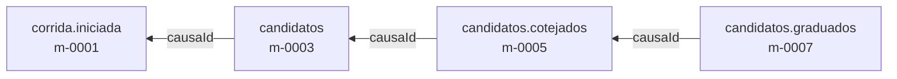
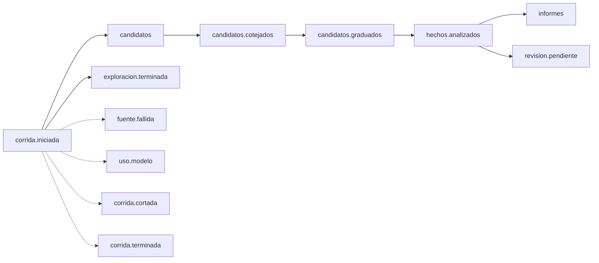

# Contratos entre agentes

Qué dice cada mensaje que se pasan los agentes, cómo se reconoce un mismo hecho y cómo se evita que un mensaje repetido cree un hecho dos veces. Es el contrato que cumplen todos los agentes de la [arquitectura](arquitectura.md), con la orquestación del [ADR 0002](../adrs/0002-orquestacion-por-mensajes.md).

Los ejemplos usan datos inventados: ningún identificador, monto ni nombre corresponde a una compra o un proyecto real.

## Convenciones

- Los mensajes son JSON en UTF-8. Los nombres de campo van en español, en *camelCase* y sin tildes (D7).
- Los instantes van en UTC con la marca `Z`, por ejemplo `2026-11-07T03:12:40Z`. Las fechas de publicación de las fuentes se guardan como las da la fuente, junto con la zona horaria si se conoce.
- Cada tipo de mensaje vive en su propio tópico, con el mismo nombre que el tipo, una sola partición y sin vencimiento. La clave de cada mensaje en Kafka es el identificador de la corrida. [PROVEN: prueba `ElParteAplicacionTest`, 2026-11-14] Entre tópicos distintos no hay orden: un agente puede recibir un mensaje antes de que el observador haya guardado el que lo causó. Por eso ningún agente depende del orden: cuando necesita la causa de lo que recibe, la busca en el registro de mensajes y la espera si todavía no llegó. [PROVEN: primera rebanada, `RegistroDeMensajes.esperar`, 2026-11-14]
- En el código, cada tipo de mensaje es un `record` de Java, y lo que produce el modelo se pide como salida estructurada validada contra su esquema ([docs/verificaciones/spring-ai.md](verificaciones/spring-ai.md)).
- **Versiones.** Agregar un campo opcional no cambia la versión. Quitar un campo, cambiar su significado o hacerlo obligatorio sube la versión, y durante la transición los consumidores aceptan las dos.

## El sobre

Todo mensaje va dentro de un sobre con los mismos campos:

| Campo | Tipo | Qué es |
|---|---|---|
| `mensajeId` | texto | Identificador del mensaje. Se calcula a partir de sus causas (ver "Idempotencia"), así que una corrida repetida produce los mismos identificadores. |
| `tipo` | texto | El tipo de mensaje, igual al nombre de su tópico. |
| `version` | entero | Versión del contrato de ese tipo. |
| `corridaId` | texto | La corrida a la que pertenece. |
| `causaId` | texto o nulo | El `mensajeId` del mensaje que lo provocó. Es nulo solo en `corrida.iniciada`. |
| `agente` | texto | Quién lo emitió: `inicio`, `explorador-arce`, `archivista`, `refutador`, `analista`, `editor`, `presupuesto`. En la primera rebanada, `uso.modelo` lo emite el servicio por el que pasan todas las llamadas al modelo, con el agente `presupuesto`, y `corrida.cortada` y `corrida.terminada` los emite el editor al cerrar la corrida. |
| `emitidoEn` | instante | Cuándo se emitió. |
| `contenido` | objeto | Lo propio de cada tipo, descrito abajo. |

Con `causaId` cada hallazgo se puede seguir hacia atrás hasta su corrida, que es lo que muestra la sala de máquinas:



## Los mensajes



Las flechas punteadas son mensajes que puede emitir cualquier momento de la corrida.

### `corrida.iniciada`

Lo emite el inicio de corrida. Arranca la noche.

| Campo | Qué es |
|---|---|
| `modo` | `normal`, `reproduccion` (respuestas grabadas, sin red) o `banco` (una noche del banco de pruebas). |
| `fechaObjetivo` | La fecha cuyas publicaciones se leen. En modo normal es la de ayer; en modo banco, la de la noche que se repite. |
| `fuentes` | Las fuentes de esta corrida. |
| `entidadesSeguidas` | Las entidades con algún suscriptor. Los exploradores filtran por ellas antes de usar el modelo. En modo `banco`, solo la entidad que se mide ([ADR 0014](../adrs/0014-medicion-contra-el-banco.md)). |
| `presupuesto` | `costoMaximoUsd`, `pasosMaximos` y `minutosMaximos` ([ADR 0005](../adrs/0005-presupuesto-por-corrida.md)). |
| `modelos` | El modelo de cada agente en esta corrida, el vigente al empezar ([ADR 0003](../adrs/0003-eleccion-del-stack.md)). Cada agente usa este y no otro. |
| `reproduceA` | En modo `reproduccion`, la corrida que se repite, normal o del banco; nulo en los demás modos. Se sumó con la primera rebanada (ver "Repetir una corrida"). |

```json
{
  "mensajeId": "m-0001", "tipo": "corrida.iniciada", "version": 1,
  "corridaId": "c-2026-11-06-normal", "causaId": null,
  "agente": "inicio", "emitidoEn": "2026-11-07T03:00:00Z",
  "contenido": {
    "modo": "normal",
    "fechaObjetivo": "2026-11-06",
    "fuentes": ["arce"],
    "entidadesSeguidas": ["organismo:bps"],
    "presupuesto": { "costoMaximoUsd": 0.50, "pasosMaximos": 200, "minutosMaximos": 45 },
    "modelos": { "explorador-arce": "claude-haiku-5-5", "archivista": "claude-haiku-5-5",
                 "refutador": "claude-sonnet-5-5", "analista": "claude-sonnet-5-5", "editor": "claude-haiku-5-5" },
    "reproduceA": null
  }
}
```

### `candidatos`

Lo emite cada explorador, uno por posible hecho.

| Campo | Qué es |
|---|---|
| `candidatoId` | Identificador del candidato en esta corrida. |
| `fuente` | De qué fuente salió. |
| `identificadorEnFuente` | El identificador estable que da la fuente (en ARCE, el de la publicación OCDS). |
| `proceso` | El proceso al que pertenece la publicación en la fuente, si lo hay (en ARCE, el `ocid` de la compra). Con él arma el archivista la clave del hecho. Se sumó con la primera rebanada. |
| `url` | Dónde está la fuente. |
| `fechaPublicacion` | La fecha de publicación detectada, con su zona horaria si se conoce. |
| `tipoDeHecho` | Qué clase de hecho es: `llamado`, `adjudicacion`, `aclaracion`, `cancelacion`, `aprobacion`, `aviso`, `norma`. |
| `entidades` | Las entidades que aparecen, con su identificador si ya se conocen. |
| `resumen` | Quién, qué y cuándo, en una o dos frases, escrito por el explorador. |
| `evidencia` | El fragmento de la fuente que respalda el resumen y la huella (hash) del contenido completo leído. |
| `datosPersonalesEnmascarados` | Cuántos datos personales se taparon antes de publicar (D3). |

```json
{
  "mensajeId": "m-0003", "tipo": "candidatos", "version": 1,
  "corridaId": "c-2026-11-06-normal", "causaId": "m-0001",
  "agente": "explorador-arce", "emitidoEn": "2026-11-07T03:02:11Z",
  "contenido": {
    "candidatoId": "k-arce-0001",
    "fuente": "arce",
    "identificadorEnFuente": "adjudicacion-9990001",
    "proceso": "ocds-ejemplo-9990001",
    "url": "https://www.comprasestatales.gub.uy/ocds/release/adjudicacion-9990001",
    "fechaPublicacion": "2026-11-06T14:20:05",
    "tipoDeHecho": "adjudicacion",
    "entidades": [
      { "rol": "comprador", "entidadId": "organismo:bps", "nombre": "Banco de Previsión Social" },
      { "rol": "proveedor", "entidadId": null, "nombre": "Proveedor de Ejemplo S.A." }
    ],
    "resumen": "El BPS adjudicó a Proveedor de Ejemplo S.A. la compra de servicios de mantenimiento, por 1.200.000 pesos.",
    "evidencia": {
      "fragmento": "awards[0].suppliers[0].name = Proveedor de Ejemplo S.A.; awards[0].value.amount = 1200000",
      "hashContenido": "sha256:0f3a…"
    },
    "datosPersonalesEnmascarados": 1
  }
}
```

El explorador de ARCE no usa el modelo: la publicación OCDS es estructurada, así que el resumen se escribe con sus campos y la evidencia es la lista de esos campos con su valor ([fuentes/compras-estatales.md](fuentes/compras-estatales.md)).

### `exploracion.terminada`

Lo emite cada explorador cuando terminó con su fuente, aunque haya fallado. Se sumó con la primera rebanada: sin él, nadie sabría cuántos candidatos esperar antes de cerrar la corrida (ver "Cuándo termina una corrida").

| Campo | Qué es |
|---|---|
| `fuente` | La fuente explorada. |
| `publicacionesLeidas` | Cuántas publicaciones de la noche leyó. |
| `candidatosEmitidos` | Cuántos candidatos emitió. |
| `sinProcesar` | Cuántas publicaciones de entidades seguidas no pudo leer. Los candidatos salen con los de la fecha objetivo primero y la cadena los procesa en ese orden, así, si el presupuesto corta la corrida, lo que queda sin procesar es del día de margen. Hasta T22 había además un tope de 60 candidatos por corrida, y lo que quedaba afuera se contaba acá. |

```json
{ "fuente": "arce", "publicacionesLeidas": 712, "candidatosEmitidos": 41, "sinProcesar": 2 }
```

### `candidatos.cotejados`

Lo emite el archivista, uno por candidato.

| Campo | Qué es |
|---|---|
| `candidatoId` | El candidato cotejado. |
| `claveDeHecho` | La identidad del hecho (ver "Identidad de un hecho"). |
| `estado` | `conocido` (ya está y no cambió), `actualizacion` (ya está y cambió algo) o `nuevo`. |
| `hechoRelacionadoId` | El hecho que ya estaba, si es conocido o actualización. |
| `diferencias` | Qué cambió, si es una actualización. |
| `razon` | Por qué el archivista decidió ese estado, en una frase. |

```json
{
  "mensajeId": "m-0005", "tipo": "candidatos.cotejados", "version": 1,
  "corridaId": "c-2026-11-06-normal", "causaId": "m-0003",
  "agente": "archivista", "emitidoEn": "2026-11-07T03:02:40Z",
  "contenido": {
    "candidatoId": "k-arce-0001",
    "claveDeHecho": "arce:ocds-ejemplo-9990001:adjudicacion",
    "estado": "nuevo",
    "hechoRelacionadoId": null,
    "diferencias": [],
    "razon": "No hay ningún hecho con esa clave; el llamado de esa compra sí está, como hecho distinto."
  }
}
```

Los candidatos `conocido` terminan acá: no siguen al refutador.

### `candidatos.graduados`

Lo emite el refutador, uno por candidato nuevo o actualizado. Los grados y lo que exige cada uno están en el [ADR 0004](../adrs/0004-grados-de-evidencia.md).

| Campo | Qué es |
|---|---|
| `candidatoId`, `claveDeHecho` | Lo que se graduó. |
| `afirmacion` | La afirmación tal como queda después de la refutación. Puede ser más acotada que el resumen del explorador. |
| `grado` | `PROVEN`, `INFERRED` o `NOT_MENTIONED`. |
| `evidencia` | Los fragmentos de la fuente que respaldan la afirmación, cada uno con su URL. |
| `razonamiento` | Obligatorio si el grado es `INFERRED`: de qué se deduce. |
| `busqueda` | Obligatorio si el grado es `NOT_MENTIONED`: qué se buscó y dónde. |
| `fechaConfirmada` | Si la fecha de publicación se pudo confirmar como de la noche leída. |
| `pruebas` | Cada intento de tirar abajo el candidato: `fecha`, `duplicado` o `fuenteDice`, con su resultado y detalle. |

Si el refutador no puede volver a leer la fuente, o el modelo no responde o responde algo sin la forma pedida, el grado es NOT_MENTIONED y `busqueda` dice por qué: sin veredicto no se publica. [PROVEN: primera rebanada, `Refutador`, 2026-11-14]

```json
{
  "mensajeId": "m-0007", "tipo": "candidatos.graduados", "version": 1,
  "corridaId": "c-2026-11-06-normal", "causaId": "m-0005",
  "agente": "refutador", "emitidoEn": "2026-11-07T03:03:30Z",
  "contenido": {
    "candidatoId": "k-arce-0001",
    "claveDeHecho": "arce:ocds-ejemplo-9990001:adjudicacion",
    "afirmacion": "El BPS adjudicó a Proveedor de Ejemplo S.A. una compra de servicios de mantenimiento por 1.200.000 pesos.",
    "grado": "PROVEN",
    "evidencia": [
      { "url": "https://www.comprasestatales.gub.uy/ocds/release/adjudicacion-9990001",
        "fragmento": "awards[0].suppliers[0].name = Proveedor de Ejemplo S.A.; awards[0].value.amount = 1200000" }
    ],
    "razonamiento": null,
    "busqueda": null,
    "fechaConfirmada": true,
    "pruebas": [
      { "prueba": "fecha", "resultado": "pasa", "detalle": "La publicación es del 2026-11-06 y el feed del mes la ubica ese día." },
      { "prueba": "duplicado", "resultado": "pasa", "detalle": "El archivista no encontró otro hecho con esa clave." },
      { "prueba": "fuenteDice", "resultado": "pasa", "detalle": "Proveedor y monto están literales en la publicación." }
    ]
  }
}
```

### `hechos.analizados`

Lo emite el analista, uno por candidato con grado `PROVEN` o `INFERRED`. El grado se copia tal cual: el analista no lo puede cambiar. Los tres campos de texto los escribe el modelo y pasan por un control en código: un campo vacío, o con una cifra que no está en la afirmación, en la evidencia, en el razonamiento ni en las fechas, no se usa ([ADR 0015](../adrs/0015-que-puede-escribir-el-analista.md)). Entonces `queDice` es la afirmación del refutador, y `porQueImporta` o `queMirar` empiezan con "Sin análisis" y dicen por qué. Si el modelo no responde, salen así los tres, y el hecho se publica igual.

| Campo | Qué es |
|---|---|
| `candidatoId`, `claveDeHecho`, `grado` | Lo analizado, con el grado del refutador. |
| `queDice` | La afirmación en lenguaje llano. |
| `porQueImporta` | Por qué le importa a quien sigue esa entidad. |
| `queMirar` | Qué conviene seguir de cerca después. |

En la primera rebanada el analista solo pasaba la afirmación, y los dos últimos campos decían "Sin análisis" en todos los hechos; el análisis con el modelo llegó con T21.

```json
{
  "mensajeId": "m-0009", "tipo": "hechos.analizados", "version": 1,
  "corridaId": "c-2026-11-06-normal", "causaId": "m-0007",
  "agente": "analista", "emitidoEn": "2026-11-07T03:04:05Z",
  "contenido": {
    "candidatoId": "k-arce-0001",
    "claveDeHecho": "arce:ocds-ejemplo-9990001:adjudicacion",
    "grado": "PROVEN",
    "queDice": "El BPS eligió proveedor para el mantenimiento que había llamado a licitación.",
    "porQueImporta": "Cierra un proceso de compra abierto y fija quién presta el servicio.",
    "queMirar": "Si aparece una ampliación del contrato o una nueva adjudicación del mismo llamado."
  }
}
```

### `informes`

Lo emite el editor, uno por cliente, cuando su informe de la mañana está listo. El informe en sí queda en la base.

| Campo | Qué es |
|---|---|
| `clienteId` | Identificador opaco del cliente: nunca su correo (D3). |
| `fechaObjetivo` | La noche del informe. |
| `hechos` | Las claves de los hechos que incluye. |
| `sinNovedades` | Verdadero si no hubo nada nuevo sobre sus suscripciones. |
| `pendientesDeRevision` | Cuántos de sus hechos están marcados como pendientes de revisión. |
| `corridaCortada` | Verdadero si la corrida se cortó por presupuesto. |

De acá en adelante, los ejemplos muestran solo el `contenido`: el sobre es igual al de los mensajes anteriores.

```json
{ "clienteId": "cl-7f2c", "fechaObjetivo": "2026-11-06",
  "hechos": ["arce:ocds-ejemplo-9990001:adjudicacion"],
  "sinNovedades": false, "pendientesDeRevision": 0, "corridaCortada": false }
```

### `revision.pendiente`

Lo emite el editor por cada hecho que va a revisión humana (ver "Umbral de revisión"). Lleva `claveDeHecho`, `grado` y `motivo`.

```json
{ "claveDeHecho": "arce:ocds-ejemplo-9990002:adjudicacion", "grado": "INFERRED",
  "motivo": "Todo hecho INFERRED va a revisión en la versión 0." }
```

### `fuente.fallida`

Lo emite un explorador cuando su fuente no responde o la respuesta no sirve. Lleva `fuente`, `url`, `tipoDeFalla` (`sinRespuesta`, `bloqueo`, `formato`, `permiso`, `sinFecha` o `sinPublicaciones`) y `detalle`. La corrida sigue con las demás fuentes. `sinFecha` dice que la fuente no deja pedir lo publicado en la fecha objetivo: en modo banco, esa noche no se puede repetir para esa fuente (D1, [ADR 0014](../adrs/0014-medicion-contra-el-banco.md)). ARCE nunca lo emite, porque su feed es por mes. `sinPublicaciones` dice que la fecha objetivo es un día hábil y la fuente no trae nada publicado ese día: puede ser un feriado o un hueco de la fuente, y la noche no es una noche sin novedades. En modo banco tampoco se puede repetir. Lo emite el explorador de ARCE (T39).

```json
{ "fuente": "arce", "url": "https://www.comprasestatales.gub.uy/ocds/rss/2026/11",
  "tipoDeFalla": "sinRespuesta", "detalle": "Conexión cortada después de 30 segundos, tres intentos." }
```

### `uso.modelo`

Lo emite el servicio del modelo por cada llamada, se haga o no, con lo que le dejó el advisor de presupuesto ([ADR 0005](../adrs/0005-presupuesto-por-corrida.md)).

| Campo | Qué es |
|---|---|
| `agenteQueLlama` | Qué agente pidió la llamada. |
| `modelo` | Qué modelo, por ejemplo `claude-haiku-5-5`. |
| `resultado` | `hecha`, `rechazadaPorPresupuesto`, `error` o `reproducida` (en modo reproducción: la respuesta sale de la grabación, con los tokens grabados y costo cero). `reproducida` se sumó con la primera rebanada, y `rechazadaPorPresupuesto` llegó con el presupuesto que corta (T22): la llamada no se hizo porque no alcanzaba. El rechazo se graba como una respuesta, y la repetición lo vuelve a emitir como `rechazadaPorPresupuesto`. |
| `tokensEntrada`, `tokensSalida`, `tokensCacheLectura`, `tokensCacheEscritura` | Lo usado. |
| `costoUsd` | Lo gastado, según la tabla de precios. |
| `reservaUsd` | Lo que se reservó antes de llamar. |
| `duracionMs` | Cuánto tardó. |
| `limite` | Solo si se rechazó: el límite que no alcanzaba, `costo`, `pasos` o `tiempo`. Se sumó con T22. |

```json
{ "agenteQueLlama": "refutador", "modelo": "claude-sonnet-5-5", "resultado": "hecha",
  "tokensEntrada": 3850, "tokensSalida": 640, "tokensCacheLectura": 2100, "tokensCacheEscritura": 0,
  "costoUsd": 0.01431, "reservaUsd": 0.0477, "duracionMs": 6120, "limite": null }
```

### `corrida.cortada` y `corrida.terminada`

`corrida.cortada` dice qué límite se alcanzó (`costo`, `pasos` o `tiempo`), lo gastado y cuántos candidatos quedaron sin procesar. `corrida.terminada` cierra la corrida con su estado (`completa`, `cortada` o `fallida`), los conteos por estado y por grado, el costo y la duración.

```json
{ "limite": "costo", "gastadoUsd": 0.4981, "pasos": 61, "minutos": 12, "sinProcesar": 3 }
```

### Cuándo termina una corrida

Una corrida termina cuando todas sus fuentes mandaron `exploracion.terminada` y todos los candidatos llegaron a un final: el archivista los dio por conocidos, el refutador los graduó NOT_MENTIONED, el presupuesto le rechazó la llamada al refutador (el candidato queda sin procesar) o el editor procesó su análisis. Lo controla un proceso que revisa cada dos segundos las corridas en curso, contando desde el registro de mensajes. El total de candidatos sale de `exploracion.terminada` y no de contar los mensajes `candidatos`, porque el observador guarda cada tópico a su ritmo. Al terminar, el editor emite un `informes` por cada cliente con suscripciones y después `corrida.terminada`. Si la corrida pasa su tope de tiempo, se corta: primero `corrida.cortada`, después los informes con `corridaCortada` y `corrida.terminada`. [PROVEN: primera rebanada, `CierreDeCorrida`, 2026-11-14] Si el presupuesto rechazó alguna llamada, por costo o por pasos, la corrida termina igual cuando todos sus candidatos llegaron a un final, pero cortada, con el límite del primer `uso.modelo` rechazado. Un candidato rechazado en el refutador queda sin procesar; uno rechazado en el analista se publica sin análisis. [PROVEN: `PresupuestoQueCortaTest`, 2026-11-16]

```json
{ "estado": "completa",
  "conteos": { "candidatos": 7, "conocidos": 5, "actualizaciones": 0, "nuevos": 2,
               "PROVEN": 1, "INFERRED": 1, "NOT_MENTIONED": 0, "sinProcesar": 0 },
  "costoUsd": 0.0623, "duracionSegundos": 248 }
```

## Repetir una corrida

Una corrida en modo `reproduccion` repite otra sin red y sin costo, y produce los mismos mensajes ([ADR 0011](../adrs/0011-grabacion-y-repeticion-de-corridas.md)).

- **Qué se graba.** En una corrida normal o del banco se graba, ya enmascarado, todo lo que se lee de afuera: la ventana del feed, el comprador de cada publicación, cada publicación de una entidad seguida, la relectura del refutador y cada respuesta del modelo, incluidas las fallas. Se graba en `parte.grabaciones` ([base-de-afirmaciones.md](base-de-afirmaciones.md)), y cada agente sigue con lo grabado, no con lo leído, así la original y la repetición ven exactamente lo mismo.
- **Qué hace la repetición.** Lee solo de las grabaciones de la corrida original. Si falta una, falla en lugar de salir a la red.
- **Lo que no cambia en la base.** El editor de una repetición no escribe hechos ni informes: emite los mismos mensajes y nada más. El archivista coteja contra los hechos de las corridas que empezaron antes de la original, así decide lo mismo que decidió ella.
- **Cómo se comparan.** Se comparan tipo, agente y contenido de cada mensaje. Quedan afuera los identificadores y las horas, `corrida.iniciada` (dice el modo), `uso.modelo` (la repetición no llama al modelo) y el costo y la duración de `corrida.terminada`. La sala de máquinas muestra la comparación en la página de cada repetición. [PROVEN: `PrimeraRebanadaTest` y una repetición en Docker Compose, 2026-11-14]

## Identidad de un hecho

La `claveDeHecho` dice cuándo dos candidatos son el mismo hecho. La calcula el archivista.

1. **Si la fuente da un identificador estable, se usa ese.** La clave es `fuente:identificador:tipoDeHecho`. En ARCE, el identificador es el del proceso de compra en OCDS (`ocid`); en el BID, el número de operación; en el Banco Mundial, el identificador del proyecto; en la normativa de Presidencia, el número de la resolución. Ejemplo: `arce:ocds-ejemplo-9990001:adjudicacion`.
2. **El tipo de hecho es parte de la clave.** El llamado y la adjudicación de una misma compra son dos hechos distintos, relacionados por su proceso.
3. **Si no hay identificador estable**, la clave es la fuente más la huella de la entidad, el tipo de hecho, la fecha del acto y el título normalizado. Las cinco fuentes de la versión 0 tienen identificadores estables ([docs/fuentes/](fuentes/README.md)), así que esta regla queda para fuentes futuras. [INFERRED]
4. **Fuentes distintas no se fusionan en la versión 0.** Si una compra aparece en ARCE y su resolución en Presidencia, son dos hechos, que el archivista puede marcar como relacionados.
5. **Una actualización no crea un hecho nuevo**: crea una versión nueva del mismo hecho, y la historia queda.

## Idempotencia

Kafka entrega cada mensaje por lo menos una vez, así que un agente puede recibir el mismo mensaje dos veces. [ASSUMED: la primera rebanada usa la confirmación por omisión de Spring for Apache Kafka y no tiene todavía una prueba de reentrega] Tres reglas hacen que eso no cambie el resultado:

1. **Identificadores deterministas.** El `mensajeId` se calcula a partir de la corrida, el agente, el `causaId` y la posición del mensaje entre los que produce esa causa. Procesar dos veces el mismo mensaje produce mensajes con los mismos identificadores.
2. **Registro de lo procesado.** Cada agente anota en la base el `mensajeId` de cada mensaje que procesó, en la misma transacción que sus efectos. Si lo vuelve a recibir, lo descarta.
3. **Escrituras por clave.** El editor escribe los hechos por `claveDeHecho` y versión. Escribir dos veces lo mismo deja todo igual.

## Umbral de revisión

La decisión D6 manda a revisión humana lo que tenga "demasiado INFERRED". En la versión 0, el umbral es el más estricto: **todo hecho INFERRED va a la cola de revisión**, y mientras nadie lo revisa se muestra con su grado y la marca "pendiente de revisión".

- **Por qué:** al principio no hay datos sobre cuánto acierta el refutador cuando deduce, y el volumen esperado es bajo (unos pocos hechos por noche para un organismo). [INFERRED: de la noche de muestra del banco de pruebas]
- **Cuándo se afloja:** cuando la medición contra el banco de pruebas y las revisiones muestren qué clases de INFERRED aciertan siempre. El umbral es un parámetro de configuración, y cambiarlo se anota en el CHANGELOG con la medición que lo justifica.
- **Cómo se revisa:** en la cola de revisión de la sala de máquinas, `/revision`, que lista las versiones pendientes, la más vieja primero, con su razonamiento, su evidencia y el enlace a su traza. Quien revisa dice si la deducción se sostiene o no; un "no se sostiene" pide una nota. Cada revisión es una fila en `revisiones` y cambia `estado_revision` a `aceptado` o `rechazado`; una versión se revisa una sola vez. La cola no escucha `revision.pendiente`: lee las versiones pendientes de la base, y el mensaje queda en el registro de la corrida. Revisar no cambia el grado. [PROVEN: `PrimeraRebanadaTest`, 2026-11-16]
- **Qué ve el cliente:** la página de la mañana lee el estado al mostrarse, así que una revisión se ve enseguida. Un hecho que se sostiene dice "revisado: se sostiene". Uno que no se sostiene sigue en la página, tachado, con la nota de la revisión y sin el análisis: nada desaparece sin que la página lo diga (D6).

## Datos personales en los mensajes

Los exploradores tapan los datos personales antes de publicar un candidato: ningún mensaje lleva contactos, firmantes ni nombres de consultores individuales, y en su lugar va `[persona]`. Cuántos se taparon queda en `datosPersonalesEnmascarados`. Qué campos se descartan en cada fuente lo fija el [ADR 0008](../adrs/0008-datos-personales.md).
