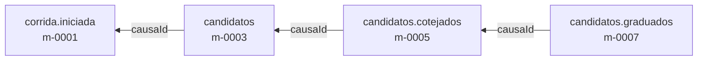
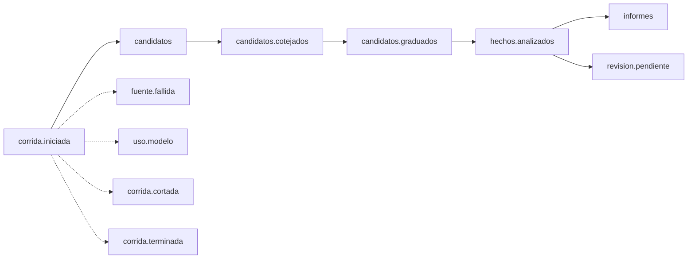

# Contratos entre agentes

Qué dice cada mensaje que se pasan los agentes, cómo se reconoce un mismo hecho y cómo se evita que un mensaje repetido cree un hecho dos veces. Es el contrato que cumplen todos los agentes de la [arquitectura](arquitectura.md), con la orquestación del [ADR 0002](../adrs/0002-orquestacion-por-mensajes.md).

Los ejemplos usan datos inventados: ningún identificador, monto ni nombre corresponde a una compra o un proyecto real.

## Convenciones

- Los mensajes son JSON en UTF-8. Los nombres de campo van en español, en *camelCase* y sin tildes (D7).
- Los instantes van en UTC con la marca `Z`, por ejemplo `2026-11-07T03:12:40Z`. Las fechas de publicación de las fuentes se guardan como las da la fuente, junto con la zona horaria si se conoce.
- Cada tipo de mensaje vive en su propio tópico, con el mismo nombre que el tipo. La clave de cada mensaje en Kafka es el identificador de la corrida, para que los mensajes de una corrida se lean en orden. [ASSUMED: el orden por clave se verifica al configurar Kafka en la primera rebanada]
- En el código, cada tipo de mensaje es un `record` de Java, y lo que produce el modelo se pide como salida estructurada validada contra su esquema ([docs/verificaciones/spring-ai.md](verificaciones/spring-ai.md)).
- **Versiones.** Agregar un campo opcional no cambia la versión. Quitar un campo, cambiar su significado o hacerlo obligatorio sube la versión, y durante la transición los consumidores aceptan las dos.

## El sobre

Todo mensaje va dentro de un sobre con los mismos campos:

| Campo | Tipo | Qué es |
|---|---|---|
| `mensajeId` | texto | Identificador del mensaje. Se calcula a partir de sus causas (ver "Idempotencia"), así que una corrida repetida produce los mismos identificadores. |
| `tipo` | texto | El tipo de mensaje, igual al nombre de su tópico. |
| `version` | entero | Versión del contrato de ese tipo. |
| `corridaId` | texto | La corrida a la que pertenece. |
| `causaId` | texto o nulo | El `mensajeId` del mensaje que lo provocó. Es nulo solo en `corrida.iniciada`. |
| `agente` | texto | Quién lo emitió: `inicio`, `explorador-arce`, `archivista`, `refutador`, `analista`, `editor`, `presupuesto`. |
| `emitidoEn` | instante | Cuándo se emitió. |
| `contenido` | objeto | Lo propio de cada tipo, descrito abajo. |

Con `causaId` cada hallazgo se puede seguir hacia atrás hasta su corrida, que es lo que muestra la sala de máquinas:



## Los mensajes



Las flechas punteadas son mensajes que puede emitir cualquier momento de la corrida.

### `corrida.iniciada`

Lo emite el inicio de corrida. Arranca la noche.

| Campo | Qué es |
|---|---|
| `modo` | `normal`, `reproduccion` (respuestas grabadas, sin red) o `banco` (una noche del banco de pruebas). |
| `fechaObjetivo` | La fecha cuyas publicaciones se leen. En modo normal es la de ayer; en modo banco, la de la noche que se repite. |
| `fuentes` | Las fuentes de esta corrida. |
| `entidadesSeguidas` | Las entidades con algún suscriptor. Los exploradores filtran por ellas antes de usar el modelo. |
| `presupuesto` | `costoMaximoUsd`, `pasosMaximos` y `minutosMaximos` ([ADR 0005](../adrs/0005-presupuesto-por-corrida.md)). |

```json
{
  "mensajeId": "m-0001", "tipo": "corrida.iniciada", "version": 1,
  "corridaId": "c-2026-11-06-normal", "causaId": null,
  "agente": "inicio", "emitidoEn": "2026-11-07T03:00:00Z",
  "contenido": {
    "modo": "normal",
    "fechaObjetivo": "2026-11-06",
    "fuentes": ["arce"],
    "entidadesSeguidas": ["organismo:bps"],
    "presupuesto": { "costoMaximoUsd": 0.50, "pasosMaximos": 200, "minutosMaximos": 45 }
  }
}
```

### `candidatos`

Lo emite cada explorador, uno por posible hecho.

| Campo | Qué es |
|---|---|
| `candidatoId` | Identificador del candidato en esta corrida. |
| `fuente` | De qué fuente salió. |
| `identificadorEnFuente` | El identificador estable que da la fuente (en ARCE, el de la publicación OCDS). |
| `url` | Dónde está la fuente. |
| `fechaPublicacion` | La fecha de publicación detectada, con su zona horaria si se conoce. |
| `tipoDeHecho` | Qué clase de hecho es: `llamado`, `adjudicacion`, `aclaracion`, `cancelacion`, `aprobacion`, `aviso`, `norma`. |
| `entidades` | Las entidades que aparecen, con su identificador si ya se conocen. |
| `resumen` | Quién, qué y cuándo, en una o dos frases, escrito por el explorador. |
| `evidencia` | El fragmento de la fuente que respalda el resumen y la huella (hash) del contenido completo leído. |
| `datosPersonalesEnmascarados` | Cuántos datos personales se taparon antes de publicar (D3). |

```json
{
  "mensajeId": "m-0003", "tipo": "candidatos", "version": 1,
  "corridaId": "c-2026-11-06-normal", "causaId": "m-0001",
  "agente": "explorador-arce", "emitidoEn": "2026-11-07T03:02:11Z",
  "contenido": {
    "candidatoId": "k-arce-0001",
    "fuente": "arce",
    "identificadorEnFuente": "adjudicacion-9990001",
    "url": "https://www.comprasestatales.gub.uy/ocds/release/adjudicacion-9990001",
    "fechaPublicacion": "2026-11-06T14:20:05",
    "tipoDeHecho": "adjudicacion",
    "entidades": [
      { "rol": "comprador", "entidadId": "organismo:bps", "nombre": "Banco de Previsión Social" },
      { "rol": "proveedor", "entidadId": null, "nombre": "Proveedor de Ejemplo S.A." }
    ],
    "resumen": "El BPS adjudicó a Proveedor de Ejemplo S.A. la compra de servicios de mantenimiento, por 1.200.000 pesos.",
    "evidencia": {
      "fragmento": "awards[0].suppliers[0].name = Proveedor de Ejemplo S.A.; awards[0].value.amount = 1200000",
      "hashContenido": "sha256:0f3a…"
    },
    "datosPersonalesEnmascarados": 1
  }
}
```

### `candidatos.cotejados`

Lo emite el archivista, uno por candidato.

| Campo | Qué es |
|---|---|
| `candidatoId` | El candidato cotejado. |
| `claveDeHecho` | La identidad del hecho (ver "Identidad de un hecho"). |
| `estado` | `conocido` (ya está y no cambió), `actualizacion` (ya está y cambió algo) o `nuevo`. |
| `hechoRelacionadoId` | El hecho que ya estaba, si es conocido o actualización. |
| `diferencias` | Qué cambió, si es una actualización. |
| `razon` | Por qué el archivista decidió ese estado, en una frase. |

```json
{
  "mensajeId": "m-0005", "tipo": "candidatos.cotejados", "version": 1,
  "corridaId": "c-2026-11-06-normal", "causaId": "m-0003",
  "agente": "archivista", "emitidoEn": "2026-11-07T03:02:40Z",
  "contenido": {
    "candidatoId": "k-arce-0001",
    "claveDeHecho": "arce:ocds-ejemplo-9990001:adjudicacion",
    "estado": "nuevo",
    "hechoRelacionadoId": null,
    "diferencias": [],
    "razon": "No hay ningún hecho con esa clave; el llamado de esa compra sí está, como hecho distinto."
  }
}
```

Los candidatos `conocido` terminan acá: no siguen al refutador.

### `candidatos.graduados`

Lo emite el refutador, uno por candidato nuevo o actualizado. Los grados y lo que exige cada uno están en el [ADR 0004](../adrs/0004-grados-de-evidencia.md).

| Campo | Qué es |
|---|---|
| `candidatoId`, `claveDeHecho` | Lo que se graduó. |
| `afirmacion` | La afirmación tal como queda después de la refutación. Puede ser más acotada que el resumen del explorador. |
| `grado` | `PROVEN`, `INFERRED` o `NO_MENCIONADO`. |
| `evidencia` | Los fragmentos de la fuente que respaldan la afirmación, cada uno con su URL. |
| `razonamiento` | Obligatorio si el grado es `INFERRED`: de qué se deduce. |
| `busqueda` | Obligatorio si el grado es `NO_MENCIONADO`: qué se buscó y dónde. |
| `fechaConfirmada` | Si la fecha de publicación se pudo confirmar como de la noche leída. |
| `pruebas` | Cada intento de tirar abajo el candidato: `fecha`, `duplicado` o `fuenteDice`, con su resultado y detalle. |

```json
{
  "mensajeId": "m-0007", "tipo": "candidatos.graduados", "version": 1,
  "corridaId": "c-2026-11-06-normal", "causaId": "m-0005",
  "agente": "refutador", "emitidoEn": "2026-11-07T03:03:30Z",
  "contenido": {
    "candidatoId": "k-arce-0001",
    "claveDeHecho": "arce:ocds-ejemplo-9990001:adjudicacion",
    "afirmacion": "El BPS adjudicó a Proveedor de Ejemplo S.A. una compra de servicios de mantenimiento por 1.200.000 pesos.",
    "grado": "PROVEN",
    "evidencia": [
      { "url": "https://www.comprasestatales.gub.uy/ocds/release/adjudicacion-9990001",
        "fragmento": "awards[0].suppliers[0].name = Proveedor de Ejemplo S.A.; awards[0].value.amount = 1200000" }
    ],
    "razonamiento": null,
    "busqueda": null,
    "fechaConfirmada": true,
    "pruebas": [
      { "prueba": "fecha", "resultado": "pasa", "detalle": "La publicación es del 2026-11-06 y el feed del mes la ubica ese día." },
      { "prueba": "duplicado", "resultado": "pasa", "detalle": "El archivista no encontró otro hecho con esa clave." },
      { "prueba": "fuenteDice", "resultado": "pasa", "detalle": "Proveedor y monto están literales en la publicación." }
    ]
  }
}
```

### `hechos.analizados`

Lo emite el analista, uno por candidato con grado `PROVEN` o `INFERRED`. El grado se copia tal cual: el analista no lo puede cambiar.

| Campo | Qué es |
|---|---|
| `candidatoId`, `claveDeHecho`, `grado` | Lo analizado, con el grado del refutador. |
| `queDice` | La afirmación en lenguaje llano. |
| `porQueImporta` | Por qué le importa a quien sigue esa entidad. |
| `queMirar` | Qué conviene seguir de cerca después. |

```json
{
  "mensajeId": "m-0009", "tipo": "hechos.analizados", "version": 1,
  "corridaId": "c-2026-11-06-normal", "causaId": "m-0007",
  "agente": "analista", "emitidoEn": "2026-11-07T03:04:05Z",
  "contenido": {
    "candidatoId": "k-arce-0001",
    "claveDeHecho": "arce:ocds-ejemplo-9990001:adjudicacion",
    "grado": "PROVEN",
    "queDice": "El BPS eligió proveedor para el mantenimiento que había llamado a licitación.",
    "porQueImporta": "Cierra un proceso de compra abierto y fija quién presta el servicio.",
    "queMirar": "Si aparece una ampliación del contrato o una nueva adjudicación del mismo llamado."
  }
}
```

### `informes`

Lo emite el editor, uno por cliente, cuando su informe de la mañana está listo. El informe en sí queda en la base.

| Campo | Qué es |
|---|---|
| `clienteId` | Identificador opaco del cliente: nunca su correo (D3). |
| `fechaObjetivo` | La noche del informe. |
| `hechos` | Las claves de los hechos que incluye. |
| `sinNovedades` | Verdadero si no hubo nada nuevo sobre sus suscripciones. |
| `pendientesDeRevision` | Cuántos de sus hechos están marcados como pendientes de revisión. |
| `corridaCortada` | Verdadero si la corrida se cortó por presupuesto. |

De acá en adelante, los ejemplos muestran solo el `contenido`: el sobre es igual al de los mensajes anteriores.

```json
{ "clienteId": "cl-7f2c", "fechaObjetivo": "2026-11-06",
  "hechos": ["arce:ocds-ejemplo-9990001:adjudicacion"],
  "sinNovedades": false, "pendientesDeRevision": 0, "corridaCortada": false }
```

### `revision.pendiente`

Lo emite el editor por cada hecho que va a revisión humana (ver "Umbral de revisión"). Lleva `claveDeHecho`, `grado` y `motivo`.

```json
{ "claveDeHecho": "arce:ocds-ejemplo-9990002:adjudicacion", "grado": "INFERRED",
  "motivo": "Todo hecho INFERRED va a revisión en la versión 0." }
```

### `fuente.fallida`

Lo emite un explorador cuando su fuente no responde o la respuesta no sirve. Lleva `fuente`, `url`, `tipoDeFalla` (`sinRespuesta`, `bloqueo`, `formato` o `permiso`) y `detalle`. La corrida sigue con las demás fuentes.

```json
{ "fuente": "arce", "url": "https://www.comprasestatales.gub.uy/ocds/rss/2026/11",
  "tipoDeFalla": "sinRespuesta", "detalle": "Conexión cortada después de 30 segundos, tres intentos." }
```

### `uso.modelo`

Lo emite el advisor de presupuesto por cada llamada al modelo, se haga o no ([ADR 0005](../adrs/0005-presupuesto-por-corrida.md)).

| Campo | Qué es |
|---|---|
| `agenteQueLlama` | Qué agente pidió la llamada. |
| `modelo` | Qué modelo, por ejemplo `claude-haiku-5-5`. |
| `resultado` | `hecha`, `rechazadaPorPresupuesto` o `error`. |
| `tokensEntrada`, `tokensSalida`, `tokensCacheLectura`, `tokensCacheEscritura` | Lo usado. |
| `costoUsd` | Lo gastado, según la tabla de precios. |
| `reservaUsd` | Lo que se reservó antes de llamar. |
| `duracionMs` | Cuánto tardó. |

```json
{ "agenteQueLlama": "refutador", "modelo": "claude-sonnet-5-5", "resultado": "hecha",
  "tokensEntrada": 3850, "tokensSalida": 640, "tokensCacheLectura": 2100, "tokensCacheEscritura": 0,
  "costoUsd": 0.01431, "reservaUsd": 0.0477, "duracionMs": 6120 }
```

### `corrida.cortada` y `corrida.terminada`

`corrida.cortada` dice qué límite se alcanzó (`costo`, `pasos` o `tiempo`), lo gastado y cuántos candidatos quedaron sin procesar. `corrida.terminada` cierra la corrida con su estado (`completa`, `cortada` o `fallida`), los conteos por estado y por grado, el costo y la duración.

```json
{ "limite": "costo", "gastadoUsd": 0.4981, "pasos": 61, "minutos": 12, "sinProcesar": 3 }
```

```json
{ "estado": "completa",
  "conteos": { "candidatos": 7, "conocidos": 5, "actualizaciones": 0, "nuevos": 2,
               "PROVEN": 1, "INFERRED": 1, "NO_MENCIONADO": 0, "sinProcesar": 0 },
  "costoUsd": 0.0623, "duracionSegundos": 248 }
```

## Identidad de un hecho

La `claveDeHecho` dice cuándo dos candidatos son el mismo hecho. La calcula el archivista.

1. **Si la fuente da un identificador estable, se usa ese.** La clave es `fuente:identificador:tipoDeHecho`. En ARCE, el identificador es el del proceso de compra en OCDS (`ocid`); en el BID, el número de operación; en el Banco Mundial, el identificador del proyecto; en la normativa de Presidencia, el número de la resolución. Ejemplo: `arce:ocds-ejemplo-9990001:adjudicacion`.
2. **El tipo de hecho es parte de la clave.** El llamado y la adjudicación de una misma compra son dos hechos distintos, relacionados por su proceso.
3. **Si no hay identificador estable**, la clave es la fuente más la huella de la entidad, el tipo de hecho, la fecha del acto y el título normalizado. Las cuatro fuentes de la versión 0 tienen identificadores estables ([docs/fuentes/](fuentes/README.md)), así que esta regla queda para fuentes futuras. [INFERRED]
4. **Fuentes distintas no se fusionan en la versión 0.** Si una compra aparece en ARCE y su resolución en Presidencia, son dos hechos, que el archivista puede marcar como relacionados.
5. **Una actualización no crea un hecho nuevo**: crea una versión nueva del mismo hecho, y la historia queda.

## Idempotencia

Kafka entrega cada mensaje por lo menos una vez, así que un agente puede recibir el mismo mensaje dos veces. [ASSUMED: se verifica con la configuración de Spring for Apache Kafka en la primera rebanada] Tres reglas hacen que eso no cambie el resultado:

1. **Identificadores deterministas.** El `mensajeId` se calcula a partir de la corrida, el agente, el `causaId` y la posición del mensaje entre los que produce esa causa. Procesar dos veces el mismo mensaje produce mensajes con los mismos identificadores.
2. **Registro de lo procesado.** Cada agente anota en la base el `mensajeId` de cada mensaje que procesó, en la misma transacción que sus efectos. Si lo vuelve a recibir, lo descarta.
3. **Escrituras por clave.** El editor escribe los hechos por `claveDeHecho` y versión. Escribir dos veces lo mismo deja todo igual.

## Umbral de revisión

La decisión D6 manda a revisión humana lo que tenga "demasiado INFERRED". En la versión 0, el umbral es el más estricto: **todo hecho INFERRED va a la cola de revisión**, y mientras nadie lo revisa se muestra con su grado y la marca "pendiente de revisión".

- **Por qué:** al principio no hay datos sobre cuánto acierta el refutador cuando deduce, y el volumen esperado es bajo (unos pocos hechos por noche para un organismo). [INFERRED: de la noche de muestra del banco de pruebas]
- **Cuándo se afloja:** cuando la medición contra el banco de pruebas y las revisiones muestren qué clases de INFERRED aciertan siempre. El umbral es un parámetro de configuración, y cambiarlo se anota en el CHANGELOG con la medición que lo justifica.

## Datos personales en los mensajes

Los exploradores tapan los datos personales antes de publicar un candidato: ningún mensaje lleva contactos, firmantes ni nombres de consultores individuales, y en su lugar va `[persona]`. Cuántos se taparon queda en `datosPersonalesEnmascarados`. Qué campos se descartan en cada fuente lo fija el [ADR 0008](../adrs/0008-datos-personales.md).
