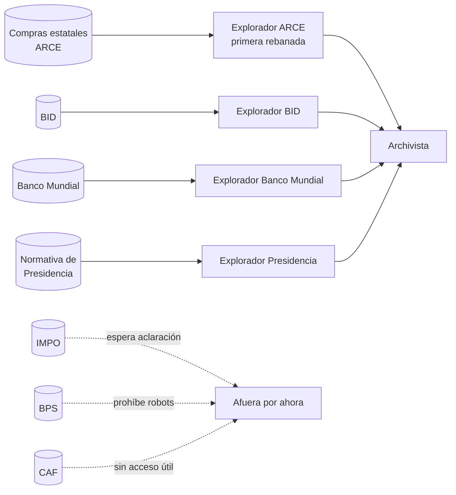

# Fuentes

Una página por fuente candidata, verificada con URL y fecha (tarjeta T10, 2026-11-07). Cada página dice qué publica la fuente, cómo se accede, con qué permiso, si se puede consultar por fecha, si nombra personas y qué riesgos tiene. Cuáles entran en la versión 0, y por qué, lo decide el [ADR 0006](../../adrs/0006-fuentes-de-la-version-0.md).

## Resumen

| Fuente | Acceso | Permiso | Por fecha | Nombra personas | Versión 0 |
|---|---|---|---|---|---|
| [Compras estatales (ARCE)](compras-estatales.md) | API en JSON (OCDS) | Licencia de Datos Abiertos de Uruguay | Sí, por mes y fecha de publicación | Contactos y algunos adjudicatarios | **Entra. Primera rebanada.** |
| [BID](bid.md) | API de datos abiertos (CKAN) | CC BY 4.0 | Sí, por aprobación y por aviso | Consultores individuales | Entra |
| [Banco Mundial](banco-mundial.md) | API v3, sin documentar | CC BY 4.0 | Sí, por aprobación | Jefes de equipo, contactos | Entra, como secundaria |
| [Presidencia](presidencia.md) | HTML y PDF | Términos que admiten aplicaciones, sin licencia | Normativa sí; noticias no | Sí | Entra solo la normativa, a ritmo bajo |
| [Diario Oficial (IMPO)](impo.md) | JSON por norma y PDF diario | Contradictorio | Sí, por edición | Muchas | Afuera hasta que IMPO aclare (T18) |
| [BPS](bps.md) | HTML y PDF | **Prohíbe la consulta automática** | Por mes | Sí | Afuera |
| [CAF](caf.md) | Sitio bloqueado; IATI cada pocos meses | ODC-BY (IATI) | No | No | Afuera |

## Qué se aprendió verificando

- **El permiso se lee primero.** Una fuente puede tener los datos perfectos y prohibir el acceso automático, como el BPS. Desde esta verificación, al revisar una fuente se leen sus términos y su robots.txt antes de la primera consulta ([arranque/como-se-trabaja.md](../../arranque/como-se-trabaja.md)).
- **Consultar por fecha no es lo mismo que ver lo que se veía esa noche.** El BID y el Banco Mundial devuelven el estado de hoy de lo aprobado en una fecha; ARCE e IMPO sí guardan cada publicación con su fecha. Para repetir noches del banco de pruebas, las segundas valen más.
- **Casi todas las fuentes nombran personas.** El enmascarado de la decisión D3 no es un caso raro: el explorador de cada fuente tiene que saber qué campos descartar.
